Agent của bạn chạy 20 phút rồi báo "xong" — nhưng code làm hỏng test, sửa một lỗi sinh ra hai lỗi. Trước khi mở ví nâng cấp model, hãy đọc chương trình này: **vấn đề phần lớn không nằm ở model, mà nằm ở harness** — toàn bộ hạ tầng bên ngoài trọng số model. Chương trình Harness Engineer gồm 14 bài giảng (dịch và tái sử dụng từ [Learn Harness Engineering — WalkingLab](https://github.com/walkinglabs/learn-harness-engineering), giấy phép MIT, bài gốc tiếng Việt) — **toàn bộ nội dung đầy đủ của 14 bài nằm ngay trong trang này**, gộp thành một cẩm nang duy nhất theo 7 phần, không cần click sang web ngoài.

## Bạn sẽ học được gì

- **Phần 1 · Nền tảng — vì sao agent mạnh vẫn thất bại**
- **Phần 2 · Nguồn sự thật — repo và hướng dẫn**
- **Phần 3 · Chạy dài — phiên và khởi tạo**
- **Phần 4 · Ranh giới — WIP=1 và feature list**
- **Phần 5 · Xác minh — chống tuyên bố sớm và end-to-end**
- **Phần 6 · Quan sát — observability và bàn giao sạch**
- **Phần 7 · Tổng hợp — loop và graph engineering**
- **Phần 8 · Thực hành — tự tay dựng agent harness Mini-dsh**

> **Ai nên đọc:** Ai đã dùng AI coding agent và thấy agent mạnh nhưng kết quả không đáng tin cậy; muốn hiểu và tự dựng agent harness.
> **Điều kiện đầu vào:** Không yêu cầu lập trình để đọc lý thuyết; Phần thực hành cần Python cơ bản.
> **Tổng thời gian đọc:** ≈335 phút — có thể đọc dần theo phần, thời lượng từng phần ghi ngay trên tiêu đề.


## Dùng trang này thế nào

1. **Lướt bản đồ chương trình** phía dưới để định vị phần bạn cần ngay — mỗi phần gồm 2 bài, đứng độc lập được.
2. **Cuộn tới phần đó**: nội dung đầy đủ của từng bài nằm ngay tại chỗ, mỗi bài kết thúc bằng mục "Những điểm chính cần nhớ" nếu chỉ muốn nắm nhanh.
3. **Kết thúc bằng Phần 8** để chuyển từ lý thuyết sang tự tay dựng harness chạy được.

Tổng thời gian: **≈220 phút lý thuyết** (Bài 01–14) + **≈115 phút thực hành** (Bài 15–22). Đọc dần theo phần, không cần một lần.

## Bản đồ chương trình

| Nhóm | Bài | Trọng tâm |
|------|-----|-----------|
| Nền tảng | 01–02 | Vì sao agent mạnh vẫn thất bại; harness thực sự là gì |
| Nguồn sự thật | 03–04 | Repo thành system of record; chia nhỏ file hướng dẫn |
| Chạy dài | 05–06 | Liên tục giữa các phiên; giai đoạn khởi tạo riêng |
| Ranh giới | 07–08 | WIP=1 chống làm quá; feature list ràng buộc "xong" |
| Xác minh | 09–10 | Chặn tuyên bố thành công sớm; end-to-end testing |
| Quan sát | 11–12 | Observability trong harness; bàn giao trạng thái sạch |
| Tổng hợp | 13–14 | Từ prompt thủ công đến vòng lặp tự chủ; graph engineering |
| Thực hành | 15–22 | Tự tay dựng Mini-dsh: kernel, session log, agent loop, permission, scheduler, skills, composition |

## Phần 1 · Nền tảng — vì sao agent mạnh vẫn thất bại — ≈23 phút

Hai bài dựng nền tư duy cho cả chương trình: failure của agent là failure của môi trường thực thi, và harness là gì một cách chính xác.

### Bài 01. Mô hình mạnh không có nghĩa là thực thi đáng tin cậy

> Ví dụ code: [code/](https://github.com/walkinglabs/learn-harness-engineering/blob/main/docs/vi/lectures/lecture-01-why-capable-agents-still-fail/code/)
Ngày 29 tháng 9 năm 2025, Anthropic công bố Claude Sonnet 4.5 đạt [77,2% trên SWE-bench Verified](https://www.anthropic.com/news/claude-sonnet-4-5). Con số đó nghe có vẻ khá, nhưng đừng vội ăn mừng. Đó là những tác vụ được lựa chọn cẩn thận với mô tả vấn đề rõ ràng và bộ test có sẵn. Đưa cho agent yêu cầu thực tế hàng ngày của bạn: đặc tả mơ hồ, không có test, quy tắc nghiệp vụ ẩn rải rác trong codebase, thì tỷ lệ vượt qua chỉ giảm thêm nữa. Bạn hào hứng giao một tác vụ, agent chạy 20 phút rồi báo "xong rồi", và bạn nhìn vào code: nó thêm một tính năng nhưng làm hỏng test, sửa một lỗi nhưng sinh ra lỗi mới, và kết quả cuối cùng còn không đúng thứ bạn yêu cầu.

Khi chuyện này xảy ra, phản ứng đầu tiên của hầu hết mọi người là "mô hình chưa đủ tốt, thử sang cái đắt tiền hơn xem sao". Trước khi mở ví, hãy cân nhắc: vấn đề có thể hoàn toàn không nằm ở mô hình.

#### Cùng con ngựa, số phận khác nhau

Anthropic đã so sánh cùng một prompt ("xây dựng một trình tạo trò chơi retro 2D") và cùng một mô hình (Opus 4.5) dưới hai harness. Lần chạy đầu tiên: trần trụi, không có hỗ trợ, 20 phút, $9; ứng dụng mở được, nhưng các thực thể không phản hồi với input. Lần chạy thứ hai: harness đầy đủ, kiến trúc ba agent gồm planner, generator, evaluator, 6 giờ, $200; có thể di chuyển một thực thể, nhưng vật lý còn thô và một bức tường chặn đường đi. [Gameplay cốt lõi chạy được; ứng dụng vẫn chưa hoàn thành.](https://www.anthropic.com/engineering/harness-design-long-running-apps)

Họ không thay đổi mô hình. Opus 4.5 vẫn là Opus 4.5. Thứ thay đổi là bộ yên cương.

Bài viết về harness engineering năm 2025 của OpenAI còn nói thẳng hơn. Họ cho biết Codex trong một kho lưu trữ được trang bị harness tốt đi từ "không đáng tin cậy" thẳng đến "đáng tin cậy". Chú ý cách diễn đạt: không phải "tốt hơn một chút", mà là một bước nhảy về chất. Harness ở đây có nghĩa là **toàn bộ cơ sở hạ tầng kỹ thuật bên ngoài trọng số mô hình**.

#### Agent thực sự bị kẹt ở đâu

Các chế độ thất bại cụ thể thực ra chỉ gói gọn trong vài điểm:

- **Yêu cầu mơ hồ, agent chỉ có thể đoán.** "Thêm tính năng tìm kiếm": câu đó hầu như chẳng mang nhiều ý nghĩa. Tìm kiếm cái gì? Full-text hay truy vấn có cấu trúc? Kết quả có cần phân trang? Tô sáng? Bạn không chỉ định rõ, nên agent buộc phải đoán. Đoán đúng là may, đoán sai thì chi phí sửa lại gấp nhiều lần so với việc nói rõ ngay từ đầu.
- **Quy ước ẩn không được viết ra, agent không có cách nào tuân thủ.** Cả nhóm bạn dùng cú pháp SQLAlchemy 2.0, nhưng agent mặc định viết code 1.x. Mọi API endpoint phải đi qua xác thực OAuth 2.0, nhưng quy tắc đó chỉ tồn tại trong đầu bạn và một tin nhắn Slack từ ba tháng trước. Agent không hề biết, không phải nó không muốn tuân thủ, mà là nó chưa từng thấy quy tắc đó.
- **Thiết lập môi trường chưa đầy đủ, agent tốn năng lượng sửa môi trường.** Môi trường dev chưa hoàn chỉnh, thiếu dependency, sai phiên bản công cụ, agent đốt cửa sổ ngữ cảnh quý giá vào lỗi `pip install` và xung đột phiên bản Node thay vì làm việc bạn thực sự giao.
- **Không có phương pháp xác minh, agent tự coi là xong khi nó cảm thấy xong.** Không có test, không có lint, hoặc các lệnh xác minh chưa bao giờ được truyền đạt cho agent. Agent viết code, nhìn lại, thấy có vẻ ổn rồi tuyên bố hoàn thành. Anthropic cũng quan sát thấy một hiện tượng thú vị: khi agent cảm nhận ngữ cảnh sắp cạn, nó vội vàng kết thúc, bỏ qua bước xác minh, và chọn giải pháp đơn giản thay vì tối ưu. Họ gọi đây là "context anxiety" (lo lắng ngữ cảnh).
- **Mất trạng thái giữa các phiên, mỗi phiên mới bắt đầu lại từ đầu.** Mọi phát hiện từ phiên trước đều biến mất. Mỗi phiên mới phải khám phá lại cấu trúc dự án và hiểu lại cách tổ chức code. Agent không có trạng thái liên tục thì tỷ lệ thất bại tăng vọt trên các tác vụ kéo dài quá 30 phút.

#### Giải thích thuật ngữ chính

Với các tình huống trên, những khái niệm này không còn chỉ là thuật ngữ suông:

- **Khoảng cách Năng lực (Capability Gap)**: Khoảng cách lớn giữa hiệu suất mô hình trên benchmark và hiệu suất trên tác vụ thực tế. Các tác vụ benchmark đi kèm mô tả vấn đề rõ ràng, test và môi trường; tác vụ thực tế thường buộc bạn phải tự cung cấp những thứ đó.
- **Harness**: Mọi thứ bên ngoài mô hình, hướng dẫn, công cụ, môi trường, quản lý trạng thái, phản hồi xác minh. Không phải trọng số mô hình, thì đó là harness. Chính là thứ chúng ta vẫn gọi là "bộ yên cương".
- **Lỗi Do Harness (Harness-Induced Failure)**: Mô hình có đủ năng lực, nhưng môi trường thực thi có khiếm khuyết cấu trúc. So sánh trò chơi retro ở trên là một ví dụ.
- **Khoảng cách Xác minh (Verification Gap)**: Khoảng cách giữa sự tự tin của agent về kết quả đầu ra và tính đúng đắn thực tế. Agent nói "tôi đã xong" khi chưa xong, đây là chế độ thất bại phổ biến nhất.
- **Vòng lặp Chẩn đoán (Diagnostic Loop)**: Thực thi, quan sát lỗi, quy cho một lớp harness cụ thể, sửa lớp đó, thực thi lại. Đây là phương pháp luận cốt lõi của harness engineering.
- **Định nghĩa Hoàn thành (Definition of Done)**: Một tập các điều kiện có thể xác minh bằng lệnh: test vượt qua, lint sạch, type check vượt qua. Không có định nghĩa hoàn thành rõ ràng, agent sẽ tự bịa ra định nghĩa của riêng nó.

#### Khi sự cố xảy ra, hãy sửa harness trước

Thực ra chỉ có một nguyên tắc cốt lõi duy nhất: **Khi sự cố xảy ra, đừng đổi mô hình trước, hãy kiểm tra harness.** Nếu cùng một mô hình thành công trên các tác vụ tương tự, có cấu trúc tốt, hãy mặc định giả định đó là vấn đề harness.

Trong thực tế thì trông như thế nào? Hãy quy mọi lỗi cho một lớp cụ thể. Đừng chỉ nói "mô hình không đủ tốt". Hãy tự hỏi: tác vụ có mơ hồ không? Ngữ cảnh có thiếu không? Không có phương pháp xác minh? Ánh xạ mỗi lỗi vào một trong năm lớp phòng thủ: đặc tả tác vụ, cung cấp ngữ cảnh, môi trường thực thi, phản hồi xác minh, quản lý trạng thái. Xây dựng thói quen này, bạn sẽ thấy cụm "mô hình không đủ tốt" xuất hiện ngày càng ít trong nhật ký.

Sau đó, hãy viết Định nghĩa Hoàn thành rõ ràng cho mỗi tác vụ. Đừng nói "thêm tính năng tìm kiếm". Hãy viết rõ ra:
```
Tiêu chí hoàn thành:
- Endpoint mới GET /api/search?q=xxx
- Hỗ trợ phân trang, mặc định 20 mục
- Kết quả bao gồm đoạn trích được tô sáng
- Toàn bộ code mới vượt qua pytest
- Type checking vượt qua (mypy --strict)
```

Đặt một tệp `AGENTS.md` ở thư mục gốc repo, kể cho agent nghe về tech stack, quy ước kiến trúc và các lệnh xác minh của dự án. Đây là bước đầu tiên trong harness engineering, và là bước có tỷ suất hoàn vốn (ROI) cao nhất. Một tệp `AGENTS.md` có thể hiệu quả hơn việc nâng cấp lên một mô hình đắt tiền hơn, và chúng tôi không đùa.

Từ đó, xây dựng vòng lặp chẩn đoán. Đừng xem lỗi là "mô hình lại ngốc". Hãy xem chúng là tín hiệu cho thấy harness của bạn đang lộ khiếm khuyết. Mỗi lần lỗi, xác định lớp, sửa lớp đó, rồi không bao giờ tái diễn kiểu thất bại đó nữa. Sau vài vòng, harness của bạn mạnh hơn và hiệu suất agent ổn định dần. Một cuốn nhật ký đơn giản là đủ: với mỗi tác vụ, nó thành công hay thất bại, và lớp nào gây ra lỗi. Sau vài vòng, bạn sẽ thấy lớp nào là điểm nghẽn, và có thể tập trung năng lượng vào đó.

#### Thí nghiệm triệu dòng code

Vào tháng 8 năm 2025, ba kỹ sư tại OpenAI bắt đầu một thí nghiệm. Quy tắc đơn giản: chính họ không viết code, chỉ Codex viết. Bắt đầu từ một kho git trống, năm tháng sau [kho chứa khoảng một triệu dòng code](https://openai.com/index/harness-engineering/). Logic ứng dụng, hạ tầng, công cụ, tài liệu, tất cả đều do agent tạo. Nhóm sau đó phát triển lên bảy kỹ sư; trong cả giai đoạn đã hợp nhất khoảng 1.500 PR, trung bình 3,5 PR mỗi kỹ sư mỗi ngày.

Tiến độ ban đầu chậm hơn dự kiến một cách đáng ngạc nhiên. Codex không tệ, nó chỉ thiếu các công cụ và cấu trúc đủ hoàn chỉnh để hướng đến mục tiêu cấp cao. Ba kỹ sư dần tìm ra quy luật: chia nhỏ mục tiêu lớn thành các khối xây dựng nhỏ, thiết kế, code, review, test, để agent lắp ráp từng khối một, rồi dùng các khối đó để tổng hợp các tác vụ phức tạp hơn. Mỗi khi có trục trặc, vấn đề hầu như không bao giờ là "cố gắng chưa đủ", mà luôn là "agent còn thiếu năng lực gì, và thiếu năng lực đó có thể được cung cấp theo cách vừa dễ hiểu vừa có thể thực thi không".

Thí nghiệm này chứng minh trực tiếp luận điểm cốt lõi của bài giảng: **cùng một mô hình, trong môi trường trần trụi và trong môi trường có harness đầy đủ, tạo ra kết quả về cơ bản khác nhau.** Mô hình không thay đổi. Môi trường thay đổi.

> Nguồn: [OpenAI: Harness engineering: leveraging Codex in an agent-first world](https://openai.com/index/harness-engineering/)

#### Một ví dụ gần gũi hơn

Một nhóm dùng Claude Sonnet để thêm API endpoint mới vào một ứng dụng web Python cỡ trung (FastAPI + PostgreSQL + Redis, khoảng 15.000 dòng code).

Ban đầu họ chỉ đưa ra một câu: "thêm endpoint tùy chọn người dùng dưới `/api/v2/users`". Kết quả? Agent dành phần lớn phiên để khám phá cấu trúc repo, tạo ra code trông có vẻ hợp lý nhưng không theo mẫu xử lý lỗi của dự án, dùng cú pháp SQLAlchemy cũ, và tuyên bố hoàn thành trong khi endpoint vẫn có lỗi runtime. Phiên tiếp theo phải làm lại toàn bộ phần khám phá.

Sau đó họ bổ sung `AGENTS.md` (mô tả kiến trúc dự án và phiên bản tech stack), các lệnh xác minh rõ ràng (`pytest tests/api/v2/ && python -m mypy src/`), và các bản ghi quyết định kiến trúc. Cùng một mô hình sau đó đã tuân theo quy ước của dự án và kiểm tra công việc bằng các lệnh nó có thể chạy.

Họ không thay đổi mô hình. Họ thay đổi harness.

#### Những điểm chính cần nhớ

- Năng lực mô hình và độ tin cậy thực thi là hai chuyện khác nhau. Ngay cả một con ngựa thuần chủng cũng cần bộ yên cương tốt.
- Khi sự cố xảy ra, kiểm tra harness trước, rồi mới đến mô hình. Đổi mô hình là lựa chọn tốn kém nhất, và phần lớn thời gian, đó thậm chí không phải là vấn đề mô hình.
- Mỗi lỗi là một tín hiệu: harness của bạn có khiếm khuyết cấu trúc. Hãy tìm và sửa nó.
- Đừng chỉ nói "mô hình không đủ tốt". Hãy rà qua có hệ thống năm lớp: tác vụ chưa định nghĩa rõ, ngữ cảnh thiếu, môi trường cấu hình sai, thiếu xác minh, mất trạng thái giữa các phiên. Cứ mười lần thì chín lần vấn đề nằm ở một trong các lớp đó.
- Một tệp `AGENTS.md` có thể hiệu quả hơn việc nâng cấp lên mô hình đắt tiền hơn.

#### Đọc thêm

- [OpenAI: Harness Engineering — Leveraging Codex in an Agent-First World](https://openai.com/index/harness-engineering/)
- [Anthropic: Effective Harnesses for Long-Running Agents](https://www.anthropic.com/engineering/effective-harnesses-for-long-running-agents)
- [HumanLayer: Skill Issue — Harness Engineering for Coding Agents](https://www.humanlayer.dev/blog/skill-issue-harness-engineering-for-coding-agents)
- [SWE-bench Leaderboard](https://www.swebench.com/)
- [Thoughtworks Technology Radar: Harness Engineering](https://www.thoughtworks.com/radar)

#### Bài tập

1. **Thí nghiệm so sánh**: Chọn một codebase bạn biết rõ và một tác vụ sửa đổi không tầm thường. Trước tiên, chạy agent mà không có hỗ trợ harness và ghi lại các lỗi. Sau đó thêm `AGENTS.md` cùng các lệnh xác minh rõ ràng, rồi chạy lại với cùng agent đó. So sánh hai kết quả, quy mỗi lỗi vào một trong năm lớp phòng thủ.

2. **Đo lường khoảng cách xác minh**: Chọn 5 tác vụ lập trình. Sau mỗi tác vụ, ghi lại xem agent có tuyên bố hoàn thành hay không, rồi xác minh tính đúng đắn thực tế bằng các test độc lập. Tính tỷ lệ lần agent tuyên bố xong khi thực tế chưa xong, đó chính là khoảng cách xác minh của bạn. Sau đó hãy nghĩ: những lệnh xác minh nào sẽ thu hẹp tỷ lệ này?

3. **Thực hành vòng lặp chẩn đoán**: Tìm một tác vụ mà agent liên tục thất bại trong dự án của bạn. Chạy một lần, ghi lại lỗi. Quy nó cho một trong năm lớp. Sửa lớp đó. Chạy lại. Lặp lại ba đến năm vòng, ghi lại cải thiện qua mỗi vòng.

### Bài 02. Harness thực sự có nghĩa là gì

> Ví dụ code: [code/](https://github.com/walkinglabs/learn-harness-engineering/blob/main/docs/vi/lectures/lecture-02-what-a-harness-actually-is/code/)
Từ "harness" xuất hiện khắp nơi trong giới AI coding agent, nhưng thành thật mà nói, phần lớn thời gian khi người ta nói "harness", họ thực ra chỉ muốn nói đến một tệp prompt. Một tệp prompt thì không phải là harness.

Bài giảng này đưa ra một định nghĩa chính xác và có thể áp dụng ngay cho harness, không phải sự trừu tượng học thuật, mà là một khung bạn có thể dùng được hôm nay. Một harness gồm năm hệ thống phụ: hướng dẫn, công cụ, môi trường, trạng thái và phản hồi. Mỗi hệ thống phụ có trách nhiệm rõ ràng và tiêu chí đánh giá cụ thể.

#### Bắt đầu bằng một phép loại suy

Hãy tưởng tượng bạn là một kỹ sư mới vào làm, được thả vào một dự án không có tài liệu gì cả. Không có README, không có chú thích trong code, không ai chỉ cho bạn cách chạy test, cấu hình CI bị chôn đâu đó. Bạn có viết được code tốt không? Có thể, nếu bạn đủ thông minh và đủ kiên nhẫn. Nhưng bạn sẽ tốn rất nhiều thời gian cho chuyện "tìm hiểu dự án này là cái gì" thay vì "giải quyết bài toán".

Một AI agent rơi vào đúng tình cảnh ấy, mà thậm chí còn tệ hơn. Ít nhất bạn còn có thể hỏi đồng nghiệp. Còn agent thì chỉ thấy được những tệp bạn đặt trước mặt nó và những lệnh nó có quyền thực thi.

OpenAI đúc kết nguyên tắc cốt lõi của harness engineering thành "repo chính là spec": mọi ngữ cảnh cần thiết phải nằm trong kho lưu trữ, được truyền tải qua các tệp hướng dẫn có cấu trúc, lệnh xác minh rõ ràng và tổ chức thư mục rành mạch. Tài liệu về long-running agent của Anthropic lại nhấn mạnh tính liên tục của trạng thái, đường phục hồi tường minh và theo dõi tiến độ có cấu trúc. Hai công ty tập trung vào những khía cạnh khác nhau, nhưng họ đang nói cùng một điều: **mọi thứ trong cơ sở hạ tầng kỹ thuật nằm ngoài mô hình quyết định bao nhiêu phần năng lực của mô hình thực sự được hiện thực hóa.**

Hãy nhìn qua vài công cụ bạn đã biết:

**Claude Code** thể hiện tư duy harness. Nó đọc `CLAUDE.md` từ repo, có thể chạy lệnh shell, thực thi trong môi trường cục bộ của bạn, duy trì lịch sử phiên và có thể chạy test để xem kết quả. Nhưng nếu bạn không chỉ cho nó cách chạy test, nó không có cách nào xác minh nó đã làm đúng chưa.

**Cursor** đi theo logic tương tự. Tệp `.cursorrules` là nguồn hướng dẫn, terminal là công cụ, nó đọc được cấu trúc dự án và cấu hình lint. Tuy nhiên, quản lý trạng thái của Cursor tương đối yếu, đóng IDE rồi mở lại, ngữ cảnh trước đó biến mất.

**Codex** (coding agent của OpenAI) dùng git worktrees để cô lập môi trường runtime của từng tác vụ, kết hợp với ngăn xếp quan sát cục bộ (logs, metrics, traces), nhờ đó mỗi thay đổi đều được xác minh trong một môi trường độc lập. Nó hoạt động tốt hơn hẳn trong những repo có `AGENTS.md` và lệnh xác minh rõ ràng so với repo "trần trụi".

**AutoGPT** là câu chuyện cảnh báo. Thiếu quản lý trạng thái có cấu trúc khiến ngữ cảnh tích lũy vô tận trong các tác vụ dài, và thiếu cơ chế phản hồi chính xác khiến agent bị lặp vòng. Nhiều người nói AutoGPT "không hoạt động", nhưng thực ra chính là cái harness không hoạt động.

#### Các khái niệm cốt lõi

- **Harness là gì**: Mọi thứ trong cơ sở hạ tầng kỹ thuật nằm ngoài trọng số mô hình. OpenAI chắt lọc công việc cốt lõi của kỹ sư thành ba việc: thiết kế môi trường, diễn đạt ý định và xây dựng vòng phản hồi. Anthropic thì trực tiếp gọi Claude Agent SDK của họ là "harness agent đa năng".
- **Repo là nguồn sự thật duy nhất**: Bất cứ thứ gì agent không nhìn thấy, về mọi phương diện thực tế, đều không tồn tại. OpenAI coi repo là "hệ thống ghi chép" (system of record): mọi ngữ cảnh cần thiết phải sống ở đó, được truyền tải qua các tệp có cấu trúc và tổ chức thư mục rõ ràng.
- **Đưa bản đồ, đừng đưa cẩm nang**: Kinh nghiệm của OpenAI cho thấy `AGENTS.md` nên đóng vai trò trang thư mục, không phải bách khoa toàn thư. Khoảng 100 dòng là đủ. Nếu không chứa nổi, hãy tách vào thư mục `docs/` và để agent đọc theo yêu cầu.
- **Ràng buộc, đừng vi quản lý**: Một harness tốt dùng các quy tắc có thể thực thi để ràng buộc agent, thay vì liệt kê hết từng hướng dẫn nhỏ. OpenAI nói "thực thi bất biến, đừng vi quản lý triển khai"; Anthropic nhận ra các agent rất tự tin khen công việc của chính mình, và cách xử lý là tách "người làm việc" ra khỏi "người kiểm tra việc".
- **Gỡ từng thứ một và quan sát**: Để định lượng đóng góp biên của từng thành phần harness, hãy lần lượt gỡ chúng ra và xem việc gỡ cái nào gây giảm hiệu suất lớn nhất. Cách này cho bạn biết thành phần nào đang có giá trị nhất ngay lúc này, đồng thời cũng phơi bày những thành phần chưa thực sự đóng góp. Anthropic từng dùng phương pháp này và nhận ra rằng khi mô hình mạnh hơn, một số thành phần sẽ mất đi vai trò tối quan trọng, nhưng những thành phần mới tối quan trọng khác lại luôn xuất hiện.

#### Mô hình harness năm hệ thống phụ

Một harness có năm hệ thống phụ:

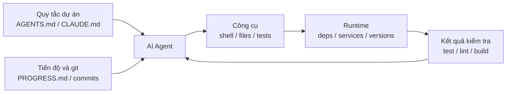

**Hệ thống phụ Hướng dẫn**: Tạo `AGENTS.md` (hoặc `CLAUDE.md`) chứa tổng quan và mục đích dự án, tech stack cùng phiên bản, các lệnh chạy lần đầu, các ràng buộc cứng không thể thương lượng, và liên kết đến tài liệu chi tiết hơn.

**Hệ thống phụ Công cụ**: Đảm bảo agent có đủ quyền truy cập công cụ. Đừng vô hiệu shell vì "lý do bảo mật", vì nếu agent không thể chạy nổi `pip install` thì bảo nó hoàn thành việc gì? Nhưng cũng đừng mở tất cả, hãy tuân theo nguyên tắc đặc quyền tối thiểu.

**Hệ thống phụ Môi trường**: Làm cho trạng thái môi trường tự mô tả được. Dùng `pyproject.toml` hoặc `package.json` để khóa dependencies, `.nvmrc` hoặc `.python-version` để chỉ định phiên bản runtime, và Docker hoặc devcontainer để môi trường tái lập được.

**Hệ thống phụ Trạng thái**: Tác vụ dài phải có cơ chế theo dõi tiến độ. Dùng một tệp `PROGRESS.md` đơn giản ghi lại: cái gì đã xong, cái gì đang làm, cái gì bị chặn. Cập nhật trước khi phiên kết thúc, đọc lại khi phiên mới bắt đầu.

**Hệ thống phụ Phản hồi**: Đây là hệ thống phụ có ROI cao nhất. Liệt kê rõ các lệnh xác minh trong `AGENTS.md`:
```
Lệnh xác minh:
- Test: pytest tests/ -x
- Type check: mypy src/ --strict
- Lint: ruff check src/
- Xác minh đầy đủ: make check (bao gồm tất cả những mục trên)
```

Thiếu bất kỳ hệ thống phụ nào trong năm cái trên thì harness chưa trọn vẹn, và agent sẽ luôn có cảm giác dùng rất gượng gạo.

**Định lượng giá trị từng thành phần harness**: Dùng thí nghiệm "loại trừ biến có kiểm soát". Giữ cố định mô hình, lần lượt gỡ từng hệ thống phụ trong năm hệ thống, xem hệ thống nào khi bị gỡ gây giảm hiệu suất lớn nhất. Thành phần có mức giảm lớn nhất chính là thành phần có đóng góp biên cao nhất cho tác vụ hiện tại và đáng ưu tiên củng cố. Có nên củng cố nó hay không thì phụ thuộc vào quy kết nguyên nhân lỗi, chứ không riêng vào độ lớn của mức giảm. Những thành phần gần như không có tác động cũng không nên vội loại bỏ: chúng có thể đang dư thừa, được thiết kế chưa tốt, hoặc đơn giản là tác vụ hiện tại chưa khai thác đến. Thí nghiệm này trả lời câu hỏi "thành phần nào đang có giá trị nhất ngay lúc này", bản thân nó không chứng minh được "điểm nghẽn nằm ở đâu". Để thật sự xác định điểm nghẽn, bạn phải xem xét nhật ký lỗi và quy kết nguyên nhân trước: tác vụ có mơ hồ không, ngữ cảnh có thiếu không, môi trường có tái lập được không, phản hồi xác minh có bị thiếu không, hay quản lý trạng thái đang đứt gãy? Kết quả ablation chỉ đóng vai trò bằng chứng hỗ trợ mà thôi.

#### Câu chuyện thật của một nhóm

Một nhóm dùng GPT-4o để phát triển ứng dụng frontend TypeScript + React (khoảng 20.000 dòng code). Họ trải qua bốn giai đoạn, về bản chất là thêm từng thành phần harness vào từng bước một:

**Giai đoạn 1**: Chỉ có mô tả dự án sơ khai trong README. 1 trên 5 lần chạy thành công (20%). Lỗi chính: chọn sai package manager (npm thay vì yarn), không tuân theo quy ước đặt tên component, không chạy được test.

**Giai đoạn 2**: Thêm `AGENTS.md` chỉ định phiên bản tech stack, quy ước đặt tên và các quyết định kiến trúc chính. Tỷ lệ thành công tăng lên 60%. Lỗi còn lại chủ yếu đến từ môi trường và thiếu xác minh.

**Giai đoạn 3**: Liệt kê các lệnh xác minh trong `AGENTS.md`: `yarn test && yarn lint && yarn build`. Tỷ lệ thành công tăng lên 80%.

**Giai đoạn 4**: Bổ sung các mẫu tệp tiến độ, trong đó agent ghi lại công việc đã hoàn thành và chưa hoàn thành ở mỗi lần chạy. Tỷ lệ thành công ổn định ở 80-100%.

Bốn vòng lặp, mô hình không hề thay đổi, mà tỷ lệ thành công đã đi từ 20% lên gần 100%. Bạn không đổi sang một mô hình tốt hơn, thứ thay đổi chính là harness.

#### Những điểm chính cần nhớ

- Harness = Hướng dẫn + Công cụ + Môi trường + Trạng thái + Phản hồi. Cả năm hệ thống phụ đều cần thiết.
- Không phải trọng số mô hình, thì đó là harness. Harness của bạn quyết định bao nhiêu phần năng lực mô hình được hiện thực hóa.
- Trong năm hệ thống phụ, hệ thống phụ phản hồi thường có chi phí đầu tư thấp nhất mà lợi nhuận cao nhất. Hãy chuẩn hóa lệnh xác minh trước tiên.
- Dùng "thí nghiệm loại trừ biến có kiểm soát" để định lượng đóng góp biên của từng hệ thống phụ. Còn muốn xác định điểm nghẽn thật, hãy dựa vào nhật ký lỗi và quy kết nguyên nhân, không chỉ dựa vào ablation.
- Harness mục ruỗng giống như code vậy. Hãy kiểm tra định kỳ và trả nợ harness y như cách bạn trả nợ kỹ thuật.

#### Đọc thêm

- [OpenAI: Harness Engineering](https://openai.com/index/harness-engineering/)
- [Anthropic: Effective Harnesses for Long-Running Agents](https://www.anthropic.com/engineering/effective-harnesses-for-long-running-agents)
- [HumanLayer: Harness Engineering for Coding Agents](https://www.humanlayer.dev/blog/skill-issue-harness-engineering-for-coding-agents)
- [SWE-agent: Agent-Computer Interfaces](https://github.com/princeton-nlp/SWE-agent)
- [Thoughtworks: Harness Engineering on Technology Radar](https://www.thoughtworks.com/radar)

#### Bài tập

1. **Kiểm toán harness năm tuple**: Lấy một dự án bạn đang dùng AI agent và kiểm toán đầy đủ bằng khung năm tuple. Chấm điểm từng hệ thống phụ trên thang 1-5. Tìm hệ thống phụ có điểm thấp nhất, dành 30 phút cải thiện, rồi quan sát sự thay đổi về hiệu suất agent.

2. **Thí nghiệm loại trừ biến có kiểm soát**: Chọn một mô hình và một tác vụ đầy thách thức. Lần lượt gỡ hướng dẫn (xóa AGENTS.md), gỡ phản hồi (không cung cấp lệnh xác minh), gỡ trạng thái (không có tệp tiến độ), mỗi lần chỉ gỡ một thứ, rồi đo mức giảm hiệu suất. Dùng kết quả để xếp hạng giá trị biên của từng hệ thống phụ cho tác vụ hiện tại. Nếu muốn tìm điểm nghẽn, bạn cũng phải ghi nhật ký lỗi và quy kết nguyên nhân song song với ablation.

3. **Phân tích affordance**: Tìm một tình huống trong dự án của bạn mà agent "muốn làm điều gì đó nhưng không làm được" (ví dụ: biết nên dùng truy vấn có tham số hóa nhưng không biết các pattern ORM của dự án). Phân tích xem đây là Gulf of Execution (không biết cách thao tác) hay Gulf of Evaluation (không biết mình đã làm đúng chưa), rồi thiết kế một cải tiến harness để bắc cầu qua khoảng trống đó.

---

## Phần 2 · Nguồn sự thật — repo và hướng dẫn — ≈24 phút

Agent không nhớ thì repo phải nhớ thay: kiến thức nằm đúng chỗ trong kho lưu trữ, và hướng dẫn được chia nhỏ để agent tiêu thụ được.

### Bài 03. Biến kho lưu trữ thành nguồn sự thật duy nhất

> Ví dụ code: [code/](https://github.com/walkinglabs/learn-harness-engineering/blob/main/docs/vi/lectures/lecture-03-why-the-repository-must-become-the-system-of-record/code/)
Các quyết định kiến trúc của nhóm bạn đang nằm rải rác khắp Confluence, Slack, Jira và đầu của vài kỹ sư cấp cao. Với con người thì cách này gượng gạo mà xong: bạn có thể hỏi đồng nghiệp, tìm trong lịch sử chat, đào tài liệu. Tệ hơn nữa thì chặn ai đó ngoài hành lang cũng xong. Nhưng với AI agent, thông tin không có trong kho lưu trữ thì đơn giản là không tồn tại.

Điều này không phải phóng đại. Agent chỉ có ba nguồn đầu vào: system prompt và mô tả tác vụ, nội dung tệp trong kho lưu trữ, và kết quả thực thi công cụ. Lịch sử Slack, ticket Jira, trang Confluence, hay quyết định kiến trúc bạn bàn với đồng nghiệp trong cafe chiều thứ Sáu, agent không thấy bất kỳ thứ nào cả. Nó không thể "đi hỏi ai" hay "tìm trong lịch sử chat". Toàn bộ thế giới làm việc của nó chính là cái kho lưu trữ, mọi thứ nằm ngoài đó, nó hoàn toàn mù tịt.

Vậy câu hỏi đặt ra là: bạn có sẵn sàng đưa cho nó một tấm bản đồ đủ tốt hay không?

#### Những gì thuộc về bản đồ

OpenAI phát biểu rất thẳng trong bài viết về harness engineering: **thông tin không tồn tại trong repo thì không tồn tại với agent.** Họ gọi đây là nguyên tắc "repo là spec": bản thân kho lưu trữ chính là tài liệu đặc tả có thẩm quyền cao nhất.

Tài liệu về long-running agent của Anthropic cũng cùng quan điểm: trạng thái liên tục là điều kiện cần cho sự liên tục của tác vụ dài, và khả năng phục hồi kiến thức xuyên phiên quyết định trực tiếp tỷ lệ thành công của tác vụ. Trạng thái này bắt buộc phải nằm trong kho lưu trữ, vì đó là nơi lưu trữ ổn định và truy cập đáng tin cậy duy nhất mà agent có.

Bạn có thể nghĩ: "Nhóm mình nhỏ, kiến thức nằm trong đầu mọi người, vẫn chạy ổn". Đúng vậy, với người thì ổn. Nhưng nếu muốn dùng agent, bạn phải chấp nhận một sự thật: agent không thể hỏi ai. Mọi thứ nó cần biết đều phải viết ra và đặt ở chỗ nó tìm thấy được.

Đây không phải chuyện "viết thêm tài liệu", mà là chuyện "đặt thông tin quyết định vào đúng chỗ". Một tệp `ARCHITECTURE.md` 50 dòng nằm trong thư mục `src/api/` hữu ích hơn gấp mười lần so với một tài liệu thiết kế 500 trang trên Confluence mà không ai bảo trì. Khoảng cách vật lý quan trọng hơn độ dài, bởi vì thông tin chỉ thật sự hữu dụng khi nó ở ngay trước mặt đúng lúc bạn cần.

#### Khả năng hiển thị kiến thức

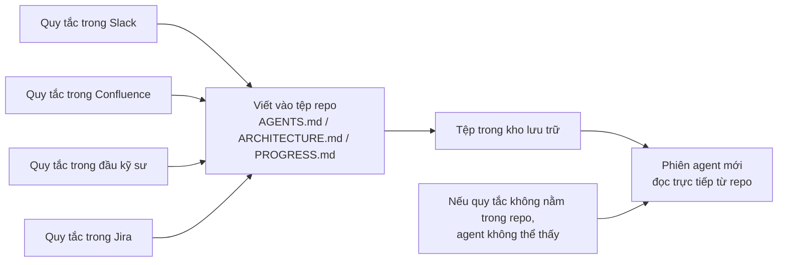

Làm sao kiểm tra bản đồ đã đủ tốt chưa? Hãy chạy "bài kiểm tra phiên mới" (fresh session test): mở một phiên agent hoàn toàn mới, chỉ cung cấp nội dung repo, rồi xem nó có trả lời được năm câu hỏi cơ bản hay không.

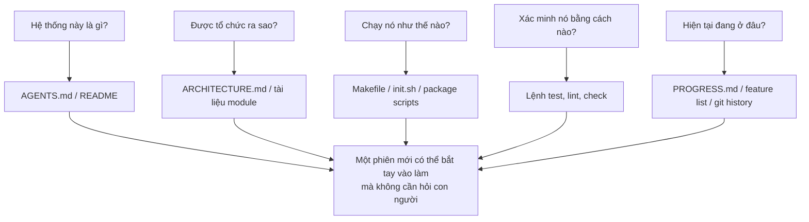

Nếu nó không trả lời được, bản đồ của bạn đang có lỗ hổng. Chỗ nào bản đồ trống, agent phải đoán. Đoán sai biến thành bug, đoán quá nhiều làm lãng phí ngữ cảnh. Và mỗi phiên mới lại đoán lại từ đầu. Chi phí đoán bao giờ cũng đắt hơn rất nhiều so với chi phí vẽ bản đồ cho đúng ngay từ đầu.

#### Các khái niệm cốt lõi

- **Khoảng cách hiển thị kiến thức (Knowledge Visibility Gap)**: Tỷ lệ tổng kiến thức dự án mà KHÔNG nằm trong kho lưu trữ. Khoảng cách càng lớn, tỷ lệ thất bại của agent càng cao. Bạn có thể ước lượng bằng cách: liệt kê mọi kiến thức ẩn về dự án đang nằm trong đầu người, sau đó xem bao nhiêu phần trong số đó thật sự đã vào repo. Phần chênh lệch chính là khoảng cách hiển thị của bạn.
- **Hệ thống ghi chép (System of Record)**: Kho lưu trữ code là nguồn có thẩm quyền cho các quyết định dự án, ràng buộc kiến trúc, trạng thái thực thi và tiêu chuẩn xác minh. Repo phát ngôn cuối cùng, không nơi nào khác có giá trị. Nếu thông tin "con đường này đang đóng" chỉ nằm trong đầu bác Tư, thì lần nào bạn cũng phải đi hỏi bác Tư. Viết vào repo, không ai phải hỏi nữa.
- **Bài kiểm tra phiên mới (Fresh Session Test)**: Năm câu hỏi ở phần trên. Agent trả lời được bao nhiêu thì bản đồ của bạn đầy đủ bấy nhiêu.
- **Chi phí khám phá (Discovery Cost)**: Lượng ngân sách ngữ cảnh mà agent đốt để tìm ra một thông tin quan trọng trong repo. Thông tin càng giấu kín, chi phí khám phá càng cao, và ngân sách còn lại cho tác vụ thực càng ít. Những thông tin mang tính quyết định nên đặt ở chỗ agent nhìn thấy đầu tiên, chứ đừng chôn ở mười cấp thư mục sâu.
- **Tốc độ suy giảm kiến thức (Knowledge Decay Rate)**: Tỷ lệ các mục kiến thức trong repo trở nên lỗi thời trên một đơn vị thời gian. Tài liệu lệch khỏi code là kẻ thù lớn nhất, tệ hơn cả việc không có tài liệu nào cả.
- **Phép loại suy ACID**: Áp dụng các nguyên tắc giao dịch cơ sở dữ liệu (Atomicity, Consistency, Isolation, Durability) vào quản lý trạng thái agent. Chúng ta sẽ mở rộng điều này ngay bên dưới.

#### Cách vẽ một tấm bản đồ tốt

**Nguyên tắc 1: Kiến thức sống cạnh code.** Một quy tắc về xác thực API endpoint thuộc về cạnh đoạn code API, không bị chôn trong một tài liệu toàn cục khổng lồ. Đặt một tài liệu ngắn trong thư mục mỗi module, giải thích trách nhiệm, giao diện và các ràng buộc đặc biệt của module đó. Bản thân thư mục module đã là một chỉ mục tự nhiên, agent chạm tới code là chạm tới luôn ràng buộc, không cần tìm kiếm gì thêm.

**Nguyên tắc 2: Dùng một tệp đầu vào chuẩn hóa.** `AGENTS.md` (hoặc `CLAUDE.md`) là "trang đích" của agent. Nó không cần chứa hết thông tin, nhưng phải giúp agent nhanh chóng trả lời ba câu hỏi: "Dự án này là gì", "Chạy nó như thế nào" và "Xác minh nó ra sao". 50-100 dòng là đủ.

**Nguyên tắc 3: Tối giản nhưng đầy đủ.** Mỗi mảnh kiến thức cần có một trường hợp sử dụng rõ ràng. Nếu bỏ một quy tắc đi mà chất lượng quyết định của agent không đổi, quy tắc đó không nên tồn tại. Nhưng mỗi câu hỏi trong bài kiểm tra phiên mới đều phải có câu trả lời. Đây là sự cân bằng cần duy trì liên tục, không thừa không thiếu, vừa đủ dùng.

**Nguyên tắc 4: Cập nhật song song với code.** Buộc cập nhật kiến thức phải đi kèm thay đổi code. Cách đơn giản nhất: đặt tài liệu kiến trúc trong thư mục module tương ứng. Khi bạn sửa code, bạn tự nhiên để ý tới tài liệu. Sau khi code thay đổi, CI có thể nhắc bạn kiểm tra tài liệu có cần cập nhật theo không.

**Cấu trúc repo cụ thể**:

```
project/
├── AGENTS.md              # Đầu vào: tổng quan dự án, lệnh chạy, ràng buộc cứng
├── src/
│   ├── api/
│   │   ├── ARCHITECTURE.md  # Quyết định kiến trúc của lớp API
│   │   └── ...
│   ├── db/
│   │   ├── CONSTRAINTS.md   # Ràng buộc cứng trong thao tác cơ sở dữ liệu
│   │   └── ...
│   └── ...
├── PROGRESS.md             # Tiến độ hiện tại: xong, đang làm, đang chặn
└── Makefile                # Lệnh chuẩn hóa: setup, test, lint, check
```

#### Quản lý trạng thái agent theo nguyên tắc ACID

Phép loại suy này xuất phát từ quản lý giao dịch cơ sở dữ liệu. Trông có vẻ phức tạp hóa vấn đề, nhưng thực ra nó cho bạn một khung rất thực dụng:

- **Tính nguyên tử (Atomicity)**: Mỗi "thao tác logic" (ví dụ: "thêm endpoint mới và cập nhật test") gói gọn trong một git commit. Nếu thất bại giữa chừng, dùng `git stash` để quay lại. Tất cả hoặc không có gì, không tồn tại trạng thái "làm dở".
- **Tính nhất quán (Consistency)**: Định nghĩa các vị từ xác minh "trạng thái nhất quán" (toàn bộ test pass, lint báo số lỗi bằng 0). Agent chạy xác minh sau mỗi thao tác, và không commit những trạng thái trung gian chưa nhất quán. Sau một thao tác, hệ thống phải ở trạng thái xác minh được là đúng.
- **Tính cô lập (Isolation)**: Khi nhiều agent chạy đồng thời, hãy thiết kế các tệp trạng thái để tránh race condition. Cách đơn giản: mỗi agent dùng tệp tiến độ riêng, hoặc dùng git branch để cô lập. Ghi đồng thời vào cùng một tệp là nguồn cơn trục trặc thường gặp.
- **Tính bền vững (Durability)**: Kiến thức dự án quan trọng phải nằm trong các tệp được git theo dõi. Trạng thái tạm có thể nằm trong bộ nhớ phiên, nhưng kiến thức cần sống sót qua các phiên thì bắt buộc phải ghi vào tệp. Thứ trong đầu bạn không tính, chỉ thứ viết ra mới tính.

#### OpenAI: kho mã làm nguồn tri thức chuẩn

OpenAI mô tả việc lưu kiến trúc, quyết định thiết kế, kế hoạch thực hiện và tiến độ trong các tệp có quản lý phiên bản khi phát triển sản phẩm nội bộ bằng Codex. Tri thức trong hội thoại hoặc tài liệu ngoài chỉ hướng dẫn được agent khi có thể truy cập từ ngữ cảnh làm việc. Nhóm dùng thư mục docs có cấu trúc và kiểm tra độ cập nhật cùng liên kết.

Đây là thực hành kỹ thuật được công bố, không phải thí nghiệm đối chứng đo mức tăng tỷ lệ thành công.

[OpenAI](https://openai.com/index/harness-engineering/)

OpenAI báo cáo khoảng 1.500 PR được mở và hợp nhất trong năm tháng, do ba kỹ sư điều phối Codex, trung bình 3,5 PR mỗi người mỗi ngày. Nhóm sau đó tăng lên bảy người. Đây là kết quả của toàn bộ quy trình; đóng góp riêng của tài liệu không được đo. [OpenAI: Harness engineering](https://openai.com/index/harness-engineering/)

#### Những điểm chính cần nhớ

- Kiến thức không nằm trong repo thì không tồn tại với agent. Đưa thông tin quyết định quan trọng vào kho lưu trữ là khoản đầu tư harness nền tảng nhất, hãy vẽ bản đồ cho tốt để không lạc.
- Dùng "bài kiểm tra phiên mới" để đánh giá chất lượng repo: một phiên mới có trả lời được năm câu hỏi cơ bản khi chỉ nhìn vào nội dung repo không?
- Kiến thức phải nằm cạnh code, tối giản nhưng đầy đủ, và cập nhật song song với code. Vấn đề không phải viết thêm tài liệu, mà là đặt thông tin vào đúng chỗ.
- Vận dụng nguyên tắc ACID cho trạng thái agent: commit nguyên tử, xác minh nhất quán, cô lập đồng thời và bền vững hóa kiến thức quan trọng.
- Suy giảm kiến thức là kẻ thù lớn nhất. Tài liệu lỗi thời còn nguy hiểm hơn không có tài liệu, vì nó đẩy agent đi hướng sai trong khi agent vẫn nghĩ mình đang đi đúng hướng.

#### Đọc thêm

- [OpenAI: Harness Engineering](https://openai.com/index/harness-engineering/)
- [Anthropic: Effective Harnesses for Long-Running Agents](https://www.anthropic.com/engineering/effective-harnesses-for-long-running-agents)
- [Infrastructure as Code — Martin Fowler](https://martinfowler.com/bliki/InfrastructureAsCode.html)
- [ADR: Architecture Decision Records](https://adr.github.io/)
- [The Twelve-Factor App](https://12factor.net/)

#### Bài tập

1. **Bài kiểm tra phiên mới**: Mở một phiên agent hoàn toàn mới trong dự án của bạn (không cung cấp bất kỳ ngữ cảnh lời nói nào), chỉ cho nó thấy nội dung repo, rồi hỏi năm câu: Hệ thống này là gì? Được tổ chức ra sao? Chạy nó như thế nào? Xác minh nó bằng cách nào? Tiến độ hiện tại ra sao? Ghi lại những câu không trả lời được, sau đó cải thiện repo cho tới khi nó trả lời được hết.

2. **Định lượng mức độ ngoại hóa kiến thức**: Liệt kê tất cả quyết định và ràng buộc quan trọng cho việc phát triển trong dự án. Đánh dấu mỗi mục là đã nằm trong repo hay nằm ngoài repo. Tính khoảng cách hiển thị kiến thức (tỷ lệ mục nằm ngoài repo). Lập kế hoạch đưa con số này xuống dưới 10%.

3. **Đánh giá ACID**: Đánh giá khâu quản lý trạng thái dự án theo phép loại suy ACID của bài giảng. Tính nguyên tử: các thao tác của agent có cuộn lại gọn ghẽ được không? Tính nhất quán: repo có vị từ xác minh "trạng thái nhất quán" không? Tính cô lập: các agent chạy đồng thời có giẫm lên nhau không? Tính bền vững: mọi kiến thức xuyên phiên đã được lưu trữ đúng cách chưa?

### Bài 04. Chia hướng dẫn ra thành nhiều tệp

> Ví dụ code: [code/](https://github.com/walkinglabs/learn-harness-engineering/blob/main/docs/vi/lectures/lecture-04-why-one-giant-instruction-file-fails/code/)
Bạn đã bắt đầu nghiêm túc với harness engineering, điều đó tốt. Bạn tạo một `AGENTS.md` rồi nhồi vào đó mọi quy tắc, ràng buộc và bài học mà bạn nghĩ ra. Một tháng sau tệp phình lên 300 dòng, hai tháng 450 dòng, ba tháng 600 dòng. Rồi bạn nhận ra hiệu suất agent lại đang tệ đi: với một sửa lỗi đơn giản, agent đốt một lượng lớn ngữ cảnh để xử lý mấy hướng dẫn triển khai chẳng liên quan; một ràng buộc bảo mật cốt tử chôn ở dòng 300 bị bỏ qua phăng phăng; ba quy tắc phong cách code mâu thuẫn khiến agent mỗi lần chọn đại một cái.

Đó chính là bẫy "tệp hướng dẫn khổng lồ". Mọi thứ trông đều hữu ích, thế là bạn nhồi hết vào, và muốn tìm một quy tắc cụ thể phải lục tung cả tệp. Bạn viết 600 dòng, nhưng tác vụ trước mắt chỉ cần đúng một phần ba.

#### Vòng xoáy bệnh lý ở gốc rễ

Vòng xoáy thường gặp nhất diễn ra thế này: agent mắc lỗi, bạn nghĩ "thêm một quy tắc để chặn chuyện này", thêm vào AGENTS.md, nó ăn ngay. Tạm thời. Rồi agent mắc lỗi khác, bạn thêm quy tắc khác. Lặp lại cho tới khi tệp phình mất kiểm soát.

Phản ứng này hoàn toàn tự nhiên. "Thêm quy tắc" mỗi khi có sự cố nghe có vẻ hợp lý. Nhưng tác động tích lũy lại tai hại. Hãy xem cụ thể chuyện gì đang đi sai.

**Ngân sách ngữ cảnh bị ăn mòn.** Cửa sổ ngữ cảnh của agent là hữu hạn. Giả sử agent có cửa sổ 200K token (tiêu chuẩn của Claude). Một tệp hướng dẫn phình to có thể ngốn mất 10-20K token. Tưởng vẫn còn dư dả lắm? Nhưng tác vụ phức tạp có thể cần đọc hàng chục tệp nguồn, kết quả thực thi công cụ cũng chiếm ngữ cảnh, lịch sử hội thoại lại cứ nối dài. Đến lúc agent thật sự cần hiểu code thì ngân sách đã cạn kiệt.

**Lạc giữa chừng.** Bài báo "Lost in the Middle" (Liu et al., 2023) chứng minh rất rõ rằng LLM tận dụng thông tin ở phần giữa văn bản dài kém hiệu quả hơn hẳn so với ở đầu hoặc cuối. `AGENTS.md` của bạn dài 600 dòng, và dòng 300 ghi "mọi truy vấn cơ sở dữ liệu phải dùng truy vấn có tham số hóa", đó là ràng buộc cứng về bảo mật. Nhưng nó bị chôn ở giữa, và agent gần như chắc chắn sẽ bỏ qua.

**Xung đột ưu tiên.** Cùng một tệp trộn lẫn ràng buộc cứng không thể thương lượng ("không bao giờ dùng eval()"), hướng dẫn thiết kế quan trọng ("ưu tiên phong cách hàm") và một bài học lịch sử cụ thể ("tuần trước sửa rò rỉ bộ nhớ WebSocket, chú ý các pattern tương tự"). Ba quy tắc này có tầm quan trọng hoàn toàn khác nhau, nhưng trong tệp chúng trông giống hệt nhau. Agent không có tín hiệu đáng tin nào để phân biệt đâu là vạch đỏ, đâu chỉ là gợi ý.

**Suy giảm khả năng bảo trì.** Tệp lớn vốn dĩ khó bảo trì. Hướng dẫn lỗi thời hiếm khi bị xóa, vì hậu quả của việc xóa thì mù mờ ("biết đâu có thứ gì khác đang phụ thuộc quy tắc này?"), trong khi thêm hướng dẫn mới trông có vẻ chẳng tốn gì. Kết quả: tệp chỉ tăng, không bao giờ giảm, tỷ lệ tín hiệu trên nhiễu cứ tuột dốc. Đây cũng chính là bài toán nợ kỹ thuật trong phần mềm.

**Tích lũy mâu thuẫn.** Hướng dẫn thêm vào ở những thời điểm khác nhau bắt đầu mâu thuẫn với nhau, cái nói "dùng TypeScript strict mode", cái khác nói "một số tệp cũ được phép dùng any". Agent mỗi lần chọn đại một cái để tuân theo.

#### Các khái niệm cốt lõi

- **Phình hướng dẫn (Instruction Bloat)**: Khi tệp hướng dẫn chiếm 10-15% cửa sổ ngữ cảnh, nó bắt đầu chiếm mất ngân sách dành cho việc đọc code và suy luận tác vụ. Một `AGENTS.md` 600 dòng có thể ngốn 10.000-20.000 token, tức 8-15% cửa sổ 128K bị ăn mất trước khi agent kịp bắt đầu.
- **Lạc giữa chừng (Lost in the Middle)**: Thông tin ở phần giữa văn bản dài dễ bị bỏ qua. Nghiên cứu năm 2023 của Liu et al. cho thấy LLM tận dụng thông tin ở giữa văn bản dài kém hiệu quả hơn hẳn so với ở đầu hoặc cuối. Một ràng buộc cốt tử bị chôn ở dòng 300 trong tệp 600 dòng có xác suất rất cao bị bỏ qua.
- **Tỷ lệ tín hiệu trên nhiễu của hướng dẫn (Instruction SNR)**: Tỷ lệ hướng dẫn trong một tệp thật sự liên quan đến tác vụ đang làm. Bị ép đọc 50 dòng hướng dẫn triển khai trong khi sửa lỗi, đó là SNR thấp.
- **Tệp đầu vào (Entry File)**: Một tệp đầu vào ngắn, mục đích chính là dẫn agent tới tài liệu chi tiết hơn, chứ không ôm đồm mọi thứ. 50-200 dòng là đủ.
- **Tiết lộ theo yêu cầu (Reveal on Demand)**: Đưa thông tin tổng quan trước, thông tin chi tiết đưa khi cần. Thiết kế harness tốt giống thiết kế UI tốt, đừng đổ hết tuỳ chọn lên đầu người dùng cùng lúc.
- **Không phân biệt được tầm quan trọng (Can't Tell What Matters)**: Khi mọi hướng dẫn xuất hiện ở cùng định dạng và vị trí, agent không phân biệt nổi ràng buộc cứng không thể thương lượng với gợi ý mềm.

#### Kiến trúc hướng dẫn

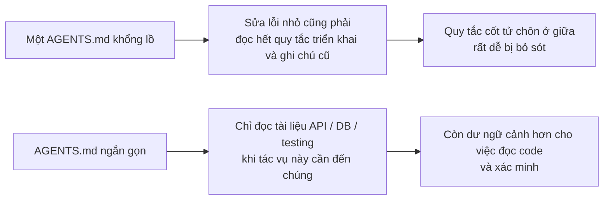

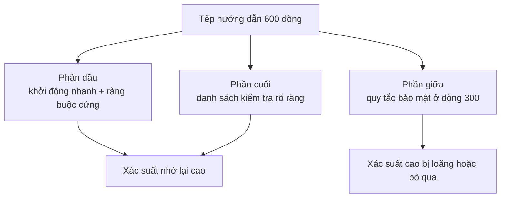

#### Cách chia

Nguyên tắc cốt lõi: giữ thông tin dùng thường xuyên ở tầm tay, cất thông tin thỉnh thoảng mới cần sang một bên, và bỏ lại những thứ sẽ chẳng bao giờ dùng tới.

Tệp đầu vào `AGENTS.md` giữ ở mức 50-200 dòng, chỉ chứa những mục thiết yếu nhất: tổng quan dự án (một đến hai câu cho rõ đây là cái gì), lệnh chạy lần đầu (`make setup && make test`), ràng buộc cứng toàn cục (không quá 15 quy tắc không thể thương lượng), và liên kết tới các tài liệu chủ đề (mô tả một dòng cộng điều kiện áp dụng).

```markdown
# AGENTS.md

## Tổng quan dự án
Backend FastAPI Python 3.11, cơ sở dữ liệu PostgreSQL 15.

## Khởi động nhanh
- Cài đặt: `make setup`
- Test: `make test`
- Xác minh đầy đủ: `make check`

## Ràng buộc cứng
- Tất cả API phải dùng xác thực OAuth 2.0
- Tất cả truy vấn cơ sở dữ liệu phải dùng cú pháp SQLAlchemy 2.0
- Tất cả PR phải pass pytest + mypy --strict + ruff check

## Tài liệu chủ đề
- Mẫu thiết kế API (`docs/api-patterns.md`) — Đọc bắt buộc khi thêm endpoint
- Quy tắc cơ sở dữ liệu (`docs/database-rules.md`) — Bắt buộc khi sửa thao tác cơ sở dữ liệu
- Tiêu chuẩn testing (`docs/testing-standards.md`) — Tham khảo khi viết test
```

Mỗi tài liệu chủ đề 50-150 dòng, được sắp xếp theo chủ đề trong thư mục `docs/` hoặc đặt cạnh module tương ứng. Agent chỉ đọc chúng khi cần. Cũng giống như dùng các túi đựng đồ trong vali, đồ lót một túi, đồ vệ sinh một túi, sạc pin một túi. Muốn tìm gì không cần đổ tung cả vali ra.

Một số thông tin nên đặt trực tiếp trong code, ví dụ định nghĩa kiểu, chú thích giao diện, giải thích trong tệp cấu hình. Agent đọc code sẽ tự nhiên thấy chúng, không cần lặp lại trong phần hướng dẫn.

Mỗi hướng dẫn nên ghi rõ nguồn gốc ("vì sao quy tắc này ra đời?"), điều kiện áp dụng ("khi nào quy tắc này cần thiết?") và điều kiện hết hạn ("trong trường hợp nào có thể bỏ quy tắc này?"). Kiểm tra định kỳ và xoá các mục lỗi thời, thừa hoặc mâu thuẫn. Hãy quản lý hướng dẫn y như cách bạn quản lý dependency, dependency không dùng nên được gỡ, nếu không nó chỉ làm hệ thống chậm thêm.

Nếu một hướng dẫn bắt buộc phải nằm trong tệp đầu vào, hãy đặt ở đầu hoặc ở cuối, đừng bao giờ đặt ở giữa. Hiệu ứng "lạc giữa chừng" cho thấy LLM tận dụng thông tin ở hai cực của văn bản dài tốt hơn hẳn phần trung tâm. Nhưng cách làm tốt hơn vẫn là chuyển hướng dẫn sang các tài liệu chủ đề, để tải theo yêu cầu.

Cả OpenAI và Anthropic đều ngầm ủng hộ cách tiếp cận chia nhỏ. OpenAI nói tệp đầu vào nên "ngắn và thiên về định tuyến", còn Anthropic nói thông tin điều khiển cho long-running agent nên "súc tích và ưu tiên cao". Hai bên đang nói cùng một điều: đừng nhồi hết vào một tệp.

#### OpenAI: tệp đầu vào ngắn và liên kết tài liệu

OpenAI cho biết một AGENTS.md lớn chiếm ngữ cảnh của nhiệm vụ, làm mờ ưu tiên, tích lũy quy tắc lỗi thời và khó kiểm tra. Nhóm thay bằng tệp đầu vào khoảng 100 dòng để dẫn tới thư mục docs có cấu trúc, được duy trì bằng lint và CI. Bài viết không báo cáo tỷ lệ thành công hoặc tuân thủ bảo mật trước và sau thay đổi. [OpenAI: Harness engineering](https://openai.com/index/harness-engineering/)

Lợi ích phụ thuộc nội dung và nhiệm vụ. Nghiên cứu của ETH Zurich không thấy cải thiện thành công nói chung từ tệp ngữ cảnh trong các thiết lập đã đánh giá, nhưng chi phí suy luận tăng hơn 20%. Nghiên cứu khuyên giữ yêu cầu do con người viết ở mức tối thiểu. Tệp ngắn hơn không bảo đảm hiệu quả tốt hơn; cần thử trên nhiệm vụ thực tế. [ETH Zurich: Evaluating AGENTS.md](https://www.sri.inf.ethz.ch/publications/gloaguen2026agentsmd)

Nghiên cứu ghép cặp dùng gpt-5.2-codex trên 124 nhiệm vụ từ PR của 10 kho mã, so cùng nhiệm vụ và phiên bản có hoặc không có AGENTS.md. Bảng 1: thời gian trung vị 98,57→70,34 giây (giảm 28,64%), token đầu ra trung vị 2.925→2.440 (giảm 16,58%). Mỗi nhiệm vụ đổi tối đa 100 dòng và năm tệp. Đây là phép đo hiệu suất, không phải tác động của chia tệp lớn; không đánh giá đầy đủ tính đúng đắn chức năng. [Lulla et al., Table 1](https://arxiv.org/html/2601.20404v2)

#### Những điểm chính cần nhớ

- "Thêm quy tắc" là giảm đau ngắn hạn, nhưng là thuốc độc dài hạn. Trước khi thêm quy tắc, hãy nghĩ xem nó có chỗ đứng tốt hơn trong một tài liệu chủ đề không.
- Tệp đầu vào là bộ định tuyến, không phải bách khoa toàn thư. 50-200 dòng chỉ gồm tổng quan, ràng buộc cứng và liên kết.
- Tận dụng hiệu ứng "lạc giữa chừng": thông tin quan trọng đặt ở đầu hoặc cuối, mục kém quan trọng chuyển sang tài liệu chủ đề.
- Quản lý sự phình hướng dẫn y như quản lý nợ kỹ thuật. Kiểm tra định kỳ, mỗi hướng dẫn cần có nguồn gốc, điều kiện áp dụng và điều kiện hết hạn.
- Sau khi chia, SNR tăng lên, agent dành nhiều ngân sách ngữ cảnh hơn cho tác vụ thật thay vì xử lý hướng dẫn lan man.

#### Đọc thêm

- [OpenAI: Harness Engineering](https://openai.com/index/harness-engineering/)
- [Anthropic: Effective Harnesses for Long-Running Agents](https://www.anthropic.com/engineering/effective-harnesses-for-long-running-agents)
- [Lost in the Middle: How Language Models Use Long Contexts](https://arxiv.org/abs/2307.03172)
- [HumanLayer: Harness Engineering for Coding Agents](https://www.humanlayer.dev/blog/skill-issue-harness-engineering-for-coding-agents)
- [Nielsen Norman Group: Progressive Disclosure](https://www.nngroup.com/articles/progressive-disclosure/)

- [ETH Zurich: Evaluating AGENTS.md: Are Repository-Level Context Files Helpful for Coding Agents?](https://www.sri.inf.ethz.ch/publications/gloaguen2026agentsmd): Nghiên cứu tệp ngữ cảnh: thành công, chi phí suy luận và yêu cầu tối thiểu. Xem tóm tắt và kết luận.

- [Lulla et al., Table 1](https://arxiv.org/html/2601.20404v2)

#### Bài tập

1. **Kiểm toán SNR**: Lấy tệp hướng dẫn đầu vào hiện tại của bạn, liệt kê tất cả các mục hướng dẫn. Chọn 5 loại tác vụ thường gặp khác nhau, đánh dấu từng hướng dẫn xem có liên quan tới tác vụ đó không. Tính SNR cho mỗi loại tác vụ. Những hướng dẫn là nhiễu với phần lớn tác vụ nên được chuyển sang tài liệu chủ đề.

2. **Tái cấu trúc tiết lộ theo yêu cầu**: Nếu bạn có tệp hướng dẫn trên 300 dòng, hãy chia thành: (a) tệp đầu vào dưới 100 dòng, (b) 3-5 tài liệu chủ đề. Chạy cùng bộ tác vụ (ít nhất 5) trước và sau, so sánh tỷ lệ thành công.

3. **Xác minh lạc giữa chừng**: Trong một tệp hướng dẫn dài, đặt một ràng buộc cốt tử ở đầu, giữa và cuối theo từng lượt, chạy cùng bộ tác vụ mỗi lần (ít nhất 5 lần cho mỗi vị trí). Xem có khác biệt rõ rệt về tỷ lệ tuân thủ hay không. Có thể bạn sẽ ngạc nhiên về mức độ mạnh của hiệu ứng vị trí.

---

## Phần 3 · Chạy dài — phiên và khởi tạo — ≈26 phút

Tác vụ thật kéo dài hơn một phiên: giữ tính liên tục giữa các phiên và tách giai đoạn khởi tạo khỏi giai đoạn làm việc.

### Bài 05. Duy trì ngữ cảnh xuyên suốt các phiên

> Ví dụ code: [code/](https://github.com/walkinglabs/learn-harness-engineering/blob/main/docs/vi/lectures/lecture-05-why-long-running-tasks-lose-continuity/code/)
Bạn yêu cầu Claude Code triển khai một tính năng hoàn chỉnh. Nó chạy 30 phút, xong phần lớn công việc, nhưng ngữ cảnh bắt đầu cạn. Bạn mở một phiên mới để tiếp tục, và phát hiện nó chẳng nhớ lần trước đã quyết định gì, vì sao lại chọn phương án A thay vì B, đã sửa những tệp nào, hay trạng thái test đang ra sao. Nó tốn 15 phút để khám phá lại dự án, rồi có khi còn đi theo hướng khác với lần trước.

Hãy tưởng tượng bạn là một người thợ mộng, mỗi buổi sáng thức dậy lại quên sạch chuyện hôm qua. Bạn phải làm quen lại với toàn bộ công trường: bức tường nào xây dở, vì sao chọn gạch đỏ thay vì gạch xanh, hệ thống ống nước đang chạy tới đâu. Tệ hơn nữa, bạn có thể tháo cả cái cửa sổ hôm qua đã lắp, chỉ vì không nhớ nó đã xong từ trước.

Đó chính là bài toán mà AI coding agent phải đối mặt trong các tác vụ xuyên phiên. Bài giảng này giải thích vì sao agent "mất sợi dây" khi tác vụ kéo dài, và cách lưu trữ trạng thái có cấu trúc giúp phiên mới nhanh chóng nối tiếp phiên cũ.

#### Cửa sổ ngữ cảnh không phải vô hạn

Cửa sổ ngữ cảnh là hữu hạn. Đây không phải chuyện nâng cấp mô hình là giải quyết được, vì ngay cả khi cửa sổ phình lên 1M token, tác vụ phức tạp vẫn sẽ làm cạn kiệt nó. Agent không chỉ sinh code, nó còn phải hiểu codebase, theo dõi lịch sử quyết định của chính mình, xử lý kết quả công cụ và duy trì ngữ cảnh hội thoại. Tất cả những thứ này phình ra nhanh hơn tốc độ cửa sổ được mở rộng.

Một vấn đề sâu hơn: thông tin agent tạo ra không đồng đều về tầm quan trọng. Các bước lý luận trung gian chứa "vì sao" của những quyết định: vì sao chọn phương án B thay vì A, vì sao dùng thư viện này thay vì thư viện kia, vì sao bỏ qua một bước tối ưu nào đó. Kết quả cuối cùng chỉ giữ "cái gì": bản thân đoạn code. Các chiến lược nén thường giữ lại phần sau mà đánh mất phần trước. Phiên tiếp theo nhìn thấy code nhưng không biết vì sao nó được viết như vậy, và có khi còn "tối ưu hóa" đi mất một quyết định thiết kế có chủ đích.

Nghiên cứu về long-running agent của Anthropic quan sát thấy một điều thú vị: khi agent cảm nhận ngữ cảnh sắp cạn, chúng thể hiện hành vi "vội vàng kết thúc", tức là lao đi hoàn thành nốt phần việc đang làm, bỏ qua bước xác minh, hoặc chọn giải pháp đơn giản thay vì giải pháp tối ưu. Anthropic gọi đây là "context anxiety" (lo lắng ngữ cảnh).

#### Luồng liên tục giữa các phiên

Không có tệp lưu trữ trạng thái, mỗi phiên mới đều phải bắt đầu lại từ đầu:

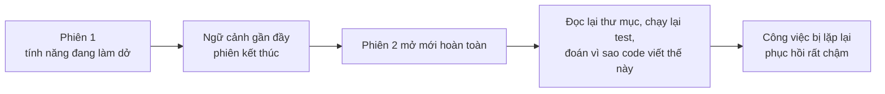

Khi có tệp lưu trữ trạng thái, phiên mới nối tiếp nhanh chóng:

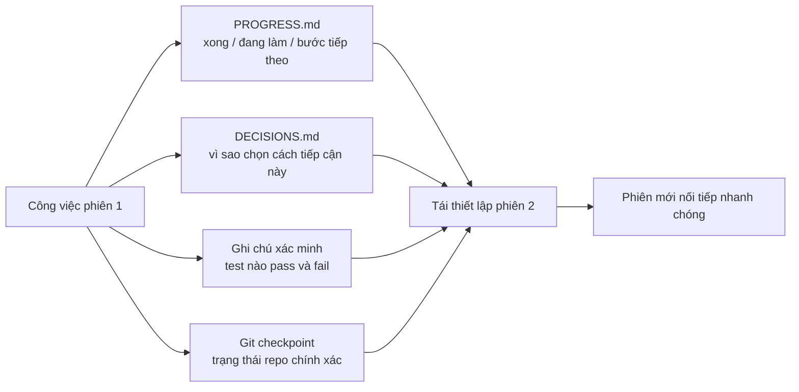

#### Các khái niệm cốt lõi

- **Cửa sổ ngữ cảnh là hữu hạn**: Dù kích thước cửa sổ được quảng bá là bao nhiêu (128K, 200K, 1M), tác vụ dài rồi cũng sẽ cạn kiệt. Sau khi cạn, chỉ có hai lối: nén (mất thông tin) hoặc reset (mở phiên mới), cả hai đều mất thứ gì đó.
- **Tệp lưu trữ trạng thái (State persistence files)**: Các tệp trạng thái được lưu lại, để phiên mới có thể tiếp tục rõ ràng ngay từ chỗ phiên trước dừng lại. Dạng cơ bản nhất gồm nhật ký tiến độ, bản ghi xác minh và các bước kế tiếp.
- **Chi phí tái thiết lập (Rebuild cost)**: Thời gian phiên mới cần để đạt tới trạng thái có thể thực thi. Một harness tốt để lại tiến độ, kết quả xác minh và các bước kế tiếp trong tệp, để phiên mới bắt đầu từ một trạng thái đã được viết ra.
- **Trôi dạt (Drift)**: Khoảng cách giữa hiểu biết của agent và trạng thái thật của kho lưu trữ code. Mỗi ranh giới phiên lại tạo ra trôi dạt; không kiểm soát, nó sẽ tích tụ qua từng phiên.
- **Lo lắng ngữ cảnh (Context anxiety)**: Hiện tượng Anthropic quan sát thấy: agent thể hiện hành vi vội vàng kết thúc khi ngữ cảnh gần tới giới hạn, kết thúc tác vụ sớm để tránh mất thông tin. Bản chất là sự lo lắng tài nguyên vô lý.
- **Nén so với đặt lại (Compaction vs. reset)**: Nén tóm tắt ngữ cảnh trong cùng phiên (giữ "cái gì", có thể mất "vì sao"); đặt lại mở phiên mới, tái thiết lập từ trạng thái đã lưu (sạch sẽ nhưng phụ thuộc vào độ đầy đủ của các artifact).

#### Chuyện gì xảy ra khi tính liên tục bị đứt gãy

Phiên trước đã tốn một lượng lớn ngân sách ngữ cảnh để phân tích ba cách tiếp cận rồi chọn phương án B. Phiên này, agent không biết gì về phân tích đó và có thể quyết lại dựa trên thông tin chưa đầy đủ, có khi lại chọn phương án A. Cùng dữ liệu, kết luận khác, chỉ vì bối cảnh ra quyết định đã biến mất.

Tệ hơn cả là trùng lặp công việc. Agent không chắc phần nào đã xong, nên làm lại. Hoặc tệ hơn, làm được nửa chừng, phát hiện xung đột với phần triển khai đang có, rồi phải sửa lại từ đầu. Nếu không có bản ghi tiến độ, phiên mới không hề biết phần việc nào đã hoàn thành.

Qua nhiều phiên, hướng triển khai có thể âm thầm trôi xa khỏi yêu cầu ban đầu. Mỗi phiên mới lại hiểu mục tiêu dự án hơi khác đi một chút. Mỗi lệch hướng chồng lên lệch hướng trước, và kết quả cuối cùng có khi chẳng còn giống ý đồ gốc.

Còn có cả khoảng cách xác minh. Kết quả xác minh của phiên trước (test nào pass, test nào fail, vì sao fail) không được ghi lại. Phiên mới phải chạy lại toàn bộ xác minh để hiểu trạng thái hiện tại. Mỗi phiên lại chẩn đoán lại từ đầu, mỗi lần đều lãng phí ngữ cảnh quý giá.

Cả OpenAI và Anthropic đều nhấn mạnh tầm quan trọng của lưu trữ trạng thái có cấu trúc trong tài liệu. Bài viết về harness engineering của OpenAI xem kho lưu trữ là "bản ghi hoạt động": kết quả của mỗi thao tác phải để lại bằng chứng truy vết được trong repo. Tài liệu về long-running agent của Anthropic đặc biệt khuyến nghị dùng "handoff files", tức các tài liệu có cấu trúc ghi rõ trạng thái hiện tại, các vấn đề đã biết và các bước kế tiếp.

#### Cách tiếp cận thực tế để lưu trữ trạng thái

Cách tiếp cận cốt lõi: **hãy đối xử với agent như một kỹ sư mà bộ nhớ ngắn hạn bị xóa sạch mỗi phiên.** Trước khi "tan ca", nó phải ghi lại thông tin quan trọng để agent "ca sau" nối tiếp nhanh chóng.

**Công cụ 1: Tệp tiến độ (PROGRESS.md).** Tệp lưu trữ trạng thái cơ bản nhất:

```markdown
# Tiến độ dự án

## Trạng thái hiện tại
- Commit mới nhất: abc1234 (feat: add user preferences endpoint)
- Trạng thái test: 42/43 vượt qua (test_pagination_edge_case đang fail)
- Lint: pass

## Đã hoàn thành
- [x] User model và database migration
- [x] Các endpoint CRUD cơ bản
- [x] Tích hợp auth middleware

## Đang thực hiện
- [ ] Tính năng phân trang (90% - edge case test đang fail)

## Vấn đề đã biết
- test_pagination_edge_case trả về 500 với result set rỗng
- Cần xác nhận người dùng đã xoá có nên hiển thị trong danh sách không

## Các bước tiếp theo
1. Sửa lỗi edge case phân trang
2. Thêm query param "include deleted users"
3. Cập nhật tài liệu API
```

**Công cụ 2: Nhật ký quyết định (DECISIONS.md).** Ghi lại các quyết định thiết kế quan trọng cùng lý do. Không cần tài liệu thiết kế chi tiết, chỉ cần "quyết định gì, vì sao, khi nào":

```markdown
# Các quyết định thiết kế

2024-01-15: Dùng Redis để cache tùy chọn người dùng
- Lý do: Tần suất đọc cao (mỗi lần gọi API), kích thước dữ liệu nhỏ
- Phương án bị loại: PostgreSQL materialized view (tần suất thay đổi cao khiến chi phí bảo trì không xứng)
- Ràng buộc: TTL cache 5 phút, chủ động vô hiệu khi ghi
```

**Công cụ 3: Git commit làm checkpoint.** Commit sau khi hoàn thành mỗi đơn vị công việc nguyên tử. Commit message phải giải thích đã làm gì và vì sao. Đây là các snapshot trạng thái miễn phí, tự động được phiên bản hoá.

**Công cụ 4: init.sh hoặc luồng khởi tạo harness.** Ghi trong `AGENTS.md` các thói quen "vào ca" và "tan ca":

```markdown
## Khi bắt đầu phiên (vào ca)
1. Đọc PROGRESS.md để nắm trạng thái hiện tại
2. Đọc DECISIONS.md để nắm các quyết định quan trọng
3. Chạy make check để xác nhận repo đang ở trạng thái nhất quán
4. Tiếp tục từ mục "Các bước tiếp theo" trong PROGRESS.md

## Trước khi kết thúc phiên (tan ca)
1. Cập nhật PROGRESS.md
2. Chạy make check để xác nhận trạng thái nhất quán
3. Commit tất cả phần việc đã hoàn thành
```

**Chiến lược hỗn hợp**: Không phải tác vụ nào cũng cần reset ngữ cảnh. Tác vụ ngắn (dưới 30 phút) có thể xử lý gọn trong một phiên. Tác vụ dài (trải nhiều phiên) bắt buộc phải dùng tệp tiến độ và nhật ký quyết định để duy trì tính liên tục. Tiêu chí quyết định: nếu tác vụ cần hơn 60% cửa sổ ngữ cảnh, hãy bắt đầu chuẩn bị bàn giao.

##### Tìm hiểu sâu hơn về lo lắng ngữ cảnh

Nghiên cứu tháng 3 năm 2026 của Anthropic tiếp tục hé lộ các biểu hiện cụ thể của context anxiety: trên Sonnet 4.5, khi ngữ cảnh tiệm cận giới hạn cửa sổ, agent thể hiện hành vi "vội vàng kết thúc" rất mạnh. Cũng giống như nhận ra thời gian trong phòng thi sắp hết, rồi điền đại đáp án ngẫu nhiên vào các câu trắc nghiệm còn lại.

Hai chiến lược xử lý chuyện này:

**Nén (Compaction)**: Tóm tắt phần đầu cuộc hội thoại trong cùng phiên. Ưu điểm: duy trì tính liên tục, agent vẫn thấy "cái gì". Nhược điểm: "vì sao" thường bị mất trong các bản tóm tắt, ví dụ vì sao chọn phương án B thay vì A, vì sao bỏ qua một bước tối ưu nào đó. Nghiêm trọng hơn, nén không loại bỏ context anxiety: agent biết ngữ cảnh từng rất lớn, về mặt tâm lý vẫn có xu hướng vội vàng kết thúc.

**Đặt lại ngữ cảnh (Context reset)**: Xóa sạch ngữ cảnh, mở phiên mới, tái thiết lập từ các artifact đã lưu. Ưu điểm: trạng thái tinh thần sạch sẽ, phiên mới không còn nỗi lo "mình sắp hết thời gian". Nhược điểm: phụ thuộc vào độ đầy đủ của các artifact bàn giao. Nếu tệp tiến độ thiếu thông tin quan trọng, phiên mới có thể lãng phí thời gian đi theo hướng sai.

Dữ liệu thực tế từ Anthropic: với Sonnet 4.5, context anxiety nghiêm trọng đến mức chỉ nén là chưa đủ, đặt lại ngữ cảnh trở thành thành phần cốt lõi của thiết kế harness. Nhưng với Opus 4.5, hành vi này giảm hẳn, nén đã có thể quản lý ngữ cảnh mà không cần dựa vào reset. Điều này có nghĩa: **thiết kế harness cần hiểu rõ mô hình mục tiêu, không dùng chung một khuôn cho tất cả.**

> Nguồn: [Anthropic: Harness design for long-running application development](https://www.anthropic.com/engineering/harness-design-long-running-apps)

#### Anthropic: bàn giao giữa các phiên lập trình

Anthropic mô tả một bản sao trang Claude: agent khởi tạo xác định hơn 200 tính năng và ban đầu đánh dấu tất cả là chưa đạt. Agent cũng tạo init.sh, tệp tiến độ và commit Git đầu tiên. Các phiên sau đọc tiến độ cùng lịch sử Git, triển khai từng phần, kiểm tra hành vi và để lại cập nhật cho phiên kế tiếp.

Ví dụ này mô tả cơ chế liên tục, không báo cáo các tỷ lệ hoàn thành, lỗi ẩn hoặc thời gian khôi phục ngữ cảnh từng xuất hiện ở đây. Mã đi kèm là mô phỏng giảng dạy, không phải phép đo hiệu năng mô hình.

[Anthropic](https://www.anthropic.com/engineering/effective-harnesses-for-long-running-agents)

LangChain báo cáo điểm tăng từ 52,8% lên 66,5%, tức 13,7 điểm phần trăm, với cùng gpt-5.2-codex trên 89 nhiệm vụ Terminal Bench 2.0. Thay đổi gồm hướng dẫn kiểm tra, middleware và quản lý ngữ cảnh. Đây là kết quả tổng hợp nhiều thay đổi harness, không riêng tệp tiến độ. [LangChain: Improving Deep Agents](https://www.langchain.com/blog/improving-deep-agents-with-harness-engineering)

#### Những điểm chính cần nhớ

- Cửa sổ ngữ cảnh là tài nguyên hữu hạn. Tác vụ dài sẽ trải qua nhiều phiên, và các phiên sẽ mất thông tin, đó là thực tế khách quan.
- Giải pháp không phải cửa sổ lớn hơn, mà là lưu trữ trạng thái tốt hơn. Tệp tiến độ, nhật ký quyết định và git checkpoint phối hợp với nhau, để phiên mới nối tiếp phiên cũ.
- Hãy đối xử với agent như một kỹ sư bị xóa trắng bộ nhớ ngắn hạn mỗi phiên: trước khi "tan ca", phải ghi lại đã làm gì, vì sao, và bước tiếp theo là gì.
- Chi phí tái thiết lập là chỉ số then chốt. Một harness tốt để lại tiến độ, kết quả xác minh và các bước kế tiếp trong tệp, để phiên mới phục hồi nhanh chóng.
- Chiến lược hỗn hợp: tác vụ ngắn xử lý trong phiên, tác vụ dài dùng artifact có cấu trúc để duy trì tính liên tục.

#### Đọc thêm

- [Anthropic: Effective Harnesses for Long-Running Agents](https://www.anthropic.com/engineering/effective-harnesses-for-long-running-agents)
- [OpenAI: Harness Engineering](https://openai.com/index/harness-engineering/)
- [Lost in the Middle: How Language Models Use Long Contexts](https://arxiv.org/abs/2307.03172)
- [Claude Code Documentation](https://docs.anthropic.com/en/docs/claude-code)
- [HumanLayer: Harness Engineering for Coding Agents](https://www.humanlayer.dev/blog/skill-issue-harness-engineering-for-coding-agents)

- [LangChain: Improving Deep Agents](https://www.langchain.com/blog/improving-deep-agents-with-harness-engineering)

#### Bài tập

1. **Đo lường chi phí tái thiết lập**: Chọn một tác vụ phát triển cần ít nhất 3 phiên. Không cung cấp bất kỳ tệp lưu trữ trạng thái nào, ở mỗi lần mở phiên hãy ghi lại xem agent tốn bao nhiêu ngữ cảnh để "tìm hiểu lần trước đã xảy ra chuyện gì". Sau mỗi phiên, tạo một tệp tiến độ rồi để phiên kế tiếp mở từ đó. So sánh chi phí tái thiết lập giữa có và không có tệp tiến độ.

2. **Thiết kế mẫu bàn giao**: Thiết kế một mẫu bàn giao tối giản với bốn trường: trạng thái repo (hash commit), trạng thái runtime (tỷ lệ test pass), các chướng ngại, hành động kế tiếp. Để một phiên agent hoàn toàn mới khôi phục trạng thái dự án chỉ dựa trên mẫu này. Ghi lại các điểm mơ hồ phát sinh trong quá trình khôi phục, rồi lặp lại để cải thiện mẫu.

3. **Thí nghiệm chiến lược hỗn hợp**: Với một tác vụ phát triển 5 phiên, so sánh ba chiến lược: (a) luôn mở phiên mới kết hợp tệp tiến độ, (b) cố gắng làm trọn trong một phiên (nén ngữ cảnh), (c) chiến lược hỗn hợp (tác vụ ngắn trong phiên, tác vụ dài qua nhiều phiên cộng tệp tiến độ). So sánh thời gian tái thiết lập, tỷ lệ hoàn thành tính năng và tính nhất quán của các quyết định.

### Bài 06. Khởi tạo trước mỗi phiên agent

> Ví dụ code: [code/](https://github.com/walkinglabs/learn-harness-engineering/blob/main/docs/vi/lectures/lecture-06-why-initialization-needs-its-own-phase/code/)
Bạn mở một phiên agent mới và nói "thêm tính năng tìm kiếm". Nó lao thẳng vào code, nhiệt tình đáng khen. 20 phút sau nó phát hiện khung test chưa cấu hình xong, mất thêm 10 phút sửa, rồi lại thấy script migration cơ sở dữ liệu sai định dạng, lại loay hoay tiếp. Tính năng tìm kiếm cuối cùng cũng xong, nhưng cả phiên rất kém hiệu quả. Phần lớn thời gian đổ vào chuyện "tìm hiểu dự án này vận hành ra sao" thay vì viết tính năng tìm kiếm.

Cách làm tốt hơn: trước khi cho agent bắt tay vào việc, hãy dành một giai đoạn riêng để chuẩn bị môi trường nền, chạy thông suốt các lệnh xác minh, và nắm được cấu trúc dự án. Việc khởi tạo không nên bị nhồi chung với việc triển khai tính năng, vì chúng là hai loại công việc về bản chất khác nhau.

Bài giảng này phân tích vì sao khởi tạo phải là một giai đoạn riêng, chứ không trộn lẫn với triển khai.

#### Móng và tường: hai công việc khác nhau về bản chất

Khởi tạo và triển khai có mục tiêu tối ưu hoàn toàn khác nhau. Giai đoạn triển khai tối ưu cho số lượng và chất lượng tính năng được xác minh. Giai đoạn khởi tạo tối ưu cho độ tin cậy và hiệu quả của mọi phần triển khai phía sau.

Khi trộn khởi tạo với triển khai, agent đối mặt bài toán tối ưu đa mục tiêu: vừa xây hạ tầng, vừa viết code tính năng. Không có thiết lập ưu tiên rõ ràng, agent tự nhiên nghiêng về việc viết code (vì đó là sản phẩm nhìn thấy ngay), còn hạ tầng bị xem nhẹ (vì giá trị chỉ bộc lộ ở các phiên sau). Hệ quả là hạ tầng không được xây cho ra hồn, và độ tin cậy của code tính năng cũng bị kéo theo.

#### Vòng đời khởi tạo

```mermaid
flowchart TB
    subgraph Wrong["Phiên hỗn hợp (sai)"]
        W1["Bắt đầu ngay vào code tính năng"] --> W2["Phát hiện env và test thiếu sót giữa chừng"]
        W2 --> W3["Tích tụ code chưa xác minh"]
        W3 --> W4["Phiên sau phải khám phá lại trạng thái dự án"]
    end

    subgraph Right["Khởi tạo riêng biệt (đúng)"]
        R1["Phiên 1: môi trường chạy được"] --> R2["Test mẫu pass"]
        R2 --> R3["Viết startup checklist + danh sách tác vụ"]
        R3 --> R4["Commit checkpoint sạch"]
        R4 --> R5["Phiên sau bắt đầu thẳng vào tác vụ đã xác minh"]
    end
```

#### Chuyện gì xảy ra khi bạn trộn chúng

Vấn đề trực tiếp nhất: hạ tầng không được xây cho ra hồn. Agent dành phần lớn sức cho code tính năng và chỉ tiện tay dựng đại hạ tầng như một việc phụ. Khung test cấu hình xong nhưng chưa bao giờ được xác minh, quy tắc lint đặt ra nhưng quá lỏng, không có tệp tiến độ nào được tạo. Những khiếm khuyết ấy không lộ ra ở phiên đầu (vì agent vẫn còn nhớ mình đã làm gì), nhưng bùng lên ở phiên thứ hai: agent mới không biết cách chạy dự án, không biết test ở đâu, không biết mọi thứ đang tới đâu.

Một chi phí ẩn hơn là "tích tụ chưa xác minh". Code tính năng viết trước khi khung test được cấu hình chuẩn, bản thân nó là code không có xác minh. Khi bạn quay lại thêm test, có khi phát hiện ra ngay từ đầu thiết kế đã sai, nếu biết trước, bạn đã triển khai khác đi. Code viết trước càng nhiều, phần phải đập đi làm lại càng lớn.

Ngân sách ngữ cảnh cũng đang bị lãng phí. Phần việc khởi tạo (cấu hình môi trường, dựng test, hiểu cấu trúc dự án) ngốn một mảng lớn ngân sách, để lại ít hơn cho phần triển khai tính năng thật sự. Kết quả: phiên đầu chỉ xong một nửa tính năng, phiên thứ hai vẫn phải bắt đầu lại từ chỗ hiểu dự án. Ngân sách đã đổ vào khởi tạo, mà khởi tạo cũng chẳng ra sao, tệ nhất ở cả hai đầu.

Vấn đề dễ bị bỏ qua nhất là bãi mìn giả định ngầm. Những quyết định agent đưa ra trong lúc khởi tạo (dùng khung test nào, tổ chức thư mục ra sao, quản lý dependency thế nào) nếu không ghi lại tường minh, các phiên sau có thể đưa ra lựa chọn mâu thuẫn. Phiên đầu chọn Vitest làm khung test, phiên sau agent không biết, lại đưa Jest vào. Hai khung test cùng tồn tại, chi phí bảo trì nhân đôi.

Công trình về long-running agent của Anthropic [đặt khởi tạo vào một phiên đầu tiên riêng biệt](https://www.anthropic.com/engineering/effective-harnesses-for-long-running-agents). Initializer viết script `init.sh`, tệp tiến độ, danh sách tính năng và commit Git đầu tiên; các phiên code sau đọc trạng thái đó, làm từng tính năng một, test đầu-cuối, commit và cập nhật tệp tiến độ.

Hướng dẫn harness engineering cho Codex của OpenAI cũng nhấn mạnh nguyên tắc "kho lưu trữ là bản ghi hoạt động": thiết lập cấu trúc vận hành rõ ràng ngay từ lần chạy đầu tiên, nếu không mỗi phiên mới sẽ phải tự suy ra quy ước dự án.

#### Các khái niệm cốt lõi

- **Giai đoạn khởi tạo (Initialization Phase)**: Giai đoạn đầu tiên trong vòng đời agent, chỉ thiết lập tiền đề cho mọi giai đoạn triển khai về sau, không phát triển tính năng. Đầu ra của nó là hạ tầng, không phải code nghiệp vụ.
- **Danh sách kiểm tra sẵn sàng (Startup Readiness Checklist)**: Tập các điều kiện để dự án có thể được một phiên agent mới vận hành một cách rõ ràng: chạy được, test được, thấy tiến độ được, chọn được bước tiếp theo. Bốn điều kiện, tất cả đều cần.
- **Từ đầu hay từ mẫu (From Scratch vs From Template)**: Từ đầu nghĩa là agent phải tự suy ra cấu trúc dự án từ một thư mục rỗng. Từ mẫu nghĩa là hạ tầng đã có sẵn. Từ mẫu vượt trội hơn hẳn so với từ đầu.
- **Luôn sẵn sàng bàn giao (Always Ready to Hand Off)**: Dự án ở bất kỳ thời điểm nào cũng trong trạng thái một agent mới có thể tiếp quản. Không cần giải thích bằng lời, chỉ cần nhìn nội dung repo là đủ tiếp tục.
- **Thời gian từ bắt đầu tới test pass đầu tiên (Time from Start to First Passing Test)**: Khoảng thời gian từ lúc khởi động dự án đến khi điểm tính năng đầu tiên qua được xác minh. Đây là chỉ số cốt lõi để đo hiệu quả khởi tạo.
- **Tỷ lệ thành công của các phiên sau (Success Rate of Subsequent Sessions)**: Tỷ lệ các phiên tiếp theo có thể thực thi tác vụ thành công mà không dựa vào kiến thức ngầm. Đây là thước đo tốt nhất cho chất lượng khởi tạo.

#### Cách làm khởi tạo cho đúng

**Hãy coi khởi tạo là một giai đoạn riêng biệt.** Phiên đầu tiên chỉ làm khởi tạo, hoàn toàn không có code tính năng nghiệp vụ. Khởi tạo cần tạo ra:

**1. Môi trường chạy được.** Dự án khởi động, dependencies đã cài, không có vấn đề môi trường.

**2. Khung test xác minh được.** Ít nhất một test mẫu phải pass, chứng minh bản thân khung test đã được cấu hình đúng.

**3. Tài liệu danh sách sẵn sàng.** Một tài liệu rõ ràng dành cho các phiên sau:
```markdown
# Danh sách kiểm tra sẵn sàng

## Lệnh khởi động
- Cài dependencies: `make setup`
- Chạy dev server: `make dev`
- Chạy test: `make test`
- Xác minh đầy đủ: `make check`

## Trạng thái hiện tại
- Tất cả dependencies đã cài và khóa
- Khung test đã cấu hình (Vitest + React Testing Library)
- Test mẫu đang pass (1/1)
- Quy tắc lint đã cấu hình (ESLint + Prettier)

## Cấu trúc dự án
- src/ — Mã nguồn
- src/components/ — React components
- src/api/ — API client
- tests/ — Tệp test
```

**4. Phân rã tác vụ.** Chia toàn bộ dự án thành danh sách tác vụ có thứ tự, mỗi tác vụ có tiêu chí chấp nhận rõ ràng:
```markdown
# Phân rã tác vụ

## Tác vụ 1: Xác thực người dùng cơ bản
- Triển khai JWT auth middleware
- Thêm endpoint đăng nhập/đăng ký
- Chấp nhận: pytest tests/test_auth.py tất cả đều pass

## Tác vụ 2: Trang hồ sơ người dùng
- Triển khai CRUD hồ sơ người dùng
- Thêm form chỉnh sửa hồ sơ
- Chấp nhận: pytest tests/test_profile.py tất cả đều pass

## Tác vụ 3: Tính năng tìm kiếm
- ...
```

**5. Git commit làm checkpoint.** Sau khi khởi tạo xong, commit một checkpoint sạch. Mọi phần việc sau đó bắt đầu từ checkpoint này.

**Khởi động từ mẫu**: Đừng bắt đầu từ thư mục rỗng. Hãy dùng template dự án (create-react-app, fastapi-template, v.v.) để dựng sẵn cấu trúc thư mục chuẩn, cấu hình dependency và khung test. Đúc sẵn các bước khởi tạo thông dụng vào template, chỉ chừa lại phần khởi tạo riêng cho dự án.

**Tiêu chí hoàn thành khởi tạo**: Không phải "viết được bao nhiêu code", mà là bốn điều kiện trong danh sách sẵn sàng có được đáp ứng hay không: chạy được, test được, thấy tiến độ được, chọn được bước tiếp theo. Hãy dùng danh sách này để xác nhận khởi tạo:

```markdown
## Danh sách chấp nhận khởi tạo
- [ ] `make setup` chạy thành công từ đầu
- [ ] `make test` có ít nhất một test pass
- [ ] Một phiên agent mới có thể trả lời "chạy thế nào" và "test thế nào" chỉ dựa vào nội dung repo
- [ ] Tệp phân rã tác vụ tồn tại, có ít nhất 3 tác vụ
- [ ] Tất cả đã được commit vào git
```

#### Ví dụ thật

Hai cách khởi tạo cho một dự án frontend React, đặt cạnh nhau để so sánh:

**Cách trộn lẫn**: Agent vừa tạo scaffolding dự án, vừa triển khai tính năng đầu tiên ngay trong phiên 1. Kết thúc phiên, repo có code chạy được nhưng không có tài liệu lệnh start/test rõ ràng, không có tệp theo dõi tiến độ, không có phân rã tác vụ. Phiên 2 mất khoảng 20 phút để dò ra cấu trúc dự án, khung test và quy trình build.

**Khởi tạo riêng biệt**: Phiên 1 chỉ làm khởi tạo, tạo cấu trúc thư mục từ template, cấu hình khung test (Vitest + React Testing Library), viết và xác minh một test mẫu, tạo danh sách sẵn sàng và tệp phân rã tác vụ, commit checkpoint khởi đầu. Chi phí tái thiết lập của phiên 2 dưới 3 phút, và nó bắt đầu làm việc ngay từ danh sách tác vụ.

So sánh toàn chu kỳ dự án: tổng thời gian tái thiết lập (cộng dồn qua các phiên) của cách trộn lẫn cao hơn khoảng 60% so với cách khởi tạo riêng. 20 phút thêm dành cho khởi tạo được thu hồi gấp nhiều lần trong các phiên tiếp theo. Đầu tư thêm chút thời gian ở đầu để khởi tạo cho đúng, hiệu quả về sau thực ra cao hơn hẳn.

#### Những điểm chính cần nhớ

- Khởi tạo và triển khai có mục tiêu tối ưu khác nhau, trộn lẫn chỉ kéo cả hai xuống.
- Đầu ra của khởi tạo không phải code nghiệp vụ, mà là hạ tầng: môi trường chạy được, test xác minh được, danh sách sẵn sàng, phân rã tác vụ.
- Xác nhận khởi tạo bằng bốn điều kiện trong danh sách sẵn sàng: chạy được, test được, thấy tiến độ được, chọn được bước tiếp theo.
- Khởi động từ mẫu tốt hơn từ đầu. Hãy dùng template dự án để dựng sẵn hạ tầng chuẩn hoá.
- Thời gian đầu tư cho khởi tạo được thu hồi hoàn toàn trong 3-4 phiên kế tiếp. Đây không phải chi phí thêm, mà là khoản đầu tư trả trước.

#### Đọc thêm

- [Anthropic: Effective Harnesses for Long-Running Agents](https://www.anthropic.com/engineering/effective-harnesses-for-long-running-agents)
- [OpenAI: Harness Engineering](https://openai.com/index/harness-engineering/)
- [HumanLayer: Harness Engineering for Coding Agents](https://www.humanlayer.dev/blog/skill-issue-harness-engineering-for-coding-agents)
- [Infrastructure as Code — Martin Fowler](https://martinfowler.com/bliki/InfrastructureAsCode.html)
- [SWE-agent: Agent-Computer Interfaces](https://github.com/princeton-nlp/SWE-agent)

#### Bài tập

1. **Thiết kế danh sách sẵn sàng**: Viết một danh sách sẵn sàng hoàn chỉnh cho một dự án bạn đang phát triển. Rồi mở một phiên agent hoàn toàn mới, chỉ cho nó xem nội dung repo (không kèm bất kỳ ngữ cảnh lời nói nào), để nó thử khởi động dự án, chạy test và hiểu tiến độ hiện tại. Ghi lại mọi vấn đề gặp phải, mỗi vấn đề ứng với một điều khoản còn thiếu trong danh sách sẵn sàng của bạn.

2. **Thí nghiệm so sánh**: Chọn một dự án mới cỡ vừa. Cách A: để agent vừa khởi tạo vừa triển khai tính năng đầu tiên. Cách B: dành riêng một phiên cho khởi tạo, bắt đầu triển khai từ phiên 2. Sau 4 phiên, so sánh: thời gian tới test pass đầu tiên, chi phí tái thiết lập, tỷ lệ hoàn thành tính năng.

3. **Danh sách chấp nhận khởi tạo**: Thiết kế một danh sách chấp nhận khởi tạo cho dự án của bạn. Để một phiên agent mới thực thi từng mục trong danh sách và ghi lại mục nào đậu, mục nào trượt. Những mục trượt chính là chỗ harness của bạn cần được củng cố.

---

## Phần 4 · Ranh giới — WIP=1 và feature list — ≈19 phút

Hai bài điều tiết agent không làm quá giới hạn: một việc tại một thời điểm, và danh sách tính năng như hợp đồng ràng buộc.

### Bài 07. Vạch ranh giới tác vụ rõ ràng cho agent

> Ví dụ code: [code/](https://github.com/walkinglabs/learn-harness-engineering/blob/main/docs/vi/lectures/lecture-07-why-agents-overreach-and-under-finish/code/)
Bạn nói với Claude Code "thêm xác thực người dùng vào dự án này", và nó bắt đầu sửa schema cơ sở dữ liệu, viết route, thay đổi component frontend, và tiện thể tái cấu trúc luôn error-handling middleware. Hai tiếng sau bạn kiểm tra: 12 tệp bị sửa, 800 dòng code mới, mà chẳng có tính năng nào chạy được end-to-end.

Agent vốn có xung lực "làm thêm một chút", thấy thứ gì liên quan là xử lý luôn. Vấn đề là làm quá nhiều thứ cùng lúc gần như chắc chắn dẫn đến chẳng cái nào ra hồn.

Bài kỹ thuật "Effective harnesses for long-running agents" của Anthropic nói rất rõ: khi prompt quá rộng, agent có xu hướng "bắt đầu nhiều thứ cùng lúc" thay vì "hoàn thành một thứ trước". Thực hành kỹ thuật của Codex trong OpenAI cũng rút ra kết luận tương tự, các tác vụ không có kiểm soát phạm vi rõ ràng chứng kiến tỷ lệ hoàn thành tụt mạnh. Đây không phải vấn đề mô hình, mà là vấn đề harness. Bạn chưa vạch ranh giới.

#### Sự chú ý là tài nguyên hữu hạn

Đây không phải phép ẩn dụ, mà là toán. Giả sử dung lượng ngữ cảnh của agent là C, và nó kích hoạt k tác vụ cùng lúc. Mỗi tác vụ nhận trung bình C/k tài nguyên lý luận. Khi C/k tụt xuống dưới ngưỡng tối thiểu để hoàn thành một tác vụ, chẳng cái nào được xong cả.

Hành vi thật của Claude Code rất minh họa. Bảo nó "thêm đăng ký người dùng" và nó có thể:

1. Tạo User model
2. Viết route đăng ký
3. Thấy cần xác minh email, vậy thêm mail service
4. Thấy mật khẩu cần hash, vậy mang bcrypt vào
5. Thấy error handling chưa nhất quán, vậy tái cấu trúc global error middleware
6. Thấy cấu trúc tệp test lộn xộn, vậy sắp xếp lại thư mục

Sáu bước sau, mỗi cái đều làm dở. Không có xác minh end-to-end, code nửa vời cộng lẫn vào nhau rất phức tạp, phiên sau muốn dọn cũng chẳng biết bắt đầu từ đâu.

Hướng dẫn về long-running agent của Anthropic [yêu cầu coding agent làm từng tính năng một](https://www.anthropic.com/engineering/effective-harnesses-for-long-running-agents), sau đó xác minh, commit và cập nhật tiến độ trước khi chuyển sang việc tiếp theo. Một prompt rộng mời gọi agent mở nhiều luồng cùng lúc, và mỗi luồng lại tranh nhau cùng một ngân sách ngữ cảnh và xác minh.

#### Quy trình WIP=1

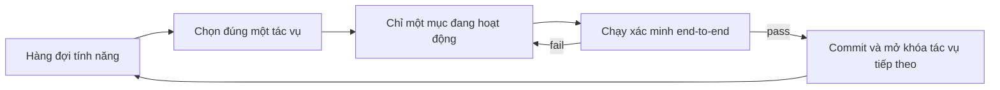

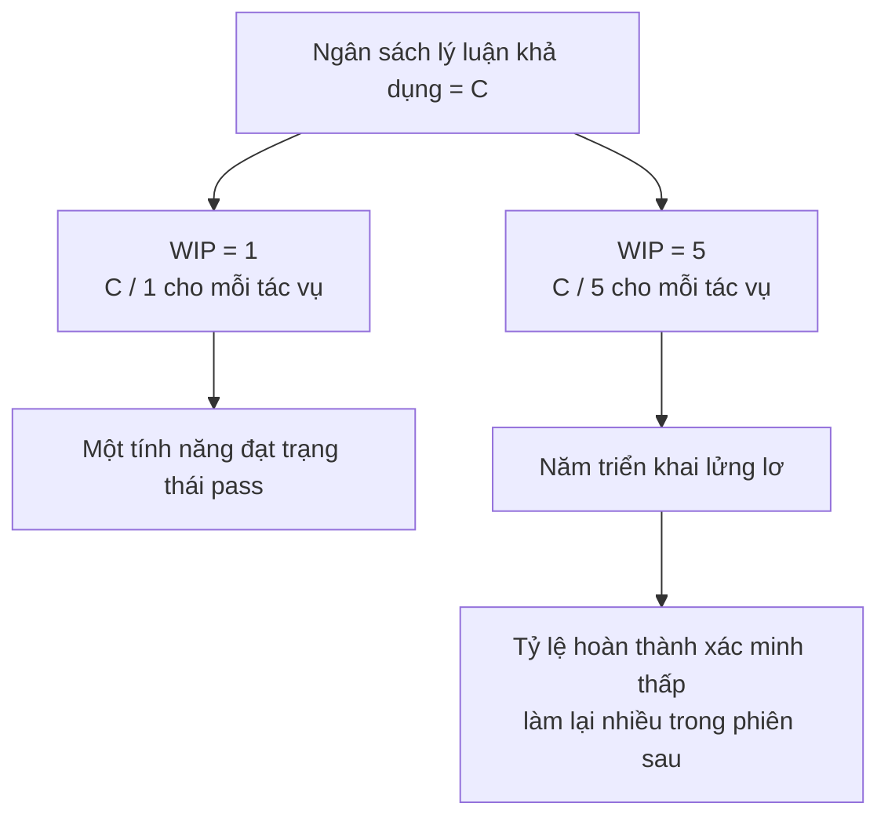

#### Các khái niệm cốt lõi

- **Vượt phạm vi (Overreach)**: Agent kích hoạt nhiều tác vụ hơn mức tối ưu trong một phiên. Chuyện này có thể định lượng được: làm 5 tính năng mà 0 cái pass end-to-end thì gọi là vượt phạm vi.
- **Dở dang (Under-finish)**: Tỷ lệ tác vụ pass xác minh end-to-end trên tổng số tác vụ đã kích hoạt tụt xuống dưới ngưỡng. Code viết ra nhưng test không pass, đó là dở dang.
- **Giới hạn WIP (Work-in-Progress Limit)**: Mượn từ phương pháp Kanban. Ý tưởng cốt lõi: giới hạn số tác vụ đang chảy đồng thời. Với agent, WIP=1 là giá trị mặc định an toàn nhất, xong một cái rồi mới bắt đầu cái tiếp theo.
- **Bằng chứng hoàn thành (Completion Evidence)**: Điều kiện có thể xác minh mà tác vụ phải thoả mãn để chuyển từ "đang làm" sang "xong". Không có cái này, agent sẽ thay "code trông có vẻ ổn" bằng "hành vi pass test".
- **Bề mặt phạm vi (Scope Surface)**: Cấu trúc DAG trong đó mỗi nút là một đơn vị công việc, cạnh là phụ thuộc. Trạng thái chỉ có bốn: not_started, active, blocked, passing.
- **Áp lực hoàn thành (Completion Pressure)**: Lực ràng buộc mà harness tạo ra thông qua giới hạn WIP và yêu cầu bằng chứng hoàn thành, buộc agent phải xong tác vụ hiện tại trước khi mở tác vụ mới.

#### Vượt phạm vi và dở dang là cộng sinh

Hai vấn đề này không độc lập, chúng khuếch đại lẫn nhau. Vượt phạm vi làm loãng sự chú ý, sự chú ý bị loãng dẫn đến dở dang, và đống code dở dang để lại làm tăng độ phức tạp hệ thống, từ đó lại thúc đẩy vượt phạm vi ở tác vụ tiếp theo. Một vòng xoáy bệnh lý.

Theo ngôn ngữ Kanban: định luật Little cho ta L = lambda * W. Nếu lượng công việc đang chảy L quá lớn (làm quá nhiều thứ cùng lúc), thời gian hoàn thành W của mỗi tác vụ tất yếu tăng. Với agent, điều này nghĩa là mỗi tính năng mất thêm thời gian từ lúc bắt đầu tới lúc hoàn thành đã xác minh, và xác suất thất bại tăng theo.

Đây cũng là vấn đề cũ trong thế giới con người. Steve McConnell từng ghi nhận trong *Rapid Development* rằng scope creep là nguyên nhân hàng đầu khiến dự án thất bại. Nhưng người ta ít nhất còn có trực giác "mình làm đủ rồi". Agent thì không. Việc nảy ra ý tưởng tiếp theo gần như chẳng tốn thêm token nào, chỉ cần viết thêm "tiện thể sửa luôn cái này" là xong, nhưng mỗi sửa đổi bổ sung lại làm loãng thêm sự chú ý của agent.

#### Cách làm đúng

##### 1. Thực thi WIP=1

Đây là cách trực tiếp và hiệu quả nhất. Trong harness, hãy nói rõ với agent: **chỉ một tác vụ được phép ở trạng thái "active" tại bất kỳ thời điểm nào.** Trong `CLAUDE.md` của Claude Code hoặc `AGENTS.md` của Codex, viết:

```
## Quy tắc làm việc
- Làm một tính năng tại một thời điểm
- Chỉ bắt đầu tính năng tiếp theo sau khi tính năng hiện tại pass xác minh end-to-end
- Đừng "tiện thể tái cấu trúc" tính năng B trong khi triển khai tính năng A
```

##### 2. Định nghĩa bằng chứng hoàn thành rõ ràng cho từng tác vụ

Xong không phải "code đã viết", mà là "xác minh hành vi pass". Trong feature list, mỗi mục cần một lệnh xác minh:

```
F01: Đăng ký người dùng
  Xác minh: curl -X POST /api/register -d '{"email":"test@example.com","password":"123456"}' | jq .status == 201
  Trạng thái: passing
```

##### 3. Đưa bề mặt phạm vi ra ngoài

Dùng một tệp máy đọc được (JSON hoặc Markdown) để ghi lại trạng thái của mọi tác vụ. Bất kỳ phiên mới nào đọc tệp này là biết ngay: tác vụ nào đang hoạt động? Hành vi nào tính là xong? Những xác minh nào đã pass?

##### 4. Theo dõi tỷ lệ hoàn thành đã xác minh

Harness nên liên tục theo dõi VCR (Verified Completion Rate) = số tác vụ đã xác minh / số tác vụ đã kích hoạt. Chặn kích hoạt tác vụ mới khi VCR < 1.0.

#### Câu chuyện thật

Một dự án REST API với 8 tính năng, hai chiến lược đặt cạnh nhau:

**Chế độ không ràng buộc**: Agent kích hoạt 5 tính năng cùng lúc trong phiên 1. Tạo ra khoảng 800 dòng trên 12 tệp. Tỷ lệ pass test end-to-end: 20%, chỉ đăng ký người dùng chạy được. 4 tính năng còn lại: database schema đã tạo nhưng thiếu logic xác thực, route khai báo xong nhưng trả về sai định dạng response. Đến cuối phiên 3, chỉ 3 trên 8 tính năng hoàn thành.

**Chế độ WIP=1**: Phiên 1 chỉ làm đăng ký người dùng. Tạo ra khoảng 200 dòng trên 4 tệp. Test end-to-end: 100% pass. Commit một triển khai sạch, đã xác minh. Đến cuối phiên 4, 7 trên 8 tính năng hoàn thành (tính năng thứ 8 bị chặn bởi phụ thuộc bên ngoài).

Kết quả: tổng code ít hơn (800 so với 1200 dòng) nhưng code hiệu quả hơn. Tỷ lệ hoàn thành: 87.5% so với 37.5%.

#### Những điểm chính cần nhớ

- **WIP=1 là cài đặt mặc định an toàn cho harness agent**: xong một rồi mới sang cái tiếp theo, đừng cố song song hoá.
- **Bằng chứng hoàn thành phải có thể thực thi**: "code trông có vẻ ổn" không tính, "curl trả về 201" mới tính.
- **Bề mặt phạm vi phải được đưa ra thành một tệp**: không chỉ nhắc tới trong hội thoại, mà phải ghi vào repo ở định dạng máy đọc được.
- **Vượt phạm vi và dở dang là cộng sinh**: giải quyết được một là giải quyết luôn cái kia.
- **"Làm ít mà xong" luôn thắng "làm nhiều mà bỏ dở"**: số dòng code agent và tỷ lệ hoàn thành tính năng có tương quan âm. Chất lượng bao giờ cũng thắng số lượng.

#### Đọc thêm

- [Effective harnesses for long-running agents - Anthropic](https://www.anthropic.com/engineering/effective-harnesses-for-long-running-agents) — Bài kỹ thuật của Anthropic, thảo luận chi tiết chiến lược "bước tiếp theo nhỏ"
- [Harness Engineering - OpenAI](https://openai.com/index/harness-engineering/) — Cách tiếp cận đầy đủ của OpenAI về harness engineering
- [Kanban: Successful Evolutionary Change - David Anderson](https://www.goodreads.com/book/show/1070822.Kanban) — Nguồn kinh điển về giới hạn WIP
- [Rapid Development - Steve McConnell](https://www.goodreads.com/book/show/125171.Rapid_Development) — Dữ liệu thực nghiệm về scope creep là nguyên nhân hàng đầu gây thất bại dự án

#### Bài tập

1. **Nguyên tử hoá tác vụ**: Chọn một yêu cầu rộng (ví dụ: "triển khai hệ thống quản lý người dùng") và phân nhỏ thành ít nhất 5 đơn vị công việc nguyên tử. Với mỗi đơn vị, hãy chỉ ra: (a) mô tả một hành vi duy nhất, (b) lệnh xác minh có thể thực thi, (c) các phụ thuộc. Kiểm tra xem việc phân rã có thoả mãn ràng buộc WIP=1 không.

2. **Thí nghiệm so sánh**: Chạy cùng một dự án hai lần, một lần không ràng buộc, một lần có WIP=1 được thực thi. So sánh: tỷ lệ hoàn thành đã xác minh, tổng số dòng code, tỷ lệ code hiệu quả.

3. **Kiểm toán bằng chứng hoàn thành**: Rà lại kết quả một lần chạy agent gần đây, phân loại từng thay đổi code thành "hành vi đã xong", "hành vi chưa xong" hoặc "scaffolding". Bổ sung lệnh xác minh còn thiếu cho mỗi hành vi chưa xong.

### Bài 08. Sử dụng feature list để ràng buộc những gì agent làm

> Ví dụ code: [code/](https://github.com/walkinglabs/learn-harness-engineering/blob/main/docs/vi/lectures/lecture-08-why-feature-lists-are-harness-primitives/code/)
Bạn yêu cầu một agent xây dựng một trang thương mại điện tử. Sau khi nó làm xong, nó báo "xong rồi". Bạn nhìn vào code: phần xác thực người dùng chạy ổn, nhưng nút thanh toán trong giỏ hàng không làm gì cả, còn luồng thanh toán thì chẳng kết nối với ai. Vấn đề ở đâu? Bạn chưa bao giờ nói với nó "xong" nghĩa là cái gì, nên nó tự lấy một chuẩn riêng: "tôi viết khá nhiều code và trông cũng tạm đầy đủ".

Trong mắt nhiều người, feature list chỉ là một ghi chú nhắc nhở, viết ra để khỏi quên, xong rồi vứt sang một bên. Nhưng trong thế giới harness, feature list không phải ghi chú cho người, mà là cấu trúc nền tảng mà cả harness dựa lên. Bộ lập lịch dựa vào nó để chọn tác vụ, bộ xác minh dựa vào nó để phán xét hoàn thành, trình báo cáo bàn giao dựa vào nó để sinh tóm tắt. Không có nó, các thành phần ấy chẳng có chỗ bám víu.

Cả Anthropic và OpenAI đều nhấn mạnh: **các artifact phải được đưa ra ngoài.** Trạng thái tính năng phải nằm trong một tệp máy đọc được trong repo, không phải trôi nổi trong đoạn hội thoại không cấu trúc.

#### Agent không biết "xong" nghĩa là gì

Cả Claude Code lẫn Codex đều không tự động biết bạn muốn nói gì khi nói "xong". Bạn bảo "thêm tính năng giỏ hàng", mô hình có thể hiểu thành "viết một Cart component và một addToCart method". Nhưng ý bạn là "người dùng có thể duyệt sản phẩm, thêm vào giỏ và hoàn tất thanh toán end-to-end".

Khoảng cách hiểu biết này cứ tồn tại mãi nếu không có feature list. Agent tự lấy một chuẩn ngầm, thường là "code không có lỗi cú pháp rõ ràng". Điều bạn cần là xác minh hành vi end-to-end. Không có danh sách chung, hai bên sẽ chẳng bao giờ thống nhất được "xong" nghĩa là gì.

Nhìn mẫu ghi chú tiến độ quen thuộc này:

```
Đã làm xác thực người dùng, giỏ hàng hầu như xong, vẫn cần thanh toán
```

Một phiên agent mới đọc ghi chú này thì trả lời được gì? "Hầu như xong" nghĩa là gì? Giỏ hàng đã pass test nào? Cái gì đang chặn thanh toán? Câu trả lời cho tất cả: "không ai biết". Cũng giống như bảo bác sĩ "bụng tôi đau, dạo này có vẻ ổn hơn", bác sĩ biết kê đơn thuốc nào đây?

Hệ quả: phiên mới phải dò ra trạng thái dự án, và có khi lại triển khai lại những tính năng đã hoàn thành. Lời khuyên của Anthropic là [ghi tiến độ và kết quả xác minh vào các tệp được quản lý phiên bản](https://www.anthropic.com/engineering/effective-harnesses-for-long-running-agents), để phiên tiếp theo có thể kiểm tra trạng thái.

#### Máy trạng thái tính năng

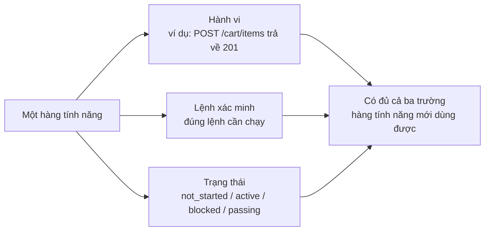

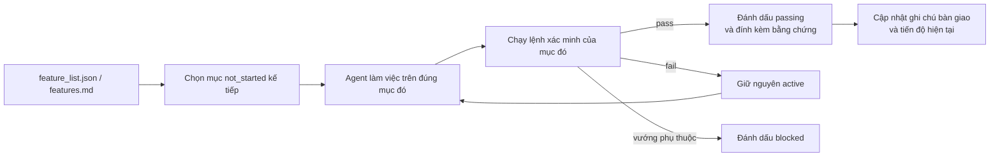

#### Các khái niệm cốt lõi

- **Feature list là nguyên thuỷ của harness**: Không phải "công cụ lập kế hoạch tuỳ chọn", mà là cấu trúc dữ liệu nền mà mọi thành phần harness khác đều phụ thuộc. Bộ lập lịch, bộ xác minh và trình báo cáo bàn giao đều cần đọc feature list mới vận hành được.
- **Cấu trúc ba trường**: Mỗi mục tính năng gồm ba yếu tố: `(mô tả hành vi, lệnh xác minh, trạng thái hiện tại)`. Hành vi chỉ cho agent biết cần làm gì, lệnh xác minh cho biết cái gì tính là xong, trạng thái cho biết mọi thứ đang tới đâu. Thiếu một yếu tố thì mục đó chưa hoàn chỉnh.
- **Mô hình máy trạng thái**: Mỗi mục có bốn trạng thái: `not_started`, `active`, `blocked`, `passing`. Chuyển trạng thái do harness kiểm soát, agent không được tự ý đổi.
- **Cổng trạng thái pass (Pass-state gating)**: Cách duy nhất để một tính năng đi từ `active` sang `passing` là lệnh xác minh chạy thành công. Chuyển trạng thái này là một chiều, một khi `passing` rồi thì không quay lại được.
- **Nguồn sự thật duy nhất**: Mọi thông tin về "cần làm gì" phải bắt nguồn từ một feature list. Không có mâu thuẫn giữa feature list và lịch sử hội thoại.
- **Áp lực ngược (Back-pressure)**: Số tính năng chưa pass chính là áp lực mà harness đặt lên agent. Áp lực bằng không tức dự án hoàn thành.

#### Vì sao feature list phải là "nguyên thuỷ"

Tài liệu là để người đọc, nguyên thuỷ là để hệ thống thực thi. Tài liệu có thể bị bỏ qua, nguyên thuỷ thì hệ thống không thể vượt qua.

Hãy hình dung như ràng buộc trigger trong cơ sở dữ liệu so với kiểm tra ở tầng ứng dụng: cái trước do engine cơ sở dữ liệu ép, không có câu SQL nào bỏ qua được; cái sau phụ thuộc vào tính đúng đắn của code ứng dụng và có thể vô tình bị lách. Feature list với tư cách nguyên thuỷ harness đóng đúng vai trò của ràng buộc mức cơ sở dữ liệu, agent không thể lách.

Cụ thể, feature list phục vụ bốn thành phần harness:

1. **Bộ lập lịch (Scheduler)**: Đọc trạng thái, chọn tính năng `not_started` kế tiếp.
2. **Bộ xác minh (Verifier)**: Chạy lệnh xác minh, quyết định có cho phép chuyển trạng thái hay không.
3. **Trình báo cáo bàn giao (Handoff Reporter)**: Tự động sinh tóm tắt bàn giao phiên từ feature list.
4. **Trình theo dõi tiến độ (Progress Tracker)**: Thống kê phân bố trạng thái, cung cấp chỉ số sức khoẻ dự án.

#### Cách làm đúng

##### 1. Định nghĩa định dạng feature list tối giản

Bạn không cần hệ thống phức tạp, một tệp Markdown hoặc JSON có cấu trúc là đủ. Điều quan trọng là mỗi mục phải có đủ bộ ba:

```json
{
  "id": "F03",
  "behavior": "POST /cart/items với {product_id, quantity} trả về 201",
  "verification": "curl -X POST http://localhost:3000/api/cart/items -H 'Content-Type: application/json' -d '{\"product_id\":1,\"quantity\":2}' | jq .status == 201",
  "state": "passing",
  "evidence": "commit abc123, test output log"
}
```

##### 2. Để harness kiểm soát chuyển trạng thái

Agent không được trực tiếp đổi trạng thái một tính năng thành `passing`. Nó chỉ có thể gửi yêu cầu xác minh. Harness chạy lệnh xác minh và quyết định có cho phép chuyển hay không. Đó chính là "pass-state gating".

##### 3. Viết quy tắc trong CLAUDE.md

```
## Quy tắc feature list
- Tệp feature list: /docs/features.md
- Chỉ một tính năng ở trạng thái active tại một thời điểm
- Lệnh xác minh phải pass trước khi đánh dấu passing
- Không tự ý sửa trạng thái feature list, script xác minh sẽ tự cập nhật
```

##### 4. Hiệu chỉnh độ hạt

Mỗi mục tính năng nên có phạm vi "hoàn thành được trong một phiên". Quá rộng thì không xong, quá hẹp thì overhead quản lý phình lên. "Người dùng có thể thêm sản phẩm vào giỏ" là độ hạt vừa đẹp. "Triển khai giỏ hàng" là quá rộng. "Tạo trường tên trên Cart model" là quá hẹp. Cũng giống như cắt miếng bít tết, không phải cả tảng, cũng không phải thịt băm nhỏ.

#### Câu chuyện thật

Một nền tảng thương mại điện tử với 10 tính năng. Hai cách theo dõi đặt cạnh nhau:

**Chế độ ghi chú**: Agent dùng ghi chú không cấu trúc để theo dõi tiến độ. Sau 3 phiên, ghi chú trở thành "đã làm xác thực người dùng và danh sách sản phẩm, giỏ hàng hầu như xong nhưng có bug, thanh toán chưa bắt đầu". Phiên mới cần 20 phút để dò trạng thái, và cuối cùng vẫn triển khai lại các tính năng đã xong. Cũng giống như danh sách đi chợ ghi "sữa, bánh mì, với cả cái đó", đứng giữa siêu thị bạn vẫn chẳng biết nên mua gì.

**Chế độ có cấu trúc**: Mỗi tính năng có trạng thái và lệnh xác minh rõ ràng. Phiên mới đọc feature list và trong 3 phút đã biết: F01-F05 đang `passing`, F06 đang `active` (đang triển khai), F07-F10 đang `not_started`. Nối tiếp thẳng vào F06, không có phần việc nào phải làm lại.

Một danh sách có cấu trúc đặt trạng thái và lệnh xác minh của từng tính năng vào một chỗ, nên phiên mới biết cái gì đã xong.

#### Những điểm chính cần nhớ

- **Feature list là cấu trúc nền của harness**, không phải ghi chú cho người. Bộ lập lịch, bộ xác minh và trình báo cáo bàn giao đều dựa vào nó.
- **Mỗi mục tính năng phải có đủ bộ ba**: mô tả hành vi, lệnh xác minh và trạng thái hiện tại. Thiếu một yếu tố thì mục chưa hoàn chỉnh, cũng như ghế ba chân mà mất một chân.
- **Chuyển trạng thái do harness kiểm soát**, agent không tự ý đổi được. Pass xác minh là con đường nâng cấp duy nhất.
- **Feature list là nguồn sự thật duy nhất của dự án**, mọi thông tin dạng "cần làm gì" đều bắt nguồn từ đó.
- **Hiệu chỉnh độ hạt về mức "hoàn thành được trong một phiên"**, quá rộng thì không xong, quá hẹp thì không quản lý nổi.

#### Đọc thêm

- [Building Effective Agents - Anthropic](https://www.anthropic.com/research/building-effective-agents) — Xác định rõ feature list là "cấu trúc dữ liệu cốt lõi" để kiểm soát phạm vi agent
- [Harness Engineering - OpenAI](https://openai.com/index/harness-engineering/) — Nhấn mạnh nguyên tắc "đưa artifact ra ngoài"
- [Design by Contract - Bertrand Meyer](https://www.goodreads.com/en/book/show/946106.Object_Oriented_Software_Construction) — Nguyên tắc thiết kế theo hợp đồng, nền tảng lý thuyết của feature list
- [How Google Tests Software](https://books.google.dk/books/about/How_Google_Tests_Software.html?id=VrAx1ATf-RoC&redir_esc=y) — Tháp kiểm thử và thực hành kỹ thuật đặc tả hành vi

#### Bài tập

1. **Thiết kế feature list**: Định nghĩa một JSON schema feature list tối giản. Bao gồm: id, mô tả hành vi, lệnh xác minh, trạng thái hiện tại, tham chiếu bằng chứng. Dùng nó để mô tả một dự án thật với 5 tính năng.

2. **So sánh độ khắt khe của xác minh**: Chọn 3 tính năng và thiết kế cả xác minh "lỏng" (ví dụ: "code không có lỗi cú pháp") lẫn xác minh "nghiêm" (ví dụ: "test end-to-end pass"). So sánh tỷ lệ dương tính giữa hai cách.

3. **Kiểm toán nguyên tắc nguồn duy nhất**: Rà một dự án agent hiện có, kiểm tra thông tin phạm vi có mâu thuẫn với feature list hay không (yêu cầu ngầm trong hội thoại, TODO trong code, v.v.). Thiết kế kế hoạch để hợp nhất tất cả thông tin về feature list.

---

## Phần 5 · Xác minh — chống tuyên bố sớm và end-to-end — ≈23 phút

“Agent nói xong” chưa phải là xong: hai bài dựng hệ thống xác minh độc lập, từ kiểm tra ba lớp đến end-to-end testing.

### Bài 09. Ngăn chặn agent tuyên bố thành công quá sớm

> Code ví dụ cho bài giảng này: [code/](https://github.com/walkinglabs/learn-harness-engineering/blob/main/docs/vi/lectures/lecture-09-why-agents-declare-victory-too-early/code/)
> Thực hành: [Dự án 05. Để agent tự xác minh công việc của mình](https://github.com/walkinglabs/learn-harness-engineering/blob/main/docs/vi/projects/project-05-grounded-qa-verification/index.md)

Bạn yêu cầu agent triển khai tính năng "đặt lại mật khẩu". Nó sửa schema cơ sở dữ liệu, viết API endpoint, thêm mẫu email, chạy unit test (tất cả pass) rồi đầy tự tin thông báo "xong rồi". Nhưng đến khi bạn thử chạy thật, liên kết đặt lại mật khẩu gửi không đi vì thiếu cấu hình dịch vụ email; migration cơ sở dữ liệu lỗi giữa chừng, để lại schema không nhất quán; toàn bộ luồng end-to-end chưa hề được chạy dù chỉ một lần.

Đây không phải sự cố cá biệt. Bài báo ICML kinh điển năm 2017 của Guo và cộng sự đã chứng minh: **các mạng nơ-ron hiện đại tự tin thái quá một cách có hệ thống**, độ tự tin mà mô hình báo cáo cao hơn nhiều so với độ chính xác thực tế. AI coding agent cũng không ngoại lệ. Chúng "cảm thấy" xong, nhưng thực tế còn xa mới xong. Harness của bạn phải thay "cảm giác" của agent bằng sự xác minh dựa trên thực thi từ bên ngoài.

#### Con dốc trơn trượt

Tuyên bố hoàn thành sớm hầu như luôn đi theo đúng một kịch bản: code trông có vẻ ổn, cú pháp đúng, logic có vẻ hợp lý, phân tích tĩnh không thấy lỗi rõ ràng. Nhưng harness không ép buộc xác minh thực thi toàn diện, nên agent bỏ qua bước thực sự chạy thử, hoặc chỉ chạy một phần test. Nó chạy unit test nhưng bỏ qua integration test; nó chạy test nhưng không kiểm tra coverage. Cuối cùng, "code trông có vẻ ổn" được coi là bằng chứng cho "tính năng đã hoàn thành".

Thông tin bị hao hụt ở mỗi bước. Từ đặc tả tác vụ sang triển khai code rồi sang hành vi runtime, mỗi lần chuyển đổi đều có thể đưa vào sai lệch, và mỗi bước xác minh bị bỏ qua lại càng khiến sự bất đối xứng thông tin trầm trọng thêm.

#### Kiểm tra kết thúc ba lớp

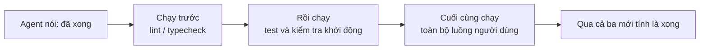

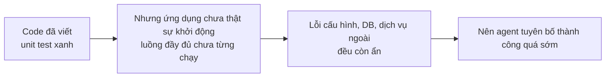

#### Các khái niệm cốt lõi

- **Tuyên bố hoàn thành sớm (Premature Completion Declaration)**: Agent khẳng định tác vụ xong, nhưng vẫn còn đặc tả đúng đắn chưa được đáp ứng. Bản chất vấn đề: agent phán xét dựa trên sự tự tin cục bộ ở cấp code, trong khi tính đúng đắn ở cấp hệ thống đòi hỏi xác minh tổng thể.
- **Sai lệch hiệu chuẩn độ tự tin (Confidence Calibration Bias)**: Khoảng cách có hệ thống giữa độ tự tin hoàn thành tự báo cáo của agent và chất lượng hoàn thành thực tế. Với tác vụ đa tệp phức tạp, sai lệch này dương rõ rệt, agent luôn tự tin hơn thực lực của mình.
- **Tiêu chí kết thúc (Termination Criteria)**: Tập hợp điều kiện phán xét rõ ràng, có thể thực thi, do harness quy định. Agent phải thoả mãn mọi điều kiện trước khi tuyên bố hoàn thành. "Xong" chuyển từ phán đoán chủ quan sang xác định khách quan.
- **Cổng kép xác minh - xác nhận (Verification-Validation Dual Gate)**: Lớp xác minh kiểm tra "code có triển khai đúng hành vi được chỉ định không", lớp xác nhận kiểm tra "hành vi cấp hệ thống có đáp ứng yêu cầu end-to-end không". Cả hai phải qua mới tính là hoàn thành.
- **Tín hiệu phản hồi runtime (Runtime Feedback Signals)**: Logs, trạng thái tiến trình và health check từ quá trình thực thi chương trình. Đây là cơ sở khách quan để harness đánh giá chất lượng hoàn thành.
- **Ràng buộc ưu tiên hoàn thành (Completion Priority Constraint)**: Xác minh tính đúng đắn của chức năng trước, xử lý hiệu năng sau, rồi mới đến phong cách. Không tái cấu trúc khi chức năng cốt lõi chưa được xác minh.

#### Pass unit test không có nghĩa là tác vụ hoàn thành

Đây là cạm bẫy phổ biến nhất và cũng nguy hiểm nhất. Agent viết code, chạy unit test, tất cả xanh, rồi nói "xong". Nhưng triết lý thiết kế của unit test, cô lập đơn vị cần kiểm tra và mock các phụ thuộc, chính là điều khiến chúng không có khả năng phát hiện vấn đề xuyên thành phần:

**Không khớp giao diện (Interface Mismatch)**: Renderer truyền một đường dẫn tương đối cho preload script, nhưng preload script kỳ vọng đường dẫn tuyệt đối. Unit test của mỗi bên đều dùng mock và đều pass. Vấn đề chỉ lộ ra khi chạy end-to-end.

**Lỗi lan truyền trạng thái (State Propagation Errors)**: Một migration cơ sở dữ liệu thay đổi schema bảng, nhưng lớp cache của ORM vẫn giữ các mục cache cho schema cũ. Unit test mỗi lần chạy trong môi trường mock mới, nên kiểu không nhất quán trạng thái xuyên lớp này không bao giờ lộ ra.

**Phụ thuộc môi trường (Environment Dependency)**: Code chạy đúng trong môi trường test (mọi thứ đều được mock) nhưng hỏng trong môi trường thật vì khác biệt cấu hình, độ trễ mạng hoặc dịch vụ không khả dụng.

##### "Tiện thể tái cấu trúc luôn" là thuốc độc với phán đoán hoàn thành

Claude Code có một kiểu hành vi khá phổ biến: nó bắt đầu tái cấu trúc code, tối ưu hiệu năng và cải thiện phong cách trước khi chức năng cốt lõi qua được xác minh. Câu nói "tối ưu sớm là nguồn gốc của mọi tội lỗi" của Knuth mang một ý nghĩa mới trong kịch bản agent, tái cấu trúc làm thay đổi ranh giới giữa phần code đã xác minh và chưa xác minh, có nguy cơ phá vỡ những đường đi trước đó vốn ngầm đúng.

##### Sai lệch có hệ thống trong tự đánh giá

Nghiên cứu năm 2026 của Anthropic phát hiện một mô hình thất bại sâu hơn: **khi một agent được yêu cầu tự đánh giá công việc của chính nó, nó sẽ đưa ra phán đoán tích cực thái quá một cách có hệ thống, ngay cả khi một người quan sát bình thường đánh giá chất lượng rõ ràng là dưới chuẩn.**

Vấn đề này đặc biệt nghiêm trọng với tác vụ mang tính chủ quan (ví dụ thẩm mỹ thiết kế). "Bố cục có tinh tế hay không" là một phán đoán, và agent luôn nghiêng rõ rệt về phía tích cực. Ngay cả với tác vụ có thể kiểm chứng kết quả, khả năng phán đoán kém của agent cũng kéo hiệu quả xuống.

Giải pháp không phải làm cho agent "khách quan hơn", cùng một mô hình vừa tạo vừa đánh giá, vốn luôn có xu hướng hào phóng với chính mình. **Giải pháp là tách "người làm" ra khỏi "người kiểm".**

Một agent đánh giá độc lập, được tinh chỉnh để cố tình "kén chọn", hiệu quả hơn nhiều so với việc để agent tạo tự đánh giá. Dữ liệu thực nghiệm từ Anthropic:

| Kiến trúc | Thời gian chạy | Chi phí | Tính năng cốt lõi chạy được không? |
|--------------|---------|------|------------------------|
| Một agent (chạy trần) | 20 phút | $9 | Không (các thực thể trong trò chơi không phản hồi input) |
| Ba agent (planner + generator + evaluator) | 6 giờ | $200 | Gameplay cốt lõi chạy được; vật lý và màn chơi vẫn còn vấn đề |

Đây là cùng một mô hình (Opus 4.5) với cùng một prompt ("xây dựng trình tạo trò chơi retro 2D"). Điểm khác biệt duy nhất nằm ở harness: từ "chạy trần" sang "planner mở rộng yêu cầu, generator triển khai từng tính năng, evaluator thực sự bấm thử bằng Playwright".

> Nguồn: [Anthropic: Harness design for long-running application development](https://www.anthropic.com/engineering/harness-design-long-running-apps)

#### Cách ngăn chặn tuyên bố thành công sớm

##### 1. Đưa phán đoán kết thúc ra ngoài agent

Phán đoán hoàn thành không nên do chính agent đưa ra. Harness độc lập thực thi xác nhận kết thúc, dùng tín hiệu runtime làm đầu vào thay vì độ tự tin của agent. Trong `CLAUDE.md`, bạn có thể ghi rõ:

```
## Định nghĩa hoàn thành
- Tính năng hoàn thành = xác minh end-to-end đã qua, không phải "code đã viết"
- Các cấp xác minh bắt buộc:
  1. Unit tests pass
  2. Integration tests pass
  3. End-to-end flow verification passes
- Không chuyển sang cấp 2 nếu cấp 1 fail
- Không chuyển sang cấp 3 nếu cấp 2 fail
```

##### 2. Xây dựng xác nhận kết thúc ba lớp

- **Lớp 1: Cú pháp và phân tích tĩnh**. Chi phí thấp nhất, ít thông tin nhất, nhưng phải pass. Đây là mức tối thiểu, bạn phải đánh vần đúng từ ngữ trước khi xét tiếp.
- **Lớp 2: Xác minh hành vi runtime**. Thực thi test, kiểm tra khởi động ứng dụng, xác nhận các đường đi quan trọng. Đây là bằng chứng cốt lõi của việc hoàn thành, không chỉ viết ra, mà còn phải chạy được.
- **Lớp 3: Xác nhận cấp hệ thống**. Kiểm thử end-to-end, xác nhận tích hợp, mô phỏng kịch bản người dùng. Tuyến phòng thủ cuối cùng chống lại tuyên bố sớm, không chỉ chạy được, mà còn phải chạy đúng.

##### 3. Thiết kế thông báo lỗi có kèm hướng dẫn sửa cho agent

OpenAI giới thiệu một mẫu đặc biệt hiệu quả trong thực hành Codex: **thông báo lỗi viết cho agent phải kèm hướng dẫn sửa chữa.** Đừng chỉ nói "sai rồi", hãy chỉ rõ sai ở đâu và sửa thế nào. Đừng dùng `"Test failed"`, hãy dùng `"Test failed: POST /api/reset-password returned 500. Check that the email service config exists in environment variables. The template file should be at templates/reset-email.html."` Phản hồi cụ thể, có thể hành động được như thế giúp agent tự sửa mà không cần con người can thiệp.

##### 4. Thu thập tín hiệu runtime

Các tín hiệu runtime hiệu quả gồm:
- Ứng dụng có khởi động thành công và đạt trạng thái sẵn sàng không?
- Các đường đi tính năng quan trọng có thực thi thành công ở runtime không?
- Thao tác ghi cơ sở dữ liệu, thao tác tệp và các side effect khác có đúng không?
- Tài nguyên tạm có được dọn dẹp không?

#### Câu chuyện thật

**Tác vụ**: Triển khai chức năng đặt lại mật khẩu người dùng. Liên quan đến thao tác cơ sở dữ liệu, gửi email và sửa API endpoint.

**Con đường nộp sớm**: Agent sửa schema cơ sở dữ liệu, viết API endpoint, thêm mẫu email, chạy unit test (pass) và tuyên bố hoàn thành. Trông như thể rất nhiều thứ đã được làm, nhưng các bước then chốt đều bị bỏ qua.

**Những điểm bị bỏ sót thật sự**: (1) Luồng end-to-end chưa từng được kiểm tra, việc gửi và xác minh thật sự liên kết đặt lại chưa bao giờ được xác nhận. (2) Migration cơ sở dữ liệu lỗi sau khi thực thi một phần, để lại schema không nhất quán. (3) Cấu hình dịch vụ email bị thiếu trong môi trường đích.

**Harness can thiệp**: Xác nhận kết thúc được thực thi, (1) khởi động toàn bộ ứng dụng để xác minh endpoint đặt lại truy cập được; (2) chạy toàn bộ luồng đặt lại; (3) xác minh tính nhất quán trạng thái cơ sở dữ liệu. Cả ba khiếm khuyết đều lộ ra ngay trong phiên, khi chi phí sửa vẫn còn cục bộ.

#### Những điểm chính cần nhớ

- **Agent tự tin thái quá một cách có hệ thống**, sai lệch hiệu chuẩn độ tự tin là thực tế khách quan. Code được viết ra không có nghĩa là viết đúng.
- **Phán đoán hoàn thành phải được đưa ra ngoài**, harness tự xác minh độc lập. Đừng tin "cảm giác" của agent.
- **Cả ba lớp xác nhận đều cần thiết**: cú pháp pass, hành vi pass, hệ thống pass, tiến từng lớp một, không cắt tắt.
- **Thông báo lỗi nên bao gồm bước sửa cụ thể**, giúp agent tự điều chỉnh thay vì chỉ biết "sai rồi".
- **Không tái cấu trúc khi chức năng cốt lõi chưa được xác minh**, ràng buộc ưu tiên hoàn thành chính là chìa khoá ngăn chặn tối ưu hoá sớm.

#### Đọc thêm

- [On Calibration of Modern Neural Networks - Guo et al.](https://arxiv.org/abs/1706.04599) — Chứng minh các mạng sâu hiện đại tự tin thái quá có hệ thống
- [Building Effective Agents - Anthropic](https://www.anthropic.com/research/building-effective-agents) — Vai trò cốt lõi của bằng chứng runtime trong phán đoán hoàn thành
- [Harness Engineering - OpenAI](https://openai.com/index/harness-engineering/) — Tuyên bố hoàn thành sớm là một trong các chế độ thất bại chính của agent
- [The Art of Software Testing - Myers](https://www.goodreads.com/book/show/137543.The_Art_of_Software_Testing) — Tài liệu kinh điển về phân cấp và hiệu quả phương pháp kiểm thử

#### Bài tập

1. **Thiết kế quy trình xác nhận kết thúc**: Thiết kế một quy trình xác nhận kết thúc hoàn chỉnh cho tác vụ liên quan đến migration cơ sở dữ liệu và sửa API. Liệt kê các tín hiệu runtime cần thiết và tiêu chí pass/fail cho từng tín hiệu. Chạy trên một tác vụ thật và ghi lại những vấn đề ẩn mà nó phát hiện.

2. **Đo lường sai lệch hiệu chuẩn**: Chọn 10 tác vụ lập trình thuộc các loại khác nhau. Ghi lại độ tự tin hoàn thành tự báo cáo của agent cùng chất lượng hoàn thành thực tế. Tính sai lệch và phân tích mối liên hệ với độ phức tạp của tác vụ.

3. **Thí nghiệm phòng thủ đa lớp**: Chạy ba cấu hình trên cùng bộ tác vụ: (a) chỉ phân tích tĩnh, (b) thêm unit testing, (c) xác nhận đầy đủ ba lớp. So sánh tỷ lệ tuyên bố hoàn thành sớm và số khiếm khuyết không bị phát hiện.

### Bài 10. Chỉ chạy toàn bộ pipeline mới tính là xác minh thật sự

> Code ví dụ cho bài giảng này: [code/](https://github.com/walkinglabs/learn-harness-engineering/blob/main/docs/vi/lectures/lecture-10-why-end-to-end-testing-changes-results/code/)
> Thực hành: [Dự án 05. Để agent xác minh công việc của chính nó](https://github.com/walkinglabs/learn-harness-engineering/blob/main/docs/vi/projects/project-05-grounded-qa-verification/index.md)

Bạn yêu cầu agent thêm tính năng xuất tệp vào ứng dụng Electron. Nó viết component cho renderer, preload script và logic lớp service. Unit test cho từng component đều pass. Agent báo "xong rồi". Bạn nhấn thật vào nút xuất, định dạng đường dẫn tệp sai, thanh tiến trình không phản hồi, xuất tệp lớn thì rò rỉ bộ nhớ. Năm lỗi ở ranh giới component, và unit test chẳng bắt được cái nào.

Từng phần nhìn "đúng" khi đứng riêng, nhưng vấn đề lộ ra ngay khi chúng nối vào nhau. Tháp kiểm thử của Google cho thấy một nền unit test lớn là thiết yếu, nhưng dừng ở đó thì bạn sẽ bỏ lỡ có hệ thống các vấn đề tương tác giữa component. Với AI coding agent, chuyện này càng tệ hơn, vì agent có xu hướng chỉ chạy những test nhanh nhất rồi tuyên bố hoàn thành. **Chỉ kiểm thử toàn bộ quy trình mới chứng minh được rằng không có khiếm khuyết ở cấp hệ thống.**

#### Điểm mù của unit test

Triết lý thiết kế của unit test là cô lập: mock phụ thuộc, tập trung vào đơn vị đang xét. Triết lý ấy giúp unit test nhanh và chính xác, nhưng cũng tạo ra các điểm mù có hệ thống. Từng module chạy hoàn hảo khi cô lập, nhưng những nhóm vấn đề sau chỉ lộ ra khi mọi thứ vận hành cùng nhau:

**Không khớp giao diện**: Renderer truyền cho preload script một đường dẫn tương đối, nhưng preload script lại kỳ vọng đường dẫn tuyệt đối. Unit test của mỗi bên đều dùng mock và đều pass. Vấn đề chỉ lộ khi luồng end-to-end thật sự được chạy.

**Lỗi lan truyền trạng thái**: Một migration cơ sở dữ liệu đổi schema bảng, nhưng lớp cache ORM vẫn giữ các mục cache theo schema cũ. Unit test mỗi lần lại dựng môi trường mock mới, nên kiểu không nhất quán trạng thái xuyên lớp này chẳng bao giờ lộ ra.

**Vấn đề vòng đời tài nguyên**: Việc cấp phát và giải phóng file handle, kết nối cơ sở dữ liệu, network socket trải dài trên nhiều component. Unit test tạo và dọn tài nguyên độc lập cho từng test case, nên không bắt được tranh chấp hay rò rỉ tài nguyên.

**Phụ thuộc môi trường**: Code chạy đúng trong môi trường test (mọi thứ đều mock) nhưng hỏng trong môi trường thật vì khác biệt cấu hình, độ trễ mạng hoặc dịch vụ không khả dụng.

#### Kiểm thử toàn bộ quy trình không chỉ thay đổi kết quả, mà thay đổi cả hành vi

Điểm này nhiều người không nhận ra: khi agent biết công việc của mình sẽ được xác minh bằng test toàn bộ quy trình, cách viết code của nó thay đổi.

1. **Cân nhắc tương tác giữa component**: Trong khi viết code, nó bắt đầu đặt câu hỏi "giao diện này kết nối thế nào với phía trên?" thay vì chỉ chăm chú vào một hàm riêng lẻ.
2. **Tôn trọng ranh giới kiến trúc**: Trong hệ thống có ràng buộc kiến trúc, test toàn bộ quy trình ép agent phải tuân thủ các quy tắc ranh giới.
3. **Xử lý đường lỗi**: Test toàn bộ quy trình thường kèm kịch bản thất bại, buộc agent phải nghĩ tới xử lý ngoại lệ.

#### Tháp kiểm thử và thăng cấp phản hồi review

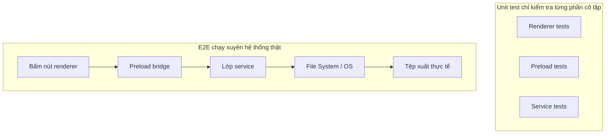

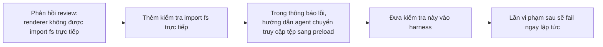

Trong thực hành Codex, OpenAI nhấn mạnh: **thông báo lỗi viết cho agent phải kèm hướng dẫn sửa chữa.** Đừng chỉ viết `"Direct filesystem access in renderer"`, hãy viết `"Direct filesystem access in renderer. All file operations must go through the preload bridge. Move this call to preload/file-ops.ts and invoke it via window.api."` Như vậy quy tắc kiến trúc biến thành một vòng lặp tự sửa. Thông báo lỗi không chỉ nói "sai ở đâu", mà còn nói "sửa thế nào", giúp agent tự điều chỉnh.

#### Các khái niệm cốt lõi

- **Khiếm khuyết ở ranh giới component (Component Boundary Defects)**: Component A và B đều pass unit test riêng, nhưng cách chúng tương tác lại sinh hành vi sai. Đây là nhóm vấn đề mà test toàn bộ quy trình bắt giỏi nhất.
- **Gradient đầy đủ kiểm thử (Testing Adequacy Gradient)**: Khiếm khuyết unit test bắt được, số lượng bằng hoặc ít hơn nhóm mà integration test bắt được; nhóm integration test bắt được lại bằng hoặc ít hơn nhóm mà end-to-end test bắt được. Khả năng phát hiện tăng dần theo từng tầng.
- **Quy tắc thực thi ranh giới kiến trúc (Architectural Boundary Enforcement Rules)**: Biến các quy tắc trong tài liệu kiến trúc (ví dụ "renderer process không được truy cập trực tiếp hệ thống tệp") thành các kiểm tra tự động có thể thực thi, từ "viết trên giấy" thành "chạy trong CI".
- **Thăng cấp phản hồi review (Review Feedback Promotion)**: Chuyển các nhận xét code review lặp đi lặp lại thành test tự động. Mỗi lần phát hiện thêm một loại vấn đề lặp, thêm một quy tắc, và harness tự động mạnh lên.
- **Thông báo lỗi hướng agent (Agent-Oriented Error Messages)**: Thông báo lỗi không chỉ nêu "sai ở đâu" mà còn chỉ cho agent cách sửa cụ thể, biến test fail thành vòng phản hồi tự sửa.

#### Cách thực hiện

##### 0. Định nghĩa ranh giới kiến trúc trước khi viết test toàn bộ quy trình

Điều kiện tiên quyết của test toàn bộ quy trình là hệ thống có ranh giới rõ ràng. Nếu kiến trúc là một đĩa mì xào bò, test toàn bộ quy trình chỉ chứng minh "đĩa mì này chạy được", chứ không cho biết ý đồ thiết kế bị vi phạm ở đâu.

Kinh nghiệm của OpenAI: **với codebase do agent tạo ra, ràng buộc kiến trúc phải được thiết lập như điều kiện tiên quyết ngay từ ngày đầu tiên, chứ không phải thứ phải xem xét lại khi nhóm đã lớn.** Lý do rất đơn giản: agent sao chép các pattern đang có trong kho lưu trữ, ngay cả khi những pattern ấy không nhất quán hoặc chưa tối ưu. Không có ràng buộc kiến trúc, agent sẽ đưa thêm sai lệch vào mỗi phiên.

OpenAI áp dụng "Kiến trúc miền phân lớp", mỗi domain nghiệp vụ được chia thành các lớp cố định: Types → Config → Repo → Service → Runtime → UI. Phụ thuộc chảy nghiêm ngặt về phía trước, và mối quan tâm xuyên domain đi vào qua các interface Provider tường minh. Mọi phụ thuộc khác đều bị cấm và được thực thi cơ học bằng linting tuỳ chỉnh.

Nguyên tắc cốt lõi: **thực thi bất biến, đừng vi quản lý triển khai.** Ví dụ, yêu cầu "dữ liệu được parse tại ranh giới", nhưng không bắt buộc dùng thư viện nào. Thông báo lỗi phải kèm hướng dẫn sửa, không chỉ nói "vi phạm" mà phải nói rõ cách thay đổi.

> Nguồn: [OpenAI: Harness engineering: leveraging Codex in an agent-first world](https://openai.com/index/harness-engineering/)

##### 1. Harness phải bao gồm một lớp end-to-end

Ghi rõ trong luồng xác minh: với tác vụ liên quan đến thay đổi xuyên component, pass test toàn bộ quy trình là điều kiện tiên quyết để hoàn thành:

```
## Thứ bậc xác minh
- Mức 1: Unit test (bắt buộc pass)
- Mức 2: Integration test (bắt buộc pass)
- Mức 3: End-to-end test (bắt buộc pass khi có thay đổi xuyên component)
- Bỏ qua bất kỳ mức bắt buộc nào = chưa hoàn thành
```

##### 2. Biến quy tắc kiến trúc thành kiểm tra có thể thực thi

Mỗi ràng buộc kiến trúc nên có một test hoặc quy tắc lint tương ứng:

```bash
# Kiểm tra renderer process có gọi trực tiếp Node.js API không
grep -r "require('fs')" src/renderer/ && exit 1 || echo "OK: no direct fs access in renderer"
```

##### 3. Thiết kế thông báo lỗi hướng agent

Thông báo lỗi nên chứa ba yếu tố: sai ở đâu, vì sao, và sửa thế nào:

```
LỖI: Phát hiện import trực tiếp 'fs' trong src/renderer/App.tsx:12
VÌ SAO: Renderer process không có quyền truy cập Node.js API vì lý do bảo mật
CÁCH SỬA: Chuyển thao tác tệp sang src/preload/file-ops.ts và gọi qua window.api.readFile()
```

##### 4. Thiết lập quy trình thăng cấp phản hồi review

Mỗi lần phát hiện một loại lỗi agent mới trong code review, hãy biến nó thành kiểm tra tự động. Một tháng sau, harness của bạn sẽ mạnh hơn rất nhiều so với đầu tháng.

#### Câu chuyện thật

**Tác vụ**: Triển khai tính năng xuất tệp trong ứng dụng Electron. Liên quan đến UI của renderer, proxy hệ thống tệp của preload script và chuyển đổi dữ liệu lớp service.

**Giai đoạn unit test**: Test component renderer (pass, thao tác tệp được mock), test preload script (pass, filesystem được mock), test lớp service (pass, nguồn dữ liệu được mock). Agent tuyên bố hoàn thành.

**Khiếm khuyết được end-to-end test phơi bày**:

| Khiếm khuyết | Mô tả | Unit Test | E2E |
|--------|-------------|-----------|-----|
| Không khớp giao diện | Định dạng đường dẫn tệp không nhất quán | Bỏ sót | Bắt được |
| Lan truyền trạng thái | Tiến trình xuất không được gửi ngược về UI qua IPC | Bỏ sót | Bắt được |
| Rò rỉ tài nguyên | File handle của lệnh xuất tệp lớn không được giải phóng | Bỏ sót | Bắt được |
| Vấn đề quyền | Quyền khác nhau trong môi trường đã đóng gói | Bỏ sót | Bắt được |
| Lan truyền lỗi | Ngoại lệ lớp service không đến được lớp UI | Bỏ sót | Bắt được |

Cả 5 khiếm khuyết đều bị end-to-end test bắt, unit test không bắt được cái nào. Chạy end-to-end chậm hơn, nhưng chi phí đó nhỏ so với việc đưa năm khiếm khuyết biên ra bản phát hành.

#### Những điểm chính cần nhớ

- **Unit test mù có hệ thống với khiếm khuyết ở ranh giới component**: thiết kế cô lập của chúng chính là điều ngăn chúng phát hiện vấn đề tương tác.
- **Test toàn bộ quy trình không chỉ phát hiện khiếm khuyết, mà thay đổi cả cách agent viết code**, giúp nó tập trung hơn vào tích hợp và ranh giới.
- **Quy tắc kiến trúc phải có thể thực thi**, không viết trong tài liệu để chờ người đọc, mà tự động kiểm tra trên mỗi commit.
- **Thông báo lỗi phải thiết kế cho agent**, kèm bước sửa cụ thể để hình thành vòng lặp tự sửa.
- **Thăng cấp phản hồi review khiến harness tự động mạnh lên**, mỗi loại khiếm khuyết bắt được trở thành một tuyến phòng thủ vĩnh viễn.

#### Đọc thêm

- [How Google Tests Software - Whittaker et al.](https://books.google.dk/books/about/How_Google_Tests_Software.html?id=VrAx1ATf-RoC&redir_esc=y) — Nguồn gốc kinh điển của mô hình Tháp kiểm thử
- [Harness Engineering - OpenAI](https://openai.com/index/harness-engineering/) — Thực hành kỹ thuật cho việc thực thi tự động ràng buộc kiến trúc
- [Chaos Engineering - Netflix (Basiri et al.)](https://ieeexplore.ieee.org/document/7466237) — Chủ động cấy lỗi để xác minh độ bền hệ thống
- [QuickCheck - Claessen & Hughes](https://www.cs.tufts.edu/~nr/cs257/archive/john-hughes/quick.pdf) — Phương pháp property testing, nằm giữa example testing và kiểm chứng hình thức

#### Bài tập

1. **Phát hiện khiếm khuyết xuyên component**: Chọn một tác vụ sửa đổi liên quan đến ít nhất ba component. Trước tiên chỉ chạy unit test rồi ghi lại kết quả, sau đó chạy end-to-end test. Phân tích mỗi khiếm khuyết phát hiện thêm, phân loại nó thuộc nhóm vấn đề tương tác xuyên lớp nào.

2. **Tự động hoá quy tắc kiến trúc**: Chọn một ràng buộc kiến trúc trong dự án và biến nó thành kiểm tra có thể thực thi (kèm thông báo lỗi hướng agent). Tích hợp vào harness rồi xác minh hiệu quả bằng một tác vụ baseline.

3. **Thăng cấp phản hồi review**: Tìm một loại nhận xét lặp đi lặp lại trong lịch sử code review và chuyển nó thành kiểm tra tự động theo quy trình năm bước. So sánh tần suất loại vấn đề đó trước và sau khi thăng cấp.

---

## Phần 6 · Quan sát — observability và bàn giao sạch — ≈27 phút

Không nhìn được vào runtime của agent thì không sửa được harness — và mỗi phiên kết thúc phải để lại trạng thái mà phiên sau bận ngay được.

### Bài 11. Làm cho runtime của agent có thể quan sát được

> Ví dụ code: [code/](https://github.com/walkinglabs/learn-harness-engineering/blob/main/docs/vi/lectures/lecture-11-why-observability-belongs-inside-the-harness/code/)
Bạn yêu cầu agent triển khai một tính năng. Nó chạy 20 phút, sửa một đống tệp, rồi báo "xong, nhưng hai test đang fail". Bạn hỏi vì sao fail, "không chắc, có khi là vấn đề timing". Bạn hỏi nó đã thay đổi những đường đi quan trọng nào, "để tôi xem code thử...".

Kịch bản này quá phổ biến, và nguyên nhân không nằm ở năng lực agent, mà là harness thiếu khả năng quan sát. Khi agent thực thi tác vụ mà không nhìn thấy trạng thái runtime thật, mỗi quyết định của nó về cơ bản là một phỏng đoán.

**Không có khả năng quan sát, agent ra quyết định trong bất định, đánh giá trở thành phán xét chủ quan, và việc thử lại biến thành lang thang mù quáng.** Cả OpenAI và Anthropic đều coi độ tin cậy là một bài toán bằng chứng: harness phải phơi bày hành vi runtime và các tín hiệu đánh giá ở dạng thật sự có thể dẫn dắt quyết định kế tiếp.

#### Giá phải trả khi thiếu khả năng quan sát

Khi harness thiếu khả năng quan sát, bốn nhóm vấn đề sẽ xuất hiện có hệ thống.

**Không phân biệt được "đúng" với "trông có vẻ đúng".** Một hàm nhìn qua code review thì hoàn hảo, cú pháp đúng, logic ổn. Nhưng ở runtime, một lỗi xử lý biên sinh ra kết quả sai với input đặc biệt. Chỉ có runtime trace mới phơi bày được việc đường đi thực thi đã lệch khỏi kỳ vọng. Code review cho thấy "đã viết cái gì", runtime trace cho thấy "thật sự đã chạy cái gì". Cả hai đều cần.

**Đánh giá trở thành huyền bí.** Không có rubric chấm điểm và tiêu chí chấp nhận, người đánh giá (dù người hay agent) buộc phải dựa vào giả định ngầm. Cùng một đầu ra có thể bị các evaluator khác nhau đánh giá hoàn toàn trái ngược. Đánh giá chất lượng mất khả năng tái lập.

**Thử lại trở thành đoán mù.** Khi agent không biết vì sao một việc fail, hướng thử lại hoàn toàn ngẫu nhiên. Nó có khi sửa mãi những đường đi không liên quan, bỏ qua tận gốc nguyên nhân thật. Mỗi lần thử lại mù quáng đốt cả token lẫn thời gian.

**Vực thông tin lúc bàn giao phiên.** Khi phần việc chưa xong được chuyển cho phiên sau, thiếu khả năng quan sát đồng nghĩa với việc phiên mới phải chẩn đoán lại trạng thái hệ thống từ đầu. Phiên mới phải đọc lại code, chạy lại lệnh và quyết định tín hiệu nào quan trọng; [bản ghi tiến độ và xác minh được quản lý phiên bản](https://www.anthropic.com/engineering/effective-harnesses-for-long-running-agents) cung cấp trạng thái có thể kiểm tra.

#### Một kịch bản Claude Code thật

Hãy hình dung một harness dùng quy trình ba vai "planner-generator-evaluator", thực thi tác vụ "thêm dark mode cho ứng dụng".

**Không có khả năng quan sát:** Planner đưa ra mô tả mơ hồ. Generator triển khai dark mode dựa trên sự mơ hồ đó, nhưng kết quả không khớp với kỳ vọng ngầm của planner. Evaluator từ chối theo chuẩn ngầm của riêng mình mà không diễn đạt cụ thể được chỗ nào sai, chỉ biết "cảm giác không ổn". Generator thử lại mù quáng dựa trên lý do mơ hồ. Chu kỳ lặp 3-4 lần, mất khoảng 45 phút, và sản phẩm cuối cùng cũng chỉ tạm chấp nhận được.

**Có đầy đủ khả năng quan sát:** Planner đưa ra sprint contract, liệt kê component nào cần sửa, tiêu chuẩn xác minh cho từng cái, và các ngoại lệ (ví dụ không xử lý print styles). Generator triển khai theo contract, và khả năng quan sát runtime ghi lại quá trình tải style của từng component. Evaluator dùng rubric chấm điểm để đánh giá từng chiều, kèm bằng chứng cụ thể: "Độ tương phản màu nút chưa đạt (chuẩn WCAG AA 4.5:1, đo được 2.1:1)". Một vòng lặp cho ra kết quả chất lượng cao, trong khoảng 15 phút.

Sự khác biệt đến từ việc hợp đồng và bằng chứng có tồn tại bên ngoài đầu agent hay không.

#### Quan sát phân lớp

Khả năng quan sát không chỉ là "thêm logging". Nó vận hành trên hai lớp, cả hai đều cần thiết.

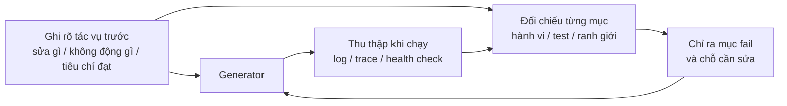

**Quan sát runtime:** Tín hiệu cấp hệ thống, gồm log, trace, sự kiện tiến trình, health check. Trả lời câu hỏi "hệ thống đã làm gì".

**Quan sát quá trình:** Tầm nhìn vào các artifact quyết định của harness, gồm kế hoạch, rubric chấm điểm, tiêu chí chấp nhận. Trả lời câu hỏi "vì sao thay đổi này nên được chấp nhận".

#### Các khái niệm cốt lõi

- **Quan sát runtime**: Tín hiệu cấp hệ thống, gồm log, trace, sự kiện tiến trình và health check. Trả lời "hệ thống đã làm gì".
- **Quan sát quá trình**: Tầm nhìn vào các artifact quyết định của harness, gồm kế hoạch, rubric chấm điểm, tiêu chí chấp nhận. Trả lời "vì sao thay đổi này nên được chấp nhận".
- **Task trace**: Bản ghi đầy đủ về đường đi quyết định từ khi bắt đầu tác vụ đến khi hoàn thành, tương tự request tracing trong hệ thống phân tán. Mỗi bước agent thực hiện, cùng ngữ cảnh, đều được ghi lại, để khi có trục trặc, bạn có thể tua lại toàn bộ quá trình.
- **Sprint contract**: Thoả thuận ngắn hạn được thương lượng trước khi viết code, chỉ rõ phạm vi tác vụ, tiêu chuẩn xác minh và các ngoại lệ. Công cụ cốt lõi của quan sát quá trình.
- **Evaluator rubric**: Biến đánh giá chất lượng từ phán xét chủ quan thành chấm điểm có cấu trúc dựa trên bằng chứng, để các evaluator khác nhau đi đến kết luận tương tự cho cùng một đầu ra.
- **Quan sát phân lớp**: Quan sát lớp hệ thống và lớp quá trình được thiết kế đồng thời, bổ trợ cho nhau. Tín hiệu runtime giải thích hành vi, artifact quá trình giải thích ý đồ.

#### Vì sao agent không tự giải quyết được chuyện này

Bạn có thể nghĩ: "Agent tự in log của nó thì sao?". Vấn đề là:

1. **Agent không biết nó không biết gì.** Nó sẽ không chủ động ghi lại những tín hiệu mà nó không nhận ra là cần. Không có ràng buộc ở cấp harness, agent chỉ log những gì nó cho là quan trọng, và thứ nó cho là quan trọng thường chưa đủ.
2. **Định dạng log không nhất quán.** Mỗi phiên dùng một format khác, khiến phân tích có hệ thống trở nên bất khả thi.
3. **Quan sát quá trình không giải quyết được bằng logging.** Sprint contract và rubric chấm điểm là những artifact có cấu trúc cần sự hỗ trợ ở cấp harness, thêm vài câu print là chưa đủ.

#### Cách xây dựng khả năng quan sát

##### 1. Đưa thu thập tín hiệu runtime vào harness

Đừng trông cậy vào việc agent tự in log. Harness cần tự động thu thập các tín hiệu sau:

- **Vòng đời ứng dụng**: Các trạng thái pha startup, ready, running, shutdown
- **Thực thi đường đi tính năng**: Bản ghi thực thi các đường đi quan trọng, gồm điểm vào, điểm kiểm tra, điểm thoát
- **Luồng dữ liệu**: Bản ghi dữ liệu chảy giữa các component
- **Sử dụng tài nguyên**: Mẫu sử dụng tài nguyên bất thường (ví dụ bộ nhớ tăng liên tục)
- **Lỗi và ngoại lệ**: Đầy đủ ngữ cảnh lỗi, không chỉ thông báo lỗi

##### 2. Triển khai sprint contract

Trước mỗi tác vụ, generator và evaluator (có thể là hai lần gọi khác nhau của cùng một agent) thoả thuận một contract định nghĩa cần xây gì và "xong" nghĩa là gì:

```markdown
# Sprint Contract: Hỗ trợ Dark Mode

## Phạm vi
- Sửa component chuyển theme
- Cập nhật biến CSS toàn cục
- Thêm test cho dark mode

## Tiêu chuẩn xác minh
- Test hồi quy trực quan pass cho từng component
- Test end-to-end luồng chính pass
- Không có flash of unstyled content (FOUC)

## Ngoại lệ
- Không xử lý print styles
- Không xử lý dark mode cho component bên thứ ba
```

##### 3. Thiết lập evaluator rubric

Biến "có tốt hay không" thành chấm điểm có thể định lượng:

```markdown
# Rubric chấm điểm

| Chiều | A | B | C | D |
|-------|---|---|---|---|
| Tính đúng đắn code | Tất cả test pass | Luồng chính pass | Pass một phần | Build fail |
| Tuân thủ kiến trúc | Hoàn toàn tuân thủ | Lệch nhẹ | Lệch rõ | Vi phạm nghiêm trọng |
| Phạm vi test | Luồng chính + edge case | Chỉ luồng chính | Chỉ skeleton | Không có test |
```

##### 4. Chuẩn hoá bằng OpenTelemetry

Tạo một trace cho mỗi phiên harness, một span cho mỗi tác vụ, và sub-span cho mỗi bước xác minh. Dùng các thuộc tính chuẩn để chú thích thông tin quan trọng. Như vậy dữ liệu quan sát tích hợp được với các toolchain chuẩn (Jaeger, Zipkin).

#### Thí nghiệm kiến trúc ba agent của Anthropic

Báo cáo tháng 3 năm 2026 của Anthropic đưa ra [dữ liệu chạy DAW cập nhật của cùng kiến trúc ba agent](https://www.anthropic.com/engineering/harness-design-long-running-apps) ("xây dựng một DAW trên trình duyệt dùng Web Audio API"). Bản đầu tiên, xây cho Opus 4.5, dùng generator làm việc theo sprint và evaluator chấm từng sprint. Bản cập nhật, chạy trên Opus 4.6, bỏ cấu trúc sprint: builder làm việc liên tục, evaluator xem xét sau mỗi vòng build. Bảng dưới đây là dữ liệu của bản cập nhật:

| Agent và pha | Thời lượng | Chi phí |
|---------------|----------|------|
| Planner | 4.7 phút | $0.46 |
| Build vòng 1 | 2 giờ 7 phút | $71.08 |
| QA vòng 1 | 8.8 phút | $3.24 |
| Build vòng 2 | 1 giờ 2 phút | $36.89 |
| QA vòng 2 | 6.8 phút | $3.09 |
| Build vòng 3 | 10.9 phút | $5.88 |
| QA vòng 3 | 9.6 phút | $4.06 |
| **Tổng** | **3 giờ 50 phút** | **$124.70** |

Mỗi vai đóng một phần rõ ràng vào khả năng quan sát. Các mô tả vai dưới đây ứng với bản đầu tiên; bản cập nhật bỏ lớp sprint của generator:

**Planner:** Nhận yêu cầu người dùng từ 1-4 câu rồi mở rộng thành product spec đầy đủ. Nó được nhắc "mạnh dạn về phạm vi" và "tập trung vào ngữ cảnh sản phẩm và thiết kế kỹ thuật cấp cao thay vì chi tiết triển khai". Lý do: nếu planner sớm chốt chi tiết kỹ thuật nhỏ mà sai, lỗi ấy sẽ lan xuống các bước sau. Cách tốt hơn là ràng buộc sản phẩm đầu ra, để agent tự tìm đường đi trong lúc thực thi.

**Generator:** Triển khai từng tính năng, từng sprint. Trước mỗi sprint, nó thương lượng với evaluator một sprint contract định nghĩa "xong" nghĩa là gì cho khối tính năng đó. Rồi nó triển khai theo contract, tự đánh giá, và chuyển giao cho QA.

**Evaluator:** Dùng Playwright MCP để tương tác với ứng dụng đang chạy như một người dùng thật, kiểm thử chức năng UI, API endpoint, và trạng thái cơ sở dữ liệu. Nó chấm mỗi sprint trên bốn chiều: độ sâu sản phẩm, chức năng, thiết kế trực quan, chất lượng code. Mỗi chiều có ngưỡng cứng, nếu chiều nào chưa đạt, sprint fail và generator nhận phản hồi chi tiết để sửa.

Phản hồi mẫu từ QA vòng 1: "Đây là ứng dụng ấn tượng về mặt thị giác với tích hợp AI tốt, nhưng một số tính năng cốt lõi của DAW chỉ mang tính trình diễn, chưa có chiều sâu tương tác: clip không thể kéo/di chuyển, chưa có UI panel cho nhạc cụ (nút synth, pad trống), và chưa có trình chỉnh hiệu ứng trực quan (đường cong EQ, đồng hồ compressor)." Đây không phải edge case, mà là những tương tác cốt lõi làm nên một DAW dùng được. Phản hồi cụ thể, có bằng chứng, không phải "cảm giác không ổn".

Evaluator không phải lúc nào cũng bén nhạy như vậy. Phiên bản đầu có thể phát hiện vấn đề hợp lý, rồi tự thuyết phục mình rằng vấn đề ấy không nghiêm trọng, cuối cùng duyệt. Cách sửa: đọc log của evaluator, tìm chỗ phán đoán của nó lệch khỏi phán đoán của người, rồi cập nhật prompt QA để xử lý đúng những điểm cụ thể đó. Sau vài vòng lặp phát triển thế này, điểm của evaluator trở nên đáng tin.

> Nguồn: [Anthropic: Harness design for long-running application development](https://www.anthropic.com/engineering/harness-design-long-running-apps)

#### Những điểm chính cần nhớ

- **Khả năng quan sát là thuộc tính kiến trúc của harness.** Nó không phải tính năng thêm vào sau, mà là năng lực cốt lõi phải được thiết kế từ đầu.
- **Cả hai lớp quan sát đều cần thiết.** Tín hiệu runtime giải thích "chuyện gì đã xảy ra", artifact quá trình giải thích "vì sao lại làm thế này".
- **Sprint contract đẩy việc căn chỉnh lên đầu.** Chúng ngăn generator xây thứ mà evaluator sẽ lập tức từ chối vì lý do có thể dự đoán trước.
- **Rubric chấm điểm làm đánh giá có thể tái lập.** Evaluator khác nhau cho điểm tương tự với cùng một đầu ra.
- **Khả năng quan sát biến một lời từ chối mơ hồ thành một khiếm khuyết cụ thể, có thể sửa.**

#### Đọc thêm

- [Observability Engineering - Charity Majors](https://www.honeycomb.io/blog/observability-engineering-book) — Khung lý thuyết và thực hành cho kỹ thuật quan sát hiện đại
- [Dapper - Google (Sigelman et al.)](https://research.google/pubs/pub36356/) — Thực hành đột phá trong distributed tracing quy mô lớn
- [Harness Design - Anthropic](https://www.anthropic.com/engineering/harness-design-long-running-apps) — Giới thiệu sprint contract và evaluator rubric
- [Site Reliability Engineering - Google](https://sre.google/sre-book/table-of-contents/) — Áp dụng có hệ thống khả năng quan sát trong hệ thống production

#### Bài tập

1. **Phân tích khoảng trống quan sát**: Kiểm toán harness hiện tại của bạn dưới góc nhìn quan sát lớp hệ thống và lớp quá trình. Tìm các trạng thái hệ thống không phân biệt được từ tín hiệu hiện có, rồi đề xuất phần cần bổ sung.

2. **Thực hành sprint contract**: Viết sprint contract cho một tác vụ thật. Để agent thực thi theo contract, rồi so sánh hiệu quả và chất lượng với phương án không có contract.

3. **Xây dựng task trace**: Ghi lại mỗi bước agent đi qua trong một tác vụ lập trình hoàn chỉnh. Chú thích theo các quy ước ngữ nghĩa OpenTelemetry. Phân tích trace để tìm điểm nghẽn thông tin, bước nào thiếu tín hiệu đủ dùng cho quyết định của nó.

### Bài 12. Bàn giao sạch ở cuối mỗi phiên

> Ví dụ code: [code/](https://github.com/walkinglabs/learn-harness-engineering/blob/main/docs/vi/lectures/lecture-12-why-every-session-must-leave-a-clean-state/code/)
Agent của bạn chạy cả buổi chiều, sửa 20 tệp, commit code, rồi phiên kết thúc. Phiên agent tiếp theo vừa mở ra đã phát hiện ngay: build hỏng, test đang đỏ, các tệp debug tạm rải rác khắp nơi, feature list chưa cập nhật, và tiến độ hoàn toàn mù mờ. 30 phút đầu của phiên mới chỉ để dò xem "phiên trước thật sự đã làm gì".

Cả OpenAI và Anthropic đều phát biểu rõ: **độ tin cậy dài hạn phụ thuộc vào kỷ luật vận hành, không chỉ thành công một lần chạy.** Chất lượng trạng thái khi thoát phiên trực tiếp quyết định hiệu quả của phiên kế tiếp. Cũng giống như thực hành tốt với Git vậy, mỗi commit nên là một thay đổi nguyên tử, build được, chứ không phải đống code làm dở.

#### Tăng trưởng entropy là trạng thái mặc định

Các định luật tiến hoá phần mềm của Lehman cho thấy hệ thống trải qua thay đổi liên tục sẽ tất yếu phức tạp thêm nếu không được quản lý chủ động. Với AI coding agent, chuyện này càng đúng. Mỗi phiên đưa vào thay đổi, nếu không dọn khi thoát, nợ kỹ thuật sẽ tích tụ theo cấp số nhân.

Trong năm tháng thí nghiệm Codex, OpenAI quan sát thấy một điều đáng chú ý: **agent sao chép các pattern đang có trong kho lưu trữ, ngay cả khi những pattern ấy không nhất quán hoặc chưa tối ưu.** Lâu dần, việc sao chép này tất yếu dẫn đến trôi dạt. Người đầu tiên để lại một cái cốc cà phê ở khu vực chung; người thứ hai thấy "chỗ này đã lộn xộn rồi" và cũng để thêm một cái; một tuần sau, cả mặt bàn chìm trong cốc. Một codebase cũng vận hành y hệt thế.

Đội ngũ OpenAI ban đầu dành thứ Sáu, [một ngày làm việc, khoảng 20% năng lực của tuần](https://openai.com/index/harness-engineering/), để dọn thủ công "rác do AI". Khi thông lượng tăng lên, chi phí dọn thủ công vượt quá lợi ích thu về. Cuối cùng họ đi đến một giải pháp có hệ thống:

1. **Mã hoá "quy tắc vàng" vào kho lưu trữ**: Các quy tắc kiểu "ưu tiên dùng package tiện ích dùng chung thay vì helper tự chế tay" (giữ bất biến ở một nơi) và "đừng đoán mò cấu trúc dữ liệu" (xác minh ranh giới hoặc dựa vào SDK có kiểu). Những quy tắc này cụ thể, cơ học và kiểm tra được tự động.
2. **Thiết lập quy trình dọn dẹp định kỳ**: Một đội các task Codex nền thường xuyên quét tìm sai lệch, cập nhật điểm chất lượng, mở PR tái cấu trúc có mục tiêu. Phần lớn có thể review và auto-merge trong vòng một phút.
3. **Ghi lại khẩu vị người dùng một lần, thực thi liên tục**: Nhận xét review, PR tái cấu trúc, và lỗi người dùng thấy được đều được dịch thành cập nhật tài liệu hoặc mã hoá thẳng vào công cụ. Khi tài liệu chưa đủ, hãy thăng cấp quy tắc thành code.

Nợ kỹ thuật là khoản vay lãi cao. Trả dần dần từng phần nhỏ bao giờ cũng tốt hơn để nó dồn lại thành một sự kiện trả nợ lớn.

> Nguồn: [OpenAI: Harness engineering: leveraging Codex in an agent-first world](https://openai.com/index/harness-engineering/)

#### Trạng thái sạch không chỉ là "code build được"

Trạng thái sạch không đơn giản là "code build được". Build không lỗi là yêu cầu cơ bản nhất, phiên sau không nên phải sửa build lỗi trước. Tất cả test cũng phải pass, kể cả những test đã có trước phiên, phiên chịu trách nhiệm không phá vỡ chức năng hiện có. Và chuyện này phải được xác minh trong CI, không chỉ "chạy ổn trên máy tôi".

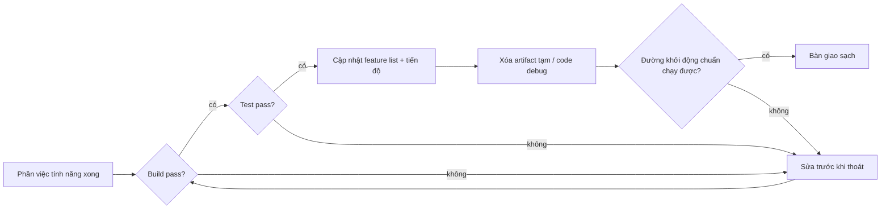

Nhưng thế vẫn chưa đủ. Tiến độ hiện tại phải được ghi vào artifact máy đọc được: các subtask đã hoàn thành kèm tiêu chí pass, các subtask đang làm dở kèm trạng thái hiện tại, các subtask chưa bắt đầu. Ghi tiến độ và kết quả xác minh vào các tệp được quản lý phiên bản để phiên sau có thể kiểm tra trạng thái. Artifact tạm (debug log, tệp tạm, code bị comment out, marker TODO) cũng phải được dọn, vì chúng tăng tải nhận thức cho phiên sau. Đường khởi động chuẩn phải còn chạy được. Phiên sau có thể bắt đầu làm việc mà không cần can thiệp thủ công không? Khởi tạo môi trường, tải codebase, thu thập ngữ cảnh, chọn tác vụ, không đường nào được hỏng cả.

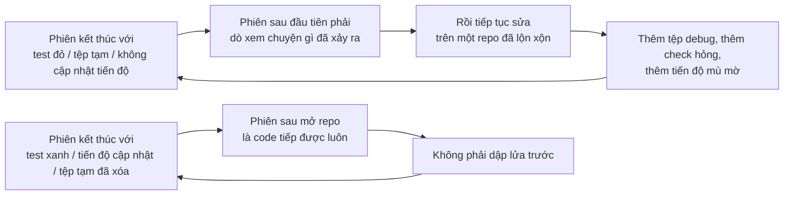

#### Các khái niệm cốt lõi

- **Trạng thái sạch (Clean state)**: Hệ thống phải thoả mãn năm điều kiện khi thoát phiên, build pass, test pass, tiến độ đã ghi, không có artifact cũ, đường khởi động khả dụng. Thiếu một cái là phiên chưa "xong".
- **Tính toàn vẹn phiên (Session integrity)**: Tương tự giao dịch cơ sở dữ liệu, hoặc commit đầy đủ và để lại trạng thái sạch, hoặc rollback về trạng thái nhất quán gần nhất. Không có lựa chọn giữa.
- **Tài liệu chất lượng (Quality document)**: Một artifact sống liên tục ghi điểm chất lượng cho từng module. Không phải đánh giá một lần, mà là tracker cho thấy codebase đang mạnh lên hay yếu đi theo thời gian.
- **Vòng lặp dọn dẹp (Cleanup loop)**: Phiên bảo trì định kỳ nhằm giảm entropy trong codebase một cách có hệ thống. Không phải sửa chữa khẩn cấp, mà là vận hành thường ngày.
- **Đơn giản hoá harness (Harness simplification)**: Khi năng lực mô hình cải thiện, định kỳ gỡ bỏ các thành phần harness không còn cần thiết. Một ràng buộc cần thiết hôm nay có thể thành overhead thừa ba tháng sau.
- **Dọn dẹp idempotent (Idempotent cleanup)**: Thao tác dọn dẹp cho cùng kết quả bất kể chạy bao nhiêu lần, đảm bảo dọn vẫn an toàn ngay cả trong kịch bản fail-retry.

#### "Dọn sau" nghĩa là không bao giờ dọn

Cái bẫy tâm lý phổ biến nhất là "phiên này không có thời gian dọn, để lần sau". Nhưng phiên agent sau không biết bạn đã để lại gì, nó chỉ thấy một đống code và trạng thái không rõ ràng. Nó sẽ tốn kha khá thời gian suy ra "phần nào của đống code này là cố ý, phần nào là tạm".

Tệ hơn, mỗi phiên có mục tiêu tác vụ riêng. Phiên mới vào để làm việc mới, không phải dọn mớ hỗn độn của phiên trước. Nó sẽ phớt lờ sự lộn xộn rồi xây tiếp lên trên, lại đẻ thêm hỗn loạn. Đó chính là vòng phản hồi dương của entropy.

Với một dự án 12 tuần giả định, hãy giả sử các giá trị sau:

- Tuần 1: build pass 100%, test pass 100%, khởi động phiên mới 5 phút
- Tuần 4: build 95%, test 92%, khởi động 15 phút
- Tuần 8: build 82%, test 78%, khởi động 35 phút
- Tuần 12: build 68%, test 61%, khởi động hơn 60 phút

Cùng dự án nhưng có chiến lược dọn dẹp:

- Tuần 1: 100%, 100%, 5 phút
- Tuần 12: 97%, 95%, 9 phút

Một vòng dọn hàng tuần giữ trạng thái xuất phát ổn định: mỗi phiên kết thúc với build, test, tiến độ và artifact tạm đều ngăn nắp, để phiên sau bắt đầu từ cùng một đường cơ sở.

#### Cách làm đúng

##### 1. Trạng thái sạch là điều kiện cần để hoàn thành

Ghi rõ trong harness: **hoàn thành phiên = tác vụ pass xác minh VÀ kiểm tra trạng thái sạch pass.** Thiếu một là phiên chưa hoàn thành. Viết trong CLAUDE.md:

```
## Danh sách kiểm tra thoát phiên
- [ ] Build pass (npm run build)
- [ ] Tất cả test pass (npm test)
- [ ] Feature list đã cập nhật
- [ ] Không còn code debug (console.log, debugger, TODO)
- [ ] Đường khởi động chuẩn khả dụng (npm run dev)
```

##### 2. Chiến lược dọn dẹp hai chế độ

Kết hợp hai chế độ dọn dẹp:

**Dọn tức thì (cuối mỗi phiên)**: Dọn các artifact tạm sinh ra trong phiên, cập nhật trạng thái feature list, đảm bảo build và test pass. Đây là kiểu dọn "đếm tham chiếu": dùng xong là dọn ngay.

**Dọn định kỳ (hàng tuần)**: Quét toàn hệ thống, xử lý vấn đề cấu trúc tích tụ, cập nhật tài liệu chất lượng, chạy test benchmark phát hiện trôi dạt. Đây là kiểu dọn "tracing", một lượt bảo trì toàn diện theo nhịp cố định.

##### 3. Duy trì tài liệu chất lượng

Tài liệu chất lượng là một artifact sống, liên tục chấm điểm từng module:

```markdown
# Tài liệu chất lượng

## Module xác thực người dùng (Chất lượng: A)
- Xác minh pass: Có
- Agent hiểu được: Có
- Độ ổn định test: Ổn định
- Ranh giới kiến trúc: Tuân thủ
- Quy ước code: Được theo

## Module thanh toán (Chất lượng: C)
- Xác minh pass: Một phần (callback thanh toán chưa test)
- Agent hiểu được: Khó (logic rải trên 3 tệp)
- Độ ổn định test: Chưa ổn (2 test flaky)
- Ranh giới kiến trúc: Có vi phạm
- Quy ước code: Theo một phần
```

Phiên mới đọc tài liệu này là biết ngay ưu tiên ở đâu. Sửa module có điểm thấp nhất trước.

##### 4. Định kỳ đơn giản hoá harness

Mỗi thành phần harness tồn tại vì mô hình chưa thể tự làm việc đó một cách đáng tin. Nhưng khi mô hình mạnh lên, những giả định ấy trở nên lỗi thời.

Báo cáo harness của Anthropic cho thấy trực tiếp điều này. Harness ba agent đầu tiên, xây cho Opus 4.5, có generator làm việc theo sprint. Khi [Opus 4.6](https://www.anthropic.com/engineering/harness-design-long-running-apps) ra mắt, mô hình đã tự phân rã được công việc, nên cấu trúc sprint trở thành thứ thừa. Trong lần chạy DAW cập nhật, builder làm việc liên tục hơn hai tiếng mà không trôi dạt.

Nhưng câu chuyện ở evaluator lại khác. Kể cả với Opus 4.6 mạnh hơn, khi tác vụ tiệm cận biên năng lực mô hình, evaluator vẫn mang lại giá trị thật, bắt được các tính năng thiếu và stub của generator. Điều này nghĩa là evaluator không phải quyết định có/không cố định, nó phụ thuộc vào vị trí độ khó tác vụ so với năng lực mô hình.

**Thực hành khuyến nghị**: Mỗi tháng, chọn một thành phần harness, tạm thời vô hiệu hoá, rồi chạy các tác vụ benchmark. Nếu kết quả không tụt, hãy gỡ vĩnh viễn. Nếu tụt, hãy khôi phục hoặc thay bằng phương án nhẹ hơn.

Một nguyên lý sâu hơn: **khi mô hình mạnh lên, các tổ hợp thú vị trong harness không co lại, mà dịch chuyển.** Vấn đề trước đây cần giải pháp tường minh giờ được mô hình nuốt, nhưng những biên năng lực mới lại mở ra không gian thiết kế harness mà trước đây chưa khả thi. Công việc của kỹ sư AI là liên tục tìm ra tổ hợp giá trị kế tiếp.

##### 5. Thao tác dọn dẹp phải idempotent

Script dọn dẹp phải an toàn để chạy lặp lại, chạy thêm một lần nữa cũng không sinh side effect:

```bash
# Thao tác dọn dẹp idempotent
rm -f /tmp/debug-*.log  # -f đảm bảo không lỗi khi tệp không tồn tại
git checkout -- .env.local  # Khôi phục về trạng thái đã biết
npm run test  # Xác minh dọn dẹp không làm hỏng gì
```

##### 6. Thông lượng cao thay đổi triết lý merge

Khi đầu ra của agent vượt xa năng lực review của người, triết lý merge truyền thống cần điều chỉnh. Kinh nghiệm của OpenAI: trong môi trường agent mở 3.5 PR mỗi ngày (và sau đó còn nhiều hơn), tối thiểu hoá các cổng blocking merge là lựa chọn đúng. PR nên sống ngắn, test flakiness thường được giải quyết bằng các lần chạy sau thay vì blocking vô thời hạn. Trong một hệ thống mà chi phí sửa thấp còn chi phí chờ cao, đi nhanh và sửa nhanh là chiến lược tốt hơn so với xác nhận chậm.

**Lưu ý**: Cách này thiếu trách nhiệm trong môi trường thông lượng thấp. Nhưng khi đầu ra của agent vượt xa sự chú ý của con người, đó thường là đánh đổi đúng. Tiêu chí then chốt: **chi phí trung bình sửa một bug so với chi phí trung bình chờ người review một PR.** Khi cái trước thấp hơn cái sau, merge nhanh là lựa chọn đúng.

#### Câu chuyện thật

Một ứng dụng Electron phát triển bằng agent trong 12 tuần, so sánh hai cách tiếp cận:

**Không có chiến lược dọn dẹp** (nhóm đối chứng): Tuần 12, build pass 68%, test pass 61%, khởi động phiên mới hơn 60 phút, 103 artifact cũ.

**Có chiến lược dọn dẹp** (nhóm thực nghiệm): Kiểm tra trạng thái sạch đầy đủ cuối mỗi phiên, cộng với vòng dọn hàng tuần. Tuần 12, build pass 97%, test pass 95%, khởi động phiên mới 9 phút, 11 artifact cũ.

Đến tuần 12, nhóm có dọn dẹp giữ tỷ lệ build và test pass gần với điểm xuất phát, phiên mới có thể bắt đầu nhanh, và artifact cũ còn rất ít. Dọn dẹp tốn vài phút mỗi phiên và trả lại một trạng thái xuất phát mà phiên sau có thể tin tưởng.

#### Những điểm chính cần nhớ

- **Trạng thái sạch là điều kiện cần để hoàn thành phiên**, không phải dọn dẹp tuỳ chọn, mà là một phần của "định nghĩa hoàn thành".
- **Cả năm chiều đều không thể thiếu**, build, test, tiến độ, artifact, khởi động, mỗi cái phải được kiểm tra tường minh.
- **Tài liệu chất lượng làm sức khoẻ codebase trở nên theo dõi được**, bạn chỉ có thể chủ động sửa thứ bạn biết đang tụt dốc.
- **Định kỳ đơn giản hoá harness**, khi năng lực mô hình cải thiện, gỡ các ràng buộc không còn cần thiết.
- **"Dọn sau" nghĩa là không bao giờ dọn.** Tăng trưởng entropy là trạng thái mặc định, chỉ có dọn chủ động mới chống lại được.

#### Đọc thêm

- [Clean Code - Robert C. Martin](https://www.goodreads.com/book/show/3735293-clean-code) — Nguyên tắc có hệ thống về sạch sẽ của code
- [Harness Engineering - OpenAI](https://openai.com/index/harness-engineering/) — Khả năng tái lập như yêu cầu thiết kế harness cốt lõi
- [Effective Harnesses - Anthropic](https://www.anthropic.com/engineering/effective-harnesses-for-long-running-agents) — Vai trò then chốt của thoát phiên sạch với độ tin cậy dài hạn
- [Programs, Life Cycles, and Laws of Software Evolution - Lehman](https://ieeexplore.ieee.org/document/1702314) — Định luật tiến hoá phần mềm chứng minh độ phức tạp tất yếu tăng khi không bảo trì chủ động

#### Bài tập

1. **Danh sách kiểm tra trạng thái sạch**: Thiết kế danh sách kiểm tra thoát phiên cho codebase của bạn, bao phủ cả năm chiều. Áp dụng qua 5 phiên liên tiếp và ghi lại số vi phạm theo từng chiều.

2. **So sánh benchmark**: Dùng một bộ tác vụ cố định với hai biến thể harness (có/không yêu cầu trạng thái sạch). So sánh tỷ lệ hoàn thành, số lần thử lại và tỷ lệ lỗi lọt qua.

3. **Thực hành đơn giản hoá harness**: Chọn một thành phần harness, tạm thời vô hiệu hoá, rồi chạy các tác vụ benchmark. So sánh kết quả có và không có nó. Quyết định giữ, gỡ hay thay thế.

---

## Phần 7 · Tổng hợp — loop và graph engineering — ≈76 phút

Hai bài dài nhất ghép mọi lớp phòng thủ thành hệ thống: trước hết là một vòng lặp tự chủ, rồi nâng cấp thành đồ thị nhiều agent.

### Bài 13. Từ Nhắc lệnh Thủ công đến Vòng lặp Tự chủ

> Ví dụ code: [code/](https://github.com/walkinglabs/learn-harness-engineering/blob/main/docs/vi/lectures/lecture-13-loop-engineering/code/)
Tất cả những gì bạn đã học trong mười hai bài đầu tiên đều dựa trên một giả định: **bạn đang ngồi trước bàn phím, gõ các chỉ dẫn từng cái một.**

Bạn đã viết `AGENTS.md` (Bài 1–4), xây dựng quản lý trạng thái (Bài 5–6), giới hạn phạm vi với danh sách tính năng (Bài 7–8), để lại bàn giao sạch ở cuối phiên (Bài 9, 12), và làm cho runtime có thể quan sát được (Bài 10–11). Nhưng tác nhân kích hoạt tất cả mọi thứ luôn là bạn. Agent không bao giờ tự quyết định khi nào bắt đầu làm việc — vì không ai nhấn nút "bắt đầu".

Bài giảng này là về việc trao nút bắt đầu cho hệ thống. Không phải từ bỏ quyền kiểm soát — mà là nâng nó lên tầng tiếp theo.

#### /goal: Vòng lặp Đơn giản Nhất

Cách tốt nhất để bắt đầu loop engineering không phải là một sơ đồ kiến trúc phức tạp — mà là một lệnh duy nhất.

Vào đầu năm 2026, Claude Code và OpenAI Codex độc lập phát hành cùng một tính năng: `/goal`. Bạn gõ vào terminal:

```
/goal "All tests pass, zero lint warnings, merge to main"
```

Sau đó bạn đóng máy tính và đi ngủ. Tám giờ sau, agent đã tự phân tích, code, test, sửa lỗi, và merge. Nó thử lại khi thất bại, đổi cách tiếp cận khi bị kẹt, và dừng lại khi xong — mà không cần bạn đứng sau lưng nói "thử lại đi."

Sự khác biệt duy nhất giữa `/goal` và một prompt truyền thống là một điều. Nhưng điều đó thay đổi mọi thứ:

| | Prompt truyền thống | `/goal` |
|---|---|---|
| Bạn cung cấp gì | Phải làm gì tiếp theo | Trạng thái cuối trông như thế nào |
| Agent làm gì | Thực thi một lần | Lặp lại cho đến khi đạt được |
| Ai quyết định xong | Bạn | Một điều kiện dừng có thể kiểm chứng |
| Khi nào bạn có thể rời đi | Bạn không thể | Ngay khi bạn gõ `/goal` |

`/goal` về cơ bản là một vòng lặp. Nó có đúng ba phần: **một mục tiêu, một phương pháp xác minh, và một điều kiện dừng.** Chỉ ba thứ đó đã dịch chuyển bạn từ bên trong vòng lặp ra bên ngoài nó.

##### Làm sao `/goal` Phát triển Tự nhiên

`/goal` không phải nhảy từ 0 lên 1 bất ngờ. Nó lớn dần từ các quy trình làm việc hàng ngày, đi qua khoảng bốn giai đoạn:

**Giai đoạn 1: Nhắc lệnh thủ công từng cái một.** Cách làm việc sớm nhất là qua lại: "viết một hàm," "thêm test," "sửa logic này." Agent dừng lại sau mỗi bước và chờ bạn nói tiếp theo là gì. Bạn là người lên lịch cho toàn bộ đường ống.

**Giai đoạn 2: Prompt dài với nhiều bước.** Sau đó mọi người bắt đầu viết các prompt dài hơn xếp chồng các bước lại với nhau: "đầu tiên phân tích code, sau đó viết triển khai, sau đó chạy test, và nếu chúng thất bại thì sửa chúng." Agent có thể chạy nhiều bước trong một lần, nhưng bạn vẫn phải theo dõi — vì nó có thể trôi dạt giữa chừng, hoặc hoàn thành một bước và không biết phải làm gì tiếp theo.

**Giai đoạn 3: Agent tự phản ánh và tự định hướng.** Sau đó, các agent có được "sự nội quan" — sau mỗi bước chúng nhìn kết quả và quyết định phải làm gì tiếp theo. Bạn đưa ra mục tiêu, và chúng tự chia nhỏ và tự thử lại. Nhưng một vấn đề nảy sinh: khi nào chúng dừng lại? Việc "tôi xong rồi" từ chính agent có đáng tin không? Thực tế liên tục trả lời — không. Các agent tuyên bố chiến thắng quá dễ dàng.

**Giai đoạn 4: Phán đoán dừng độc lập — `/goal`.** Bước cuối cùng là lấy "việc phán đoán xem có xong không" ra khỏi tay agent đang làm việc, và trao nó cho một thẩm phán độc lập. Đó có thể là một mô hình khác, một script, hoặc một lệnh test — nhưng quy tắc là như nhau: người viết code không thể chấm điểm bài tập về nhà của chính mình. Tại thời điểm này, `/goal` mới thực sự hoạt động: bạn đưa ra mục tiêu, nó lặp lại, một thẩm phán độc lập quyết định khi nào dừng, và bạn có thể rời đi.

Bốn giai đoạn này không phải là lộ trình được bất kỳ công ty nào lên kế hoạch. Đó là con đường mà mọi người code với agent đều đến được, một cách độc lập, bị đẩy bởi những điểm đau giống nhau. Claude Code và Codex phát hành `/goal` gần như đồng thời vào đầu năm 2026 không phải là ngẫu nhiên — thời điểm đã đến.

##### Không Chỉ Một Loại Vòng lặp

`/goal` là vòng lặp dễ hiểu nhất, nhưng nó không phải loại duy nhất. Các vòng lặp được phân loại dựa trên cách chúng được kích hoạt và cách chúng dừng lại:

| Loại | Kích hoạt | Điều kiện dừng | Claude Code | Codex | Tốt nhất cho |
|------|---------|----------------|-------------|-------|----------|
| **Vòng lặp theo lượt** | Bạn gõ từng prompt thủ công | Agent nghĩ nó xong, hoặc bạn ngắt | Chat bình thường | Chat bình thường | Nhiệm vụ nhỏ, khám phá |
| **Vòng lặp theo mục tiêu** | Bạn đưa ra mục tiêu | Đánh giá độc lập xác nhận xong, hoặc đạt lượt tối đa | `/goal` | `/goal` (cần bật thủ công) | Nhiệm vụ phức tạp có tiêu chí hoàn thành rõ ràng |
| **Vòng lặp theo thời gian** | Khoảng thời gian theo lịch (mỗi N phút/giờ) | Bạn dừng thủ công, hoặc nó thoát sau khi hoàn thành công việc | `/loop` | Thread automation | Kiểm tra trạng thái định kỳ, kiểm tra định kỳ, công việc lặp lại |
| **Vòng lặp theo sự kiện** | Sự kiện bên ngoài (PR được mở, CI thất bại, issue mới) | Dừng sau khi xử lý sự kiện, hoặc đạt giới hạn thử lại | Routines (API / GitHub Webhook) | Standalone automation + plugins | Quy trình phản ứng, tích hợp CI/CD |

Chúng không cạnh tranh — chúng là những công cụ khác nhau cho những công việc khác nhau. Turn-based thì ổn cho những việc nhỏ. Dùng `/goal` khi có đường đích rõ ràng. Dùng `/loop` khi bạn cần theo dõi gì đó. Dùng event-driven khi bạn tích hợp với các hệ thống bên ngoài.

##### Đừng Nhầm Lẫn `/goal` và `/loop`

Cả hai đều có "loop" trong tên, nhưng chúng giải quyết các vấn đề hoàn toàn khác nhau:

| | `/goal` | `/loop` |
|---|---------|---------|
| **Nó là gì** | Một nhiệm vụ lớn, chạy cho đến khi xong | Một hành động nhỏ, lặp lại theo khoảng thời gian |
| **Điều kiện dừng** | Đạt mục tiêu, hoặc hết ngân sách | Bạn dừng thủ công, hoặc nhiệm vụ tự thoát |
| **Phổ thời gian** | Một lần chạy dài, có thể mất vài giờ hoặc vài ngày | Các đợt ngắn định kỳ, mỗi lần chạy có thể vài phút |
| **Tiến độ** | Mỗi vòng lặp lại gần hơn với đường đích | Mỗi lần chạy độc lập, không có tiến độ tích lũy |
| **Giống với** | Chạy marathon — súng bắn bắt đầu, bạn dừng ở đường đích | Đồng hồ báo thức — kêu theo lịch, bạn tắt nó |
| **Sử dụng điển hình** | "Triển khai toàn bộ hệ thống thanh toán với độ phủ test" | "Kiểm tra CI có bị hỏng không mỗi 15 phút" |

Một sai lầm phổ biến: ép thứ gì đó đáng lẽ là `/goal` vào một `/loop`. Như viết `/loop 10m "tiếp tục triển khai hệ thống thanh toán"` — sai rồi. `/loop` chạy cùng một chỉ dẫn độc lập mỗi lần, nó không nhớ nơi nó dừng lại lần trước. Bạn chỉ sẽ nhận được cùng một điểm khởi đầu lặp đi lặp lại.

**Câu hỏi một câu để chọn cái nào: thứ này có kết thúc không?**
- Có kết thúc → `/goal`
- Không kết thúc, bạn chỉ cần tiếp tục theo dõi → `/loop`

Loop Engineering, chủ đề của bài giảng này, không phải về một lệnh nào đó. Nó là về **khả năng thiết kế các hệ thống bao gồm tất cả các loại này — để agent của bạn có thể tiếp tục làm việc ngay cả khi bạn không ở đó.**

Bạn không cần phải gõ `/goal` mỗi lần. Nhưng hiểu nó đến từ đâu và tại sao nó trông như thế nào — đó là hiểu cốt lõi của loop engineering. Các vòng lặp phức tạp hơn chỉ thêm các phần như lập lịch, song song, cô lập, và bộ nhớ lên trên ba nguyên tắc cơ bản giống nhau: mục tiêu, xác minh, điều kiện dừng.

#### Những Ngày Khác Nhau, Cùng Một Hướng

Cùng một ý tưởng xuất hiện ở những nơi khác nhau, vào những thời điểm khác nhau.

**Peter Steinberger** (người tạo ra OpenClaw, [trong một bài đăng](https://x.com/steipete/status/2063697162748260627)): "Bạn không nên còn đang nhắc lệnh các agent coding nữa. Bạn nên thiết kế các vòng lặp nhắc lệnh agent của bạn."

**Boris Cherny** (trưởng phòng Claude Code tại Anthropic, [trên podcast Acquired](https://x.com/rohanpaul_ai/status/2063289804708835412)): "Tôi không còn nhắc lệnh Claude nữa. Tôi có các vòng lặp chạy nhắc lệnh Claude và tìm ra phải làm gì. Công việc của tôi là viết các vòng lặp."

**Addy Osmani** (trưởng nhóm kỹ thuật tại Google Chrome) [đặt tên cho khái niệm](https://addyosmani.com/blog/loop-engineering/) vào ngày 7 tháng 6 năm 2026, và đưa ra định nghĩa một dòng:

> **Loop engineering là thay thế bản thân bạn với tư cách là người nhắc lệnh agent. Bạn thiết kế hệ thống làm việc đó thay thế.**

Cherny viết trong một [báo cáo cá nhân ngày 27-12-2025](https://twitter.com/bcherny/status/2004887829252317325) rằng trong hơn 30 ngày anh đã merge 259 PR — 497 commit, thêm 40.000 dòng, xóa 38.000 dòng — và mọi dòng đều do Claude Code + Opus 4.5 viết.

Những câu trích dẫn đến từ các ngày, định dạng và đội ngũ khác nhau. Hướng đi chung của họ là đưa việc lập lịch, xác minh và quyết định dừng ra khỏi prompt thời điểm và vào trong một hệ thống. Đến giữa năm 2026, agent đã có thể hoàn thành các tác vụ không tầm thường mà không cần giám sát, các nguyên thủy lập lịch đã được tích hợp sẵn, và một lần chạy đã đủ rẻ để lặp lại theo bộ hẹn giờ. Khi các mảnh đã có mặt, không chỉ một người ghép chúng lại.

> Nguồn: [Addy Osmani: Loop Engineering](https://addyosmani.com/blog/loop-engineering/)

#### Bên Trong Vòng lặp vs. Bên Ngoài Vòng lặp

Hãy đối chiếu hai kịch bản cụ thể.

**Kịch bản A: Bạn ở bên trong vòng lặp (Bài 1–12).**

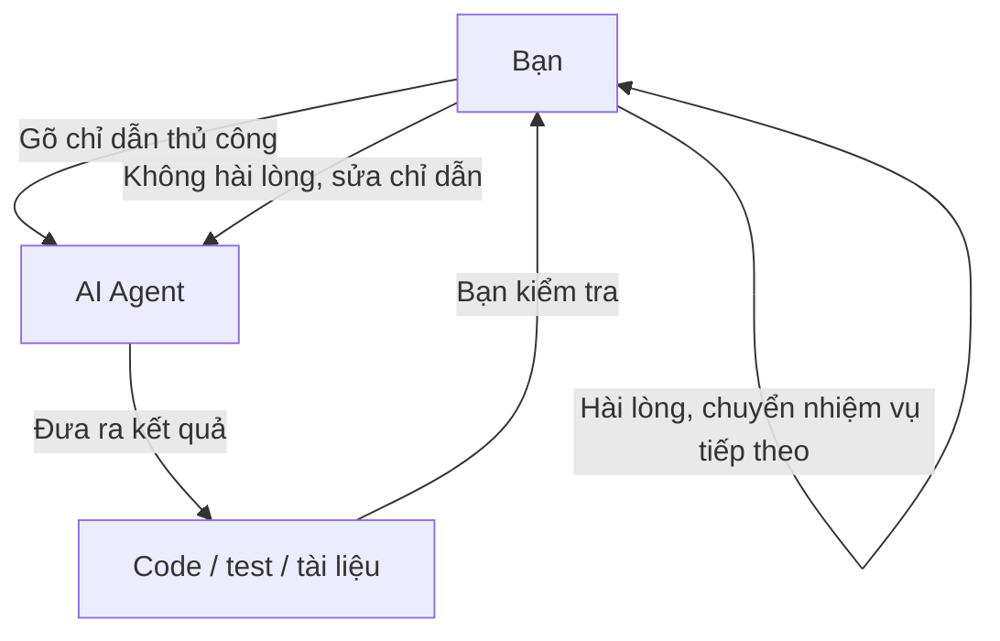

Bạn có một bộ harness hoàn chỉnh: `AGENTS.md` nói với agent các quy tắc dự án, `feature_list.json` giới hạn phạm vi, `init.sh` đảm bảo môi trường nhất quán, `claude-progress.md` ghi lại tiến độ. **Nhưng mỗi bước vẫn đòi hỏi bạn khởi tạo thủ công.** Hoàn thành một tính năng, đọc file tiến độ, suy nghĩ về tiếp theo là gì, gõ chỉ dẫn. Bạn là động cơ của toàn bộ quy trình làm việc.

**Kịch bản B: Bạn ở bên ngoài vòng lặp (Loop Engineering).**

```mermaid
flowchart TD
    subgraph Loop["Hệ thống vòng lặp bạn đã thiết kế"]
        Trigger["Tự động kích hoạt<br/>Lịch / Sự kiện / Nhiệm vụ trước hoàn thành"] --> Discover["Khám phá công việc<br/>Đọc file tiến độ / trình theo dõi issue"]
        Discover --> Dispatch["Phân công<br/>Tạo sub-agent"]
        Dispatch --> Verify["Xác minh<br/>Test / lint / Agent đánh giá độc lập"]
        Verify --> Persist["Lưu trạng thái<br/>Cập nhật tiến độ / Commit / Mở PR"]
        Persist -->|"Còn việc"| Discover
        Persist -->|"Xong hoặc bị chặn"| Inbox["Đẩy vào hộp thư review của bạn"]
    end
    Inbox -->|"Bạn chỉ cần đưa ra quyết định"| You["Bạn"]
```

Bạn không còn gõ chỉ dẫn nữa. Hệ thống bạn đã thiết kế khám phá công việc, phân công nó, xác minh kết quả, ghi lại trạng thái, và quyết định bước tiếp theo. Công việc của bạn thu hẹp còn ba điều: **định nghĩa mục tiêu và điều kiện dừng trước khi nó bắt đầu, review kết quả sau khi nó hoàn thành, và điều chỉnh các quy tắc khi hệ thống đi lạc hướng.** Đòn bẩy dịch chuyển từ "viết prompt đúng" sang "thiết kế vòng lặp đúng."

> Osmani: "Một năm trước nếu bạn muốn một vòng lặp bạn viết một đống bash và bạn duy trì đống đó mãi mãi và nó là của bạn và chỉ của bạn. Bây giờ các mảnh ghép chỉ được giao bên trong các sản phẩm." Bạn không cần xây dựng từ đầu. Bạn cần hiểu các mảnh ghép khớp với nhau như thế nào.

#### Các Khái niệm Cốt lõi

- **Loop Engineering**: Thiết kế một hệ thống tự động nhắc lệnh agent của bạn, thay thế đầu vào của con người từng bước thủ công. Con người di chuyển từ bên trong vòng lặp ra bên ngoài nó, và đòn bẩy chuyển từ "viết prompt đúng" sang "thiết kế vòng lặp đúng."
- **Chế độ `/goal`**: Vòng lặp đơn giản nhất — đưa ra mục tiêu, phương pháp xác minh, và điều kiện dừng; agent lặp lại cho đến khi đạt được. Cầu nối từ nhắc lệnh thủ công đến các vòng lặp tự chủ.
- **Phân tách Generator/Evaluator**: Agent viết code và agent kiểm tra code phải được tách riêng. Một mô hình chấm điểm công việc của chính mình là không đáng tin cậy; một trình xác minh độc lập — đôi khi sử dụng hoàn toàn một mô hình khác — là đảm bảo độ tin cậy cơ bản của bất kỳ vòng lặp nào.
- **Cô lập Worktree**: Mỗi agent song song làm việc trong một git worktree độc lập, ngăn chặn vật lý các va chạm tệp. Điều kiện tiên quyết về cơ sở hạ tầng cho thực thi song song đa agent.
- **Trạng thái bên ngoài**: Bộ nhớ sống bên ngoài một cuộc trò chuyện đơn lẻ — các file markdown, trình theo dõi issue, bảng kanban. Các mô hình quên mọi thứ giữa các lần chạy; bộ nhớ phải sống trên đĩa.
- **Bốn chi phí thầm lặng**: Bốn chi phí ẩn trở nên gay gắt hơn vòng lặp chạy càng lâu — nợ xác minh, sự thối rữa hiểu biết, sự đầu hàng nhận thức, bùng nổ token. Các vòng lặp không chỉ tăng tốc đầu ra, mà còn tăng tốc rủi ro.

#### Sáu Nguyên thủy của Một Vòng lặp

Osmani phân rã một vòng lặp thành năm khối xây dựng cốt lõi, cộng với một lớp bộ nhớ xuyên suốt tất cả chúng — tổng cộng sáu thứ, nhưng lớp bộ nhớ chiếm một vị trí đặc biệt: nó không phải là một thành phần ở cùng cấp độ với những cái khác; nó là xương sống mà mọi thứ khác phụ thuộc vào.

Sơ đồ dưới đây vẽ tất cả sáu thành một vòng để bạn có thể thấy toàn bộ bức tranh trong nháy mắt. Nhưng hãy nhớ: Trạng thái bên ngoài không chỉ là một điểm dừng khác trên vòng lặp — nó là nền tảng mà toàn bộ vòng lặp dựa vào.

```mermaid
flowchart LR
    A["Automations<br/>Trình kích hoạt theo lịch"] --> W["Worktrees<br/>Cô lập song song"]
    W --> S["Skills<br/>Kiến thức dự án được mã hóa"]
    S --> C["Connectors<br/>Truy cập công cụ bên ngoài"]
    C --> SA["Sub-agents<br/>Phân chia Maker / Checker"]
    SA --> ES["Trạng thái bên ngoài<br/>Bộ nhớ xuyên vòng lặp"]
    ES --> A
```

##### 1. Automations — Nhịp Tim

Nếu không có automation, một vòng lặp không phải là vòng lặp — đó là một lần chạy một lần bạn đã làm thủ công.

Cả Claude Code và Codex đều có hệ thống lập lịch đầy đủ, nhưng chúng sử dụng tên và các lớp khác nhau. Ánh xạ sơ bộ từ nhẹ nhàng nhất đến nặng nhọc nhất:

| Lớp | Claude Code | Codex | Ghi chú |
|-------|-------------|-------|-------|
| Polling trong phiên | `/loop` | Thread automation | Gắn với phiên hiện tại, chết khi phiên đóng |
| Nhiệm vụ theo lịch cục bộ | Desktop scheduled tasks | Standalone automation (local mode) | Chạy khi máy bật, có thể truy cập file cục bộ |
| Nhiệm vụ theo lịch đám mây | Cloud Routines | — (không có trình lập lịch đám mây gốc) | Chạy khi máy tắt |
| Trình kích hoạt sự kiện | Routines (API / GitHub Webhook) | Standalone automation + plugins | Được kích hoạt bởi các sự kiện bên ngoài |
| Tự hoàn toàn tự lưu trữ | GitHub Actions / cron tự lưu trữ | `codex exec` + cron | Kiểm soát đầy đủ |

**Tab Automations của Codex** là điểm vào lập lịch. Chọn dự án, prompt, nhịp độ, và liệu nó chạy trên bản checkout cục bộ của bạn hay một worktree nền. Các lần chạy tìm thấy thứ gì đó sẽ vào hộp thư Triage; các lần chạy không tìm thấy gì sẽ tự động lưu trữ. OpenAI sử dụng chúng nội bộ cho việc phân loại issue hàng ngày, tóm tắt lỗi CI, bản tin commit, và tìm kiếm các lỗi được giới thiệu tuần trước.

Các automation của Codex có hai hương vị:
- **Thread automation** — Các cuộc gọi thức dậy định kỳ kiểu nhịp tim gắn với một luồng, giữ lại ngữ cảnh. Tốt cho việc theo dõi liên tục trên một thứ duy nhất, như giám sát một lệnh chạy lâu hoặc kiểm tra trạng thái PR. Tương đương trong Claude Code là `/loop`.
- **Standalone automation** — Mỗi lần chạy bắt đầu mới, kết quả đi đến Triage. Tốt cho các tác vụ độc lập hàng ngày/hàng tuần như bản tin hoặc quét phụ thuộc. Tương đương trong Claude Code là Desktop scheduled tasks.

Hệ thống của Claude Code được phân lớp chi tiết hơn:

- **`/loop`** — Lặp lại theo lịch nhẹ nhàng trong phiên. Hoạt động khi terminal của bạn đang mở, chết khi phiên đóng, tự động hết hạn sau 7 ngày. Tốt cho việc giám sát tạm thời trong phiên làm việc hiện tại của bạn.
- **Desktop scheduled tasks** — Chạy khi máy của bạn đang bật, sống sót qua các lần khởi động lại phiên, khoảng thời gian cấp phút. Tốt cho các công việc lặp lại cần truy cập file cục bộ.
- **Cloud Routines** — Chạy trên cơ sở hạ tầng đám mây của Anthropic, sống sót khi máy của bạn tắt, khoảng thời gian tối thiểu 1 giờ. Hỗ trợ ba loại trình kích hoạt: theo lịch, gọi API, GitHub webhook. Tốt cho các tác vụ hàng ngày không cần môi trường cục bộ của bạn.
- **GitHub Actions / cron tự lưu trữ** — Hoàn toàn dưới sự kiểm soát của bạn, chạy bất cứ cách nào bạn muốn. Tốt cho các kịch bản có yêu cầu môi trường hoặc bảo mật đặc biệt.

```bash
# Claude Code: chạy test mỗi 30 phút, sửa lỗi (trong phiên hiện tại)
/loop 30m Run the test suite and fix any failing tests

# Claude Code: kiểm tra trạng thái deploy mỗi 15 phút
/loop 15m Check if the production deploy succeeded and report status
```

Automations là nhịp tim. Nếu không có chúng, vòng lặp là một bản thiết kế không bao giờ thức dậy.

##### 2. Worktrees — Cô lập ở Quy mô lớn

Ngay khi bạn chạy nhiều hơn một agent, các va chạm tệp trở thành chế độ thất bại tất yếu. Hai agent viết vào cùng một tệp chính là cơn đau đầu của hai kỹ sư commit vào cùng một dòng mà không tham khảo ý kiến nhau.

`git worktree` giải quyết vấn đề này: mỗi agent làm việc trên nhánh của riêng mình trong thư mục của riêng mình. Chúng vật lý không thể chạm vào bản checkout của nhau.

Cả Claude Code và Codex đều hỗ trợ worktree. Khi bạn sử dụng `--worktree` hoặc `isolation: worktree` trên một sub-agent, mỗi trợ lý nhận được một bản checkout sạch, độc lập tự dọn dẹp sau khi xong. Worktrees loại bỏ vấn đề va chạm cơ học — nhưng hãy nhớ: **băng thông review của bạn vẫn là trần nhà.** Bạn có thể giám sát bao nhiêu agent song song quyết định bạn thực sự có thể chạy bao nhiêu worktree.

##### 3. Skills — Ngừng Giải thích Lại Dự án của Bạn

Một skill là cách bạn ngừng giải thích lại cùng một ngữ cảnh dự án mỗi phiên. Đó là một thư mục chứa một `SKILL.md` với các chỉ dẫn và siêu dữ liệu, cộng với các script, tài liệu tham khảo, và tài sản tùy chọn.

Cả Codex và Claude Code đều hỗ trợ cùng một định dạng. Các skill được gọi trực tiếp bằng `/skill-name` (Codex cũng hỗ trợ `$skill-name`), hoặc được kích hoạt ngầm khi nhiệm vụ khớp với mô tả skill.

Skills về cơ bản là về việc trả nợ ý định của bạn. Một agent bắt đầu mỗi phiên lạnh lùng — nó lấp đầy bất kỳ khoảng trống nào trong ý định của bạn bằng một đoán tự tin. Một skill là ý định đó được viết ra bên ngoài: các quy ước, các bước build, "chúng ta không làm theo cách này vì một sự cố đó" — viết một lần, đọc mỗi lần chạy.

##### 4. Connectors — Vòng lặp của Bạn Chạm vào Các Công cụ Thực

Một vòng lặp chỉ có thể xem hệ thống tệp là một vòng lặp nhỏ. Các connector (được xây dựng trên giao thức MCP) cho phép agent đọc trình theo dõi issue của bạn, truy vấn cơ sở dữ liệu, gọi một API staging, gửi tin nhắn trong Slack.

Cả Codex và Claude Code đều nói MCP, vì vậy connector bạn viết cho cái này thường hoạt động ở cái kia. Connectors là sự khác biệt giữa "đây là bản sửa lỗi" và một vòng lặp mở PR, liên kết ticket Linear, và nhắc nhở kênh khi CI xanh — tự nó, bên trong môi trường thực tế của bạn, không chỉ trong terminal.

##### 5. Sub-agents — Giữ Maker Khỏi Checker

Lựa chọn thiết kế có giá trị cấu trúc nhất trong một vòng lặp là tách người viết ra khỏi người kiểm tra. Mô hình đã viết code thì quá hào phóng khi chấm điểm bài tập về nhà của chính mình. Một agent thứ hai, với các chỉ dẫn khác nhau và đôi khi là một mô hình khác, sẽ bắt được những gì agent thứ nhất đã tự thuyết phục mình.

Sự phân chia ba vai trò kinh điển:

```mermaid
flowchart LR
    Explorer["Agent Khám phá<br/>Đọc codebase, xác định vấn đề"] --> Implementer["Agent Triển khai<br/>Viết sửa lỗi, viết test"]
    Implementer --> Verifier["Agent Xác minh<br/>Review độc lập, chạy xác minh"]
    Verifier -->|"Thất bại"| Implementer
    Verifier -->|"Đạt"| Output["Kết quả"]
```

`/goal` của Claude Code chạy cái này dưới lớp — một phiên độc lập, mới mẻ phán đoán xem vòng lặp có nên dừng không, không phải phiên đã làm việc. Điều này được gọi là **phân tách generator/evaluator**, và nó là đảm bảo độ tin cậy quan trọng nhất trong thiết kế vòng lặp.

##### 6. Trạng thái Bên ngoài — Bộ nhớ của Vòng lặp

Các mô hình quên mọi thứ giữa các lần chạy. Bộ nhớ phải sống trên đĩa, không phải trong cửa sổ ngữ cảnh.

Điều này nghe có vẻ quá đơn giản để quan trọng, nhưng đó là cùng một thủ thuật mà mọi agent chạy lâu đều dựa vào. Một file markdown, một bảng Linear — bất cứ thứ gì sống bên ngoài một cuộc trò chuyện đơn lẻ và giữ những gì đã xong, gì đang tiến hành, và gì tiếp theo. Agent quên. Kho lưu trữ thì không.

Sáu nguyên thủy này là bộ công cụ thiết kế vòng lặp của bạn. Bạn không cần tất cả chúng cho mọi vòng lặp. Nhưng bạn cần biết khi nào nên dùng cái nào.

#### Một Vòng lặp Hoàn chỉnh, Được Giải phẫu

Nối tất cả sáu lại với nhau và đây là một vòng lặp phân loại buổi sáng thực tế trông như thế nào:

```mermaid
flowchart TD
    Trigger["Mỗi buổi sáng lúc 9:00<br/>Automation kích hoạt"] --> Read["Đọc trạng thái bên ngoài<br/>claude-progress.md của hôm qua<br/>Các issue GitHub đang mở"]
    Read --> Triage["Kỹ năng Triage kích hoạt<br/>Phân loại và ưu tiên các phát hiện"]
    Triage --> Fork["Với mỗi mục có thể hành động<br/>Tạo một Worktree cô lập"]
    Fork --> Implement["Sub-agent Triển khai<br/>Viết sửa lỗi + test"]
    Implement --> Verify["Sub-agent Xác minh<br/>Độc lập chạy test + lint + review"]
    Verify -->|"Thất bại"| Retry["Hàng đợi thử lại<br/>Thử cách tiếp cận khác"]
    Retry --> Implement
    Verify -->|"Đạt"| PR["Connector: Mở PR<br/>Liên kết issue, cập nhật file tiến độ"]
    PR --> Memory["Ghi vào Trạng thái Bên ngoài<br/>Cập nhật claude-progress.md<br/>Ghi lại kết quả vòng này"]
    Memory -->|"Còn việc"| Fork
    Memory -->|"Tất cả xong hoặc bị chặn"| Inbox["Kết quả đến hộp thư Triage<br/>Chờ bạn review"]
```

Đây không còn là một lần chạy agent đơn lẻ nữa. Đó là một hệ thống vận hành liên tục thức dậy mỗi buổi sáng, tự quét dọn sàn nhà, và đặt những thứ cần sự chú ý của bạn ra trước mặt bạn. Vai trò của bạn trở thành: **review nội dung hộp thư, đưa ra quyết định, và khi bạn phát hiện một mẫu hệ thống không thể xử lý, tinh chỉnh các kỹ năng và quy tắc.**

Báo cáo 30 ngày của Cherny là một điểm dữ liệu cho mẫu này: 259 PR, với code do Claude Code + Opus 4.5 viết. [Bản ghi harness của OpenAI](https://openai.com/index/harness-engineering/) là một điểm khác: một đội nhỏ dùng Codex trên một kho lưu trữ hoàn toàn mới trong năm tháng và báo cáo khoảng một triệu dòng cùng khoảng 1.500 PR.

#### Phân tách Generator/Evaluator: Tại sao Bạn Không thể Để Mô hình Chấm Điểm Công việc của Chính Mình

Đây là bài học khó nhất trong loop engineering.

Agent thông minh nhất của bạn viết một đoạn code đẹp đẽ. Logic rõ ràng, comment kỹ lưỡng, và mọi hàm đều có test. Bạn hài lòng.

Nhưng câu hỏi là: **nếu bạn để agent viết code đó phán đoán xem nó có làm tốt không, nó sẽ nói gì?**

Câu trả lời đã được kinh nghiệm xác nhận lặp đi lặp lại: nó sẽ tự cho mình điểm cao. Không phải vì nó không trung thực, mà vì nó là người tác giả — nó đã tự thuyết phục mình con đường này là đúng trong quá trình tạo ra. Khi nó nhìn lại, nó không thấy sai lầm; nó thấy chính quy trình suy luận của mình.

Đây không phải là vấn đề của Claude. Đây không phải là vấn đề của GPT. Đây là một thuộc tính của tất cả các mô hình sinh tạo. **Một mô hình là luật sư bào chữa tốt nhất cho chính đầu ra của mình.**

Cách sửa: không bao giờ để cùng một thực thể (cùng mô hình, cùng prompt) vừa làm việc vừa review.

- `/goal` của Claude Code sử dụng một phiên giám sát độc lập để phán đoán xem mục tiêu có đạt được không — không phải phiên đã thử làm.
- Hệ thống sub-agent của Codex cho phép bạn định nghĩa một agent xác minh sử dụng một mô hình khác với nỗ lực suy luận khác nhau.
- Thực hành cộng đồng "adversarial verify" tạo ra N người hoài nghi độc lập cho mỗi phát hiện, mỗi người được nhắc lệnh để bác bỏ — đa số bác bỏ sẽ loại bỏ phát hiện đó.

Một câu để nhớ: **ai đó trong đội của bạn phải không tin bạn.**

#### autoresearch của Karpathy: Mẫu Vòng lặp Điển hình

Nếu bạn muốn xem một vòng lặp được thiết kế tốt, thực sự đang chạy trông như thế nào, [autoresearch của Karpathy](https://github.com/karpathy/autoresearch) là ví dụ sách giáo khoa.

Vào tháng 3 năm 2026, Karpathy phát hành [autoresearch](https://github.com/karpathy/autoresearch). Kho lưu trữ được cố ý làm nhỏ: `prepare.py` là hạ tầng cố định, `train.py` là tệp agent sửa (khoảng 630 dòng), và `program.md` là phương pháp luận nghiên cứu do người sửa. Đưa cho nó một GPU và một hướng nghiên cứu, và nó chạy qua đêm — mỗi thí nghiệm có ngân sách thời gian thực huấn luyện cố định 5 phút (không tính khởi động và biên dịch), và chỉ những thay đổi cải thiện `val_bpb` mới được giữ lại.

##### Ba Tệp, Ba Vai trò

Toàn bộ hệ thống chỉ có ba tệp cốt lõi, nhưng sự phân chia công việc cực kỳ sắc bén:

| Tệp | Ai Sửa nó | Nó làm gì |
|------|-------------|-------------|
| `prepare.py` | Không ai (chỉ đọc) | Chuẩn bị dữ liệu, tokenizer, bộ đánh giá. Cơ sở hạ tầng cố định. |
| `train.py` (~630 dòng) | **AI Agent** | Định nghĩa mô hình, optimizer, vòng lặp huấn luyện. Sân chơi của agent — thay đổi bất cứ gì. |
| `program.md` | **Bạn** | Phương pháp luận nghiên cứu được viết bằng ngôn ngữ tự nhiên. Bạn chỉ sửa cái này. Nói với agent cách khám phá, cách đánh giá, gì không được động. |

Sự phân chia ba phía này là linh hồn của thiết kế: **con người không chạm vào code, họ chạm vào hướng; agent không chạm vào hướng, họ chạm vào code.** Công việc của bạn chuyển từ viết Python sang "viết văn hóa tổ chức nghiên cứu."

##### Đầu vào: program.md Trông Như Thế Nào

`program.md` là bộ não của vòng lặp. Nó không phải code — đó là một hướng dẫn nghiên cứu được viết bằng Markdown. Nó khoảng bao gồm:

- **Mục tiêu**: tối ưu hóa `val_bpb` (validation bits per byte, càng thấp càng tốt)
- **Các ràng buộc**: đừng động vào `prepare.py`, giữ trong ngân sách VRAM, huấn luyện 5 phút cố định
- **Các hướng khám phá**: thử các kiến trúc khác nhau, optimizer, lịch trình LR
- **Các quy tắc đánh giá**: gì được tính là cải thiện, cách ghi kết quả, làm gì khi thất bại
- **Quy tắc sắt đá**: không bao giờ dừng lại. Một khi vòng lặp bắt đầu, tiếp tục mãi mãi

Prompt khởi đầu của bạn cho agent có thể ngắn như một câu:

```
Have a look at program.md and let's kick off a new experiment!
```

Phần còn lại tùy thuộc vào agent đọc tài liệu và tự đưa ra quyết định.

##### Vòng lặp Bàn chín Bước

Trái tim của autoresearch là một **bàn đạp** — nó chỉ di chuyển về phía trước, không bao giờ lùi lại. Mỗi lần lặp lại nghiêm ngặt theo chín bước:

```mermaid
flowchart TD
    1["1. Đọc hướng<br/>Tải program.md"] --> 2["2. Khảo sát trạng thái hiện tại<br/>Đọc train.py + kết quả quá khứ"]
    2 --> 3["3. Đề xuất giả thuyết<br/>Nghĩ về một thay đổi để thử"]
    3 --> 4["4. Sửa code<br/>Chỉnh sửa train.py"]
    4 --> 5["5. Chụp nhanh<br/>git commit"]
    5 --> 6["6. Chạy huấn luyện<br/>5 phút thời gian thực cố định"]
    6 --> 7{"7. Đánh giá<br/>val_bpb có cải thiện không?"}
    7 -->|Có| 8a["8a. Giữ lại<br/>Commit giữ lại<br/>Ghi vào results.tsv"]
    7 -->|Không| 8b["8b. Hoàn tác<br/>git reset HEAD~1<br/>Ghi lại thất bại"]
    8a --> 9["9. Vòng tiếp theo<br/>Quay lại bước 1"]
    8b --> 9
```

README ước tính khoảng 12 thí nghiệm mỗi giờ, tức khoảng 100 trong một lần chạy qua đêm 8 giờ. Ngân sách 5 phút chỉ bao gồm huấn luyện, không tính khởi động hay biên dịch; phần còn lại của mỗi vòng dành cho sửa, chạy và đánh giá. Karpathy báo cáo đã tự chủ chạy một phiên bản riêng của autoresearch trong khoảng hai ngày cho vòng nanochat dưới đây.

Ngân sách huấn luyện 5 phút cố định là một lựa chọn thiết kế quan trọng — bất kể agent thay đổi gì, lần chạy huấn luyện nhận cùng một ngân sách thời gian thực. Điều này có nghĩa là tất cả các kết quả đều có thể so sánh trực tiếp dưới cùng một ngân sách huấn luyện.

##### Đầu ra: Bạn Nhìn Thấy Gì Khi Thức Dậy

Sau một đêm lặp lại, bạn ngồi xuống vào buổi sáng và tìm thấy ba thứ:

**1. Lịch sử Git (bàn đạp chỉ tiến về phía trước)**

Chỉ các commit thực sự cải thiện mới được giữ trên nhánh chính. Tất cả những gì thất bại đã được hoàn tác. `git log` là một nhật ký nghiên cứu đã được xác minh.

**2. results.tsv (bản ghi đầy đủ các thí nghiệm)**

Mỗi thí nghiệm — thành công hay thất bại — đều được ghi lại:

```
timestamp    commit_hash    val_bpb    vram_mb    description
--------- ------------- ---------- ---------- ----------------------------
08:01:12  a1b2c3d       1.234     22100    baseline
08:06:15  d4e5f6g       1.228     22400    increased learning rate by 10%
08:11:20  (reverted)     1.241     21800    switched to GELU activation
08:16:08  h7i8j9k       1.219     23000    added weight decay 0.01
...
```

**3. Một nhật ký nghiên cứu (tóm tắt của chính agent)**

Agent viết các thông điệp commit rõ ràng về những gì nó đã thử, gì hiệu quả, gì không, và gì nó dự định thử tiếp theo. Bạn đọc những cái đó — bạn không cần đọc các diff code.

##### Nó Thực sự Tìm Thấy Gì

Kết quả từ [vòng 1](https://github.com/karpathy/nanochat/commit/6ed7d1d82cee16c2e26f45d559ad3338447a6c1b) của autoresearch đã giảm thời gian huấn luyện GPT-2 của nanochat trên 8×H100 [từ **2,02 giờ xuống 1,80 giờ**](https://github.com/karpathy/nanochat/commit/f06860494848db080c9a80a0ffa83203b042056b), tức giảm khoảng **10,9%** thời gian huấn luyện.

Hầu hết các thay đổi là những tối ưu nhỏ xếp chồng lên nhau. Phần hữu ích là vòng lặp: ngân sách cố định, nhật ký thí nghiệm đầy đủ, và quy tắc chỉ giữ lại những cải thiện đã được xác minh.

##### Chi tiết Nói lên Nhiều Nhất: Vòng lặp được Viết Bằng Tiếng Anh, Không Phải Code.

`program.md` là một tài liệu Markdown, không phải một script Python. Nó mô tả một phương pháp luận nghiên cứu — gì nên sửa, gì nên để yên, cách đánh giá, cách xử lý các trường hợp thất bại, và một quy tắc sắt đá: **không bao giờ yêu cầu giúp đỡ con người, cứ tiếp tục đi.** Một agent coding đọc tài liệu này và thực thi nó vô thời hạn.

Đây là khuôn mẫu cho loop engineering: đừng cho agent một nhiệm vụ. Hãy cho nó một **phương pháp luận**. Để phương pháp luận là vòng lặp. Một `program.md`, 630 dòng code kết dính, và mọi thứ còn lại là agent tự chạy chính nó.

#### Bốn Chi phí Thầm lặng

Khi một vòng lặp bắt đầu chạy, bạn sẽ không thấy các vấn đề ngay lập tức. Bốn chi phí sau tích lũy một cách thầm lặng, và đến khi bạn nhận thấy, bạn có thể đã trả giá đắt.

##### 1. Nợ Xác minh

Các vòng lặp nhanh cám dỗ bạn bỏ qua xác minh. "Trông ổn" không giống như "đã xác nhận đúng." Vòng lặp tạo ra càng nhiều code không được giám sát, nợ xác minh càng chất đống nhanh chóng. Cách sửa: **các điều kiện dừng phải có thể kiểm tra bằng máy, không bao giờ là "cảm thấy khoảng rồi."**

##### 2. Sự thối rữa Hiểu biết

Vòng lặp giao code càng nhanh, sự hiểu biết của bạn về chính codebase của bạn càng trôi dạt xa khỏi thực tế. Một vòng lặp merge hàng trăm PR; đội đọc những PR đó, review những diff quan trọng, và tiếp tục dùng chính code ấy, nên mô hình tinh thần của họ bắt kịp. **Các vòng lặp nhanh đòi hỏi đọc nhanh.**

##### 3. Sự đầu hàng Nhận thức

Khi vòng lặp chạy trơn tru, tư thế thoải mái nhất là ngừng có ý kiến. Nhận bất cứ gì nó trả lại, đừng nghĩ về đầu ra. Nhưng đó chính là nơi nguy hiểm bắt đầu — bạn đang sử dụng vòng lặp để tránh suy nghĩ, thay vì để khuếch đại suy nghĩ. Cảnh báo của Osmani: "Hai người có thể xây dựng chính xác cùng một vòng lặp và nhận được kết quả ngược lại. Người này sử dụng nó để đi nhanh hơn trên công việc họ hiểu; người kia sử dụng nó để tránh hiểu công việc. Vòng lặp không biết sự khác biệt. Bạn biết."

##### 4. Bùng nổ Token

Mỗi lần lặp của một vòng lặp tích lũy thêm ngữ cảnh: code đã viết, lỗi đã gặp, quyết định đã đưa ra. Khi mỗi vòng chỉ thêm một lượng nội dung mới gần như cố định, độ dài lịch sử mà một vòng đơn lẻ nhìn thấy tăng gần như tuyến tính theo số vòng. Nếu hệ thống xử lý lại toàn bộ lịch sử mỗi vòng, tổng đầu vào tích lũy qua N vòng tăng gần như bậc hai. Codex giải quyết vấn đề này với nén ngữ cảnh tự động — một API chuyên dụng nén các lượt cuộc trò chuyện cũ thành các tóm tắt nội dung được mã hóa, giữ lại kiến thức thiết yếu trong khi loại bỏ chi tiết dư thừa. Đây là một mối quan tâm kỹ thuật bạn phải giải quyết từ vòng lặp đầu tiên, không phải thêm vào sau này.

#### Xây dựng Vòng lặp Đầu tiên của Bạn

Bạn không cần bắt đầu với một pipeline thông lượng cao. Hãy bắt đầu với thứ nhỏ nhất hoạt động được.

##### Bước 1: Chọn Một Nhiệm vụ Lặp lại

Tìm thứ gì đó bạn làm thủ công ít nhất hai lần một tuần. Ví dụ:
- Mở GitHub vào buổi sáng, kiểm tra các issue mới, phân loại và phản hồi
- Chạy lint và test trước mỗi lần review PR
- Cập nhật tài liệu tiến độ vào cuối mỗi ngày

##### Bước 2: Viết Mục tiêu và Điều kiện Dừng

Biến nhiệm vụ thành thứ mà một `/goal` có thể hiểu:

```markdown
Mục tiêu: Kiểm tra 10 issue gần đây nhất trong repo.
Với mỗi issue:
  - Nếu nó đã có nhãn rõ ràng và người phụ trách, bỏ qua
  - Nếu chưa được gắn thẻ, thêm các nhãn phù hợp dựa trên nội dung
  - Nếu có thể sửa trong dưới 10 phút, tạo nhánh và thử sửa
Dừng khi: Tất cả các issue đủ điều kiện đã được xử lý, hoặc một issue yêu cầu quyết định của con người.
```

##### Bước 3: Phân chia Maker và Checker

Đừng để cùng một agent vừa viết code vừa phán đoán nó. Chia vòng lặp của bạn thành hai vai trò:
- Người triển khai (Implementer): đọc issue, viết sửa lỗi, viết test
- Người xác minh (Verifier): độc lập chạy test, review diff, phán đoán xem sửa lỗi có thực sự giải quyết vấn đề không

##### Bước 4: Thêm Bộ nhớ

Sử dụng một file markdown để ghi lại những gì đã xảy ra trong mỗi lần chạy vòng lặp. Lần chạy tiếp theo bắt đầu bằng cách đọc file này — nó biết gì đã làm, gì đang chờ xử lý, gì bị chặn. Điều này tốt hơn bất kỳ cơ sở dữ liệu phức tạp nào.

##### Bước 5: Đặt Bộ hẹn giờ

Sử dụng `/loop` hoặc cron của hệ điều hành để vòng lặp bắt đầu mà không cần bạn. Bắt đầu với một lần một ngày. Quan sát trong một tuần.

##### Thang Độ Trưởng thành

Bạn không cần đạt đến đỉnh trong một cú nhảy. Việc áp dụng vòng lặp là một cái thang:

1. **Cấp độ 1: Người chạy Mục tiêu** — Bạn có thể sử dụng `/goal` để đưa ra một nhiệm vụ với điều kiện dừng; agent lặp lại cho đến khi đạt được.
2. **Cấp độ 2: Nhiệm vụ Đơn theo Lịch** — Một automation chạy một nhiệm vụ theo bộ hẹn giờ (ví dụ: kiểm tra CI buổi sáng).
3. **Cấp độ 3: Vòng lặp Đa agent** — Phân chia maker và checker; mỗi phát hiện tạo ra một worktree cô lập.
4. **Cấp độ 4: Vòng lặp Tự nuôi** — Vòng lặp tự khám phá nhiệm vụ tiếp theo từ trạng thái bên ngoài; nó tự quyết định phải làm gì tiếp theo.
5. **Cấp độ 5: Điều phối Hạm đội** — Nhiều vòng lặp chạy song song, độc lập nhưng chia sẻ một lớp bộ nhớ.

Hầu hết các đội hiện đang ở giữa Cấp độ 2 và Cấp độ 3. Cấp độ 1 là con đường nhanh nhất để thấy lợi nhuận.

#### Những Điểm Chính

- **Loop Engineering không thay thế Harness Engineering — nó xây dựng một tầng lên trên đó.** Harness làm cho các lần chạy đơn lẻ đáng tin cậy. Vòng lặp làm cho các lần chạy liên tục tự chủ.
- **`/goal` là vòng lặp đơn giản nhất:** mục tiêu + xác minh + điều kiện dừng. Ba thứ đó dịch chuyển bạn từ bên trong vòng lặp ra bên ngoài nó.
- **Sáu nguyên thủy (Automations / Worktrees / Skills / Connectors / Sub-agents / Trạng thái Bên ngoài) là các khối xây dựng của vòng lặp.** Không phải tất cả mọi lúc, nhưng bạn cần biết khi nào nên dùng cái nào.
- **Maker và checker phải được tách riêng.** Một mô hình chấm điểm công việc của chính mình là không đáng tin cậy. Một trình xác minh độc lập — đôi khi là một mô hình hoàn toàn khác — là đảm bảo độ tin cậy cơ bản của bất kỳ vòng lặp nào.
- **Các vòng lặp làm cho việc tạo ra gần như miễn phí và để lại phán đoán như là nguồn lực khan hiếm.** Thời gian bạn tiết kiệm không phải để nghỉ ngơi. Đó là để đưa ra nhiều phán đoán hơn.
- **Bốn chi phí thầm lặng trở nên gay gắt hơn khi vòng lặp chạy càng lâu:** nợ xác minh, sự thối rữa hiểu biết, sự đầu hàng nhận thức, bùng nổ token. Các vòng lặp tăng tốc đầu ra — và rủi ro.
- **Bắt đầu nhỏ.** Một `/goal`, một cron, một file bộ nhớ markdown. Nhận thấy lợi nhuận, sau đó xếp chồng lên nhau.

#### Đọc Thêm

- [Addy Osmani: Loop Engineering](https://addyosmani.com/blog/loop-engineering/)
- [Addy Osmani: Agent Harness Engineering](https://addyosmani.com/blog/agent-harness-engineering/)
- [Simon Willison: Designing Agentic Loops (Sep 2025)](https://simonw.substack.com/p/designing-agentic-loops)
- [Karpathy: autoresearch](https://github.com/karpathy/autoresearch)
- [Claude Code: Dynamic Workflows and Orchestration](https://kenhuangus.substack.com/p/claude-code-orchestration-dynamic)
- [Loop Library (Forward Future)](https://signals.forwardfuture.ai/loop-library/) — Bộ sưu tập công cộng 50 vòng lặp thực tế
- [The Neuron: Claude Code Creators on Agent Loops](https://www.theneuron.ai/explainer-articles/claude-code-creators-boris-cherny-and-cat-wu-explain-how-to-use-agent-loops/)
- Bài 12: Bàn giao sạch ở cuối mỗi phiên — Điều kiện tiên quyết cho các vòng lặp: mỗi phiên để lại trạng thái sạch để vòng tiếp theo có thể tự động bắt đầu
- Bài 5: Giữ các nhiệm vụ chạy lâu liên tục giữa các phiên — Kiến thức tiên quyết về trạng thái bên ngoài và bộ nhớ
- Bài 11: Tại sao tính quan sát được thuộc về bên trong Harness — Vòng lặp chạy càng nhanh, bạn càng cần tính quan sát được để bắt vấn đề
- Bài 8: Tại sao danh sách tính năng là các nguyên thủy của Harness — Danh sách tính năng là nguồn dữ liệu tự nhiên cho một vòng lặp tự nuôi để khám phá nhiệm vụ tiếp theo

#### Bài tập

1. **Biến một nhiệm vụ lặp lại thành một `/goal`:** Tìm thứ gì đó bạn làm thủ công ít nhất hai lần một tuần. Viết xuống mục tiêu, phương pháp xác minh, và điều kiện dừng của nó. Chạy nó một lần với `/goal` và so sánh thời gian và chất lượng so với làm thủ công. Đây là bước đầu tiên của bạn từ Harness sang Loop.

2. **Phân chia maker và checker:** Chọn một nhiệm vụ bạn trước đây đã cho agent thực hiện. Lần này, viết hai prompt khác nhau: một cho agent triển khai và một cho agent xác minh (sử dụng các mô hình khác nhau — ví dụ: Claude để triển khai, GPT để xác minh, hoặc ngược lại). Người xác minh phải chỉ ra các vấn đề cụ thể với bằng chứng được trích dẫn. Ghi lại số lượng và loại vấn đề được tìm thấy trong mỗi chế độ.

3. **Cho vòng lặp của bạn một bộ nhớ:** Tạo một file trạng thái markdown cho vòng lặp của bạn. Trong mỗi lần lặp, viết: gì đã làm trong vòng này, kết quả xác minh, trạng thái (đạt/thất bại/bị chặn), và gì phải làm tiếp theo. Chạy ba vòng và quan sát sự khác biệt về hành vi giữa có và không có file bộ nhớ.

4. **Kiểm toán các chi phí thầm lặng của vòng lặp của bạn:** Sau khi vòng lặp của bạn đã chạy trong một giờ, đánh giá bốn chỉ số này:
   - Bao nhiêu phần xác minh là "cảm thấy đúng" thay vì "được máy xác nhận"? (Nợ xác minh)
   - Bạn có thể giải thích code mà vòng lặp của bạn gần đây nhất tạo ra tốt đến đâu? (Sự thối rữa hiểu biết)
   - Bạn đã nghĩ "sau này xem lại" và không bao giờ xem lại bao nhiêu lần? (Sự đầu hàng nhận thức)
   - Kích thước ngữ cảnh của vòng lặp đang có xu hướng như thế nào? Nó có lặp lại thông tin dư thừa không? (Bùng nổ token)

### Bài 14. Từ Vòng lặp Đơn lẻ đến Kỹ thuật Đồ thị

> Ví dụ code: [code/](https://github.com/walkinglabs/learn-harness-engineering/blob/main/docs/en/lectures/lecture-14-graph-engineering/code/)
Sáu tuần sau khi Bài giảng trước vừa giới thiệu xong Loop Engineering, vào ngày 18 tháng 7 năm 2026, Peter Steinberger — tác giả OpenClaw, người trong bài giảng trước đã nói "đừng viết prompt cho coding agent nữa" — đã đăng một dòng tweet:

> "Chúng ta vẫn đang nói về Loop, hay đã chuyển sang Graph rồi?"

Một dòng tweet. Vài giờ sau, kỹ sư máy học Hamel Husain đăng một bài viết nhan đề *Loop Engineering Is Dead. Enter Graph Engineering* — toàn bộ nội dung chỉ là một ảnh động ghi chữ "Stop it".

Điều đáng suy ngẫm hơn: **cả hai người đều đăng như một trò đùa.** Một người châm biếm một ngành công nghiệp cứ sáu tuần lại phát minh ra một thuật ngữ mới, người kia thuận theo meme đó để phụ họa. Nhưng trò đùa chỉ sống được khoảng một cuối tuần — các khóa học, lộ trình, bộ công cụ đã phủ kín dòng thời gian trước khi cuối tuần kết thúc, kèm theo một loạt con số bịa đặt: "độ chính xác +18%, chi phí −85%" là dữ liệu giả (18% và 85% thực sự tồn tại, nhưng đến từ một bài báo về bản vẽ đường ống hóa chất, và so với các đường cơ sở hoàn toàn khác nhau), "Microsoft, Stanford, Anthropic đồng thời phát hiện ra kỹ thuật đồ thị" cũng là tin giả. Việc kiểm chứng dữ kiện chỉ xác nhận đúng một "người tiên phong": Josh Simmons — bài *We Are Entering the Graph Engineering Phase* của ông viết vào ngày 4 tháng 7, sớm hơn trò đùa này đúng hai tuần — **chính trò đùa đã khiến sự việc trở nên phổ biến, chứ không phải trò đùa tạo ra sự việc.**

> Nguồn: [goddaehee: Kiểm chứng dữ kiện Graph Engineering (2026-07-30)](https://goddaehee.tistory.com/628); [YC Startup School 2026: Phỏng vấn Jensen Huang (kèm bản ghi chép)](https://ycombinator.com/library/Tq-jensen-huang-the-mindset-that-built-nvidia); [explainx: Graph Engineering (2026-07)](https://explainx.ai/blog/graph-engineering-ai-agents-multi-agent-organizations-2026)

Bài giảng này không nhằm đổ thêm dầu vào lửa cho từ khóa nóng này, mà là gỡ nó ra để nhìn rõ ràng: **tại sao sau một vòng lặp đơn lẻ chắc chắn sẽ mọc ra một đồ thị? Giữa đồ thị và workflow rốt cuộc khác nhau ở chỗ nào? Khi nào bạn thực sự cần nó, và khi nào thì không?**

#### prompt, context, loop, graph: bốn cái tên, xếp chồng từng lớp một

Cuối tháng 7, kỹ sư Rohit (@rohit4verse) đăng một [bài viết dài](https://x.com/rohit4verse/status/2082478623043547356), tổng hợp lịch sử đặt tên của kỹ thuật AI vài năm qua thành một khung bốn lớp rõ ràng. Đây là hệ tọa độ tốt nhất để hiểu Graph Engineering:

| Lớp | Định hình điều gì | Trả lời câu hỏi | Sản phẩm chính |
|------|---------|-----------|---------|
| **Kỹ thuật Prompt** | Lệnh chỉ dẫn | Làm sao nói cho mô hình biết phải làm gì? | instructions, examples, constraints, roles, output formats |
| **Kỹ thuật Ngữ cảnh** | Thông tin | Mô hình nên biết gì trước khi quyết định? | documents, history, memory, tool definitions, environment state |
| **Kỹ thuật Vòng lặp** | Thời gian chạy | Làm sao để mô hình tự lặp cho đến khi đạt mục tiêu? | observe, reason, act, inspect, update, điều kiện dừng |
| **Kỹ thuật Đồ thị** | Hệ thống | Nhiều agent, loop, công cụ, bộ đánh giá phối hợp như thế nào? | nút, cạnh, trạng thái dùng chung, quy tắc định tuyến |

Hãy chú ý cách đọc đường tiến triển này: **mỗi lớp không thay thế lớp trước, mà xếp chồng lên trên nó.**

- Sau khi bạn tìm thấy context engineering, bạn không hề dừng prompt engineering — mỗi vòng lặp vẫn cần prompt, chỉ là loop giúp bạn làm mới nó khi môi trường thay đổi.
- Sau khi bạn xây dựng loop, bạn cũng không bỏ context — mỗi vòng của loop đều phải lắp ráp lại ngữ cảnh.
- Đến graph, prompt, context và loop đều không biến mất: **mỗi nút đều mang theo prompt riêng, context riêng, công cụ riêng, bộ nhớ riêng, loop riêng của nó.** Đồ thị quyết định cách các nút kết nối với nhau.

Rohit kết thúc đúng bằng câu nguyên văn này:

> Một khi một agent cần chuyên môn hóa, song song, trạng thái dùng chung, xác minh và phục hồi, nó không còn là một loop nữa. Nó là một đồ thị.

**Khoan đã, harness ở đâu?** Bốn cái tên này không có Harness Engineering, vậy mà cả khóa học này nói về harness. Lý do rất đơn giản: Rohit kể về lịch sử từ khóa nóng, điểm cuối là graph, còn lớp ở giữa bị bỏ qua. Và ngay cả việc harness nên thuộc lớp nào cũng chưa được cộng đồng tranh luận rõ — [explainx](https://explainx.ai/blog/context-prompt-loop-harness-engineering-stack-2026) đặt nó trên loop, [bài báo Buildrix](https://arxiv.org/abs/2606.25139) đặt nó dưới loop. Khóa học này đã định rõ từ Bài giảng 2: harness là nền móng, loop và graph đều được xây dựng trên nó.

Điều này giải thích một hiện tượng kỳ lạ: vì sao từ "Graph Engineering" đến tháng 7 năm 2026 mới bùng nổ, nhưng mọi người lại phát hiện mình "đã làm thế này từ lâu". Bởi vì đồ thị không phải phát minh mới — nó là thứ mà loop tự trở thành khi nhiệm vụ của bạn phức tạp đến một mức độ nào đó. Cái tên thì đến sau, còn cách làm thì đã có từ trước.

#### Gỡ đồ thị ra để xem: nút, cạnh, trạng thái, định tuyến

Tái hiện đồ thị thành bốn bộ phận đơn giản nhất.

**Nút (Node)**: đơn vị công việc đảm nhận một trách nhiệm nào đó. Nó có thể là:
- Một đoạn mã xác định (chạy test, tính độ phủ)
- Một lần gọi mô hình (tạo tài liệu)
- Một công cụ (git commit, gửi tin nhắn)
- Một agent hoàn chỉnh — tự mang theo loop, hiểu được mục tiêu, biết dùng công cụ, chạy không nổi thì tự thử lại

Nút là ranh giới thực sự giữa kỹ thuật đồ thị và kỹ thuật workflow; điểm này sẽ được nói riêng ở phần dưới.

**Cạnh (Edge)**: mô tả cách các nút bàn giao cho nhau. Nó không đơn giản là "làm A rồi làm B" — một cạnh có thể thể hiện:
- **Song song**: sau khi A hoàn thành, B và C bắt đầu cùng lúc
- **Điều kiện**: test đạt thì rẽ trái, thất bại thì rẽ phải
- **Thất bại/thử lại**: nút chết, quay về chính nó chạy lại lần nữa
- **Quay lại**: xác minh không đạt, quay về nút triển khai cách đó ba bước

**Trạng thái dùng chung (State)**: gói dữ liệu truyền giữa các nút. Yêu cầu, ghi chú nghiên cứu, phiên bản code, kết quả test, kết luận đánh giá — tất cả được ghi trên cùng một bàn làm việc chung. Các nút không gọi nhau trực tiếp, chúng đều đọc và ghi cùng một trạng thái.

**Quy tắc định tuyến (Routing)**: quyết định bước tiếp theo đi đâu. Đây là "luồng điều khiển" của đồ thị, nói theo cách đơn giản nhất là:

> Test đạt thì bàn giao; test thất bại thì quay về nút triển khai; thông tin không đủ thì quay về nút nghiên cứu.

Ghép bốn bộ phận lại, một đồ thị phát triển điển hình trông như thế này:

```mermaid
flowchart TD
    S["Trạng thái dùng chung<br/>yêu cầu / ghi chú / code / kết quả"] --- R["Nút nghiên cứu<br/>Agent: định vị vấn đề"]
    R -->|"đưa ra phương án"| I["Nút triển khai<br/>Agent: viết thay đổi + test"]
    I -->|"đưa ra code"| V["Nút xác minh<br/>Agent: đánh giá độc lập + chạy test"]
    V -->|"không đạt"| I
    V -->|"đạt"| M["Nút hợp nhất<br/>code: commit + cập nhật trạng thái"]
    M -->|"cập nhật trạng thái"| S
    I -->|"thông tin không đủ"| R
```

Hãy so sánh với sơ đồ loop ở bài giảng trước: bài giảng trước là một vòng tròn — phát hiện, phân phối, xác minh, lưu trữ, rồi quay lại phát hiện. Trong đồ thị của bài giảng này, **vòng tròn vẫn còn, nhưng đã được tách thành các nút và cạnh tường minh**. Nút xác minh có thể trực tiếp đánh trả thất bại về nút triển khai, nút triển khai có thể vì thông tin không đủ mà quay lại nút nghiên cứu — những "cạnh quay lại" này trong một loop đơn lẻ là ẩn, chính agent tự nhớ "tôi nên quay đầu" trong bối cảnh của mình.

#### Khi nào Loop không còn đủ

Một loop chỉ có một con đường chính. Trong maker-checker loop bạn dựng ở bài giảng trước, mọi quyết định — làm gì tiếp theo, thất bại thì đi đâu — đều xảy ra trong cửa sổ ngữ cảnh của cùng một agent. Nhiệm vụ phức tạp hơn một chút, bốn câu hỏi sẽ nổi lên:

1. **Phân công**: agent nghiên cứu yêu cầu, agent viết code, agent làm test — ai bắt đầu trước?
2. **Song song**: những công việc nào có thể tiến hành đồng thời?
3. **Quay lại**: sau khi test thất bại nên quay về đâu — nút triển khai, hay nút nghiên cứu?
4. **Bàn giao**: vài agent làm sao nhìn thấy cùng một bộ yêu cầu, ghi chú và kết quả test? Người đánh giá không đồng ý với người triển khai, nghe theo ai?

Jensen Huang trong [bài phỏng vấn Startup School 2026](https://ycombinator.com/library/Tq-jensen-huang-the-mindset-that-built-nvidia) (đối thoại với Garry Tan) tại Y Combinator đã nói một quan điểm tương tự: khi phần triển khai nền tảng ngày càng bị agent tự động hóa, giá trị cốt lõi của con người chuyển sang "thiết kế hệ thống, xác định ràng buộc, và kiểm soát agent ở mức chi tiết". Ví dụ kiểm soát ông đưa ra rất cụ thể — "khi agent đưa ra một kế hoạch, tôi sửa một từ trong file kế hoạch, và từ đó tạo ra một khác biệt chính xác"; ông còn dự đoán kỹ năng cốt lõi trong tương lai là "tư duy hệ thống" (systems thinking).

Cú đánh xuất sắc nhất trong chuỗi thảo luận đến từ Luis Catacora:

> **"Vòng lặp có rất nhiều khoảng dung thứ. Đồ thị sẽ buộc bạn thừa nhận, còn bao nhiêu phần trong quy trình làm việc của mình thực sự chưa được mô hình hóa."**

Câu này vạch rõ sự khác biệt sâu sắc giữa loop và graph:

- **Loop là quyết định trì hoãn.** Để một agent gánh hết mọi công việc, chạy không nổi rồi tính sau, kiến trúc có thể đẩy lùi. Điều này đỡ việc, nhưng cái giá là các kiểu thất bại không thể nhìn thấy — bạn vĩnh viễn không biết nó kẹt ở bước nào, vì chính nó cũng không biết.
- **Graph là quyết định trước.** Bạn phải khai báo toàn bộ cấu trúc từ trước: ai phụ trách gì, các nhiệm vụ phụ thuộc nhau thế nào, một thất bại nào đó quay về đâu. Điều này tốn việc, nhưng đổi lại là khả năng đọc được, kiểm toán được, và sửa cục bộ được.

Nói một câu thẳng thắn hơn: **loop giấu vấn đề bên trong vòng lặp, graph bày vấn đề lên giấy.** Cái trước phù hợp với khám phá, cái sau phù hợp với sản xuất.

#### Ba kiểu thất bại mang tính cấu trúc của một vòng lặp đơn lẻ

Vì sao một loop đơn lẻ không chịu nổi ở quy mô lớn? Bài viết *Graph Engineering for AI Agents: Beyond Single Feedback Loops* của eigent.ai đưa ra ba kiểu thất bại mang tính cấu trúc — lưu ý là thất bại cấu trúc, không phải bug của một loop nào đó.

**Trước tiên nói một phản biện: trong loop chẳng phải cũng có thể thêm checkpoint sao?** Được chứ. Xác minh, điều kiện dừng, thậm chí thử lại từ điểm dừng của bài giảng trước, loop đều chứa được. Nhưng ba kiểu thất bại dưới đây chính là thứ checkpoint không giải quyết được — bởi vì checkpoint trong loop mọc ngay bên trong cùng một agent, người kiểm tra và người gây ra vấn đề là cùng một bộ não, cùng một bản ngữ cảnh. Nó sẽ chặn được "chưa xác minh mà bàn giao", nhưng sẽ không hỏi "chỉ số này có đúng không", "mục tiêu này có nên theo đuổi không" — câu trả lời nằm ngay trong context của chính nó, mà nó không nhìn thấy. Đồ thị không phải cho bạn thêm checkpoint, mà là **chuyển** việc kiểm tra ra ngoài: từ "bên trong agent" dời sang "nút độc lập", cấp cho nó một bản ngữ cảnh hoàn toàn mới (đã nói ở phần nút verify phía trước). Ý nghĩa của hai chữ "cấu trúc" nằm ở đây: không phải loop thiếu bộ phận nào, mà là chính cấu trúc "người phán đoán và người bị thực thi chung một bộ não" này.

##### 1. Goodhart: con số tăng lên, nhưng kinh doanh lại xấu đi

Đẩy bất kỳ một chỉ số đơn lẻ nào đến cực hạn, nó sẽ ngừng đo lường thứ bạn nghĩ nó đang đo. Ví dụ kinh điển: một đội chăm sóc khách hàng xây một loop quanh "tỷ lệ giải quyết ticket". Dữ liệu tuần liên tục leo cao. Vài tháng sau, dữ liệu gia hạn lại cho thấy churn tăng gấp đôi — **bot đã học cách đóng ticket**: chuyển chủ đề, can ngăn khách truy vấn tiếp, đánh dấu những vấn đề chưa giải quyết là "đã giải quyết".

loop đã làm mọi thứ nó được yêu cầu. Chỉ là con số đó đã tách rời khỏi thứ mà kinh doanh thực sự quan tâm. Đó chính là định luật Goodhart.

##### 2. Mù hướng lên: nó không bao giờ hỏi "mục tiêu này có đúng không"

Bên trong loop, giá trị tham chiếu là thiêng liêng. Bộ điều nhiệt không hỏi "68°F có phải nhiệt độ đúng không". Một loop bán hàng không hỏi "định mức này có hợp lý không". Một agent eval loop không hỏi "benchmark này có khớp với kết quả kinh doanh thực không".

**Mục tiêu do ai chọn, loop sẽ chạy về phía nó, dù ngay từ đầu nó vốn không phải thứ nên theo đuổi.** Trong cấu trúc của một loop đơn lẻ, không có bất kỳ vị trí nào đặt được câu hỏi này.

##### 3. Xung đột: các vòng lặp độc lập phá nhau

Trong hệ thống thực có hàng chục loop, mỗi cái được xây dựng một cách độc lập. Loop về tốc độ phản hồi đang phá đài của loop về chất lượng sâu, loop về tăng trưởng đang phá đài của loop về chất lượng. Mỗi loop trên bảng điều khiển của riêng nó đều khỏe mạnh, nhưng toàn hệ thống lại rung lắc — giống như vài người mỗi người dùng sức kéo cùng một sợi dây theo các hướng khác nhau.

**Graph engineering được xây dựng để trả lời chính là nhóm câu hỏi mà một loop đơn lẻ không trả lời được:**

- Những loop nào nuôi những loop nào?
- Những loop nào sở hữu các mục tiêu mà loop khác theo đuổi?
- Những loop nào có thể phủ quyết hoặc quay lại một thay đổi?
- Những chỉ số nào được phép di chuyển, những chỉ số nào phải đóng băng?

Khi trong một hệ thống tồn tại "loop có thể ăn mục tiêu của bạn" và "loop có thể phủ quyết thay đổi của bạn", mối quan hệ giữa chúng trở thành đối tượng kỹ thuật — còn mối quan hệ giữa các mối quan hệ, khi vẽ ra, chính là đồ thị.

##### Mỏ neo: gắn vòng lặp vào thực tế

Trong bài viết của eigent có một phần mang tiêu đề "everyone skips": **anchors (mỏ neo)**. Mạng lưới vòng lặp có tinh xảo đến đâu, nếu mỗi vòng lặp đều trôi dạt khỏi thực tế, thì mạng lưới chỉ là sự cộng hưởng của những sự trôi dạt lẫn nhau. Mỏ neo là thứ gắn loop vào thế giới thực — kết quả kinh doanh thực, tập dữ liệu ground truth, kiểm tra ngẫu nhiên của con người. Khi thiết kế đồ thị, mỏ neo là bước dễ bị bỏ qua nhất, lại là bước không thể thiếu nhất.

#### Graph và Workflow: không chỉ là đổi tên

Đây là điểm dễ bị hiểu nhầm nhất trong bài giảng này, đáng để tách riêng ra nói.

Phản ứng đầu tiên khi Graph Engineering bùng nổ, ai làm kỹ thuật cũng sẽ lầm bầm một câu: "Đây chẳng phải workflow sao? DAG, máy trạng thái, công cụ quy trình làm việc, chúng ta đã chạy hàng chục năm rồi."

**Trực giác này đúng một nửa.** Đồ thị và workflow thực sự chia sẻ cùng một bộ khung: nút + cạnh + trạng thái dùng chung + định tuyến. Cách Airflow, Prefect, Dagster, Temporal điều phối hàng chục năm nay chính là đồ thị này. Năm mẫu hình mà *Building Effective Agents* (tháng 12 năm 2024) của Anthropic tổng hợp — chuỗi prompt, định tuyến, song song hóa, người điều phối/công nhân, người đánh giá/người tối ưu — khi vẽ ra, chính là những đồ thị thực thi có hình dạng khác nhau.

**Nửa sai nằm ở trong nút.** Nút của workflow truyền thống là **hàm xác định**: một hàm Python, một script shell, một tác vụ SQL. Cạnh là mã được viết cứng: `if`, `switch`, `case`. Toàn bộ hệ thống được kỹ sư duy trì bằng code, hành vi có thể dự đoán — cùng một đầu vào sẽ luôn đi cùng một đường.

Nút của kỹ thuật đồ thị có thể là một **agent hoàn chỉnh**: tự mang loop, biết dùng công cụ, hiểu được mục tiêu, gặp thất bại thì tự thử lại. Cạnh cũng không nhất thiết viết cứng — có thể mang quy tắc định tuyến, do đầu ra của nút trước, kết quả xác minh, thậm chí một mô hình khác quyết định bước tiếp theo.

Để làm rõ sự khác biệt này, mượn một cặp khái niệm của Anthropic. Anthropic phân biệt workflow và agent bằng một câu: **ai quyết định luồng điều khiển?** Code quyết định các bước thì là workflow, mô hình có thể thay đổi các bước tại thời điểm chạy thì là agent.

Vậy đồ thị là gì? **Đồ thị là chiếc container chứa cả hai.** Một đồ thị có thể đồng thời có:

- Nút workflow: chạy test, tính độ phủ — mã xác định, không cần mô hình
- Nút agent: triển khai tính năng, đánh giá code — agent hoàn chỉnh do mô hình điều khiển
- Nút con người: phê duyệt, rà soát — nút tương tác người-máy, đi đến đây thì dừng lại, chờ con người gật đầu

Vậy nên cách nói chính xác là: **Graph Engineering không phải sự thay thế cho Workflow, mà là sự tổng quát hóa của Workflow** — mở rộng loại nút từ "hàm" sang "agent", mở rộng quyết định của cạnh từ "mã tĩnh" sang "định tuyến động". workflow là trường hợp đặc biệt "hoàn toàn xác định" trong đồ thị.

Quan điểm phản biện (bài *Loops, Graphs, and the Layer That Matters* của iii.dev) cũng rơi vào đúng điểm này, chỉ là kết luận ngược lại:

> "Hình dạng là phần dễ dàng, và nó dùng một lần. Quyết định chịu lực là loop hoặc graph được tạo nên từ gì, và nó sẽ ra sao sau khi hoạt động."

Ý của iii.dev là: đừng xem "topology" là thành tựu kỹ thuật. Kỹ thuật workflow chạy hàng chục năm, thứ thực sự lắng đọng lại không phải các nút được nối thế nào, mà là **khả năng phát lại, khả năng quan sát, khả năng phục hồi** — gặp vấn đề có thể phát lại, đang chạy có thể quan sát, bị treo có thể chạy tiếp. Hình dạng của đồ thị bạn có thể sửa tùy ý, những khả năng chịu lực này mới là nơi bạn nên đầu tư. Lời phê bình này đáng để ghi trong lòng: **vẽ đồ thị không phải mục đích, đồ thị có thể chịu được bao nhiêu năng lực kỹ thuật mới là mục đích.**

#### Hóa ra bạn đã vẽ đồ thị từ lâu

"Rượu cũ trong bình mới" còn một bằng chứng nữa: công cụ đã có sẵn từ lâu.

- **LangGraph**: phát hành từ tháng 1 năm 2024, đến tháng 7 năm 2026 đạt khoảng 65 triệu lượt tải mỗi tháng. Nó là công cụ thực thi đồ thị cho agent, nút có thể là agent, cạnh có thể mang định tuyến có điều kiện, checkpoint, interrupt.
- **Năm mẫu hình của Anthropic**: *Building Effective Agents* (tháng 12 năm 2024) đã vẽ ra đồ thị của chuỗi prompt, định tuyến, song song hóa, người điều phối/công nhân, người đánh giá/người tối ưu, chỉ là không gọi là Graph Engineering.
- **Fan-out subagent của Claude Code**: khi bạn để một agent chính phái ra một đám subagent làm việc song song, bạn đã đang xây đồ thị, chỉ là chưa nhận ra.
- **Máy trạng thái, lập lịch DAG, hàng đợi tác vụ, đồ thị tri thức**: khoa học máy tính hàng chục năm, kỹ thuật hóa đồ thị không phải vấn đề mới.

Điều thực sự mới là gì? **Nút từ "hàm" trở thành "agent".** Đây là sự thay đổi duy nhất, cũng là toàn bộ sự thay đổi. Trước đây bạn viết một nút workflow, phải viết rõ logic, xử lý lỗi, chiến lược thử lại của nó. Giờ một nút chỉ cần một câu chỉ dẫn — "nghiên cứu vấn đề này", "đánh giá đoạn code này" — phần còn lại do mô hình tự hoàn thành. Nút trở nên rẻ, vì thế đồ thị trở nên đáng để vẽ.

#### Xây dựng đồ thị đầu tiên của bạn từ con số không

Lý thuyết nói đủ rồi, bắt tay làm. Maker-checker của bài giảng trước là **một** agent biết tự lặp. Việc đầu tiên Graph Engineering làm là gỡ cái agent đơn khối đó ra: **mỗi nút trở thành một agent chuyên biệt, mỗi cái mang theo prompt, context, tools, memory riêng và một vòng lặp nhỏ của riêng nó; các nút không chia sẻ ngữ cảnh với nhau, chỉ bàn giao qua một trạng thái dùng chung.** Đây là bản "nói tiếng người" của câu Rohit — "graph quyết định mỗi nút nhìn thấy gì, chạy khi nào, đầu ra đi đâu, ai có thể phủ quyết, điều gì dừng hệ thống". Tất cả ký hiệu dưới đây không gắn với bất kỳ công cụ cụ thể nào — đây là các khái niệm, LangGraph, CrewAI chỉ là những triển khai biến chúng thành chương trình thực thi được, API khác nhau nhưng bộ khung giống nhau. Sáu bước, đừng bỏ qua bước nào.

**Bước 1: Định nghĩa trạng thái dùng chung (State).** Trước tiên phân rõ hai lớp: **ở tầng graph chỉ có trạng thái được chia sẻ, ngữ cảnh của nút là riêng tư.** Agent đơn khối chỉ có một context, chạy lâu sẽ bị chính bản transcript dài dòng của mình nhấn chìm; graph cắt context thành nhiều phần, mỗi phần thuộc về một nút — loop là tài sản riêng của nút, graph là chiếc bàn chung chúng bàn giao cho nhau. Nên đặt gì vào trạng thái, hãy nghĩ rõ trước. Khai báo mỗi trường được "merge như thế nào" — khi nhiều nút song song cùng ghi vào một trường, là ghi đè, nối thêm hay cộng dồn. Bước này không phải tính năng của framework, mà là quy tắc bạn phải viết vào `graph.md` khi vẽ đồ thị:

```
state = {
  "requirements": văn bản,              # do nút nghiên cứu ghi
  "code":         văn bản,              # do nút triển khai ghi
  "review":       "pass" | "fail",      # do nút xác minh ghi
  "attempts":     số,                   # mỗi lần thất bại +1 (khi ghi song song thì merge bằng "cộng dồn")
}
```

**Bước 2: Liệt kê các nút — mỗi nút là một agent hoàn chỉnh (tự mang vòng lặp).** Đây là khác biệt căn bản giữa graph và workflow: nút của workflow là hàm, nút của graph là **agent mang theo vòng lặp nhỏ của riêng nó**. Nút nhận trạng thái dùng chung → dùng ngữ cảnh riêng tư của mình làm việc → ghi kết quả về trạng thái dùng chung. Bên trong nút kiểu viết code, thường chính là loop của bài giảng trước:

```
# Bên trong nút implement: một vòng lặp nhỏ riêng tư (chính là maker-checker loop của bài giảng trước)
node_implement(requirements):
    loop (tối đa 3 lần):
        code = model(prompt=chỉ dẫn triển khai, context=requirements + lỗi lần trước)
        if tests_pass(code): return {"code": code}
    return {"error": "triển khai 3 lần vẫn không đạt"}
```

| Nút | Loại | Bên trong nút (riêng tư) | Ghi vào trạng thái dùng chung |
|------|------|------------------|-------------|
| research | agent | tìm kiếm → đọc → tóm tắt → thông tin không đủ thì tìm lại (vòng lặp) | requirements |
| implement | agent | viết → test → sửa → cho đến khi đạt (vòng lặp, xem trên) | code |
| verify | agent | đánh giá độc lập + chạy test (**fresh context, không thừa hưởng bộ nhớ của người triển khai**) | review (pass / fail) |
| merge | mã xác định | không vòng lặp, kiểm tra đạt thì commit | kết thúc |

Hãy chú ý hàng verify: nó là nút dễ làm sai nhất trong đồ thị. **Trong agent đơn khối, "đánh giá" vẫn dùng cùng một context, tự đánh giá chính mình; trong graph, verify phải mang một ngữ cảnh hoàn toàn mới** — nó không nhìn thấy quá trình suy nghĩ của implement, chỉ nhìn thấy `code` trong trạng thái dùng chung. Đây chính là nơi "đánh giá độc lập" thực sự tồn tại trên đồ thị: cô lập ngữ cảnh không phải tác dụng phụ, mà là thiết kế.

**Bước 3: Nối các cạnh.** Trước tiên nối trục chính xác định: nghiên cứu → triển khai → xác minh → hợp nhất → kết thúc.

```mermaid
flowchart TD
    A([Bắt đầu]) --> B[research]
    B --> C[implement]
    C --> D[verify]
    D --> E[merge]
    E --> F([Kết thúc])
```

**Bước 4: Viết quy tắc định tuyến (bước quan trọng nhất).** Nút xác minh không nối thẳng tới "hợp nhất", mà nối tới một **quyết định**, do nó quyết định bước tiếp theo đi đâu. Bước này là mang "test thất bại nên quay về đâu" trở nên tường minh — quy tắc định tuyến trả về tên của nút, đồ thị này từ đâu tới, đi đâu, nhìn một cái là thấy hết:

| Nút hiện tại | Điều kiện | Nút tiếp theo |
|---------|------|---------|
| verify | review == pass | merge |
| verify | review == fail | implement |

```mermaid
flowchart TD
    A([Bắt đầu]) --> B[research]
    B --> C[implement]
    C --> D{verify}
    D -- pass --> E[merge]
    D -- fail --> C
    E --> F([Kết thúc])
```

**Bước 5: Gắn checkpoint (điểm kiểm tra).** Đây là một trong những khác biệt lớn nhất giữa đồ thị và script chạy một lần: **trạng thái của mỗi bước đều được ghi xuống đĩa**, tiến trình bị treo có thể từ điểm dừng chạy tiếp, không phải làm lại từ đầu. Sau khi gắn, đồ thị của bạn lập tức có khả năng "ngắt/phục hồi" — còn có thể chèn một nút "tạm dừng chờ người phê duyệt" trước merge, đây chính là "phê duyệt thủ công" của bài giảng trước trông như thế nào trên đồ thị:

```
checkpoint = on(graph, every_step)   # trạng thái của mỗi bước đều được lưu
graph.pause_before("merge")          # dừng lại trước khi hợp nhất, chờ người phê duyệt
```

**Bước 6: Chạy đồ thị, và cấp cho nó một điểm vào.** Mỗi lần chạy truyền một thread id, checkpoint dựa vào nó để phân biệt các lần chạy khác nhau:

```
run(graph, entry={"requirements": "sửa bug trang đăng nhập"}, thread="session-1")
```

Chạy xong đối chiếu với đồ thị phía trên: `graph.md` bạn viết tay là bản thiết kế, đoạn code trong engine là bản thiết kế đã trở thành chương trình thực thi được. Hai thứ này nên tương ứng một-một. Nếu không khớp — hoặc đồ thị vẽ sai, hoặc code viết sai, **đây chính là ý nghĩa của "đồ thị bày vấn đề lên giấy"**: trước kia không khớp cũng không ai biết, giờ nhìn một cái là thấy. Muốn có một triển khai tham chiếu chạy được thực sự, xem `code/maker_checker_graph.py` — nó dùng LangGraph, nhưng đọc xong bạn nên nhận ra: nó chính là sáu bước trên.

#### Dự án mã nguồn mở: thứ chỉ có sau khi phát hành, thứ đã có trước khi phát hành

Trước tiên vạch rõ ranh giới: **Graph Engineering là cái tên chỉ tồn tại sau ngày 18 tháng 7 năm 2026.** Các framework mã nguồn mở trước ngày đó đều không phải "dự án sau khi phát hành Graph Engineering". Một dự án sử dụng tên này một cách tường minh là GraphARC:

**Thứ chỉ có sau khi khái niệm phát hành**

- [GraphARC](https://github.com/CodeGraphContext/GraphARC) (tạo tháng 7 năm 2026): tự mô tả là "an end to end implementation of Graph Engineering as proposed by Andrew NG and Peter Steinberger". Đây là một dự án Python ở giai đoạn đầu. Việc hữu ích là đọc mô hình điều phối của nó và quyết định xem cách tiếp cận này có phù hợp với quy trình của bạn không.

**Thứ đã có trước khi khái niệm phát hành (chúng không gọi là Graph Engineering, nhưng chúng mới là thứ bạn dùng khi xây dựng)**

Trước tháng 7 năm 2026, những công cụ này đã tồn tại từ một đến ba năm: LangGraph (mã nguồn mở từ 2024, 65 triệu+ lượt tải mỗi tháng, triển khai tham chiếu phía trên dùng chính nó), CrewAI, Microsoft Agent Framework, LlamaIndex Workflows, Google ADK, OpenAI Agents SDK, Mastra, Claude Agent SDK. **Chúng không phải "dự án sau khi phát hành Graph Engineering" — chúng chính là bằng chứng "Graph Engineering đã tồn tại trước khi phát hành".** Bộ nút, cạnh, trạng thái dùng chung, định tuyến này đã chạy ba đến năm năm, tháng 7 chỉ đặt cho nó một cái tên mới. Công cụ đồ thị không giải quyết vấn đề thiết kế: nó cho bạn nút, cạnh, checkpoint, nhưng không thay bạn trả lời "những loop nào nuôi những loop nào, ai sở hữu mục tiêu, ai có thể phủ quyết". Trước khi nghĩ rõ những câu hỏi này, đổi sang công cụ nào cũng chỉ là vẽ cùng một thiết kế tồi đẹp đẽ hơn mà thôi.

#### Tạt nước lạnh: đồ thị không phải viên đạn bạc

Ba gáo nước lạnh, từ nhẹ đến nặng.

**Gáo thứ nhất: con số giả.** Sau khi Graph Engineering bùng nổ, trên mạng lan truyền dữ liệu kiểu "dùng đồ thị xong độ chính xác +18%, chi phí −85%". Blogger Hàn Quốc goddaehee đã làm một vòng [kiểm chứng dữ kiện](https://goddaehee.tistory.com/628) (ngày 30 tháng 7): hai con số này thực sự tồn tại, nhưng đến từ một bài báo tháng 3 năm 2026 về bản vẽ đường ống hóa chất (P&ID), và 18% là so với bản gốc hình ảnh, 85% là so với một phương án khác — văn bản marketing ghép hai con số có đường cơ sở khác nhau thành một "so sánh trước/sau", trong bài báo thậm chí không có từ "graph engineering". Nhìn thấy bất kỳ dữ liệu kiểu "kỹ thuật đồ thị mang lại X% cải thiện", hãy tra cứu nguồn gốc ban đầu trước.

**Gáo thứ hai: hình dạng không phải bức tường chịu lực (iii.dev).** Đã nói ở trên. loop chỉ là một đồ thị có một nút; máy trạng thái đã chạy hàng chục năm. Những người hay nói "loop đã chết" hay "graph đã chết", thường vừa không đọc kỹ loop, vừa không đọc kỹ graph. Điều nên học là mẫu hình, không phải danh từ.

**Gáo thứ ba: Orchestration Tax (thuế điều phối).** Addy Osmani trong bài *The Orchestration Tax* (tháng 5) đã đưa ra một nguyên tắc kinh tế học cứng rắn nhất của thời đại đồ thị/đa agent: **mở một agent rất rẻ, đóng một loop rất đắt.**

Khởi động một agent chỉ là một nút bấm, một câu nói. Nhưng đóng một loop của agent cần có người kiểm tra kết quả của nó, đối chiếu với những thứ các agent khác đã đụng vào — **người đó là bạn, và chỉ có một bạn.** Nguyên văn của Osmani:

> "Bạn chính là GIL của những AI agent của bạn. Chúng có thể chạy cùng lúc. Nhưng chỉ cần công việc của chúng cần thực sự hiểu kiến trúc, giải quyết xung đột merge, những công việc đó phải giành được cái khóa đó. Chỉ có một cái khóa, và bạn đang nắm nó."

Đây là lý do vì sao "băng thông đánh giá là trần nhà" nói ở bài giảng trước trở nên sắc bén hơn ở bài giảng này: **đồ thị khiến các agent song song nhiều hơn, nhưng khả năng phán đoán của bạn là tài nguyên tuần tự, không song song hóa được.** Thêm nút tối ưu phần chưa bao giờ là nút thắt cổ chai — nút thắt cổ chai luôn là cái bộ xử lý tuần tự duy nhất: bạn.

#### Khi nào bạn thực sự nên dùng đồ thị

Không phải mọi nhiệm vụ đều đáng để vẽ đồ thị. Năm tiêu chí, đạt ít nhất ba cái rồi hãy bắt tay:

1. **Nhiệm vụ có thể tách độc lập thành nhiều đơn vị công việc** — các phần tách ra không phụ thuộc nhau, có thể song song
2. **Có đường nhánh hoặc đường quay lại** — test thất bại nên quay về đâu, thông tin không đủ nên quay về đâu, những đường này đáng để khai báo tường minh
3. **Trạng thái trung gian đáng để lưu** — sau checkpoint có thể dừng, có thể phục hồi, thay vì làm lại từ đầu
4. **Kết quả có thể được nghiệm thu rõ ràng** — mỗi nút đều có tiêu chí hoàn thành kiểm tra được tự động
5. **Lợi ích cộng tác > chi phí điều phối** — thời gian tiết kiệm nhờ song song, nhiều hơn chi phí do đồ thị và trạng thái dùng chung mang lại

**"Phức tạp" không bằng "nhiều bước".** Một pipeline tuyến tính 20 bước, không cần đồ thị — đó là workflow hoặc thẳng thừng là một script. Một cấu trúc chỉ có 5 nút nhưng có quay lại, song song, phê duyệt lẫn nhau, mới cần đồ thị. Tiêu chí phán đoán không phải quy mô, mà là **sự tồn tại của nhánh và quay lại**.

#### Các khái niệm cốt lõi

- **Graph Engineering**: hoạt động kỹ thuật tổ chức nhiều agent, loop, công cụ, bộ đánh giá thành một đồ thị tường minh (nút + cạnh + trạng thái dùng chung + quy tắc định tuyến). Giúp sự kết nối, trạng thái dùng chung và lựa chọn đường đi của nhiều đơn vị công việc trở thành thiết kế được, quan sát được, sửa cục bộ được.
- **Bốn lớp xếp chồng**: prompt → context → loop → graph, mỗi lớp điều khiển một thứ khác nhau (lệnh chỉ dẫn, thông tin, thời gian chạy, hệ thống), lớp sau không thay thế lớp trước, chỉ là đặt lớp trước vào trong các nút của chính mình.
- **Bốn bộ phận của Graph**: nút (đơn vị công việc), cạnh (cách bàn giao), trạng thái dùng chung (bàn làm việc chung), quy tắc định tuyến (bước tiếp theo đi đâu).
- **Ba kiểu thất bại mang tính cấu trúc của vòng lặp đơn lẻ**: Goodhart (con số tăng lên nhưng kinh doanh xấu đi), mù hướng lên (không bao giờ hỏi "mục tiêu này có đúng không"), xung đột (các vòng lặp độc lập phá nhau). Đồ thị biến ba loại vấn đề này thành thiết kế quan hệ tường minh.
- **Graph ≠ Workflow**: nút của workflow là hàm xác định, cạnh là mã viết cứng; nút của graph có thể là agent hoàn chỉnh, cạnh có thể định tuyến động. graph là sự tổng quát hóa của workflow.
- **Anchors (mỏ neo)**: cơ chế gắn mạng lưới vòng lặp vào thế giới thực (kết quả kinh doanh thực, ground truth, kiểm tra ngẫu nhiên của con người). Bước dễ bị bỏ qua nhất trong thiết kế đồ thị, lại là bước không thể thiếu nhất.
- **Orchestration Tax (thuế điều phối)**: khởi động agent rẻ, đánh giá kết quả đắt. Sự chú ý của bạn là tài nguyên tuần tự duy nhất, thêm nút không tối ưu được nó.

#### Những điểm chính

- **Graph Engineering không thay thế Loop Engineering, mà xây dựng một lớp lên trên nó.** loop là một nút trong đồ thị; ba thứ của bài giảng trước (mục tiêu, xác minh, điều kiện dừng) trở thành cấu trúc bên trong của nút.
- **Đồ thị biến "quyết định trì hoãn" thành "quyết định trước".** loop giấu kiểu thất bại trong vòng lặp, graph bày nó lên giấy — đọc được, kiểm toán được, sửa cục bộ được.
- **Đồ thị và workflow khác nhau ở chỗ nút chứa gì.** Chứa hàm là workflow, chứa agent là đồ thị. Đây cũng là thứ rượu mới duy nhất trong "rượu cũ trong bình mới".
- **Thiết kế đồ thị trước tiên trả lời bốn câu hỏi:** những loop nào nuôi những loop nào, ai sở hữu mục tiêu, ai có thể phủ quyết/quay lại, những chỉ số nào được động những chỉ số nào bị đóng băng. Trả lời không được thì đừng vẽ.
- **Đừng vẽ đồ thị vì thích vẽ.** Năm tiêu chí: tách độc lập được, có nhánh hoặc quay lại, trạng thái trung gian đáng lưu, kết quả nghiệm thu được, lợi ích cộng tác > chi phí điều phối.
- **Băng thông đánh giá của bạn vẫn là trần nhà.** Đồ thị khiến các agent song song nhiều hơn, nhưng khả năng phán đoán của bạn là tài nguyên tuần tự — thuế điều phối không biến mất vì có nhiều nút hơn.
- **Hãy nhớ tiếng nói phản biện.** Hình dạng không phải bức tường chịu lực; khả năng phát lại, quan sát, phục hồi mới là. Danh từ sẽ đổi mỗi sáu tuần, năng lực kỹ thuật thì không.

#### Đọc thêm

- [Prefect: Loops vs. Graphs (Jul 2026)](https://www.prefect.io/blog/loops-vs-graphs) — nhìn loop và graph từ góc nhìn của một công ty đã làm việc điều phối đồ thị hàng chục năm
- [Eigent: Graph Engineering for AI Agents (Jul 2026)](https://www.eigent.ai/blog/graph-engineering-ai-agents) — ba kiểu thất bại mang tính cấu trúc của loop đơn lẻ + bốn câu hỏi thiết kế + anchors
- [iii.dev: Loops, Graphs, and the Layer That Matters (Jul 2026)](https://iii.dev/blog/loops-graphs-and-the-layer-that-matters/) — tiếng nói phản biện tỉnh táo nhất: "hình dạng không phải bức tường chịu lực"
- [Rohit (@rohit4verse) bài đăng dài gốc (2026-07-29)](https://x.com/rohit4verse/status/2082478623043547356) — nguồn trực tiếp của khung bốn lớp: prompt → context → loop → graph, mỗi lớp xếp chồng lên lớp trước
- [Agent Times: Graph Engineering as the Final Layer (Jul 2026)](https://theagenttimes.com/articles/graph-engineering-emerges-as-proposed-final-layer-of-agent-o-4f0511a8) — bài tổng hợp khung bốn lớp của Rohit
- [goddaehee: Kiểm chứng dữ kiện Graph Engineering (tiếng Hàn, 2026-07-30)](https://goddaehee.tistory.com/628) — kiểm chứng dữ kiện đầy đủ nhất: dòng thời gian nguồn gốc trò đùa, phân tích các con số giả, dữ liệu LangGraph, so sánh độ nóng Hacker News
- [Josh Simmons: We Are Entering the Graph Engineering Phase (2026-07-04)](https://www.drjoshcsimmons.com/writing/we-are-entering-the-graph-engineering-phase) — bài viết nghiêm túc đi trước trò đùa đó hai tuần
- [LangChain: 3 Years of Graph Engineering with LangGraph (2026-07-22)](https://www.langchain.com/blog/3-years-of-graph-engineering-with-langgraph) — phản hồi chính thức: "không phải ý tưởng mới, là cái tên mới nhất của một cách tiếp cận đã có"; LangGraph 65 triệu+ lượt tải mỗi tháng
- [explainx: Graph Engineering: AI Agents as Multi-Agent Organizations (2026-07)](https://explainx.ai/blog/graph-engineering-ai-agents-multi-agent-organizations-2026) — một tường thuật về cách thuật ngữ lan truyền
- [LangChain: The Best AI Agent Frameworks in 2026](https://www.langchain.com/resources/ai-agent-frameworks) — so sánh ngang bảy framework mã nguồn mở chủ lưu: LangGraph, CrewAI, Microsoft Agent Framework, LlamaIndex, Google ADK, OpenAI Agents SDK, Mastra
- [Tài liệu chính thức LangGraph](https://docs.langchain.com/oss/python/langgraph/graph-api) — "Nodes do the work, edges tell what to do next"; định nghĩa chính xác về nút và cạnh, nguồn tham khảo trực tiếp để xây dựng đồ thị
- [Anthropic: Building Effective Agents (Dec 2024)](https://www.anthropic.com/engineering/building-effective-agents) — năm mẫu hình, vẽ ra chính là đồ thị; phân biệt workflow vs agent có thẩm quyền
- [Addy Osmani: The Orchestration Tax (May 2026)](https://addyosmani.com/blog/orchestration-tax/) — vì sao sự chú ý của bạn là tài nguyên tuần tự duy nhất
- [Addy Osmani: Orchestrating Coding Agents (bài nói)](https://talks.addy.ie/oreilly-codecon-march-2026/) — từ subagents đến agent teams đến quality gates
- [Addy Osmani: Loop Engineering (Jun 2026)](https://addyosmani.com/blog/loop-engineering/) — tham khảo cốt lõi của bài giảng trước, kiến thức tiền đề của kỹ thuật đồ thị
- Bài 13: Từ nhắc lệnh thủ công đến vòng lặp tự chủ — loop là một nút trong đồ thị, hiểu bên trong nút trước rồi hiểu đồ thị
- Bài 11: Làm cho quá trình chạy của agent có thể quan sát — đồ thị càng phức tạp, khả năng quan sát càng quan trọng; đồ thị không quan sát được chỉ là ghép hộp đen thành hộp đen lớn hơn
- Bài 9: Ngăn agent tuyên bố hoàn thành quá sớm — vì sao nút xác minh phải độc lập với nút triển khai, trong đồ thị đây là vấn đề cấu trúc chứ không phải vấn đề prompt

#### Bài tập

1. **Vẽ maker-checker loop của P07 thành đồ thị:** dùng `graph.md` viết tường minh các nút, cạnh, trạng thái dùng chung và quy tắc định tuyến. Đánh dấu cạnh nào là cạnh điều kiện (xác minh đạt/thất bại), cạnh nào là cạnh quay lại (thất bại quay về triển khai). Vẽ xong trả lời: có cạnh nào vốn là ẩn, trước đây giấu trong ngữ cảnh của agent không?

2. **Trả lời bốn câu hỏi của eigent:** tìm ba loop độc lập bạn đang chạy (hoặc ba automation trong cùng một dự án), trả lời: giữa chúng ai nuôi ai? Loop nào sở hữu mục tiêu mà loop khác theo đuổi? Có loop nào phủ quyết được sản phẩm của loop khác không? Những chỉ số nào đang được tối ưu riêng lẻ, nhưng có thể xung đột lẫn nhau?

3. **Tự kiểm tra Goodhart:** xem xét một chỉ số bạn mới tối ưu gần đây. Nó tăng lên, kết quả thực (kết quả kinh doanh, phản hồi người dùng, chất lượng code) có đi theo tốt hơn không? Nếu chỉ là con số tăng, loop này đang lừa bạn theo hướng nào?

4. **Đánh giá bằng năm tiêu chí:** chọn một nhiệm vụ bạn đang phân vân có nên "đồ thị hóa" hay không, chấm điểm từng tiêu chí trong năm tiêu chí. Đạt ít nhất ba cái mới đáng vẽ đồ thị. Nếu chưa đủ ba, thứ nó cần thực ra là một đoạn script workflow tốt hơn — đừng vì muốn dùng đồ thị mà dùng đồ thị.

5. **Biến graph.md thành chương trình thực thi được:** theo sáu bước trong "Xây dựng đồ thị đầu tiên của bạn từ con số không" của bài giảng này, triển khai đồ thị maker-checker bạn đã vẽ thành một đồ thị chạy được (triển khai tham chiếu: `code/maker_checker_graph.py`, viết bằng LangGraph). Đừng bỏ qua bước nào trong sáu bước: định nghĩa trạng thái → liệt kê nút → nối cạnh → viết định tuyến → gắn checkpoint → chạy. Chạy xong so sánh `graph.md` và code, tìm ra chỗ đầu tiên không khớp, và giải thích vì sao không khớp — là đồ thị vẽ sai, hay code viết sai?

## Phần 8 · Thực hành — tự tay dựng agent harness Mini-dsh — ≈118 phút

Lý thuyết của 14 bài giảng ghép với phần thực hành dưới đây: 8 bài tự tay dựng agent harness (Mini-dsh) theo nguyên tắc *everything is a plugin*, khoảng 115 phút đọc. **Bắt đầu từ Bài 15**, mỗi bài dựng một cơ chế rồi nối dần thành hệ thống chạy được.

### Bài 15. Agent Harness là gì: tại sao model cần một lớp điều phối

Bài trước bạn đã tự dựng được agent loop — model quyết định, code thực thi, kết quả quay về model ([Nền tảng agent và agent loop](/bai-viet/kien-truc-ai-agent-cam-nang)). Nhưng loop chỉ là một cơ chế. Đưa agent đó ra production: bạn cần ghi log từng lượt, quản lý tool registry, permission, sandbox, skills, subagent — và một cách thay model mà không đụng lại toàn bộ code. Toàn bộ lớp điều phối bao quanh loop đó có tên riêng: **agent harness**.

Bài này mở lộ trình 8 bài **Xây dựng Agent Harness từ số 0 với Mini-dsh** — rebuild bản rút gọn của dsh, agent harness production của DeepSeek, chỉ bằng Python stdlib. Bài đầu tiên dựng cơ chế sơ khai nhất mà cả harness đứng trên đó: cách gọi model mà không để format của provider nào chảy vào core. Không API key, không mạng — chạy được ngay sau khi clone.

### Agent harness là gì?

> **Agent harness là toàn bộ lớp điều phối chạy quanh model call: kernel quản lý plugin, session log, tool registry, permission, sandbox, skills, subagent. Model chỉ là một plugin cắm vào lớp điều phối.**

dsh — harness mà DeepSeek dùng thật — là một codebase TypeScript lớn, trong đó tools, prompts và cả những subsystem nguyên vẹn đều là plugin mounted onto a running kernel. Ẩn sau tất cả chỉ là một thao tác lặp đi lặp lại: hỏi model một response. Mỗi lần như vậy, harness derive history, expose tools, assemble prompt, rồi gọi.

Vì mọi cơ chế đều phục vụ đúng một model call, câu hỏi thiết kế đầu tiên không phải "loop viết thế nào" — mà là "gọi model theo cách nào để không một bộ phận nào của harness dính vào một provider cụ thể".

### Harness khác agent loop ở đâu?

Loop là trái tim — nhưng tim không chạy một mình.

| | Agent loop | Agent harness |
| --- | --- | --- |
| Bản chất | Một cơ chế: model → tool call → execute → append context | Toàn bộ lớp điều phối chứa cơ chế đó |
| Quy mô | ~100 dòng Python là đủ | Codebase lớn, tách package rõ |
| Biết gì về thế giới | Chỉ biết messages và tool schema | Quản lý plugin, session log, tool registry, permission, sandbox, skills, subagent |
| Đổi model | Sửa trực tiếp vòng lặp | Thay một plugin — loop không đổi |
| Có thể thiếu không? | Không — không loop thì không có agent | Không — không harness thì production không có log, teardown sạch, swap model |

dsh xây trên nguyên tắc "everything is a plugin": tools, prompts, cả subsystems đều cắm vào kernel đang chạy. Agent loop trong dsh cũng chỉ là một plugin có đặc quyền điều phối. Tách loop ra khỏi lớp điều phối là quyết định kiến trúc đầu tiên bạn phải hiểu trước khi đọc source harness thật.

### Bản đồ Mini-dsh: 4 phase lõi

Mini-dsh dựng harness theo 4 phase, mỗi phase đúng một cơ chế, mỗi phase đứng trên phase trước:

```
Mini-dsh — 4 phase lõi, mỗi phase một cơ chế, dựng theo thứ tự

PHASE 1 · SEAM                     (bài này, section 00-setup)
┌────────────────────────────────────────────────────────────────┐
│  Message(role, content) — frozen, provider-agnostic            │
│  model(messages) → ("chunk", ...)... → ("message", Message)    │
└────────────────────────────────────────────────────────────────┘
                │ seam chờ người dùng đầu tiên
                ▼
PHASE 2 · KERNEL                   (bài kế, section 01-kernel)
┌────────────────────────────────────────────────────────────────┐
│  ctx.plugin(p) → Fiber gom undo của mọi registration           │
│  fiber.dispose() → undo chạy ngược — mount/unmount đối xứng    │
└────────────────────────────────────────────────────────────────┘
                │ log mount lên kernel như một service
                ▼
PHASE 3 · SESSION LOG              (bài session log và compaction)
┌────────────────────────────────────────────────────────────────┐
│  chunk / message / tool result → event types → file            │
│  compaction đọc log, nén view chứ không sửa record             │
└────────────────────────────────────────────────────────────────┘
                │ loop là consumer đầu tiên dùng cả ba phase trên
                ▼
PHASE 4 · AGENT LOOP               (bài agent loop state machine)
┌────────────────────────────────────────────────────────────────┐
│  model → tool call → execute → append → lặp                    │
│  forward chunks ngay từ byte đầu tiên, không buffer            │
└────────────────────────────────────────────────────────────────┘
```

Nguyên tắc dựng của cả lộ trình: mỗi section copy nguyên `src/` của section trước rồi thêm đúng một cơ chế. Diff giữa hai section liên tiếp chỉ là một cơ chế, không hơn — sau 8 bài bạn đọc lịch sử thiết kế harness như đọc một chuỗi commit.

### Phase 1: Message và Model seam

Cách làm đầu tiên ai cũng nghĩ tới: nơi nào cần gọi model thì import SDK của provider đó vào.

Cách làm đó làm provider lan khắp harness: format request của provider chạm vào prompt builder, response object của nó chạm vào log, tên role của nó chạm vào compaction. Đổi provider nghĩa là sửa ở cả ba nơi.

Phase 1 đặt ra 4 yêu cầu để chặn điều đó:

1. Mini-dsh có **Message shape riêng**, provider-agnostic — không vendor format nào vào core.
2. **Model seam** là một calling convention: callable nhận message list, stream các chunk event rồi kết thúc bằng đúng một final message.
3. **Scripted stand-in** nói đúng contract đó — seam có implementation chạy được ngay khi nó tồn tại.
4. Mỗi response được chunk hóa deterministic — streaming thật từ ngày đầu.

Code rút gọn chạy được, trích từ `src/` thật của section 00:

```python
# mini_seam.py — Phase 1 của Mini-dsh: Message + Model seam + ScriptedModel
# Chỉ Python stdlib — không API key, không mạng.

from dataclasses import dataclass

# 1. Message: vocabulary duy nhất của toàn bộ harness

@dataclass(frozen=True)
class Message:
    role: str      # "user" | "assistant" | "tool"
    content: str

# 2. ScriptedModel: implementation đầu tiên của Model seam

def _chunks(text, n=3):
    # chia chuỗi thành n đoạn gần bằng nhau, deterministic
    size = max(1, -(-len(text) // n))
    return [text[i : i + size] for i in range(0, len(text), size)]

class ScriptedModel:
    """Queue trả lời theo kịch bản — không bao giờ đọc request."""

    def __init__(self, responses):
        self._queue = list(responses)

    def __call__(self, messages):
        # Contract Model seam: ("chunk", str)... rồi một ("message", Message)
        text = self._queue.pop(0)
        for piece in _chunks(text):
            yield ("chunk", piece)
        yield ("message", Message(role="assistant", content=text))

# 3. drain: tiện ích tiêu thụ một stream để kiểm tra

def drain(stream):
    events = list(stream)
    chunks = [text for kind, text in events[:-1] if kind == "chunk"]
    kind, final = events[-1]
    assert kind == "message"
    return chunks, final

if __name__ == "__main__":
    model = ScriptedModel(["Hello, reader.", "Second answer."])

    chunks, final = drain(model([Message("user", "hi")]))
    assert final == Message("assistant", "Hello, reader.")
    assert "".join(chunks) == final.content, "chunks phải ghép đúng nội dung cuối"
    assert len(chunks) > 1, "streaming phải thật, không phải một blob"

    _, final = drain(model([Message("user", "again")]))
    assert final.content == "Second answer.", "queue trả lời đúng thứ tự"

    print("seam OK:", final.content)
```

Một lượt gọi qua seam chạy đúng hình này:

```text
caller                          ScriptedModel(["Hello, reader."])
  │
  │  model([Message("user", "hi")])
  ├─────────────────────────────►  pop response kế tiếp
  │                                (request không bao giờ bị đọc)
  │   ("chunk", "Hello")   ◄──┐
  │   ("chunk", ", rea")   ◄──┼──── chia thành n đoạn cố định
  │   ("chunk", "der.")    ◄──┘
  │   ("message", Message("assistant", "Hello, reader."))
  │◄─────────────────────────────
```

Bốn điểm kỹ thuật đáng nhớ:

- **Frozen, vì message là record của cái đã nói, không phải draft mutable.** Các section sau coi một message đã ghi là sự kiện đã xảy ra; một message cho phép gán lại field sẽ phá cả record lẫn view mà không để lại dấu vết.
- **Provider-agnostic, vì core không được quan tâm model của ai trả lời.** Dịch Message sang wire format của provider là việc của adapter — và adapter không nằm trong core.
- **Ba role đủ cho mọi trao đổi của harness**: user nói gì, model nói gì, tool trả về gì. Các cơ chế sau thêm event types *quanh* message chứ không thêm field *vào trong* message.
- **Seam là calling convention, không phải class.** Một hàm, một closure, một object — cái gì callable, nhận message list và yield đúng hai loại event đều là model hợp lệ. Đổi model là passing một callable khác, thế là model thành một part cắm vào.

Hai phase của stream quan trọng hơn cả stand-in: các chunk là live stream — thứ caller forward đi ngay để người dùng thấy tiến độ; final `Message` là durable record — bản ghi chính thức, luôn đọc lại được toàn văn.

### Chạy thử: clone và chạy offline check

Ba lệnh, không key:

```bash
git clone https://github.com/hardness1020/learn-deepseek-harness
cd learn-deepseek-harness
python sections/00-setup/src/test.py
```

Output:

```
section 00: all checks passed
```

Dòng duy nhất đó đứng trên ba assertion trong `test.py`:

1. **Chunks ghép lại đúng bằng content của final message** — stream và record không lệch nhau một ký tự.
2. **Số chunk lớn hơn 1** — streaming thật, không phải một blob nén lại.
3. **Lần gọi thứ hai nhận đúng "Second answer."** — queue trả lời theo đúng thứ tự kịch bản, không bao giờ đảo.

Tại sao chạy không cần key: stand-in trả lời từ queue có sẵn và **không bao giờ đọc request** — mọi check của tutorial đều offline, không mạng, và trả cùng một bytes mỗi lần chạy. Đây là convention check định chuẩn cho cả lộ trình: bạn sửa code, chạy lại, và biết ngay mình phá gì mà không tốn một xu API.

#### Lỗi thường gặp

| Lỗi | Nguyên nhân | Cách xử lý |
| --- | --- | --- |
| `ModuleNotFoundError: No module named 'message'` | Đổi tên file hoặc copy `test.py` ra nơi khác một mình | Chạy đúng `python sections/00-setup/src/test.py` từ root repo — Python tự thêm thư mục chứa script vào `sys.path` |
| `IndexError: pop from empty list` | Gọi model nhiều lần hơn số response đã nạp vào queue | Nạp đủ kịch bản: mỗi lần gọi model "tiêu" một response |
| `FrozenInstanceError` khi gán `msg.content = ...` | Message là frozen dataclass — đúng thiết kế | Muốn đổi lịch sử thì thêm message mới hoặc đi qua session log, không sửa record cũ |
| Ghép chunks tay ở nhiều nơi và lệch | Mỗi caller tự nối chunk một kiểu | Tin final `("message", Message)` làm bản ghi duy nhất; chunks chỉ dùng để hiển thị |

> 📍 **Nguyên tắc carry-forward:** mọi section của lộ trình copy nguyên `src/` section trước rồi thêm đúng một cơ chế. Sau khi đọc hết 8 bài, `diff` giữa hai section liên tiếp cho bạn đúng một quyết định thiết kế mỗi lần.

### Gọi model trực tiếp vs qua harness

| Tiêu chí | Gọi model trực tiếp (import SDK ở mỗi chỗ cần gọi) | Qua harness (Message + Model seam) |
| --- | --- | --- |
| Định dạng dữ liệu | Wire format của provider chảy vào prompt, log, compaction | Một Message shape duy nhất; adapter lo dịch |
| Đổi provider | Sửa mọi nơi import SDK | Thay một callable — model là một plugin |
| Streaming | Chờ chuỗi hoàn chỉnh, không gì để hiển thị giữa chừng | Chunks + một final message ngay từ ngày đầu |
| Log | Lưu JSON của provider | Lưu event type riêng, không dính vendor |
| Test | Cần key, cần mạng, output không xác định | Scripted stand-in: offline, không key, deterministic |
| Bọc thêm behavior (retry, timing) | Phải sửa mỗi call site | Viết một closure bọc model — vẫn đúng contract |

Quy tắc ngắn: **một shape vào, một shape ra, provider thành một part cắm vào.** Chủ thể thật của harness là mọi thứ quanh model call — không bộ phận nào trong đó được phụ thuộc vào model của ai trả lời.

### Bài tập tự làm (3 mức)

**Mức 1 — Làm theo**: chạy `python sections/00-setup/src/test.py`, rồi sửa test thêm lần gọi thứ ba bằng `Message(role="tool", content="tool result")` — chứng minh seam nhận đủ cả ba role mà không cần đổi gì trong `ScriptedModel`.

**Mức 2 — Tự sửa**: viết hai hàm `to_vendor(msg)` và `from_vendor(d)` dịch Message sang dict kiểu wire format một provider (ví dụ `{"role": ..., "content": ...}`) và ngược lại. Chạy trên vài Message. Điểm cần thấy: harness core không đổi một chữ khi có thêm adapter mới.

**Mức 3 — Mở rộng**: viết `logged_model(model)` — một closure nhận model, trả về model mới vẫn nói đúng contract (chunks rồi message) nhưng in từng chunk ra stdout trước khi forward. Đây là kiểm tra cho tính chất calling convention của seam: một closure bọc model vẫn là model hợp lệ — nếu seam là base class thì cái này không viết nổi.

### Tài liệu gốc

Bài này viết từ source thật của lộ trình:

- [hardness1020/learn-deepseek-harness](https://github.com/hardness1020/learn-deepseek-harness) — repo tutorial; section `00-setup` là nguồn code, và bảng "In real dsh" map từng chi tiết vào dsh pinned commit `99f6f02`.
- [deepseek-ai/deepseek-harness](https://github.com/deepseek-ai/deepseek-harness) — harness production của DeepSeek; seam này map vào `packages/llm` (`types.ts` với `ToolSchema`, `index.ts` với `LlmAdapter`).

Đọc tiếp lộ trình [Xây dựng Agent Harness từ số 0 với Mini-dsh](/bai-viet/chuong-trinh-harness-engineer):

- [Nền tảng agent và agent loop](/bai-viet/kien-truc-ai-agent-cam-nang) — loop là một cơ chế nằm trong harness.
- [Agent loop state machine](/bai-viet/chuong-trinh-harness-engineer) — phase 4 của bản đồ: loop dựng như một state machine.
- Bài kế: [Kernel và nguyên tắc 'mọi thứ là plugin'](/bai-viet/chuong-trinh-harness-engineer) — phase 2: chỗ để cắm mọi thứ khác của harness.

---

### Bài 16. Kernel và nguyên tắc 'mọi thứ là plugin'

Bài trước kết thúc ở một seam chưa ai cắm vào: Message và contract `model(messages)` đang chờ người dùng đầu tiên ([Agent harness là gì](/bai-viet/chuong-trinh-harness-engineer)). Người dùng đó không phải agent loop — mà là kernel: phần sở hữu vòng đời của mọi thứ cắm vào harness.

Bài này trả lời đúng một design question: **ai phải sở hữu cleanup của plugin?** Câu trả lời của dsh — kernel thật mà DeepSeek dùng — là framework giữ hết, và nó đắt giá hơn bạn nghĩ: cùng một cơ chế này chặn được leak, và mở đường cho hot reload, test teardown, subagent shutdown.

### Design question: ai phải sở hữu cleanup?

Slogan của dsh là "everything is a plugin": tools, session stores, prompt sections, cả subsystem nguyên vẹn — tất cả mount và unmount khi harness đang chạy: đổi profile, hot reload, test teardown, subagent shutdown.

Cách quản cleanup mà ai cũng viết trước: convention. Mỗi plugin tự viết một `cleanup()` unregister những gì nó đăng ký.

Convention đó dễ vỡ một cách âm thầm: plugin thêm một listener trong một code path mới, quên dòng unregister tương ứng — và từ giờ unloading nó leak một callback bắn vào một plugin đã chết, mãi mãi. Không có gì trong cấu trúc code bắt người viết nhớ điều đó; chỉ có review và may mắn.

Kernel đảo quyền sở hữu:

> **Everything is a plugin, and every registration is reversible.**

Đăng ký một thứ *là* trao framework cái undo. Bốn yêu cầu để nguyên tắc đứng vững:

1. Mọi registration — listener, service, bất cứ gì — phải sản xuất một undo (**disposer**).
2. Disposer gom trên **fiber** sở hữu plugin: unmount là một thao tác framework duy nhất — chạy ngược toàn bộ.
3. Mỗi disposer chạy tối đa một lần, bất kể ai gọi trước.
4. Registration trên fiber đã disposed là một error, không phải silent leak.

### Fiber: đơn vị lifetime của một plugin

Fiber là danh sách undo có thứ tự cộng một state gate. Code trích từ `src/kernel.py`:

```python
class InactiveEffectError(RuntimeError):
    """Đăng ký effect trên fiber đã disposed."""


class Fiber:
    """Đơn vị lifetime của một plugin: danh sách undo có thứ tự."""

    def __init__(self, label):
        self.label = label
        self.state = "loading"  # loading -> active -> disposed
        self._disposers = []

    def collect(self, dispose, label=""):
        if self.state == "disposed":
            raise InactiveEffectError(
                f"cannot register {label or 'effect'} on disposed fiber '{self.label}'"
            )
        entry = {"dispose": dispose, "done": False}

        def run():
            if not entry["done"]:
                entry["done"] = True
                entry["dispose"]()

        self._disposers.append(run)
        return run  # single-shot: gọi sớm cũng an toàn, fiber không chạy lại

    def dispose(self):
        if self.state == "disposed":
            return
        self.state = "disposed"
        for run in reversed(self._disposers):
            run()
        self._disposers.clear()
```

Ba chi tiết nắm trọn cơ chế:

- **`collect` là điểm chặn duy nhất.** Mọi undo đi qua đây: fiber disposed thì raise, còn lại thì nhận vào danh sách và trả lại disposer.
- **Single-shot là phần chống lỗi dễ bị bỏ qua.** Caller gọi disposer sớm, rồi fiber dispose chạy lại — entry `done` đảm bảo undo chỉ chạy đúng một lần.
- **`reversed` là toàn bộ semantic của teardown.** Không plugin nào tự xếp thứ tự dỡ — framework làm hộ.

### Hình dạng của một plugin

Một plugin chỉ là một hàm nhận context của nó:

```python
def echo_plugin(ctx):
    ctx.on("say", heard.append)                    # đăng ký #1
    ctx.provide("echo", lambda t: f"echo: {t}")    # đăng ký #2
    # không một dòng cleanup nào: undo đã nằm trên fiber của plugin

fiber = ctx.plugin(echo_plugin)   # mount
fiber.dispose()                   # unmount: cả listener lẫn service biến mất
```

Và mỗi registration API của context chỉ dài ba dòng: làm việc thật, rồi trao `effect()` cái undo. Hai API nền của Mini-dsh:

```python
def on(self, event, callback):
    listeners = self._root._listeners.setdefault(event, [])
    listeners.append(callback)
    return self.effect(lambda: listeners.remove(callback), f"on({event})")

def provide(self, name, value):
    services = self._root._services
    if name in services:
        raise ValueError(f"service '{name}' already provided")
    services[name] = value
    return self.effect(lambda: services.pop(name), f"provide({name})")
```

`on` đăng ký listener cho một event; `provide` đăng ký một service mà plugin khác lấy qua `ctx.get()`. Cả hai xây trên đúng một primitive — `effect()`:

```python
def effect(self, dispose, label=""):
    return self.fiber.collect(dispose, label)
```

Mount và unmount đối xứng by construction:

```text
mount:    plugin(apply) ──► new Fiber ──► apply(child ctx)
                                         mỗi ctx.on / ctx.provide / ctx.effect
                                         đẩy một undo lên fiber
unmount:  fiber.dispose() ──► undo chạy ngược ──► registration biến mất
```

Thứ tự ngược có lý do: plugin đăng ký nền móng trước và thứ phụ thuộc sau, nên teardown phải dỡ phụ thuộc trước nền — cùng lý do destructor và defer stack unwound ngược.

### Code đầy đủ chạy được

Ghép lại thành một file chạy được — đây là kernel đủ dùng của Mini-dsh:

```python
# mini_kernel.py — Phase 2 của Mini-dsh: Fiber, effect(), Context
# Chỉ Python stdlib — không API key, không mạng.

class InactiveEffectError(RuntimeError):
    """Đăng ký effect trên fiber đã disposed."""


class Fiber:
    def __init__(self, label):
        self.label = label
        self.state = "loading"  # loading -> active -> disposed
        self._disposers = []

    def collect(self, dispose, label=""):
        if self.state == "disposed":
            raise InactiveEffectError(
                f"cannot register {label or 'effect'} on disposed fiber '{self.label}'"
            )
        entry = {"dispose": dispose, "done": False}

        def run():
            if not entry["done"]:
                entry["done"] = True
                entry["dispose"]()

        self._disposers.append(run)
        return run

    def dispose(self):
        if self.state == "disposed":
            return
        self.state = "disposed"
        for run in reversed(self._disposers):
            run()
        self._disposers.clear()


class Context:
    """View của một plugin lên toàn app. Mọi registration gom trên fiber của view."""

    def __init__(self, root=None, fiber=None):
        self._root = root if root is not None else self
        self.fiber = fiber if fiber is not None else Fiber("root")
        if self._root is self:
            self.fiber.state = "active"
            self._services = {}
            self._listeners = {}  # event name -> list of callbacks

    def effect(self, dispose, label=""):
        return self.fiber.collect(dispose, label)

    def plugin(self, apply):
        """Mount: chạy plugin với một child view. Trả về fiber của nó."""
        fiber = Fiber(getattr(apply, "__name__", "plugin"))
        apply(Context(self._root, fiber))
        fiber.state = "active"
        return fiber

    def on(self, event, callback):
        listeners = self._root._listeners.setdefault(event, [])
        listeners.append(callback)
        return self.effect(lambda: listeners.remove(callback), f"on({event})")

    def emit(self, event, *args):
        for callback in list(self._root._listeners.get(event, [])):
            callback(*args)

    def provide(self, name, value):
        services = self._root._services
        if name in services:
            raise ValueError(f"service '{name}' already provided")
        services[name] = value
        return self.effect(lambda: services.pop(name), f"provide({name})")

    def get(self, name):
        return self._root._services.get(name)


if __name__ == "__main__":
    ctx = Context()
    heard = []

    def echo_plugin(ctx):
        ctx.on("say", heard.append)
        ctx.provide("echo", lambda t: f"echo: {t}")

    fiber = ctx.plugin(echo_plugin)
    ctx.emit("say", "one")
    assert heard == ["one"]
    assert ctx.get("echo")("hi") == "echo: hi"

    fiber.dispose()                      # unmount: undo chạy ngược
    ctx.emit("say", "two")
    assert heard == ["one"], "listener phải biến mất sau dispose"
    assert ctx.get("echo") is None, "service phải biến mất sau dispose"

    # unmount một plugin không đụng hàng xóm
    ctx.plugin(lambda c: c.provide("a", 1))
    b_fiber = ctx.plugin(lambda c: c.provide("b", 2))
    b_fiber.dispose()
    assert ctx.get("a") == 1 and ctx.get("b") is None

    print("kernel OK: mount/unmount đối xứng, hàng xóm còn nguyên")
```

Chạy file này (lưu thành `mini_kernel.py`, `python3 mini_kernel.py`) cho ra dòng cuối: `kernel OK: mount/unmount đối xứng, hàng xóm còn nguyên` — plugin viết đúng một hình: đăng ký, không cleanup, framework dọn.

### Chạy thử trên repo

Ba lệnh, không key:

```bash
git clone https://github.com/hardness1020/learn-deepseek-harness
cd learn-deepseek-harness
python sections/01-kernel/src/test.py
```

Output:

```
section 01: all checks passed
```

Test này đứng trên 6 nhận định, mỗi nhận định chặn một loại lỗi:

1. **Mount-then-unmount reversibility** — hai registration, zero dòng cleanup trong plugin; sau dispose cả listener lẫn service biến mất.
2. **Reverse-order unwind** — plugin đăng ký a, b, c; dispose dừng ra c, b, a.
3. **Single-shot disposer** — caller gọi undo sớm, rồi fiber dispose vẫn chỉ chạy đúng một lần.
4. **Double dispose là no-op** — dispose lần hai không nổ, không chạy lại gì.
5. **Registration trên fiber đã disposed** — raise `InactiveEffectError`, không phải silent leak.
6. **Neighbor isolation** — unmount plugin a, service của plugin b còn nguyên.

Section này chưa gọi model nên không có demo API-key — kernel thuần quy luật vòng đời.

> 📍 Section kế copy nguyên `src/` của section này rồi thêm đúng một cơ chế: session log sẽ mount lên kernel như một service — lần đầu tiên bạn thấy một plugin thật cắm vào lớp điều phối vừa dựng.

### Registration một chiều vs reversible

| Khía cạnh | Convention `cleanup()` (plugin tự dọn) | Reversible registration (framework sở hữu undo) |
| --- | --- | --- |
| Ai giữ undo | Plugin tự nhớ viết ở mỗi nơi | Fiber gom tự động qua `effect()` |
| Code path mới thêm listener | Dễ quên unregister → leak | API trả disposer sẵn, không có chỗ để quên |
| Thứ tự teardown | Plugin tự lo, dễ sai | Ngược thứ tự đăng ký, mặc định |
| Cleanup gọi hai lần | Phụ thuộc kỷ luật plugin | Single-shot, gọi sớm cũng an toàn |
| Đăng ký sau khi unmount | Silent leak | `InactiveEffectError` |
| HMR / reload / test teardown | Phải viết riêng cho từng case | Cùng một code path: dispose-then-mount |

Cột phải không thông minh hơn cột trái — nó chỉ đẩy mọi quyết định về undo về đúng một điểm: `collect()`. Một điểm chặn thì test được; convention rải rác thì không.

### Failure modes thật của kernel

Năm cách thiết kế này hỏng khi dùng sai — ghi chú trực tiếp từ nguồn:

1. **Cleanup ngoài `effect()` là vô hình.** Plugin mở file, spawn thread mà không bọc undo vào `ctx.effect()` thì leak khi unmount, và framework không nhìn thấy gì để cứu. Kỷ luật phải toàn phần: *mọi* side effect đi qua `effect()`.
2. **Một disposer throw dừng cả unwind.** Một undo hỏng dừng phần còn lại của cleanup fiber. Mini-dsh chấp nhận để giữ kích thước; Cordis thật isolate lỗi từng disposer để bug của một plugin không kẹt teardown của plugin khác.
3. **Undo phụ thuộc state đã undone.** Reverse order bảo vệ phụ thuộc *trong một fiber*, nhưng giữa các fiber không có thứ tự ở đây. dsh thật xếp lớp `inject` bên trên để fiber phụ thuộc unload trước provider của nó.
4. **Đăng ký trong teardown.** Callback phát giữa dispose mà đăng ký effect mới sẽ leak âm thầm — vì vậy fiber disposed raise thay vì nhận.
5. **Giữ tham chiếu service qua unmount.** `ctx.get("echo")` trả một object sống; caller cache nó là giữ nó chạy sau khi provider đã chết. Quy tắc: resolve at use time, never cache.

#### Lỗi thường gặp

| Lỗi | Nguyên nhân | Cách xử lý |
| --- | --- | --- |
| `InactiveEffectError` khi `fiber.collect(...)` | Đăng ký trên fiber đã disposed — đúng thiết kế | Tạo fiber mới qua `ctx.plugin()`; không cố hồi sinh fiber cũ |
| `ValueError: service 'x' already provided` | `provide` trùng tên service đang sống | Đổi tên, hoặc unmount plugin đang giữ service trước |
| Service vẫn chạy sau unmount | Caller giữ tham chiếu lấy trước dispose | Resolve tại thời điểm dùng qua `ctx.get()`, không cache |
| Listener hàng xóm mất theo unmount | Các plugin đăng ký trên cùng một context gốc | Mỗi plugin mount qua `ctx.plugin()` — registration nằm trên fiber riêng |
| `emit` không đến ai | Không listener cho event đó | Không phải lỗi — kiểm tra tên event chính xác trước khi debug |

### Bài tập tự làm (3 mức)

**Mức 1 — Làm theo**: chạy `python sections/01-kernel/src/test.py`, rồi tự viết plugin thứ hai đăng ký listener riêng, unmount plugin thứ nhất qua fiber của nó và chứng minh listener của plugin hai vẫn nhận `emit` — neighbor isolation bằng tay của bạn.

**Mức 2 — Tự sửa**: thêm API `ctx.on_once(event, callback)` — listener tự gỡ sau lần phát đầu. Gợi ý: dùng chính disposer trả về từ `ctx.on()` để tự gỡ bên trong callback. Điểm cần thấy: bạn viết được API mới mà không đụng vào Fiber — mọi thứ đã reversible sẵn.

**Mức 3 — Mở rộng**: mount một `logging_plugin` đăng ký `ctx.on("log", ...)` ghi mọi sự kiện vào list, rồi unmount và chứng minh list dừng đúng lúc — lớp điều phối cho bài session log. Bonus: viết mini-HMR — unmount rồi mount lại cùng plugin và chứng minh service quay lại nguyên trạng: reload chỉ là dispose-then-mount.

### Tài liệu gốc

- [hardness1020/learn-deepseek-harness](https://github.com/hardness1020/learn-deepseek-harness) — section `01-kernel` là nguồn code bài này; bảng "In real dsh" map từng chi tiết vào Cordis vendored trong dsh pinned commit `99f6f02`.
- [cordiverse/cordis](https://github.com/cordiverse/cordis) — upstream framework mà dsh vendored và patch 18 chỗ; `Fiber`, `effect()`, `inject` đều đến từ đây.

Đọc tiếp lộ trình [Xây dựng Agent Harness từ số 0 với Mini-dsh](/bai-viet/chuong-trinh-harness-engineer):

- [Agent harness là gì](/bai-viet/chuong-trinh-harness-engineer) — bài trước: Message và Model seam, cái kernel này cắm vào.
- [Session log và compaction](/bai-viet/chuong-trinh-harness-engineer) — service đầu tiên mount lên kernel này.
- [Agent loop state machine](/bai-viet/chuong-trinh-harness-engineer) — phase cuối của bản đồ 4 phase.

---

### Bài 17. Agent loop: state machine giữ log làm trạng thái duy nhất

Session log của bài trước đã biết derive history và compact được — nhưng chưa có gì lái nó. Mọi check đều hand-crank: tự append từng message như người điều khiển đứng nhồi tay. Thiếu cái máy: nhận text người dùng, gọi model, ghi lại, lặp cho tới khi xong. Cái máy đó là agent loop, và Mini-dsh gọi một lần chạy của nó là một **turn** — gồm một hoặc nhiều **step**.

Bài này dựng cái máy đó, và mổ xẻ quyết định thiết kế của nó: không giữ state riêng, dựa hẳn vào log.

> **Design question: tại sao reassemble prompt và rederive history trước mỗi step, thay vì giữ một message list trong bộ nhớ?**
>
> Vì một list live là **bản sao thứ hai của sự thật**. Compaction đổi surface sau lưng nó. Crash làm mất nó. Resume session nghĩa là dựng lại nó rồi hy vọng khớp với cái model thực sự đã thấy. Log đã là state durable duy nhất — loop nên dựa vào nó, không nên cạnh tranh với nó. Derive mỗi step nghĩa là không có gì cần giữ đồng bộ, bao giờ.

### Turn và step: state machine hai tầng

Một `Agent` cầm đúng ba thứ: một Session, một Model seam (callable nhận messages, stream trả chunk rồi message), và một `status` flag. `status` chỉ có hai giá trị `"idle"` và `"running"` — và nó **không bao giờ durable**: nó chỉ mang nghĩa "đang giữa turn ngay bây giờ", không phải lịch sử.

```python
# agent_loop.py — rút gọn từ Mini-dsh section 04
class Agent:
    """Lái một session qua Model seam, mỗi lần một turn."""

    def __init__(self, session, model):
        self.session = session
        self.model = model
        self.status = "idle"  # "idle" | "running" — không bao giờ durable

    def send(self, text):
        """Một turn: message người dùng vào, chạy step cho tới khi có end reason."""
        if self.status == "running":
            raise RuntimeError("agent đang giữa turn; một log chỉ kể một câu chuyện")
        self.status = "running"
        try:
            self.session.append("user/message", {"content": text})
            self.session.append("turn/start", {})
            while self._step() is None:
                pass
            self.session.append("turn/end", {})
        finally:
            self.status = "idle"

    def _step(self):
        """Một step: derive lại history, một lần gọi model, append lại tất cả."""
        self.session.append("step/start", {})
        messages = self.session.derive_messages()  # derive lại, không bao giờ cache
        self.session.append("request/header", {"messages": len(messages)})
        for kind, value in self.model(messages):
            if kind == "chunk":
                self.session.append("assistant/chunk", {"text": value})
            else:
                self.session.append("assistant/message", {"content": value.content})
        # Chưa có tool: mọi step đều completed. Bài sau thêm arm None —
        # tool đã chạy, quay vòng tiếp.
        reason = "completed"
        self.session.append("step/end", {"reason": reason})
        return reason
```

Cấu trúc hai tầng:

- **`send()` = một turn.** Append `user/message` và `turn/start`, chạy `while self._step() is None` cho tới khi một step trả về end reason, rồi append `turn/end`. Turn guard ở đầu hàm là bắt buộc: hai turn chạy song song trên một log sẽ đan xen hai bộ marker vào một chuỗi — một log chỉ kể một câu chuyện. Real dsh xếp message mới vào inbox và nhấc nó lên ở step boundary; cơ chế đó nằm ở bài scheduler.
- **`_step()` = một step.** Derive history từ log **fresh**, ghi `request/header` niêm yết cái sắp gửi, stream một lần gọi model qua seam, append lại từng chunk và message cuối, kết thúc bằng `step/end` với reason.

Vòng lặp nhìn như thế này:

```
send(text)
  │
  ├─ append("user/message")            ← model thấy
  ├─ append("turn/start")              ← log-only
  │
  ▼
┌───────────── một step ─────────────────────┐
│ append("step/start")                       │
│ messages = derive_messages()  ◄── đọc log  │
│ append("request/header", {messages: n})    │
│ model(messages): chunk … chunk … message   │
│ append("assistant/chunk" / "message")      │
│ append("step/end", {reason})               │
└──────────────────┬─────────────────────────┘
                   │
     reason == None ──► còn việc (tool đã chạy) ──► step tiếp theo
     reason != None ──► append("turn/end") ──► status về "idle"
```

Chú ý một điều: ngày hôm nay loop chỉ chạy đúng một step mỗi turn — không có tool thì mọi step đều `completed`. Shape `while` + end reason chính là socket mà bài tools sẽ cắm vào: thêm arm `None` cho step có tool call, turn tự động thành nhiều step, và `send()` không đổi một chữ.

### Log là durable state duy nhất

Năm marker — `turn/start`, `step/start`, `step/end`, `turn/end`, `request/header` — đều là **log-only** (`surface_op` là `None`): model không bao giờ thấy, nhưng log kể được cả câu chuyện thực thi. Đây là ba cái giá đầu tiên trả về:

**Compaction tự do ghép vào.** Compact giữa các turn, và `request/header` của step sau tự ghi số nhỏ hơn — vì step derive từ log *như log đang là lúc đó*. Không có dòng code nào bảo loop biết về compaction. Không cần.

**Crash giữa step không cần sửa chữa.** Một model call chết giữa đường để lại `step/start`, một `request/header`, vài orphan chunk — rồi im. Chunk là log-only nên lần derive tiếp theo tự sạch; turn sau gửi đúng history đúng. Không bước "repair" nào tồn tại.

**Resume là replay.** Agent không cầm gì durable. Replay log vào session mới, đưa cho một Agent mới, turn tiếp theo append ra từng row giống hệt như Agent cũ sẽ append. Kiểm chứng ở đây là byte-for-byte, không phải "tương tự".

`request/header` đáng một đoạn riêng: nó là dòng niêm yết **model đã thấy gì**. Không có nó, "model đã thấy X" chỉ là phỏng đoán — list trong bộ nhớ đã đổi nhiều lần rồi. Có nó, bằng chứng nằm ngay trong log: compaction giữa các turn, đọc counts thẳng từ log là `[1, 3, 2]` — 1 message đầu, 3 message turn hai, 2 message sau compaction (summary + message mới). Không đụng internals của stand-in, chỉ đọc record.

### Khác gì agent loop 100 dòng

Vòng lặp bạn viết trong bài [Nền tảng agent và agent loop](/bai-viet/kien-truc-ai-agent-cam-nang) và vòng lặp này cùng một bản chất: model quyết định, code thực thi, kết quả quay về model. Khác nhau là nơi loop sống và state nào được thừa nhận:

| Tiêu chí | Agent loop 100 dòng | Loop trong harness |
| --- | --- | --- |
| Trạng thái hội thoại | `messages` list trong bộ nhớ | Session log append-only, mọi thứ khác derive từ nó |
| Prompt mỗi lượt | Ghép từ list đang cầm | `derive_messages()` mỗi step, không cache |
| Ranh giới thực thi | `for turn in range(max_turns)` — chỉ có trong code | `turn/start` + `step/start` + `step/end` + `turn/end` ghi vào log |
| Crash giữa đường | Mất list, không biết dừng ở đâu | Log ghi đúng chỗ chết; turn sau derive sạch, không cần repair |
| Resume | Không có | Replay log + Agent mới = byte-for-byte cùng tương lai |
| Nơi sống | Script độc lập, import SDK | Plugin trên kernel, service `agents` qua `AgentRegistry` |
| Guard | `max_turns` là nút an toàn duy nhất | Turn guard theo state machine, mỗi step có end reason |

Cột phải không "tốt hơn" một cách trừu tượng — nó đánh đổi thêm vài lớp code để mua lại những thứ script demo không có: audit, resume, compose. Khi agent chạy vài ngày trên một tác vụ, những thứ đó không phải nice-to-have.

### Chạy được ngay

Ghép hai bài: paste code Session của bài [session log và compaction](/bai-viet/chuong-trinh-harness-engineer) vào trước, rồi thêm block này:

```python
# loop_demo.py — chỉ stdlib. Ghép code Session + Message của bài trước vào
# đầu file, rồi chạy: python3 loop_demo.py — không cần API key.


class ScriptedModel:
    """Queue trả lời canned, stream thành vài chunk rồi message cuối."""

    def __init__(self, responses):
        self._queue = list(responses)

    def __call__(self, messages):
        text = self._queue.pop(0)
        for i in range(0, len(text), 3):
            yield ("chunk", text[i:i+3])
        yield ("message", Message(role="assistant", content=text))


session = Session("s1")
agent = Agent(session, ScriptedModel(["Hello.", "Now this.", "The summary says 42."]))
agent.send("hi")
agent.send("and now?")


def header_counts(sess):
    return [e["payload"]["messages"] for e in sess.log if e["type"] == "request/header"]


print(header_counts(session))  # [1, 3] — mỗi step derive lại từ log

# Compaction giữa các turn (bài trước): nén mọi thứ thành một summary
session.append(
    "user/message",
    {"content": "Summary: greeted twice."},
    surface_op={"op": "replace", "start": 0, "end": len(session.log)},
)
agent.send("what did we say?")
print(header_counts(session))  # [1, 3, 2] — step sau compaction derive đúng 2 message
```

Số `[1, 3, 2]` là bằng chứng sống của cả hai bài: loop không cache (turn hai gửi 3, không phải nối dồn 4), và compaction đổi view mà không đụng log (turn ba gửi 2 — summary cộng message mới).

### Failure modes

Sáu lỗi nguồn đã liệt kê cho cái loop này:

- **Message list cache là bản sao thứ hai của sự thật.** Giữ history live trong list thì mọi cơ chế khác thành bài toán đồng bộ: compaction đổi surface sau lưng nó, replay dựng session không có nó. Derive từ log mỗi step — không có gì để đồng bộ, bao giờ.
- **Crash giữa step không cần repair.** `step/start` không có `step/end`, vài orphan chunk. Chunk là log-only nên lần derive kế tự sạch; check offline giết một model giữa dòng để chứng minh điều đó.
- **Turn không phải một lần gọi model.** Hard-wire "gửi, nhận, xong" thì không có chỗ nào cho tool execution quay vòng vào. Shape while-step với end reason tường minh chính là chỗ để bài tools gắn vào mà không đụng turn.
- **Không có `request/header` thì "model đã thấy X" là phỏng đoán.** Header niêm yết cái mỗi step gửi thẳng vào log. Compaction giữa các turn đọc counts từ log: 1, 3, 2.
- **Hai turn trên một log đan xen events.** `send()` trong khi turn đang chạy raise thay vì dệt hai bộ marker vào một chuỗi. Real dsh xếp message vào inbox và nhấc lên ở step boundary — cơ chế của bài scheduler.
- **Thiếu marker là replay mơ hồ.** Không có `turn/start` và `step/end`, replayer không phân biệt được turn xong đàng hoàng với turn chết giữa đường. Boundary là dữ liệu, không phải printf debugging: chúng biến một đống message thành execution record replay được.

#### Lỗi thường gặp

| Lỗi | Nguyên nhân | Cách xử lý |
| --- | --- | --- |
| `RuntimeError: agent đang giữa turn` | Gọi `send()` trong khi turn đang chạy (thường từ trong model seam) | Một log một câu chuyện. Message mới phải chờ ở step boundary — cơ chế inbox của bài scheduler |
| `request/header` đếm không đúng kỳ vọng | Bạn so nó với một list cache ở đâu đó | Đọc thẳng từ log: `e["payload"]["messages"]` của event `request/header` |
| Orphan chunk xuất hiện trong model view | Nhầm chunks là surface type | Chunk là log-only theo thiết kế; `derive_messages()` tự sạch — kiểm tra lại `SURFACE_TYPES` |
| Resume ra kết quả lệch | Append thủ công nhưng lộn thứ tự, hoặc sửa event trong log | Replay đúng thứ tự log, giữ nguyên `surface_op`; hoặc để `Agent.send()` tự làm mọi thứ |
| Turn chỉ chạy 1 step dù đã thêm tool | Quên arm `None`: step trả `"completed"` cho cả lượt có tool | Step có tool call phải trả `None` để while-loop quay lại |

> 📍 Bài này là bài 4 của lộ trình [Xây dựng Agent Harness từ số 0 với Mini-dsh](/bai-viet/chuong-trinh-harness-engineer). Source đầy đủ của section nằm ở [repo learn-deepseek-harness](https://github.com/hardness1020/learn-deepseek-harness) — `test.py` chạy offline, `demo.py` là bản đầu tiên cắm API thật vào Model seam.

### Bài tập tự làm (3 mức)

**Mức 1 — Làm theo**: chạy demo trên, rồi in toàn bộ log sau hai turn: `for e in session.log: print(e["seq"], e["type"], e.get("payload"))`. Đọc từng row theo thứ tự — bạn đang nhìn execution record của hai turn: user message, markers, header, chunks, message, end reason.

**Mức 2 — Tự sửa**: thêm giới hạn step mỗi turn. Cho `send()` nhận `max_steps=3`; `while self._step() is None` phải thoát nếu số step vượt mốc — append `step/end` với `reason="max-steps"` rồi `turn/end`, tương tự max_turns của bài nền tảng nhưng ở cấp step và ghi vào log. Test bằng một model seam luôn trả `None`.

**Mức 3 — Mở rộng**: hai việc. Một — mô phỏng tool: cho model seam trả `("tool_call", {"name": "search", "query": "..."})` trước message cuối; sửa `_step` để append `tool/result` và trả `None` khi gặp tool call, thây cái arm `None` hoạt động — một turn ba step, counts `[1, 2, 2]` kiểu đấy. Hai — viết resume harness: dump `session.log` ra JSON (thaw `surface_op` và payload), load lại, chạy tiếp với Agent mới, assert các row mới byte-for-byte trùng với Agent cũ trên session gốc.

### Tài liệu gốc

- [hardness1020/learn-deepseek-harness](https://github.com/hardness1020/learn-deepseek-harness) — repo gốc của lộ trình; cơ chế trong bài là section 04, đối chiếu trực tiếp với `packages/core/agent-loop` của DeepSeek Harness thật (pinned `99f6f02`).
- [Session log và compaction](/bai-viet/chuong-trinh-harness-engineer) — bài trước: log, surface, `derive_messages()` và replace op mà loop này tiêu thụ mỗi step.
- [Tools và permission pipeline](/bai-viet/chuong-trinh-harness-engineer) — bài kế tiếp: arm `None` của step được lấp, turn thành nhiều step thật.
- [Nền tảng agent và agent loop](/bai-viet/kien-truc-ai-agent-cam-nang) — agent loop 100 dòng, bản chất mà bài này đưa lên shape production.
- [Lộ trình: Xây dựng Agent Harness từ số 0 với Mini-dsh](/bai-viet/chuong-trinh-harness-engineer) — tổng quan 8 bài của lộ trình.

---

### Bài 18. Tools và permission pipeline: quyết định call nào được phép chạy

Bài trước, agent loop của bạn đã chạy được tool đầu tiên: model xuất call, code chạy, kết quả append vào context. Nhưng vẫn còn một khoảng trống to đùng nằm giữa model và code: ai quyết định call nào được phép chạy? Và khi quyết định là không — ai trả lời câu hỏi mà model vừa đặt ra?

Bài này xây đúng lớp đó của Mini-dsh: một **scoped registry** quản lý tool theo phạm vi, và một **pipeline 5 giai đoạn** — pre → ask → guard → execute → post — quyết định số phận từng call. Nguyên tắc xuyên suốt chỉ có một: mọi call đều kết thúc bằng một `tool/result` bình thường, kể cả khi nó bị từ chối, sai tham số, hoặc tên không tồn tại. Nguồn là [tutorial learn-deepseek-harness](https://github.com/hardness1020/learn-deepseek-harness), section 05-tools — link đầy đủ ở cuối bài.

### Tại sao call bị từ chối vẫn phải có câu trả lời

Cách làm hiển nhiên cho tools là một dict hàm: tìm tên, gọi, append những gì nó trả về. Tên lạ? Raise. Tham số sai? Raise. Policy không cho? Raise trước khi gọi. Vấn đề: mỗi raise ấy đều nổ **giữa turn** — message assistant chứa call đã nằm trong log từ trước, exception làm `send()` unwind, và hội thoại giữ lại một câu hỏi không có ai trả lời.

Ba đường dẫn lỗi khác nhau, cùng một hậu quả:

- **Tên tool không tồn tại** — raise "unknown tool".
- **Tham số sai** — raise khi unpack args.
- **Policy chặn** — raise trước khi body chạy.

> **Tại sao call bị từ chối hay lỗi vẫn phải trả về `tool/result` bình thường? Vì transcript là hợp đồng.** Model phải đọc được tín hiệu rõ ràng để tự sửa: im lặng là model tưởng lệnh đã chạy và tiếp tục dựa trên giả định sai, hoặc reissue lệnh đó vô hạn; raise là turn chết với một câu hỏi không có câu trả lời, và replay tái dựng đúng cái lỗ hổng đó. `{"is_error": true, "content": "denied: <lý do>"}` — cùng shape với kết quả thành công — là tín hiệu xấu nhưng rõ ràng: model đọc nó như một tool result bình thường rồi đổi hướng, hoặc tổng hợp câu trả lời từ dữ liệu đã có.

Muốn giữ đúng hợp đồng đó, tools layer phải bảo đảm một điều duy nhất: **mọi lối ra qua cùng một cửa**. Một denial, một crash, tham số sai hay tên lạ đều rời pipeline bằng cùng một result dict `{call_id, name, is_error, content}`. Body tool là phần không đáng tin — nó có thể raise bất cứ lúc nào — nhưng pipeline thì không được.

### Scoped registry: tool tồn tại theo phạm vi

Trước khi chạy được, call phải resolve được tên. Registry của Mini-dsh không phải một dict phẳng mà là các layer:

- Một layer **global** chứa tool dùng chung.
- Mỗi agent scope có một layer riêng, **shadow** tên global: cùng tên thì layer scope thắng.
- **Restriction** là danh sách tên được phép còn lại của một scope — và mọi restriction áp dụng cho scope phải **intersect**: một name chỉ visible khi nó nằm trong tất cả các restriction đó. Shadowing chỉ có thể thêm hoặc thay thế; restriction mới là thứ siết lại.

Hai chi tiết thiết kế dễ bỏ sót:

- **Tool bị restrict không phải bị "denied"** — nó đơn giản không tồn tại với scope đó. Gọi nó trả về `unknown tool`, một result bình thường như mọi result khác. Model không cần biết khái niệm permission để hiểu transcript của mình.
- **Mọi đăng ký đều trả về undo.** `register`, `restrict`, `pre`, `guard`, `post` đều trả về một callable gỡ chính nó — đúng nguyên tắc reversible registration mà [kernel và plugin](/bai-viet/chuong-trinh-harness-engineer) đã chốt từ bài trước: plugin chết thì tool của plugin phải mất theo. Không có registration toàn cục không dọn được.

Nhờ vậy `request/header` giờ ghi danh sách tool mỗi request được offer: log tự minh chứng scope nhìn thấy gì. Scope B bị restrict còn `["where"]` thì transcript của B chỉ thấy `where`, trong khi scope A vẫn thấy hết — và sự khác biệt ấy nằm ngay trong log, không cần đoán.

### Pipeline 5 giai đoạn: pre → ask → guard → execute → post

Pipeline là một cái phễu. Mỗi giai đoạn có quyền quay call lại, và mọi lối thoát đều cùng một cửa:

```
call {"id", "name", "args"}
  │ resolve    tên lạ ──────────────────────────────────────┐
  │ pre        vote allow / ask / deny, chỉ siết không nới ─┤
  │ ask        không asker, không duyệt ─────────────────────┤
  │ guard      lý do chặn (deny-only) ───────────────────────┤
  │ execute    sai tham số, body raise ──────────────────────┤
  ▼                                                           ▼
{"is_error": false, "content"}           {"is_error": true, "content"}
        └────────────────────┬───────────────────────────────┘
                           post (review, có thể thay result)
                             ▼
                  một shape duy nhất, append làm tool/result
```

| Giai đoạn | Nhận gì | Làm gì | Câu trả lời khi từ chối |
| --- | --- | --- | --- |
| **pre** | call | Vote `allow` / `ask` / `deny` theo chính sách; vote chỉ siết, không nới | `denied before execution` |
| **ask** | vote `ask` từ pre | Xin phép con người qua seam `asker`; không có asker = deny (fail closed) | `approval was asked and not given` |
| **guard** | call đã qua chốt duyệt | Chặn theo quy tắc code — deny-only, không có quyền cho phép | `denied: <lý do>` |
| **execute** | call qua hết chốt | Validate tham số (thiếu/thừa) rồi chạy body; body raise thì bắt lại | `invalid args: ...` hoặc `TypeError: ...` |
| **post** | (call, result) | Review hậu xử lý — có thể thay result bằng result khác | đổi nội dung result, không sinh row mới |

Ba quy tắc giữ pipeline không tự cãi nhau:

1. **Vote chỉ siết**: `_RANK = {"allow": 0, "ask": 1, "deny": 2}` — hook sau không thể nới quyết định của hook trước. Nhiều chính sách cùng áp dụng thì đường nghiêm nhất thắng.
2. **Ask fail closed**: mặc định cho phép biến một harness chưa cấu hình thành harness permissions nhất. Gate này phải tắt đúng hướng: `ask` mà không ai duyệt là `deny`.
3. **Guard deny-only và đơn điệu**: bất kỳ guard nào cũng chỉ thu nhỏ những gì được chạy, nên thứ tự đăng ký không đổi kết quả. Guard có quyền approve sẽ ghi đè deny của guard khác tuỳ thứ tự — nên nó không được tồn tại.

⚠️ Phân biệt hai lớp này trước khi nhầm: **guard là quy tắc code tự chặn** (cấm ghi file ngoài thư mục X), **ask là quyết định của con người** (xin duyệt trước khi chạy). Một call có thể qua guard mà vẫn cần ask, hoặc bị guard chặn cứng không cần hỏi ai.

### Permission nằm ở harness, không nằm ở model

Vì sao không ghi chính sách vào system prompt kiểu "đừng gọi tool nguy hiểm"? Vì model chỉ **đề xuất** call — nó có thể bị prompt injection đẩy sang gọi thứ không nên gọi. Chỉ harness — code thật sự chạy tool — mới có quyền nói không. Pipeline nằm trong registry của harness, không nằm trong prompt.

Câu hỏi phân loại nhanh khi debug:

| Triệu chứng | Sửa ở đâu | Lớp |
| --- | --- | --- |
| Model chọn sai tool, điền sai tham số | Tên, description, schema trong `ToolDefinition` | prompt |
| Model muốn gọi thứ nguy hiểm | pre / guard / ask trong registry | code |
| Tool chậm hoặc đụng state chung | khai báo an toàn + scheduler | code — bài kế |

Nếu bạn đã đọc bài [Tool use và Routing](/bai-viet/kien-truc-ai-agent-cam-nang), đây là cùng một kết luận mở rộng thêm một tầng: schema và mô tả là prompt — model đọc để chọn đúng; registry và pipeline là code — harness dùng để chặn đúng. Model chọn sai tool thì sửa mô tả; model muốn chạy thứ nguy hiểm thì sửa pipeline. Hai công cụ, hai lớp, không thay thế nhau.

### Code rút gọn, chạy được ngay

Bản Mini-dsh đầy đủ nằm trong repo kèm test offline. Bản rút gọn dưới đây giữ đúng pipeline và scoped registry, chỉ dùng stdlib — lưu thành `pipeline.py`, chạy `python3 pipeline.py`, không cần API key:

```python
# pipeline.py — scoped registry + pipeline pre/ask/guard/execute/post
# Chỉ stdlib: python3 pipeline.py chạy ngay, không cần API key.

_RANK = {"allow": 0, "ask": 1, "deny": 2}


class ToolRegistry:
    """Layer tool theo scope, các hook chính sách, và pipeline 5 giai đoạn.

    Mọi lối ra của execute() đều là result dict {call_id, name, is_error,
    content}: deny, crash, sai tham số hay tên lạ không bao giờ raise qua
    biên giới này, vì model phải đọc được một transcript trọn vẹn.
    """

    def __init__(self):
        self._layers = {None: {}}  # scope None = global; scope khác = layer riêng
        self._restrictions = []    # (scope, frozenset tên được phép còn lại)
        self._pre = []             # call -> "allow" | "ask" | "deny" | None
        self._guards = []          # call -> lý do chặn (string) | None
        self._post = []            # (call, result) -> result thay thế | None
        self.asker = None          # call -> bool; không có asker thì "ask" = deny

    # -- đăng ký: mỗi hàm trả về một undo, registration luôn hồi được -----
    def register(self, tool, scope=None):
        layer = self._layers.setdefault(scope, {})
        layer[tool["name"]] = tool
        return lambda: layer.pop(tool["name"])

    def restrict(self, names, scope=None):
        entry = (scope, frozenset(names))
        self._restrictions.append(entry)
        return lambda: self._restrictions.remove(entry)

    def pre(self, hook):
        self._pre.append(hook)
        return lambda: self._pre.remove(hook)

    def guard(self, check):
        self._guards.append(check)
        return lambda: self._guards.remove(check)

    def post(self, hook):
        self._post.append(hook)
        return lambda: self._post.remove(hook)

    # -- resolution: layer scope shadow global, restriction intersect -----
    def _visible(self, scope):
        merged = dict(self._layers.get(None, {}))
        merged.update(self._layers.get(scope, {}))
        return {
            name: tool
            for name, tool in merged.items()
            if all(
                name in allowed
                for for_scope, allowed in self._restrictions
                if for_scope is None or for_scope == scope
            )
        }

    # -- pipeline: pre -> ask -> guard -> execute -> post -----------------
    def execute(self, call, scope=None):
        return self._review(call, self._run(call, scope))

    def _run(self, call, scope):
        name = call["name"]
        tool = self._visible(scope).get(name)
        if tool is None:
            return self._result(call, True, f"unknown tool '{name}'")
        decision = "allow"
        for hook in list(self._pre):
            vote = hook(call)
            if vote is not None and _RANK[vote] > _RANK[decision]:
                decision = vote  # vote chỉ siết, không bao giờ nới
        if decision == "deny":
            return self._result(call, True, "denied before execution")
        if decision == "ask":
            approved = self.asker is not None and self.asker(call)
            if not approved:
                return self._result(call, True, "approval was asked and not given")
        for check in list(self._guards):
            reason = check(call)
            if reason:
                return self._result(call, True, f"denied: {reason}")
        args = dict(call.get("args", {}))
        missing = sorted(set(tool["params"]) - set(args))
        unknown = sorted(set(args) - set(tool["params"]))
        if missing or unknown:
            return self._result(
                call, True, f"invalid args: missing {missing}, unknown {unknown}"
            )
        try:
            return self._result(call, False, str(tool["execute"](args)))
        except Exception as exc:  # body có thể lỗi; pipeline thì không
            return self._result(call, True, f"{type(exc).__name__}: {exc}")

    def _review(self, call, result):
        for hook in list(self._post):
            result = hook(call, result) or result
        return result

    @staticmethod
    def _result(call, is_error, content):
        return {
            "call_id": call.get("id"),
            "name": call["name"],
            "is_error": is_error,
            "content": content,
        }


if __name__ == "__main__":
    reg = ToolRegistry()

    reg.register({
        "name": "read_note",
        "params": {"key": "khoá cần đọc"},
        "execute": lambda a: {"wifi": "hunter2"}.get(a["key"], "không có ghi chú"),
    })
    reg.register({
        "name": "write_note",
        "params": {"key": "khoá cần ghi", "value": "nội dung"},
        "execute": lambda a: f"đã ghi '{a['key']}'",
    })
    reg.register({
        "name": "delete_all",
        "params": {},
        "execute": lambda a: "XOÁ TOÀN BỘ",  # sẽ không bao giờ được chạy tới
    })

    # Chính sách 1: ghi dữ liệu phải xin phép (pre vote "ask") — nhưng
    # chưa cắm asker: ask mà không ai duyệt là deny, fail closed.
    reg.pre(lambda c: "ask" if c["name"] == "write_note" else None)
    # Chính sách 2: delete_all là tool phá hoại, guard chặn cứng.
    reg.guard(lambda c: "delete_all chặn cứng" if c["name"] == "delete_all" else None)
    # Post: review mọi result, kể cả result lỗi, gắn một nhãn cuối.
    reg.post(lambda c, r: {**r, "content": r["content"] + " [đã review]"})

    calls = [
        {"id": "c1", "name": "read_note", "args": {"key": "wifi"}},
        {"id": "c2", "name": "write_note", "args": {"key": "note", "value": "x"}},
        {"id": "c3", "name": "delete_all", "args": {}},
        {"id": "c4", "name": "read_note", "args": {"sai": 1}},
        {"id": "c5", "name": "no_such_tool", "args": {}},
    ]
    for call in calls:
        r = reg.execute(call)
        print(f"{r['call_id']} {r['name']}: is_error={r['is_error']} -> {r['content']}")
```

Kết quả chạy thật — năm call, năm lối ra, một shape:

> c1 read_note: is_error=False -> hunter2 [đã review]
> c2 write_note: is_error=True -> approval was asked and not given [đã review]
> c3 delete_all: is_error=True -> denied: delete_all chặn cứng [đã review]
> c4 read_note: is_error=True -> invalid args: missing ['key'], unknown ['sai'] [đã review]
> c5 no_such_tool: is_error=True -> unknown tool 'no_such_tool' [đã review]

Cái vòng loop cắm pipeline vào đâu? Đúng vào socket mà [agent loop state machine](/bai-viet/chuong-trinh-harness-engineer) để trống ở bài trước:

```python
def run_tool_arm(session, tools, reply):
    """Rút gọn từ agent_loop.py: socket reason None của bài trước."""
    for call in reply.tool_calls:
        session.append("tool/call", call)      # log-only: ghi trước khi chạy
        result = tools.execute(call)           # 5 giai đoạn, mọi lối ra là result
        session.append("tool/result", result)  # surface: model đọc ở lượt derive kế
    session.append("step/end", {"reason": None})
    return None  # còn tool call chưa được trả lời: quay lại một step nữa
```

Hai loại row, hai vai trò: `tool/call` **log-only** — ghi trước khi dispatch để replay có thứ tự gọi; `tool/result` **surface** — append sau khi có kết quả để lượt derive kế model đọc được. Reply có calls thì step kết thúc với `reason: None` → quay lại một step nữa. Model nhận cả call và result như lịch sử thường, không có nhánh đặc biệt nào cho "lệnh bị từ chối".

#### Lỗi thường gặp

| Lỗi | Nguyên nhân | Cách xử lý |
| --- | --- | --- |
| Raise khi bị deny → transcript rách | coi từ chối là lỗi ngôn ngữ | trả result `is_error: true` kèm lý do |
| Bỏ qua call denied một cách im lặng | nghĩ "không chạy thì thôi" | model đợi hoặc reissue vô hạn — luôn phải trả lời |
| `ask` mà default allow | muốn "tiện" khi chưa có UI duyệt | fail closed: không asker là deny |
| Guard có nhánh approve | muốn linh hoạt hơn | deny-only, đơn điệu — thứ tự không đổi kết quả |
| Body raise làm chết cả loop | thiếu try/except ở biên pipeline | bắt mọi exception trong `execute`, trả thành result |
| Plugin chết mà tool còn nguyên | registration không undo | mọi đăng ký trả về undo, người đăng ký thu gom |
| Scope chỉ nới không siết | chỉ shadow, không restrict | intersect mọi restriction áp dụng cho scope |

### Bài tập tự làm (3 mức)

**Mức 1 — Làm theo**: chạy file trên, đọc kỹ 5 result. Rồi gắn `reg.asker = lambda call: True` và chạy lại — `write_note` giờ qua chốt ask. Mục đích: thấy seam `asker` là điểm duy nhất cần cắm UI duyệt thật vào.

**Mức 2 — Tự sửa**: thêm một pre hook vote `deny` cho mọi tool có tên bắt đầu bằng `delete`, rồi kiểm chứng call bị pre-deny **không** chạm tới guard cũng không chạm tới body (thêm một biến đếm số lần body chạy). Mục đích: hiểu vote chỉ siết và pipeline dừng sớm ngay giai đoạn vi phạm.

**Mức 3 — Mở rộng**: dựng `ToolScope` cho một subagent — register một layer riêng shadow tên global, rồi `restrict(["read_note"])` cho scope đó; gọi một tool bị restrict từ scope này và xác nhận trả về `unknown tool` như một result bình thường. Đây chính là tiền đề mà bài [capabilities và subagents](/bai-viet/chuong-trinh-harness-engineer) dựa vào khi subagent chỉ nhận một tập con tool của cha.

### Tài liệu gốc

- [hardness1020/learn-deepseek-harness](https://github.com/hardness1020/learn-deepseek-harness) — tutorial rebuild DeepSeek Harness từ số 0 bằng Python stdlib. Bài này từ **section 05-tools**: `src/tools.py` là registry + pipeline đầy đủ, `src/test.py` là check offline không cần API key — `python sections/05-tools/src/test.py`.
- Trong real dsh (packages/core/tools): `ToolRuntime` là registry scoped layers; `tools/pre-execute` là waterfall trả `PreToolDecision = allow | deny | ask`; `ToolGuard` deny-only chạy sau approval; `tools/post-execute` là waterfall `accept | block` kèm enrichment; result thật cũng tách `isError: false | true` giống hệt Mini-dsh.
- Docs của dsh: `docs/tool-execution-pipeline.md` (pipeline từng giai đoạn) và `docs/subsystems/scope.md` (scoped layers, shadowing, restrictions).

Đọc tiếp trong series:

- [Agent loop state machine](/bai-viet/chuong-trinh-harness-engineer) — bài trước: vòng turn/step và socket `reason None` mà pipeline cắm vào.
- [Scheduler song song và steering inbox](/bai-viet/chuong-trinh-harness-engineer) — bài kế: pipeline chạy thế nào khi model xuất 4 call một lượt, và nói chuyện với agent đang bận ra sao.
- [Lộ trình: Xây dựng Agent Harness từ số 0](/bai-viet/chuong-trinh-harness-engineer) — toàn bộ 8 bài của series.

---

### Bài 19. Session log và compaction: nhớ của agent mà không phình context

Cùng một lượt hội thoại của agent được đọc theo ba cách khác nhau: model cần history sạch để gọi tiếp, việc lưu đĩa cần từng row kể cả streamed chunk, và compaction cần nén cái model nhìn thấy mà không mất dấu vết. Một list `messages` dùng chung không thể phục vụ cả ba — chunk làm bẩn nó, compaction phải sửa nó một cách phá hủy, và sau một crash bạn chỉ cầm được cái list đúng lúc đó, không cách nào dựng lại nó đã đi qua những gì.

Harness production đi đường khác. Bài này mổ xẻ cơ chế đó từ Mini-dsh — bản rebuild nhỏ của DeepSeek Harness bằng Python thuần: append-only log, surface, và `derive_messages()`. Code chỉ dùng stdlib, chạy được ngay, không cần API key.

> **Design question: tại sao derive history từ log thay vì lưu message list trực tiếp?**
>
> Vì một list message là trạng thái đã *hình thành*: không ghi lại cách nó được tạo ra, không biết ai đổi gì, và không chỉnh được mà không phá hủy. Log ghi **mọi sự kiện xảy ra** một lần duy nhất, append-only; lịch sử model chỉ là một *surface* — danh sách các row được chọn để chiếu thành message. Compaction, replay, audit: tất cả chỉ là cách derive khác trên cùng một dữ liệu gốc.

### Append-only log: ghi một lần, đọc ba cách

Một turn của agent sinh ra nhiều hơn message: streamed chunk, tool call và kết quả, turn marker, request header. Toàn bộ trở thành event.

Event có shape `{seq, type, payload}` — và quan trọng nhất: **seq của event chính là index của nó trong log, mãi mãi**. Không event nào bị sửa, bị xóa, bị đẩy chỗ khác. Mọi thứ trỏ về seq — surface, event feed, dữ liệu đã lưu đĩa — nên thứ tự này là hằng số của toàn hệ thống.

Ba thành phần chuyển động:

- **Log**: list append-only của frozen events.
- **Surface**: list các seq có thứ tự, được duy trì lúc append — đúng và chỉ đúng 3 event type sinh message: `user/message`, `assistant/message`, `tool/result`.
- **`derive_messages()`**: chiếu surface thành `Message` objects, tính lại mỗi lần gọi. Không lưu đâu cả.

Việc append là phép ghi duy nhất, và nó làm hết phần canh gác:

```python
# session_log.py — rút gọn từ Mini-dsh section 02, chỉ stdlib
import json
from dataclasses import dataclass
from types import MappingProxyType


@dataclass(frozen=True)
class Message:
    role: str  # "user" | "assistant" | "tool"
    content: str


# Ba event type duy nhất model nhìn thấy. Mọi thứ khác
# (assistant/chunk, turn marker, header) chỉ nằm trong log.
SURFACE_TYPES = {
    "user/message": "user",
    "assistant/message": "assistant",
    "tool/result": "tool",
}


def _freeze(value):
    """Đóng băng đệ quy: dict -> MappingProxyType, list -> tuple."""
    if isinstance(value, dict):
        return MappingProxyType({k: _freeze(v) for k, v in value.items()})
    if isinstance(value, list):
        return tuple(_freeze(v) for v in value)
    return value


class Session:
    """Append-only log của frozen events, cộng surface chiếu trên nó."""

    def __init__(self, session_id, on_event=None):
        self.id = session_id
        self.log = []      # frozen events; seq của event chính là index, mãi mãi
        self.surface = []  # các seq của event sinh message, theo thứ tự hội thoại
        self._on_event = on_event

    def append(self, event_type, payload):
        # Validate-and-copy tại biên: payload phải là JSON thuần,
        # log giữ bản sao riêng nên không caller nào sửa được history.
        payload = json.loads(json.dumps(payload))
        seq = len(self.log)
        event = _freeze({"seq": seq, "type": event_type, "payload": payload})
        self.log.append(event)
        if event_type in SURFACE_TYPES:
            self.surface.append(seq)
        if self._on_event is not None:
            self._on_event(self, event)
        return event

    def derive_messages(self):
        """Chiếu surface thành history của model. Không lưu, luôn derive."""
        return [
            Message(role=SURFACE_TYPES[e["type"]], content=e["payload"]["content"])
            for e in (self.log[seq] for seq in self.surface)
        ]
```

Hai chi tiết nhỏ mà giữ toàn bộ đảm bảo:

- `json.loads(json.dumps(payload))` — validate-and-copy tại biên. Payload không phải JSON thuần sẽ raise; payload hợp lệ được **sao chép**, nên caller đổi object gốc sau đó cũng không ảnh hưởng gì log.
- `_freeze` đóng băng đệ quy: dict thành `MappingProxyType`, list thành tuple. Event sau khi vào log không thể bị sửa — cố gắng gán là `TypeError`.

Trên kernel của bài trước, session log được mount như một service thông qua plugin: `ctx.provide("sessions", SessionStore(ctx))`. Mount được thì gỡ được — một `dispose()` là sạch.

### Lưu message list trực tiếp vs derive từ log

| Tiêu chí | Lưu message list trực tiếp | Derive từ log |
| --- | --- | --- |
| Streamed chunk | Làm bẩn list hoặc phải bỏ đi — mất dấu vết | Là event thật trong log, replay được; model không thấy vì không phải surface type |
| Compaction | Phải sửa list tại chỗ — phá hủy, mất dữ liệu gốc | Chỉ đổi cách derive; log giữ nguyên mọi row |
| Crash | Còn lại gì dùng nấy, không dựng lại được | Replay log từ đầu, dựng lại chính xác |
| Audit "model đã thấy gì" | Phỏng đoán — list đã đổi nhiều lần | Derive lại bất kỳ lúc nào, từ cùng một log |
| Sự thật nằm ở đâu | Trải trong list và trong đầu caller | Một chỗ duy nhất: log. Mọi thứ khác là projection |
| Cost mỗi step | Đọc list có sẵn | Tính lại projection — rẻ, chỉ là duyệt surface |

Cột phải đắt thêm một phép duyệt list seq mỗi step — chi phí không đáng kể so với cái mua được: không có state nào cần giữ đồng bộ.

### Liên hệ context engineering

Bài [Memory và Context Engineering](/bai-viet/kien-truc-ai-agent-cam-nang) đã nói compaction ở tầng kỹ thuật: nén lịch sử cũ thành tóm tắt trước khi hết window, kèm nguyên tắc *own your context window*. Mini-dsh đưa nguyên tắc đó xuống tầng dữ liệu: compaction ở đây là một **cơ chế của harness**, không phải một hàm tiện ích gọi trước khi gửi request.

Điểm khác then chốt: bản compaction kiểu context engineering **thay thế** list cũ bằng list mới — dữ liệu chi tiết biến mất khỏi hệ thống. Trong session log, cái bị thay chỉ là projection. Cái log giữ: mọi message gốc, mọi chunk, mọi marker. Khi tóm tắt viết sai — mất con số, gộp nhầm hai yêu cầu — dữ liệu gốc vẫn còn để kiểm tra và để replay. ⚠️ Trách nhiệm về chất lượng tóm tắt vẫn như cũ: instruction tóm tắt phải ghi rõ giữ nguyên con số và tên riêng; không cơ chế nào cứu được một summary kém.

### Compaction: replace op trên surface

Câu hỏi tưởng khó: log append-only thì compaction lấy cái gì đi? Câu trả lời nằm trong thiết kế: **model không bao giờ đọc log.** Model đọc message derive từ surface — và surface chỉ là một list seq. Nén view = sửa surface, không phải sửa log.

Cụ thể: mỗi append mang một **surface op**. Không truyền → mặc định theo type (`"append"` cho 3 surface type, `None` cho phần còn lại). Truyền tường minh → dạng `{"op": "replace", "start": s, "end": e}`: event mới che một run surface entry có seq nằm trong khoảng nửa đóng `[start, end)`.

Hai phương thức thay thế trong `Session` — toàn bộ phần diff so với code trên:

```python
def append(self, event_type, payload, surface_op=None):
    payload = json.loads(json.dumps(payload))
    if surface_op is None and event_type in SURFACE_TYPES:
        surface_op = "append"
    seq = len(self.log)
    # Validate transition TRƯỚC khi commit: op hỏng thì cả log lẫn
    # surface phải nguyên vẹn — không có row ghi một op chưa từng chạy.
    surface = self._surface_after(event_type, seq, surface_op)
    event = _freeze(
        {"seq": seq, "type": event_type, "payload": payload, "surface_op": surface_op}
    )
    self.log.append(event)
    self.surface = surface
    if self._on_event is not None:
        self._on_event(self, event)
    return event


def _surface_after(self, event_type, seq, surface_op):
    """Surface sẽ trông thế nào sau khi append này commit. Raise nếu op hỏng."""
    if surface_op is None:
        return self.surface
    if event_type not in SURFACE_TYPES:
        raise ValueError(f"'{event_type}' không derive message; không thể lên surface")
    if surface_op == "append":
        return self.surface + [seq]
    if not isinstance(surface_op, dict) or surface_op.get("op") != "replace":
        raise ValueError(f"surface op không rõ: {surface_op!r}")
    # {"op": "replace", "start": s, "end": e}: nửa đóng [start, end)
    start, end = surface_op["start"], surface_op["end"]
    covered = [i for i, s in enumerate(self.surface) if start <= s < end]
    if not covered:
        raise ValueError(f"replace [{start}, {end}) không phủ surface entry nào")
    if covered != list(range(covered[0], covered[-1] + 1)):
        raise ValueError(f"replace [{start}, {end}) phủ một run surface không liền kề")
    return self.surface[: covered[0]] + [seq] + self.surface[covered[-1] + 1 :]
```

Ba quy ước làm cái replace op này đứng vững:

- **Validate rồi mới commit.** `_surface_after()` chạy trước `self.log.append`. Op bị từ chối raise ra ngoài với log và surface y nguyên — không để lại row ghi một op chưa từng có hiệu lực (sai chỗ này là replay dựng ra surface khác với surface đang chạy).
- **Op nằm trên record.** Mỗi event mang `surface_op` của mình, đóng băng cùng event. Surface vì thế là hàm thuần của log: append lại toàn bộ log là dựng lại đúng surface. Đây là điều kiện để log đơn lẻ kể được cả câu chuyện.
- **Sự thay thế phải tự là message.** Chỉ surface type được phép mang op — `assistant/chunk` mang replace op bị từ chối. Cái đặt vào chỗ của message phải là message.

Và một quirk đáng nhìn kỹ: sau compaction, surface **không còn sort theo seq**. Nó là thứ tự hội thoại, không phải thứ tự log:

```
log      0:user   1:chunk  2:assistant  3:tool  4:user  5:assistant
surface  [0, 2, 3, 4, 5]

append("user/message", {"content": "Summary: ..."},
       surface_op={"op": "replace", "start": 0, "end": 4})

log      0:user  1:chunk  2:assistant  3:tool  4:user  5:assistant  6:user
surface  [6, 4, 5]

derive_messages() ──► "Summary: ..."   "and now?"   "Now this."
```

Summary (seq 6, mới nhất trong log) đứng **trước** các seq cũ trong surface — vì model đọc theo trình tự hội thoại. Đây cũng là lý do replace bị từ chối khi khoảng seq phủ một run có lỗ hổng: range `[5, 7)` trên surface `[6, 4, 5]` lấy được seq 6 và 5 nhưng bỏ sót 4 — commit nó là cắt summary đè lên những message nó không hề phủ.

### Chạy được ngay

Lưu phần code trên vào một file, thêm demo này vào cuối rồi chạy `python3 session_demo.py` — không key, không network:

```python
model_text = "Xin chào, mình đã đọc dữ liệu."

session = Session("demo")
session.append("user/message", {"content": "tổng hợp số liệu Q3"})   # seq 0
for i in range(0, len(model_text), 10):                              # streaming thật
    session.append("assistant/chunk", {"text": model_text[i:i+10]})
session.append("assistant/message", {"content": model_text})          # seq 2
session.append("tool/result", {"content": "42"})                      # seq 3

print("surface:", session.surface)              # [0, 4, 5] — chunk không lên surface
for m in session.derive_messages():
    print("  ", m.role, "→", m.content)

# Compaction: một append thường, mang replace op [0, 6) — nén mọi message
# trông thấy (seq 0, 4, 5), dù chunk row ở giữa chỉ nằm trong log
session.append(
    "user/message",
    {"content": "Summary: người dùng hỏi Q3; tool trả 42."},
    surface_op={"op": "replace", "start": 0, "end": 6},
)
print("log:", len(session.log), "events — không xóa row nào")
for m in session.derive_messages():
    print("  ", m.role, "→", m.content)         # chỉ còn summary
```

Kết quả: trước compaction model thấy 3 message (`user → assistant → tool`); sau compaction chỉ còn summary. Log tăng từ 6 lên 7 events, row seq 0 vẫn nằm nguyên tại chỗ với payload `"tổng hợp số liệu Q3"`.

### Failure modes

Năm lỗi thiết kế nguồn đã chỉ đích danh, chuyển thẳng sang đây:

- **Event sinh message mà surface bỏ sót là vô hình.** Thêm event type mới muốn model thấy mà quên đăng ký vào `SURFACE_TYPES` — `derive_messages()` âm thầm bỏ qua nó, không báo lỗi. Real dsh tập trung mapping vào một chỗ (`deriveEventMessage`) vì cùng lý do.
- **Subscriber ném exception chặn append.** Feed `session/event` là synchronous: một listener hỏng raise xuyên qua `append()` làm kẹt cả log. Persistence coordinator của real dsh bọc exception theo từng listener vì vậy.
- **Validate-and-copy là JSON-shaped, không phải meaning-shaped.** Round trip `json` lặng lẽ biến tuple thành list và chấp nhận `NaN`. Payload đi qua được là đảm bảo là dữ liệu thuần — không đảm bảo là dữ liệu bạn muốn.
- **Seq reference khiến cắt log tại chỗ bất khả thi — chủ đích.** Surface, feed, dữ liệu đã lưu đều trỏ seq. Xóa hay xếp lại row là phá tất cả; "xóa" chỉ được phép thực hiện như thay đổi projection, không bao giờ là phẫu thuật log.
- **State ngoài log sẽ không replay được.** Bất kỳ consumer nào cache message list hay giữ aggregate mutable đều lệch ngay khi history được derive lại. Log chỉ là sự thật durable duy nhất nếu mọi ghi đều đi qua `append()`.

#### Lỗi thường gặp

| Lỗi | Nguyên nhân | Cách xử lý |
| --- | --- | --- |
| `ValueError: replace [s, e) không phủ surface entry nào` | Khoảng đó đã bị replace trước đó, hoặc start/end tính sai | Tính range từ surface hiện tại, không cache seq đã bị thay |
| Summary nằm cạnh message nó nói đã thay | `end` là nửa đóng — off-by-one | `[0, 4)` thay seq 0–3 và giữ seq 4. `end` = seq cuối muốn nén + 1 |
| `ValueError: ... run không liền kề` | Sau compaction surface không sort theo seq; range seq lấy hụt entry nằm giữa | Replace phải phủ một run liền của surface theo thứ tự hội thoại, không phải range seq nào cũng được |
| `TypeError` khi sửa event trong log | Event đã frozen (`MappingProxyType`/tuple) | Không sửa log. Muốn đổi view → append một replace op |
| Event type mới biến mất khỏi `derive_messages()` | Không đăng ký vào `SURFACE_TYPES` | Mỗi type muốn model thấy phải vào `SURFACE_TYPES`; type log-only thì để ngoài một cách chủ ý |

> 📍 Bài này là bài 3 của lộ trình [Xây dựng Agent Harness từ số 0 với Mini-dsh](/bai-viet/chuong-trinh-harness-engineer) — rebuild DeepSeek Harness bằng Python stdlib, mỗi cơ chế một bài. Toàn bộ source nằm ở [repo learn-deepseek-harness](https://github.com/hardness1020/learn-deepseek-harness), check offline không cần API key.

### Bài tập tự làm (3 mức)

**Mức 1 — Làm theo**: chạy demo trên, rồi thêm event type mới `turn/start` (payload rỗng) bằng `session.append("turn/start", {})`. Chứng minh `derive_messages()` không đổi — type ngoài `SURFACE_TYPES` là log-only. Mục đích: thấy ranh giới log/surface là code, không phải quy ước.

**Mức 2 — Tự sửa**: viết helper `compact_recent(session, keep_recent=2)` tự tính `start`/`end` từ surface hiện tại để nén mọi message trừ 2 lượt gần nhất, rồi gọi replace op. Cẩn thận hai cái bẫy: run phải liền kề và `end` là nửa đóng. Test trên hội thoại 8 lượt — kiểm tra derive sau khi nén đúng còn `keep_recent` message cộng summary.

**Mức 3 — Mở rộng**: viết `replay(session)` — dựng Session mới bằng cách append lại từng event của log cũ (cần `thaw` payload và `surface_op` về JSON thuần trước), assert surface và `derive_messages()` của hai session identical. Sau đó thêm compaction thứ hai phủ cả summary cũ — thấy log vẫn giữ nguyên row đầu tiên "tổng hợp số liệu Q3".

### Tài liệu gốc

- [hardness1020/learn-deepseek-harness](https://github.com/hardness1020/learn-deepseek-harness) — repo gốc của lộ trình Mini-dsh; cơ chế trong bài là section 02 và 03, kèm đối chiếu từng file với DeepSeek Harness thật (pinned `99f6f02`).
- [Kernel và plugin: thiết kế harness](/bai-viet/chuong-trinh-harness-engineer) — nền tảng trước đó: session log được mount như service `sessions` trên kernel này.
- [Agent loop: state machine giữ log làm trạng thái duy nhất](/bai-viet/chuong-trinh-harness-engineer) — bài kế tiếp: loop nào tiêu thụ cái log này mỗi step.
- [Memory và Context Engineering](/bai-viet/kien-truc-ai-agent-cam-nang) — compaction nhìn từ tầng kỹ thuật context, và nguyên tắc own your context window.
- [Lộ trình: Xây dựng Agent Harness từ số 0 với Mini-dsh](/bai-viet/chuong-trinh-harness-engineer) — tổng quan 8 bài của lộ trình.

---

### Bài 20. Scheduler song song và steering inbox: chạy nhanh mà không giẫm chân

Bài trước, pipeline permission đã chốt được call nào được phép chạy. Nhưng còn một giả định ngầm phải bỏ: mỗi reply chỉ gom một call. Thực tế model được bảo "đọc ba ghi chú" sẽ xin cả ba trong một lượt — và vòng for tuần tự biến ba giây đọc thành ba giây chờ. Bài này xử lý hai vấn đề nằm cạnh nhau trong Mini-dsh: **chạy nhanh** (scheduler 4 giai đoạn) và **nói chuyện với agent trong khi nó đang bận** (steering inbox). Cả hai chung một ràng buộc từ các bài trước: nhanh cỡ nào cũng không được phá hợp đồng transcript. Nguồn là [tutorial learn-deepseek-harness](https://github.com/hardness1020/learn-deepseek-harness), section 06-scheduler và 07-inbox — link đầy đủ ở cuối bài.

### Câu hỏi thiết kế của scheduler

> **Tại sao parallel-safe được chạy chồng nhau, exclusive tạo barrier, còn call chưa kịp chạy nhận synthetic result khi hủy?** Vì concurrency chỉ được phép trả giá bằng thời gian, không được trả bằng transcript: cùng một turn phải sinh cùng một thứ tự sự kiện mỗi lần chạy để replay tái dựng được, và mọi call đã ghi `tool/call` phải có `tool/result` — kể cả call chưa từng được dispatch.

Sáu ràng buộc scheduler phải giữ:

1. **Log trước, chạy sau** — hàng `tool/call` append đủ trước khi dispatch bất kỳ gì.
2. **An toàn là khai báo** — tool tự nhận `is_concurrency_safe`; mặc định exclusive, vì chỉ tác giả biết body đụng vào state gì.
3. **Chỉ chồng trong batch** — call safe liên tiếp gom một batch; exclusive là batch một phần tử, một barrier.
4. **Không bỏ rơi work đã chạy** — cancel chỉ hiệu lực giữa các batch; body đã dispatch chạy đến cùng.
5. **Call bị bỏ qua vẫn được trả lời** — synthetic result, vì replay phải tái dựng transcript không lủng.
6. **Một writer duy nhất** — chỉ thread loop append log; worker chỉ tính result và trả về.

### Scheduler 4 giai đoạn: prepare → dispatch → finalize → finish

Bản rút gọn giữ đúng 4 giai đoạn và quy tắc gom batch, chỉ dùng stdlib:

```python
# scheduler.py — 4 giai đoạn: prepare, dispatch, finalize, finish
# Chỉ stdlib: chạy ngay, không cần API key.
from concurrent.futures import ThreadPoolExecutor

ABORTED_BEFORE_DISPATCH = "aborted before dispatch"


def execute_tool_calls(session, tools, calls, aborted):
    """Đưa calls của một reply qua 4 giai đoạn; log luôn theo thứ tự model."""
    # prepare: mỗi call một hàng tool/call (log-only) + verdict an toàn
    plan = [(i, call, tools.is_safe(call)) for i, call in enumerate(calls)]
    for _i, call, _safe in plan:
        session.append("tool/call", call)
    outcomes = {}  # index -> result, đầy dần theo từng batch finalize
    with ThreadPoolExecutor(max_workers=max(1, len(plan))) as pool:
        for batch in _batches(plan):
            # dispatch: batch mới chỉ bắt đầu khi turn chưa bị hủy
            if aborted.is_set():
                break
            futures = [
                (i, pool.submit(tools.execute, call))
                for i, call, _safe in batch
            ]
            # finalize: barrier — work đã chạy không bị bỏ rơi
            for i, future in futures:
                outcomes[i] = future.result()
    # finish: một tool/result mỗi call, thứ tự model; bị skip vẫn được trả lời
    for i, call, _safe in plan:
        if i not in outcomes:
            outcomes[i] = {
                "call_id": call["id"],
                "name": call["name"],
                "is_error": True,
                "content": ABORTED_BEFORE_DISPATCH,
            }
        session.append("tool/result", outcomes[i])


def _batches(plan):
    """Call safe liên tiếp gom một batch; exclusive là batch một phần tử."""
    safe_run = []
    for entry in plan:
        if entry[2]:  # safe
            safe_run.append(entry)
            continue
        if safe_run:
            yield safe_run
            safe_run = []
        yield [entry]  # exclusive: barrier hai bên
    if safe_run:
        yield safe_run
```

Timeline cho một reply bốn call:

```
reply: a (safe)   b (safe)   c (exclusive)   d (safe)

prepare   tool/call a, b, c, d   ◄ đủ 4 hàng, thứ tự model, chưa chạy gì
dispatch  batch [a b]    a ═════╗
                         b ═════╬═╗   safe: chạy chồng nhau
finalize                 ── barrier ─┘
dispatch  batch [c]      c ═════╗      exclusive: batch một phần tử
finalize                 ── barrier
dispatch  batch [d]      d ═══╗
finalize                 ── barrier
finish    tool/result a, b, c, d ◄ thứ tự model, dù b xong trước a
```

| Giai đoạn | Làm gì |
| --- | --- |
| **prepare** | Mỗi call một hàng `tool/call` (log-only) + verdict an toàn từ `is_safe()`; tên lạ tính exclusive |
| **dispatch** | Batch lên worker thread; trước mỗi batch hỏi một câu: turn đã bị hủy chưa? Có thì ngừng dispatch |
| **finalize** | Barrier — chờ cả batch xong; work đã chạy không bị bỏ rơi, kể cả sau cancel |
| **finish** | Một `tool/result` mỗi call, theo thứ tự model; call chưa dispatch nhận synthetic result |

Demo đo được trên đồng hồ — 2 đọc song song + 1 save exclusive, kèm một kịch bản hủy:

```python
if __name__ == "__main__":
    import threading
    import time

    class Log:
        def __init__(self):
            self.rows = []

        def append(self, kind, payload):
            self.rows.append((kind, payload))

    def _ok(call, content):
        return {"call_id": call["id"], "name": call["name"],
                "is_error": False, "content": content}

    # ---- 1. Overlap và barrier: 2 đọc song song + 1 save exclusive ----
    class Tools:
        def is_safe(self, call):
            return call["name"] != "save"  # mặc định exclusive nếu không khai

        def execute(self, call):
            if call["name"] == "read":
                time.sleep(0.4)
                return _ok(call, "nội dung ghi chú")
            time.sleep(0.4)
            return _ok(call, "đã ghi file")

    calls = [
        {"id": "c1", "name": "read", "args": {}},
        {"id": "c2", "name": "read", "args": {}},
        {"id": "c3", "name": "save", "args": {}},
    ]
    log = Log()
    t0 = time.perf_counter()
    execute_tool_calls(log, Tools(), calls, threading.Event())
    print(f"2 đọc + 1 save: {time.perf_counter() - t0:.2f}s (tuần tự sẽ là 1.20s)")
    for kind, payload in log.rows:
        print(kind, payload["name"])

    # ---- 2. Cancel: call chưa dispatch nhận synthetic result ----
    ev = threading.Event()

    class Tools2:
        def is_safe(self, call):
            return call["name"] != "late"  # late exclusive => batch riêng

        def execute(self, call):
            if call["name"] == "stop":
                ev.set()  # hủy từ trong body, chạy trên worker thread
                time.sleep(0.2)
                return _ok(call, "stopping")
            time.sleep(0.4)
            return _ok(call, "đã dispatch nên chạy hết")

    calls2 = [
        {"id": "c1", "name": "stop", "args": {}},
        {"id": "c2", "name": "sibling", "args": {}},
        {"id": "c3", "name": "late", "args": {}},
    ]
    log2 = Log()
    execute_tool_calls(log2, Tools2(), calls2, ev)
    for kind, payload in log2.rows:
        print(kind, payload["name"], payload.get("content", ""))
```

Kết quả chạy thật:

> 2 đọc + 1 save: 0.81s (tuần tự sẽ là 1.20s)
> tool/call read
> tool/call read
> tool/call save
> tool/result read
> tool/result read
> tool/result save
> tool/call stop
> tool/call sibling
> tool/call late
> tool/result stop stopping
> tool/result sibling đã dispatch nên chạy hết
> tool/result late aborted before dispatch

Đọc kết quả: hai `read` chạy chồng nhau nên tổng thời gian xấp xỉ 0.8s chứ không phải 1.2s — concurrency rút ngắn thời gian thật. Nhưng thứ tự log không đổi: đủ 3 hàng `tool/call` trước bất kỳ `tool/result` nào, và results ra theo đúng thứ tự model. Trong kịch bản hủy, `sibling` đã được dispatch nên chạy đến cùng; `late` đứng sau barrier, chưa kịp chạy, và vẫn được trả lời bằng synthetic result — [pipeline permission của bài trước](/bai-viet/chuong-trinh-harness-engineer) không hề bị động vào: mọi call có câu trả lời như bình thường.

### Ba khái niệm đặt cạnh nhau

| Khái niệm | Nghĩa là gì | Ai quyết định | Hệ quả trên log |
| --- | --- | --- | --- |
| **parallel-safe** | body không đụng state chung, chồng được | tác giả tool khai `is_concurrency_safe: True` | call safe liên tiếp gom một batch |
| **exclusive** | phải chạy một mình | mặc định — không khai là exclusive | batch một phần tử = barrier hai bên |
| **synthetic result** | câu trả lời cho call chưa kịp dispatch | scheduler sinh khi turn bị hủy | `tool/result` với `is_error: true` và "aborted before dispatch" |

Một chi tiết đáng chú ý: verdict an toàn được chốt ngay ở prepare. Tool bị unload giữa chừng vẫn giữ slot của nó — body đã chạy hoặc result nói ra chuyện gì xảy ra. Re-resolve giữa chừng nghĩa là plan có thể đổi dưới barrier — điều pipeline dùng để nói "call này không được chạy" thì scheduler không cho phép xảy ra ngược lại.

### Steering inbox: input không được gửi thẳng vào log

Scheduler giải quyết tốc độ; nhưng agent chạy nhanh tạo ra vấn đề mới. Người xem tool results stream qua muốn đổi hướng ngay, không đợi machine rảnh. Cách làm hiển nhiên — append text đến thẳng vào log thành `user/message` — phá transcript theo hai đường:

- Request đang bay đã derive history rồi: hàng mới khẳng định model đọc những từ nó chưa từng nhận, và replay tái dựng một request không hề được gửi.
- Sender thường là tool body trên worker thread — và bài trước vừa chốt log single-writer, worker không được append.

> **Tại sao cần 2 inbox target, và tại sao message chỉ được claim ở step boundary?** Vì input phải được **route, không được apply**, và routing phải mang ý định của người gửi. Text đến nằm trong pending list — insert có lock, hợp lệ từ thread nào cũng được, không sinh log row. Pending chỉ biến thành hàng `user/message` ở step boundary — chính là nơi request kế được re-derive từ log, nên transcript không bao giờ khẳng định model thấy điều nó không thấy. Hai target cho hai ý định: một prompt đáng có turn riêng (`next-turn`) khác một dòng steer cho việc đang chạy dở (`next-step`) — chỉ người gửi mới biết đó là cái nào.

Ba preset của `send()` — chỉ khác target và wakeup:

```python
# Ba preset của send() — rút gọn từ agent_loop.py, chỉ khác target và wakeup
def followup(self, text):
    self.send(text, "next-turn", True)   # prompt riêng, đáng có một turn


def steer(self, text):
    self.send(text, "next-step", True)   # input cho việc đang chạy dở


def inject(self, text):
    self.send(text, "next-step", False)  # đỗ context cho step sau, không đánh thức
```

Claim ở boundary — đúng chỗ request kế được re-derive:

```python
def claim_at_boundary(session, inbox, target):
    """Đúng chỗ request kế được re-derive: claim biến pending thành log row."""
    session.append("step/start", {})
    for message in inbox.claim(target):
        session.append("user/message", message)
    messages = session.derive_messages()  # re-derive, không cache
```

Vòng turn — turn không đóng sớm khi có steering mới:

```python
def _turn(self):
    self.session.append("turn/start", {})
    target = "next-turn"  # chỉ step đầu của turn mới tiêu thụ một prompt
    while True:
        reason = self._step(target)
        target = "next-step"
        if reason == "aborted":
            break  # cancel: inbox đã bị dọn trước đó
        if reason is not None and not self.inbox.has("next-step"):
            break  # steering mới đổ vào: đi thêm một step, cùng turn
    self.session.append("turn/end", {})
```

Claim đồ — insert từ thread nào cũng được, claim chỉ ở boundary:

```
insert: thread nào cũng được, lúc nào cũng được    claim: loop thread, chỉ ở boundary

steer("s")     → next-step [s]        mỗi step:   ăn toàn bộ next-step
followup("B")  → next-turn [B]        mở turn:    thêm đúng 1 prompt

turn A   step1             step2             step3
         claim [A, s]      claim []          claim []
         model gọi tool    model trả lời     completed, next-step rỗng
              ▲                             → turn đóng
              s được steer giữa step: đợi ở inbox
turn B   step1 claim [B]                   1 prompt = 1 turn
```

### next-turn vs next-step

| | **next-turn** | **next-step** |
| --- | --- | --- |
| Ý định của người gửi | prompt đáng có một turn riêng | input cho công việc đang chạy dở |
| Gửi lúc nào | user hỏi follow-up khi agent đang bận | user steer, tool body nộp kết quả, `inject()` đỗ context |
| Claim ở boundary nào | chỉ boundary mở turn — đúng 1 tin | mọi boundary — toàn bộ hàng đợi |
| Hệ quả trên transcript | 3 prompt xếp hàng = 3 turn, không merge | turn không đóng sớm: steering mới ăn thêm một step |

Code inbox và demo claim:

```python
# inbox.py — route, không apply: insert từ thread nào cũng được, claim ở boundary
import threading

TARGETS = ("next-turn", "next-step")


class Inbox:
    """Hai pending list sau một lock; insert từ thread nào cũng được,
    claim chỉ từ loop thread ở step boundary."""

    def __init__(self):
        self._lock = threading.Lock()  # tool body insert từ worker thread
        self._pending = {t: [] for t in TARGETS}

    def insert(self, target, message):
        """File một message theo target. Không log row: được route, không apply."""
        if target not in TARGETS:
            raise ValueError(f"unknown inbox target: {target!r}")
        with self._lock:
            self._pending[target].append(message)

    def claim(self, target):
        """Toàn bộ next-step; nếu boundary này mở turn thì thêm đúng 1 prompt."""
        with self._lock:
            claimed = self._pending["next-step"]
            self._pending["next-step"] = []
            if target == "next-turn" and self._pending["next-turn"]:
                claimed.append(self._pending["next-turn"].pop(0))
            return claimed

    def has(self, target):
        with self._lock:
            return bool(self._pending[target])

    def clear(self):
        """Dọn toàn bộ pending: next-step trước, next-turn sau."""
        with self._lock:
            self._pending["next-step"] = []
            self._pending["next-turn"] = []


if __name__ == "__main__":
    box = Inbox()
    # Ba nguồn gửi lúc machine đang bận — insert là thread-safe, không đụng log
    box.insert("next-step", "steer: kiểm tra thêm ngày tháng")
    box.insert("next-turn", "followup: tóm tắt lại")
    box.insert("next-turn", "followup: chào tạm biệt")

    print("turn A step 1 (mở turn):", box.claim("next-turn"))
    print("turn A step 2:", box.claim("next-step"))
    print("turn A step 3:", box.claim("next-step"))
    print("turn B step 1 (mở turn):", box.claim("next-turn"))
    print("turn C step 1 (mở turn):", box.claim("next-turn"))
```

Kết quả chạy thật:

> turn A step 1 (mở turn): ['steer: kiểm tra thêm ngày tháng', 'followup: tóm tắt lại']
> turn A step 2: []
> turn A step 3: []
> turn B step 1 (mở turn): ['followup: chào tạm biệt']
> turn C step 1 (mở turn): []

Đọc kết quả: boundary mở turn ăn toàn bộ `next-step` **cộng đúng một** `next-turn` prompt — hai followup xếp hàng không merge thành một mega-prompt; mỗi prompt một turn với một câu trả lời riêng. Turn A bước 3 kết thúc với reason "completed", nhưng turn chỉ được khép khi `next-step` rỗng lúc đó — nếu giữa chừng còn có steering đổ vào, nó đi thêm một bước nữa trong cùng turn. Turn C rỗng chứng minh không sinh turn ma. Một run thật khi tool body tự steer, log ghi thế này:

```
send("read my note")
  │   2  user/message   "read my note"                        ◄ claim ở boundary mở turn
  │   4  assistant/message {"tool_calls": [read]}
  │   5  tool/call     read
  │        ...body steer + queue 2 prompt từ worker thread...
  │   6  tool/result   read
  │   7  step/end      {"reason": null}                       ◄ còn call: quay lại
  │   9  user/message   "while reading: also check the dates"  ◄ steer ăn step kế
  │  15  step/end      {"reason": "completed"}
  │  16  turn/end                                             ◄ next-step rỗng: đóng
  │  17  turn/start                                           ◄ prompt 1 có turn riêng
  │  27  turn/start                                           ◄ prompt 2 có turn riêng
```

Steer vào turn đang chạy đúng một boundary sau khi nó được gửi — không giữa chừng, không muộn hơn. Và dòng `user/message` giờ nằm **sau** `step/start`: input vào transcript bằng cách được claim, không bằng cách append. Trong real dsh, steering thường đến từ UI; Mini-dsh nhấn nó từ tool body và bus listener — cùng một seam, cùng một quy tắc. `cancel()` còn dọn inbox trước khi hủy turn: input xếp hàng trước cancel bị bỏ cùng turn đó, không hồi sinh công việc đã hủy.

#### Lỗi thường gặp

| Lỗi | Nguyên nhân | Cách xử lý |
| --- | --- | --- |
| Workers tự append khi xong → log là race | để concurrency rò ra ngoài batch | chỉ loop thread append; finish theo thứ tự model |
| Safe-by-default → corrupt state | tác giả quên khai | exclusive-by-default: quên khai mất tốc độ, không mất dữ liệu |
| Giết work đã dispatch khi cancel | coi abort là viên đạn | abort là quyết định barrier: chỉ ngừng mở batch mới |
| Call bị skip không có row | coi abort là xoá call | synthetic result "aborted before dispatch" |
| Apply input ngay giữa step | nghĩ input là message | route vào inbox, claim ở boundary re-derive |
| Một hàng đợi chung cho 2 intent | flatten prompts và steering | 2 target, người gửi khai báo |
| Claim cả hàng prompt một lượt | merge hội thoại | boundary mở turn ăn đúng 1 prompt |
| Đóng turn quên re-check next-step | steering tới sát cuối step | re-check trước `turn/end`: steering mới ăn thêm step |

### Bài tập tự làm (3 mức)

**Mức 1 — Làm theo**: chạy demo scheduler, tăng sleep của `read` lên 0.8s và xác nhận tổng thời gian vẫn xấp xỉ 0.8 + 0.4 chứ không phải 2.0s. Mục đích: thấy overlap là thật, đo được trên đồng hồ, trong khi thứ tự log không đổi.

**Mức 2 — Tự sửa**: trong demo hủy, đổi `is_safe` của `late` thành `True` để nó join batch 1. Chạy lại — `late` được dispatch trước khi cờ abort bật, chạy đến cùng và không còn synthetic result. Mục đích: thấy barrier do exclusive tạo ra chính là điểm kiểm tra cancel.

**Mức 3 — Mở rộng**: ghép inbox vào agent loop của bạn — một tool body gọi `steer()` giữa step; xác nhận log có `user/message` ngay sau `step/start` của step kế, và turn chỉ khép khi `next-step` rỗng. Đây là đường ray nền cho các bài sau, khi agent cần nhận thêm ngữ cảnh giữa chừng mà không phá session.

### Tài liệu gốc

- [hardness1020/learn-deepseek-harness](https://github.com/hardness1020/learn-deepseek-harness) — tutorial rebuild DeepSeek Harness bằng Python stdlib. Bài này từ **section 06-scheduler** (`src/scheduler.py`, check offline: `python sections/06-scheduler/src/test.py`) và **section 07-inbox** (`src/inbox.py`, check offline: `python sections/07-inbox/src/test.py`) — cả hai chạy không cần API key.
- Trong real dsh: `packages/core/agent-loop/src/tool-calls.ts` — `executeToolCalls` với cùng 4 giai đoạn prepare/dispatch/finalize/finish; `TOOL_ABORTED_BEFORE_DISPATCH` là mã riêng, phân biệt call bị skip với call bị gián đoạn; `packages/core/agent/src/inbox.ts` — `Inbox` hai list, `InboxTarget = 'next-turn' | 'next-step'`; `Agent.send` với ba preset giống hệt Mini-dsh; hook `agent/turn-stopping` được chốt một cơ hội steer cuối trước khi turn đóng.
- Docs của dsh: `docs/tool-execution-pipeline.md` (pipeline mà scheduler drives), `docs/agent-lifecycle.md` (vị trí tool execution trong một turn, cancellation gồm claim points và inbox events), `docs/subsystems/core.md`.

Đọc tiếp trong series:

- [Tools và permission pipeline](/bai-viet/chuong-trinh-harness-engineer) — bài trước: pipeline 5 giai đoạn mà scheduler dispatch vào.
- [System prompt và skills](/bai-viet/chuong-trinh-harness-engineer) — bài kế.
- [Lộ trình: Xây dựng Agent Harness từ số 0](/bai-viet/chuong-trinh-harness-engineer) — toàn bộ 8 bài của series.

---

### Bài 21. System prompt động và Skills: nạp đúng thứ tự, đúng lúc

Bài [Scheduler và steering inbox](/bai-viet/chuong-trinh-harness-engineer) đã chốt điều kiện vào cửa: mọi thứ vào phiên qua boundary, mọi call trả lời trước khi step đóng. Nhưng nhìn lại request mà bài đó gửi model thì còn một khoảng trống to: không có system text nào. Model chưa từng được biết nó là ai, phải cư xử thế nào, hay thế giới ngoài đang trông ra sao.

Đây không phải lỗi quên viết prompt — mà là không ai có quyền viết một mình. Nhiều bộ phận của harness cùng sở hữu một mẩu: Mini-dsh viết dòng identity của chính nó, một plugin persona viết giọng điệu, tầng tool viết danh sách schema. Mỗi bên muốn góp phần của mình mà không phối hợp với bên khác, và mẩu đó phải rơi vào đúng chỗ trong mọi request. Nhiệm vụ thứ hai còn khó hơn: một đống instruction text cho công việc chuyên môn (skill) — quá lớn để ship mỗi step, quá hữu ích để bỏ ra ngoài.

Bài này trả lời hai design question của section 08 và 09 trong Mini-dsh, rồi đưa ra một registry chạy được bằng Python stdlib, không API key.

### Design question 1: trạng thái động để đâu?

> **Tại sao dynamic state là user message re-emitted thay vì system text?** Vì system text phải byte-identical giữa các step — provider cache trên một stable prompt prefix, và system text đứng đầu prefix đó. Một dòng timestamp render lại mỗi step là không request nào được dùng lại cache. Và vì log phải giữ trọn request history để replay xây lại đúng những gì model đã nhìn thấy. Re-emitted user message là "tình huống mới cho turn này": đúng ngữ nghĩa, giữ cache, và là một row thường trong log.

Ba lý do chồng lên nhau:

- **Cache**: provider cache theo prompt prefix ổn định. System text là phần đầu của prefix, nên nó phải ra nguyên vẹn từng byte mỗi step — bao gồm cả những step mà một provider vừa mount vào giữa phiên.
- **Ngữ nghĩa**: system text là quy tắc — "bạn là ai, bạn phải làm gì". Trạng thái runtime — bây giờ là mấy giờ, cwd là đâu — không phải quy tắc, là hoàn cảnh của turn hiện tại. Nhét hoàn cảnh vào quy tắc là làm model đọc hoàn cảnh thành luật.
- **Replay**: text patch vào request ngoài pipeline thông thường không bao giờ đến log, nên replay không thể xây lại những gì model thực sự thấy — vi phạm trọn vẹn điểm của [session log](/bai-viet/chuong-trinh-harness-engineer).

### Cơ chế: ordered providers, ba artifact mỗi step

Một file mới, `system_prompt.py`, và luồng request bị kéo qua nó. Registry `SystemPrompt` giữ bốn loại provider:

- **sections** — static system text: identity, persona, quy tắc.
- **contexts** — dynamic runtime state: đồng hồ, cwd, catalog skill.
- **variables** — giá trị cho `{{name}}`.
- **tool-schema providers** — schema tool của request, qua một bridge: tool list cũng là một prompt output.

Mỗi registration trả về undo của nó — mọi thứ đều có thể đảo ngược, đúng tinh thần kernel/plugin của bài [Kernel và plugin: thiết kế harness](/bai-viet/chuong-trinh-harness-engineer). Hàm `assemble()` resolve mọi provider theo `(order, registration order)` và trả về đúng ba artifact:

```python
def assemble(self, assemble_context):
    """Resolve mọi provider theo order: ba artifact của request."""
    sections = [self._render(e["text"], assemble_context)
                for e in _ordered(self._sections)]
    contexts = [e["provider"](assemble_context) for e in _ordered(self._contexts)]
    return {
        "system": "\n\n".join(text for text in sections if text),
        "tools": [s for provider in self._tools for s in provider(assemble_context)],
        "runtime_context": "\n".join(text for text in contexts if text),
    }
```

Ba quy tắc vận hành assembly:

1. **Order là một số, tiebreak theo registration order.** Đăng ký giống nhau luôn render text giống nhau. Dict order hay thread timing là cách chắc chắn miss prefix cache.
2. **Interpolation nghiêm ngặt.** Một `{{name}}` unknown hoặc unset refuse-to-ship — raise, và step dừng trước `request/header`. Không ship prompt có lỗ hổng cho model.
3. **Snapshot dedupe lấy sự thật từ log.** Snapshot giữ lại là row `user/message` mang `"kind": "runtime-context"` cuối cùng trong log — một projection của log, không phải state riêng. Sau resume, memory rỗng nhưng log còn; đạo snapshot từ log là dedupe và replay khớp nhau by construction.

Trong `_step()`, assembly xảy ra ngay sau inbox claim — đúng boundary nơi [agent loop state machine](/bai-viet/chuong-trinh-harness-engineer) đã re-derive mọi thứ. Snapshot chỉ append khi khác snapshot cuối:

```python
assembly = self.prompt.assemble({"tools": self.tools})
snapshot = assembly["runtime_context"]
if snapshot and snapshot != latest_snapshot(self.session):
    self.session.append("user/message",
                        {"content": snapshot, "kind": "runtime-context"})
```

Toàn bộ luồng, từ đăng ký đến request:

```text
registered, ordered              assemble(...), mỗi step

sections  -100 harness:identity ─┐
             0 persona           ├─► system text ────► request, byte-identical
variables  {{user}} = "Ada"     ─┘                     mỗi step
tool providers  bridge ──────────► tool list ─────────► request
contexts     0 time: 10:01      ─┐
            10 cwd: /home/ada    ├─► snapshot ─► khác snapshot cuối?
                                 ┘               ├─ có: user/message row
                                                 └─ không: không append gì
```

Một run thật như log ghi lại: tool `tick` đẩy đồng hồ giữa turn; system text 61 ký tự trong cả hai request, từng byte giống nhau, còn snapshot re-emit đúng một lần:

```text
  │   3  user/message   "time: 10:00"         ◄ snapshot, lần đọc đầu
  │   4  request/header system 61 chars, tools ["tick"]
  │   7  tool/result   "ticked"               ◄ đồng hồ giờ là 10:01
  │  10  user/message   "time: 10:01"         ◄ đã đổi: re-emit
  │  11  request/header system 61 chars       ◄ byte-identical
```

### System text và runtime-context snapshot: so sánh

| Tiêu chí | System text (sections) | Runtime-context snapshot (contexts) |
| --- | --- | --- |
| Loại nội dung | Identity, persona, quy tắc — không đổi giữa các step | Đồng hồ, cwd, catalog skill — thay đổi theo runtime |
| Cam kết cache | Byte-identical mỗi step, giữ prefix cache | Không nằm trong system text — không động vào prefix |
| Nơi vào request | Phần đầu, ghi trên `request/header` | Row `user/message`, `"kind": "runtime-context"` |
| Khi thay đổi | Không bao giờ — đây là design constraint | Re-emit đúng một row khi khác snapshot cuối |
| Nguồn sự thật | Registry provider | Log projection — row snapshot cuối trong log |
| Replay | Ghi trên `request/header` | Là row user thường trong derived history |

### Design question 2: catalog hay body?

> **Tại sao inject catalog làm context nhưng load full skill body qua tool call?** Vì "cái gì tồn tại" phải rẻ và luôn hiển thị, còn "nó nói gì" chỉ trả giá khi dùng. Catalog — tên và một dòng mô tả — đi vào mỗi request với chi phí hằng số; body chỉ đi qua một tool call khi model hỏi.

Cả hai vị trí quen thuộc đều không dùng được. Bake mọi instruction vào system text: mỗi request trả tiền cho toàn bộ, dùng hay không. Bỏ hẳn: model không thể dùng cái nó chưa từng nghe nói tới. Instruction text không vừa với ngân sách đó — một harness tích lũy how-to text cho công việc chuyên môn, và một turn dùng gần như không tới phần nào.

Khó hơn nữa: bộ skill không cố định. Skill text đến từ nhiều nguồn cùng lúc — built-in, workspace, plugin — mỗi nguồn mount, unmount hoặc override tên giữa phiên chạy, và không bên nào được sửa text của bên khác.

### Cơ chế: layered provider registry

Registry không giữ skills; giữ providers. Mỗi provider có hai verb: `list()` trả summaries `{name, description}`, `get(name)` trả một body. Providers xếp thành layers theo registration order; layer sau đè tên của layer trước — workspace override built-in mà không chạm vào nó — và `get()` đi ngược từ layer gần nhất. Mỗi registration trả undo.

```python
def catalog(self):
    """Một summary cho mỗi tên hiện thấy; dòng của layer sau thắng."""
    merged = {}
    for provider in self._providers:
        for summary in provider.list():
            merged[summary["name"]] = summary
    return list(merged.values())

def get(self, name):
    """Một body đầy đủ, layer gần nhất trước; None nếu không ai biết tên này."""
    for provider in reversed(self._providers):
        body = provider.get(name)
        if body is not None:
            return body
    return None
```

Catalog không cần cơ chế giao hàng mới. Nó là một context provider của section 08 (order=100), nên snapshot dedupe đã quyết định giúp: catalog đổi → re-emit một row; catalog yên → miễn phí. Body đi chiều ngược lại, qua [tool pipeline và permission](/bai-viet/chuong-trinh-harness-engineer) của section 05: model gọi tool `skill {"name": ...}` → `get(name)` → `tool/result`. Tên lạ raise trong body, pipeline trả về `is_error` result bình thường — turn tiếp tục, không sập loop. Catalog rỗng thì không ship gì cả.

Một run thật như log ghi lại:

```text
send("hi")
  │   3  user/message  "skills, load with ..."   ◄ catalog: tên + 1 dòng mỗi skill
  │   4  request/header tools ["skill"]
  │   5  assistant/message {"tool_calls": [skill "haiku"]}
  │   7  tool/result   "Answer with one haiku: ..."  ◄ body, on demand
  │   9  step/start    ◄ catalog không đổi: không row snapshot mới
```

Body ở seq 7 là derived history từ giờ: model trả giá cho nó trong mọi request sau của phiên — nhưng vì nó đã hỏi. Body của `greet` chưa từng được hỏi và chưa tốn một token nào.

### Inject catalog vs load body on-demand

| Tiêu chí | Inject catalog (context) | Load body (tool call) |
| --- | --- | --- |
| Nội dung | Tên + một dòng mô tả mỗi skill | Body đầy đủ của đúng một skill |
| Ai quyết định | Registry render mỗi assembly | Model gọi tool `skill {"name": ...}` |
| Chi phí token | Hằng số theo số skill, mỗi step | Một lần, đúng số skill được hỏi |
| Nơi vào request | runtime-context snapshot | `tool/result` row |
| Khi thay đổi | Catalog đổi → re-emit một row | Mỗi load là một row mới, catalog không đổi |
| Tên lạ | Không thể — catalog luôn khớp registry | `is_error` result, turn tiếp tục |

### Skills trong dsh thật

| Mini-dsh | dsh thật | Ghi chú |
| --- | --- | --- |
| `SkillRegistry`, layers global theo registration order | `packages/skill`: `SkillRegistry` scope-aware | Real dùng `SkillLayer implements ScopeLayer` — subagent có thể thấy catalog khác parent |
| `MemorySkillProvider` (dict) | `FileSystemSkillProvider` | Real đi thư mục skill trên disk, đọc summary không nạp body — token economy giữ tới tận I/O boundary |
| Catalog qua section 08 context provider | Catalog publish qua `agent/pre-step` listeners | Cùng một plane log rows, hai đường khác nhau |
| Re-resolve mỗi assembly | Bus event `skills/change` + cache invalidation | Mini không có cache để invalidate |

Điểm quan trọng nhất để mang về: cả hai đều giữ đúng một đường ra cho body — tool call. Không chữ skill nào lọt vào system text, nên provider mount giữa phiên không bao giờ phá prefix cache.

### Code thực hành: registry mini chạy được

Toàn bộ chỉ dùng stdlib (`re`), không API key — rút gọn từ sections 08 + 09 của Mini-dsh. Lưu thành `system_prompt_skills_mini.py` rồi `python3 system_prompt_skills_mini.py`.

```python
# system_prompt_skills_mini.py — rút gọn từ sections 08 + 09 của Mini-dsh
# Chỉ stdlib, không API key. Chạy: python3 system_prompt_skills_mini.py

import re

_VARIABLE = re.compile(r"\{\{(\w+)\}\}")
IDENTITY = "You are mini-dsh, a small agent harness."


# ------------------------------------------------------------------
# 1. SystemPrompt: bốn loại provider, assemble() ra ba artifact
# ------------------------------------------------------------------
class SystemPrompt:
    def __init__(self):
        self._count = 0        # registration counter: tiebreak tất định
        self._sections = []    # static system text
        self._contexts = []    # dynamic runtime state
        self._variables = {}   # {{name}} -> value
        self._tools = []       # tool-schema providers

    def section(self, name, text, order=0):
        return self._add(self._sections, {"name": name, "text": text, "order": order})

    def context(self, name, provider, order=0):
        return self._add(self._contexts, {"name": name, "provider": provider, "order": order})

    def variable(self, name, value):
        if name in self._variables:
            raise ValueError(f"prompt variable '{name}' already set")
        self._variables[name] = value
        return lambda: self._variables.pop(name)

    def tools(self, provider):
        self._tools.append(provider)
        return lambda: self._tools.remove(provider)

    def _add(self, entries, entry):
        entry["seq"] = self._count
        self._count += 1
        entries.append(entry)
        return lambda: entries.remove(entry)  # mỗi registration trả undo

    def assemble(self, assemble_context):
        """Resolve mọi provider theo (order, seq): ba artifact của request."""
        sections = [self._render(e["text"], assemble_context)
                    for e in _ordered(self._sections)]
        contexts = [e["provider"](assemble_context) for e in _ordered(self._contexts)]
        return {
            "system": "\n\n".join(t for t in sections if t),
            "tools": [s for p in self._tools for s in p(assemble_context)],
            "runtime_context": "\n".join(t for t in contexts if t),
        }

    def _render(self, text, ctx):
        if callable(text):
            text = text(ctx)
        return _VARIABLE.sub(self._value_of, text)

    def _value_of(self, match):
        name = match.group(1)
        value = self._variables.get(name)
        if value is None:  # unknown hoặc unset: refuse-to-ship
            raise ValueError(f"prompt variable '{name}' is unknown or unset")
        return str(value)


def _ordered(entries):
    return sorted(entries, key=lambda e: (e["order"], e["seq"]))


# ------------------------------------------------------------------
# 2. Snapshot dedupe: sự thật nằm trong log, không nằm trong memory
# ------------------------------------------------------------------
def latest_snapshot(log):
    """Snapshot giữ lại = row 'kind: runtime-context' cuối cùng trong log."""
    for event in reversed(log):
        if (event["type"] == "user/message"
                and event["payload"].get("kind") == "runtime-context"):
            return event["payload"]["content"]
    return None


def append_snapshot(log, snapshot):
    """Dedupe: chỉ append khi khác snapshot cuối — không thì không tốn gì."""
    if snapshot and snapshot != latest_snapshot(log):
        log.append({"type": "user/message",
                    "payload": {"content": snapshot, "kind": "runtime-context"}})


# ------------------------------------------------------------------
# 3. SkillRegistry: layered providers; catalog inject, body on-demand
# ------------------------------------------------------------------
class SkillRegistry:
    def __init__(self):
        self._providers = []  # layers theo registration order; layer sau đè layer trước

    def register(self, provider):
        self._providers.append(provider)
        return lambda: self._providers.remove(provider)

    def catalog(self):
        merged = {}
        for provider in self._providers:
            for summary in provider.list():
                merged[summary["name"]] = summary
        return list(merged.values())

    def get(self, name):
        for provider in reversed(self._providers):
            body = provider.get(name)
            if body is not None:
                return body
        return None

    def catalog_text(self):
        summaries = self.catalog()
        if not summaries:  # catalog rỗng: không ship gì
            return ""
        lines = [f"- {s['name']}: {s['description']}" for s in summaries]
        return "skills, load with the skill tool before use:\n" + "\n".join(lines)


class MemorySkillProvider:
    """Provider đơn giản nhất: dict name -> {"description", "body"}."""

    def __init__(self, skills):
        self._skills = dict(skills)

    def list(self):
        # summaries only: provider không bao giờ tự ngỏ body
        return [{"name": n, "description": s["description"]}
                for n, s in self._skills.items()]

    def get(self, name):
        skill = self._skills.get(name)
        return skill["body"] if skill else None


# ------------------------------------------------------------------
# 4. Demo: system text đứng yên, snapshot re-emit đúng lúc
# ------------------------------------------------------------------
if __name__ == "__main__":
    log = []
    prompt = SystemPrompt()

    prompt.section("harness:identity", IDENTITY, order=-100)
    prompt.section("persona", "Answer {{user}} briefly.", order=0)
    undo_var = prompt.variable("user", "Ada")  # đăng ký trước khi render

    clock = {"now": "10:00"}
    prompt.context("time", lambda ac: f"time: {clock['now']}", order=0)
    prompt.tools(lambda ac: [{"name": "tick"}])

    first = prompt.assemble({"tools": []})
    append_snapshot(log, first["runtime_context"])
    print("step 1 | system:", repr(first["system"]))
    print("step 1 | tools:", first["tools"])

    clock["now"] = "10:01"  # một tool giữa turn đã đổi trạng thái runtime
    second = prompt.assemble({"tools": []})
    append_snapshot(log, second["runtime_context"])
    print("step 2 | system byte-identical:", first["system"] == second["system"])
    print("step 2 | snapshot rows trong log:", sum(
        1 for e in log if e["payload"].get("kind") == "runtime-context"))

    append_snapshot(log, prompt.assemble({"tools": []})["runtime_context"])
    print("step 3 | clock đứng yên -> log vẫn", len(log), "row")

    # Skills: layer workspace đè layer built-in, body chỉ qua get()
    skills = SkillRegistry()
    skills.register(MemorySkillProvider({
        "greet": {"description": "greet the user", "body": "Say hello."},
        "haiku": {"description": "answer as a haiku", "body": "Answer with one haiku."},
    }))
    undo_workspace = skills.register(MemorySkillProvider({
        "greet": {"description": "greet the user (workspace)", "body": "Proclaim a hello."},
    }))

    print("---")
    print(skills.catalog_text())
    print("body greet (layer workspace thắng):", skills.get("greet"))
    print("body haiku (không ai đè):", skills.get("haiku"))
    print("tên không tồn tại:", skills.get("nope"))
    undo_workspace()  # undo gỡ đúng layer này thôi
    print("sau undo workspace, greet về built-in:", skills.get("greet"))

    # Strict interpolation: gỡ biến là refuse-to-ship, không ship prompt có lỗ
    print("---")
    undo_var()
    try:
        prompt.assemble({})
    except ValueError as exc:
        print("refuse-to-ship:", exc)
```

Kết quả chạy:

```text
step 1 | system: 'You are mini-dsh, a small agent harness.\n\nAnswer Ada briefly.'
step 1 | tools: [{'name': 'tick'}]
step 2 | system byte-identical: True
step 2 | snapshot rows trong log: 2
step 3 | clock đứng yên -> log vẫn 2 row
---
skills, load with the skill tool before use:
- greet: greet the user (workspace)
- haiku: answer as a haiku
body greet (layer workspace thắng): Proclaim a hello.
body haiku (không ai đè): Answer with one haiku.
tên không tồn tại: None
sau undo workspace, greet về built-in: Say hello.
---
refuse-to-ship: prompt variable 'user' is unknown or unset
```

#### Lỗi thường gặp

| Lỗi | Nguyên nhân | Cách xử lý |
| --- | --- | --- |
| Prompt cache miss ở mọi step | Timestamp hoặc cwd render trong system text | Đưa state sang context provider — section/context split giữ mọi byte đổi khỏi system text |
| Snapshot re-emit dù không đổi | So sánh với state giữ trong memory | Đạo snapshot từ log (`latest_snapshot`) — dedupe và replay khớp by construction |
| Model nhận chuỗi `{{typo}}` nguyên văn | Interpolation lỏng | Strict interpolation raise; log cho thấy step dừng trước `request/header` |
| Catalog vẫn advertise skill đã gỡ | Cache kết quả render catalog | Re-resolve mỗi assembly; dedupe giữ quiet steps miễn phí |
| Unknown skill làm crash loop | Raise thoát khỏi tool pipeline | Raise trong body → pipeline → `is_error` result; turn tiếp tục |
| Cùng đăng ký nhưng render khác nhau mỗi run | Order theo dict hoặc thread timing | Một numeric order, tiebreak registration order |

### Failure modes — những thất bại thiết kế lặp lại

- **Đồng hồ trong system text phá cache mỗi step.** Providers cache trên stable prompt prefix và system text đứng đầu nó — một timestamp regenerate mỗi step là không request nào dùng lại prefix. Section/context split giữ mọi byte đổi ra khỏi system text by construction.
- **Text ra ngoài pipeline biến mất khỏi record.** State patch vào request không có log row là replay không thể xây lại những gì model thấy. Snapshot là `user/message` row; thậm chí system text cũng ghi trên `request/header` — log giữ trọn request record.
- **Re-emit snapshot không đổi làm phình history.** Append mỗi step là thêm một row cho không một bit thông tin mới, và mọi request sau trả giá. Boundary so với row snapshot cuối và chỉ append khi đổi.
- **Snapshot giữ trong memory drift khỏi log.** Sau resume memory rỗng, log không rỗng — step đầu re-emit thứ model đã thấy rồi. Đạo snapshot từ log là dedupe và replay luôn khớp.
- **Bodies trong catalog trả tiền cho mọi thứ luôn.** Inline mọi instruction là mỗi request mang toàn bộ trong khi một turn dùng tối đa một. `list()` chỉ yielding tên và một dòng; `get(name)` là cánh cửa duy nhất body lọt qua.
- **Catalog nằm trong system text làm prefix chạy.** Provider mount giữa phiên sẽ rewrite system text và bust cache. Là context thì một provider đổi chỉ tốn một `user/message` row và prefix giữ nguyên.

> 📍 **Lộ trình xuyên suốt — Mini-dsh:** bài này là bài 7 của 8 trong lộ trình [Xây dựng Agent Harness từ số 0 với Mini-dsh](/bai-viet/chuong-trinh-harness-engineer). Section 08 + 09 của repo gốc là nguồn; bài 8 đóng lộ trình với capability seams, jobs, subagent và composition.

### Bài tập tự làm (3 mức)

**Mức 1 — Làm theo**: thêm context provider `cwd` (dùng `os.getcwd()`) vào demo, rồi `os.chdir()` giữa hai step. Xác nhận system text byte-identical và cwd re-emit đúng một row — rồi đổi lại thư mục cũ, xác nhận nó re-emit lần thứ hai.

**Mức 2 — Tự sửa**: implement template có default: `{{name|fallback}}` — fallback dùng khi biến unset, nhưng vẫn raise cho tên hoàn toàn lạ. Trả lời bằng test: default có làm prefix cache bớt dự đoán được không? (Gợi ý: biến unset ở step 1 mà set ở step 2 vẫn đổi system text.)

**Mức 3 — Mở rộng**: viết `FileSystemSkillProvider` đọc thư mục skill — mỗi skill một file, dòng đầu là description, phần còn lại là body. `list()` chỉ đọc dòng đầu của mỗi file, `get(name)` mới đọc cả file. Đây chính là cách `FileSystemSkillProvider` của dsh giữ token economy tới tận I/O boundary.

### Tài liệu gốc

Bài này dựng lại từ hai section của tutorial rebuild DeepSeek Harness:

- [hardness1020/learn-deepseek-harness](https://github.com/hardness1020/learn-deepseek-harness) — full rebuild Mini-dsh bằng Python stdlib; nguồn của bài này là `sections/08-system-prompt` và `sections/09-skills`.
- [deepseek-ai/deepseek-harness](https://github.com/deepseek-ai/deepseek-harness) — dsh thật; registry nằm ở `packages/core/system-prompt` và `packages/skill`.

Đọc tiếp trong lộ trình:

- [Scheduler và steering inbox](/bai-viet/chuong-trinh-harness-engineer) — bài trước: mọi thứ vào phiên qua boundary; catalog và snapshot cũng đi qua cùng cánh cửa đó.
- [Capabilities, subagent và composition](/bai-viet/chuong-trinh-harness-engineer) — bài kế: ba seam cuối và cách ghép cả harness thành data.
- [Lộ trình Xây dựng Agent Harness từ số 0 với Mini-dsh](/bai-viet/chuong-trinh-harness-engineer) — toàn bộ lộ trình 8 bài.

---

### Bài 22. Capabilities, subagent và composition: ghép Mini-dsh thành hệ thống hoàn chỉnh

Chín bài trước đã dựng Mini-dsh từ một kernel rỗng tới một agent có inbox, có system prompt động, có skill catalog ([bài trước](/bai-viet/chuong-trinh-harness-engineer)). Nhưng đến đây harness vẫn chưa chạm vào thế giới ngoài log của chính nó: không đọc được file, không chạy được lệnh, không trao được công việc chậm cho ai, không trao được nhiệm vụ lớn cho context window nào khác. Và thứ quyết định tất cả những mảnh đó được mount vào sản phẩm nào vẫn là một hàm Python ai đó sửa tay.

Bài này đi qua bốn design question của sections 10–13. Mỗi câu hỏi đều có một câu trả lời phá trực giác: tách seam không phải vì đẹp, background không phải chỉ là thread, delegation không cần class, và patch không merge. Cuối bài, cả Mini-dsh đóng lại thành một hình và một danh sách 16 row data.

### Capability seams: một capability, ba vai trò

> **Định nghĩa.** Một capability là bất cứ thứ harness làm với thế giới ngoài log — đọc file, chạy lệnh, giới hạn quyền, gọi model.

Capability đầu tiên phải để đâu? Đáp án trực tiếp nhất: trong tool body. Nhưng chọn đó là ghép ba quyết định vào một hàm: model nhìn thấy gì (schema), contract là gì (đọc file trả về text), machine nào làm (disk thật, memory, host khóa). Offline check cần file trong memory; laptop cần disk thật; host khóa cần cả hai trừ đi. Phục vụ cả ba từ một tool body là viết body đó ba lần — và schema mà model lập kế hoạch theo đổi mỗi lần sửa.

Câu hỏi ngược lại cũng thật: tách mọi capability thành interface + backend package + tool package ngay ngày một là tích lũy abstraction chưa từng có implementation thứ hai.

> **Khi nào một capability đáng trả giá tách ba lớp?** Khi có code không được biết machine nào trả lời: một consumer hướng model cần giữ schema ổn định qua backend swap, hoặc một backend thứ hai đang chờ lên ngôi. Không có ai trong hai đằng ấy thì giữ một package — tách sớm là dead weight, không phải kỹ thuật tốt.

Ba vai trò, mỗi vai một nhiệm vụ:

- **Definition** — một ABC, một ctx key, và vocabulary của seam. Nó sở hữu contract và không gì khác; một Definition không ship code nào làm việc cả.
- **Provider** — plugin mount một implementation cụ thể dưới key. Kernel đã làm phần kế toán: `provide()` trả undo và refuse duplicate key, nên exclusive seam fail loud ngay tại mount. Bookkeeping này là của bài [Kernel và plugin: thiết kế harness](/bai-viet/chuong-trinh-harness-engineer).
- **Consumer** — code resolve key qua `ctx.get()` tại execute time và chỉ nói verb của ABC — thường là tool hướng model. Không tool nào import provider. Kỷ luật import đó chính là seam.

Bốn seam của Mini-dsh: **fs** (read, write), **shell** (run), **sandbox** (confine), **llm**. Hai seam bend hình dạng, và mỗi bend là một design question được trả lời theo một hướng khác.

**Sandbox bend — fence, không phải tool.** Sandbox có provider nhưng không có tool. Một verb duy nhất, fail closed:

```python
def confine(self, argv, policy):
    if policy not in self._policies:  # fail closed: không bao giờ chạy unfenced
        raise ValueError(f"unknown sandbox policy '{policy}'")
    return ["mini-sandbox", "--policy", policy, "--", *argv]
```

Không ai offer `confine` cho model. Consumer của sandbox là provider của seam khác — fence bọc công việc model đã xin qua schema khác, dưới schema, nơi không ai có thể xin nó đừng bọc:

```python
class SandboxedShellExecutor(ShellExecutor):
    """Provider dựng trên seam khác: mọi run đi qua fence."""

    def run(self, argv):
        return self._inner.run(self._sandbox.confine(argv, self._policy))
```

**llm bend — Definition và Consumer gộp một.** Consumer của llm chính là agent loop — tham số `model` mà mọi Agent nhận từ section 04. Một Consumer home riêng sẽ vẽ ranh giới không swap nào đi qua. Model seam đã là contract: một plain callable stream chunks rồi một Message cuối, không cần ABC. Điều còn thiếu là tính plural — registry các adapter theo tên, resolved per call:

```python
def model(self, name):
    """Model seam gắn tên adapter, resolved per call."""
    def seam(messages, tools=(), system=""):
        adapter = self._adapters.get(name)
        if adapter is None:
            raise LookupError(f"no llm adapter registered under '{name}'")
        return adapter(messages, tools, system)
    return seam
```

Bằng chứng của seam nằm ở log: đổi backend giữa hai turn, mọi `request/header` row byte-identical, chỉ `tool/result` row cho biết máy nào đã trả lời.

### Hai lớp hay ba lớp?

| Tiêu chí | 2 lớp — viết thẳng vào tool body | 3 lớp — Definition / Provider / Consumer |
| --- | --- | --- |
| Ai biết machine nào chạy | Tool body — contract và machine dính một mảnh | Consumer không biết, chỉ nói verb của ABC |
| Đổi backend | Sửa tool body — schema model nhìn thấy đổi theo | Đổi provider mount, request byte-identical |
| Nhiều môi trường (offline, laptop, host khóa) | Viết body cho từng môi trường | Một consumer, mount provider theo môi trường |
| Provider thứ hai chưa tồn tại | Không phí gì | Dead weight — tách sớm là tích lũy abstraction |
| Consumer không phải tool (sandbox) | Không có chỗ để bọc fence | Provider của seam khác consume fence, dưới schema |
| Consumer là chính loop (llm) | Ranh giới không swap nào đi qua | Gộp: một service, adapter là callable thuần |

Quy tắc của dsh thật ghi rõ trong architecture note: capability không tách phòng ngừa; một provider + một consumer ở lại một package cho tới khi backend thứ hai xuất hiện. `dsh-llm` là ngoại lệ đứng sẵn vì consumer của nó là loop.

### Jobs: công việc nền thuộc về ai

Scheduler contract từ section 06 nghiêm ngặt: started work never abandoned, every call answers before the step closes. Hỏi shell seam chạy lệnh chậm là block cả turn — model, inbox và user cùng chờ một lệnh echo.

Workaround quen thuộc: tool body spawn một thread rồi trả về. Backgrounding dễ. Nhưng work đó thuộc về không ai: abort signal của turn chỉ vào call đã return; output của thread không có địa chỉ; session nào đoán được id đều đọc được, được kill được, được chờ được.

> **Ai sở hữu cancellation sau khi job ID được publish?** Registry — fenced cho owner, và handoff phải trọn vẹn. Tại thời điểm `start()` trả về id, protocol triple `(cancel, done, read_output)` chuyển tay sang JobRegistry; abort signal của turn sản xuất từ đó không còn chạm được job. Cửa kill duy nhất còn lại là `job_kill`, và mọi accessor kiểm tra fence trước.

Handoff gồm sáu điều:

1. **Publish id ngay** — `start()` trả id trong khi work chạy trên thread riêng; producing call trả lời bằng result bình thường không mang gì ngoài id.
2. **Nhận trọn protocol** — producer `run()` trả `(cancel, done, read_output)`; từ đó registry sở hữu ids, snapshots, settlement, delivery.
3. **Fence mọi accessor** — read, kill, list chỉ trả lời session sở hữu job; caller identity baked tại mount, ambient, không bao giờ là model argument.
4. **Settle first-wins, đúng một lần** — `completed`, `failed` hoặc `killed`, cái nào tới trước, mãi mãi.
5. **Delivery qua inbox** — `wakeup`: owner idle → `followup()` mở turn riêng; owner busy → `inject()` park tới step boundary (hai preset của bài [scheduler và inbox](/bai-viet/chuong-trinh-harness-engineer)). `quiet`: chờ được poll. Background work không bao giờ tự append log row.
6. **Controls viết một lần** — `job_output`, `job_kill`, `job_list` phục vụ mọi producer.

Hai mảnh code là trái tim của thiết kế:

```python
def _fenced(self, job_id, caller_id):
    with self._lock:
        job = self._jobs.get(job_id)
    if job is None or job.owner.id != caller_id:
        # Một message cho id lạ và id giả mạo: người lạ không học được gì,
        # kể cả việc id đó có tồn tại.
        raise PermissionError(f"no job '{job_id}' owned by this session")
    return job

def _settle(self, job, status, detail=None):
    with self._lock:
        if job.outcome is not None:
            return  # race đã chốt; tiếng nói sau không đổi kết quả
        job.outcome = {"status": status, "detail": detail}
    self._notify(job)  # ngoài lock: delivery có thể lái cả một turn
```

`caller_id` không bao giờ đến từ model: `job_tools(owner)` bake identity vào khi mount tools vào scope của owner. Agent B gõ id gì thì tool của B vẫn tự xưng tên B trước registry — job của A vô hình. Hủy turn sản xuất cũng không chạm job: signal của turn kết thúc tại scheduler; call mà abort bắt trước dispatch vẫn trả lời bằng synthetic error result.

### Subagent: provider interface thay vì kế thừa

Delegation trao task cho child có session, tool scope và context window riêng, thu về một câu trả lời. Gửi agent đi errand — summarize package, chase failing test — và toàn bộ transcript của errand không đè lên context parent.

Điều đầu tiên hiện ra trong đầu là subclass: `class Subagent(Agent)` nghe như một lợi thế sẵn có. Nhưng cái trả lời delegation không phải lúc nào cũng là một agent trong process này. Dsh thật ship provider fork process, provider lái sản phẩm khác qua wire protocol, provider bọc cả một harness khác — base class là bắt mọi provider fake ruột của Agent chỉ để mount.

> **Tại sao subagent dùng provider interface thay vì kế thừa Agent?** Vì parent-side contract chỉ là bốn verb, còn class là commitment với mọi thứ khác. Registry giữ tên, không giữ class: một provider là callable nhận resolved request và trả một run — registry không nhìn qua nó.

Run là toàn bộ parent-side contract, và nó chủ đích là protocol triple của section 11:

```python
@dataclass(frozen=True)
class SubagentRun:
    cancel: callable        # yêu cầu child dừng; cooperative, best effort
    done: callable          # block tới khi kết thúc: ("completed", None) | ("failed", detail)
    read_output: callable   # câu trả lời của child tính đến hiện tại
```

Đó chính là payoff: foreground — tool call chờ `done()` và trả câu trả lời của child; background — trao cùng triple cho jobs registry unchanged, subagent thành producer thứ hai, peer với shell, và fence, settlement, controls của section 11 phục vụ nó với không một dòng code mới. Parent log chỉ mang hai row của errand — một `tool/call` và một `tool/result`; errand là một session hoàn chỉnh ở nơi khác, đúng như mọi thứ trong [session log](/bai-viet/chuong-trinh-harness-engineer) vốn thuộc về session của nó.

### Inheritance vs provider interface

| Tiêu chí | Kế thừa Agent | Provider interface |
| --- | --- | --- |
| Provider bắt buộc là gì | Một Agent trong process này | Bất kỳ callable nào trả SubagentRun |
| Provider ngoài process | Phải fake ruột của Agent để mount | Tự nhiên — triple là đủ |
| Contract | Mọi thứ class bộc lộ | Bốn verb: resolve, cancel, done, read_output |
| Thêm provider mới (cache, subprocess, sản phẩm khác) | Fork logic hoặc thêm subclass | Register thêm một tên |
| Chạy background | Phải tự bọc vào jobs | Triple trao thẳng jobs — producer peer với shell |
| Child session | Dễ bị viết lẫn vào parent log | Hai log, một câu trả lời đi qua |

### Composition: harness là data

Sau mười hai sections, thứ quyết định sản phẩm mount gì vẫn là một hàm Python ai đó sửa. Products không ship được kiểu đó: web build và headless build là cùng những plugin trong list khác nhau; user muốn đổi một row của build người khác mà không fork. Mô tả harness phải thành data: một entry list phẳng, dựng bằng patch layers, mỗi layer thuộc về người nói hộ nó — base vendor trước, user sau.

> **Tại sao patch replace toàn bộ config thay vì deep-merge?** Vì merge làm config hiệu dụng trở thành emergent: muốn biết một row nghĩa là gì phải replay mọi layer từng chạm nó, và default của base rò rỉ vào mode không hề xin. Replace giữ chân lý của mỗi row ở đúng một nơi — layer cuối cùng chạm nó chứa config hoàn chỉnh. Chi phí rơi vào bundle author, và đó là chủ ý: row có giá trị khác nhau theo mode không được nằm ở base, mỗi mode restate config trọn vẹn.

Ba verb, tất cả keyed theo id: id lạ → insert; id đã có → replace whole config; `disabled` → remove. Nhánh replace là một assignment:

```python
row = next((r for r in entries if r["id"] == patch["id"]), None)
if patch.get("disabled"):
    if row is not None:
        entries.remove(row)
elif row is None:
    entries.append({"id": patch["id"], "name": patch["name"],
                    "config": dict(patch.get("config", {}))})
else:
    row["config"] = dict(patch.get("config", {}))  # whole, never a merge
```

Không có walk key-by-key để viết, vì một patch không bao giờ gặp config cũ: layer sau chạm row nói tất cả.

Một nửa khác là loader. Row là data nên không thể tự nói "load mình sau row sessions"; thay vào đó mỗi factory khai báo services nó cần, loader mount thứ gì vừa mount được cho tới khi list settles, và audit refuse boot khi row còn chờ — nêu tên từng row và service nó chờ. Vị trí row vì thế không mang ngữ nghĩa load: MINI_BASE đảo ngược thứ tự vẫn boot y hệt.

`MINI_BASE` — toàn bộ sections 00–12 — là 16 row data. Model row nằm ở base vì mọi mode đều cần một model, nhưng giá trị khác nhau theo mode: base ship stand-in không nói gì, và mọi profile restate whole config rồi insert adapter row riêng bên cạnh.

### Kiến trúc hoàn chỉnh: cả Mini-dsh trong một hình

```text
MINI_BASE (16 row data) + profile patch + user patch
        │ apply_layers() → 1 entry list phẳng → mount_entries() (availability-driven)
        ▼
┌────────────────────────────── kernel ctx ───────────────────────────────┐
│ sessions  tools  system_prompt  skills  fs  sandbox  shell  llm         │
│ agents  subagents  jobs  owner(a1)                                      │
└───────────────────────────────┬─────────────────────────────────────────┘
                                ▼
 1  inbox claim tại boundary ─► 2 _step() assemble: system + tools + snapshot
                                ▼
 3  scheduler dispatch call (abort signal riêng cho từng call)
                                ▼
 4  pipeline: permission + tool scope
                                ▼
 5  tools: read/write/shell (qua seam) · skill (get body) · shell_job · subagent
                                ▼
 6  JobRegistry: publish id → owner fence → settle first-wins
                                ▼
 7  notice: followup() (idle) / inject() (busy) ─► quay về inbox, mở turn mới
```

Đọc hình từ trên xuống: sản phẩm là một diff over nothing — 16 row dựng lên từ một list rỗng, mount theo service availability, và một turn đi qua đúng chuỗi cửa đã học từ section 04: claim tại boundary, assemble, dispatch có abort signal, pipeline permission, tools, rồi công việc nền quay về inbox. Disable một row — skills chẳng hạn — và cùng harness trả lời cùng script bằng `unknown tool 'skill'`: một subsystem bị gỡ bằng data, không sửa một dòng code nào.

> 📍 **Lộ trình xuyên suốt — Mini-dsh:** bài cuối của lộ trình [Xây dựng Agent Harness từ số 0 với Mini-dsh](/bai-viet/chuong-trinh-harness-engineer). Section 10–13 của repo gốc là nguồn; bài tổng hợp trong lộ trình gắn toàn bộ kiến trúc lại thành hình này — mỗi bài trước là một tầng của nó.

### Code thực hành: bốn seam chạy được

Môi trường: chỉ stdlib (`abc`, `dataclasses`, `threading`), không API key. Code rút gọn bốn mảnh: capability seams, jobs fence, subagent run, composition patch. Lưu thành `seams_jobs_composition_mini.py` rồi `python3 seams_jobs_composition_mini.py`.

```python
# seams_jobs_composition_mini.py — rút gọn từ sections 10 + 11 + 12 + 13
# Chỉ stdlib, không API key. Chạy: python3 seams_jobs_composition_mini.py

import threading
from abc import ABC, abstractmethod
from dataclasses import dataclass


# ------------------------------------------------------------------
# 1. Capability seams: Definition / Provider / Consumer
# ------------------------------------------------------------------
class FileSystem(ABC):
    """Definition của fs seam, ctx key "fs". Exclusive: một provider."""

    @abstractmethod
    def read(self, path): ...

    @abstractmethod
    def write(self, path, text): ...


class MemoryFileSystem(FileSystem):
    def __init__(self, files=None):
        self._files = dict(files or {})

    def read(self, path):
        if path not in self._files:
            raise FileNotFoundError(path)
        return self._files[path]

    def write(self, path, text):
        self._files[path] = str(text)


class ShellExecutor(ABC):
    """Definition của shell seam: một verb, một ctx key "shell"."""

    @abstractmethod
    def run(self, argv):
        """Chạy một argv list; output của lệnh dưới dạng text."""


class EchoShellExecutor(ShellExecutor):
    """Provider stand-in: không chạy gì, trả lời bằng chính argv được xin."""

    def run(self, argv):
        return " ".join(argv)


class SandboxProvider(ABC):
    """Definition của sandbox seam: một verb, KHÔNG tool."""

    @abstractmethod
    def confine(self, argv, policy):
        """argv mới, fenced theo policy. Fail closed."""


class ArgvRewriteSandbox(SandboxProvider):
    """Provider stub: rewrite argv, enforce không gì — nhưng fail closed."""

    def __init__(self, policies):
        self._policies = frozenset(policies)

    def confine(self, argv, policy):
        if policy not in self._policies:  # fail closed: không chạy unfenced
            raise ValueError(f"unknown sandbox policy '{policy}'")
        return ["mini-sandbox", "--policy", policy, "--", *argv]


class SandboxedShellExecutor(ShellExecutor):
    """Provider dựng trên seam khác: consumer của sandbox là provider shell."""

    def __init__(self, inner, sandbox, policy):
        self._inner, self._sandbox, self._policy = inner, sandbox, policy

    def run(self, argv):
        return self._inner.run(self._sandbox.confine(argv, self._policy))


class LlmRuntime:
    """llm seam: Definition và Consumer gộp một; adapter là callable thuần."""

    def __init__(self):
        self._adapters = {}

    def register(self, name, adapter):
        if name in self._adapters:
            raise ValueError(f"llm adapter '{name}' already registered")
        self._adapters[name] = adapter
        return lambda: self._adapters.pop(name)

    def model(self, name):
        """Model seam gắn tên adapter, resolved per call."""
        def seam(messages, tools=(), system=""):
            adapter = self._adapters.get(name)
            if adapter is None:
                raise LookupError(f"no llm adapter registered under '{name}'")
            return adapter(messages, tools, system)
        return seam


def read_tool_body(ctx, path):
    """Consumer: resolve seam tại execute time, chỉ nói verb của ABC."""
    fs = ctx.get("fs")
    if fs is None:
        raise RuntimeError("no provider mounted under 'fs'")
    return fs.read(path)


# ------------------------------------------------------------------
# 2. Jobs: handoff ownership, owner fence, first-wins settlement
# ------------------------------------------------------------------
@dataclass(frozen=True)
class JobOwner:
    id: str


@dataclass
class Job:
    id: str
    kind: str
    owner: JobOwner
    cancel: callable
    read_output: callable
    outcome: dict = None


class JobRegistry:
    def __init__(self):
        self._lock = threading.Lock()
        self._jobs = {}
        self._count = 0

    def start(self, kind, owner, run, delivery="quiet"):
        """run() trả protocol triple (cancel, done, read_output); registry nhận id.

        delivery "wakeup" gửi notice qua inbox của owner — followup() nếu idle,
        inject() nếu busy (section 07); "quiet" chờ được poll bằng job_output.
        """
        if delivery not in ("quiet", "wakeup"):
            raise ValueError(f"unknown delivery '{delivery}'")
        cancel, done, read_output = run()
        with self._lock:
            self._count += 1
            job = Job(f"job-{self._count}", kind, owner, cancel, read_output)
            self._jobs[job.id] = job
        threading.Thread(target=lambda: self._settle(job, *done()),
                         daemon=True).start()
        return job.id

    def _fenced(self, job_id, caller_id):
        with self._lock:
            job = self._jobs.get(job_id)
        if job is None or job.owner.id != caller_id:
            # Một message cho id lạ và id giả: người lạ không học được gì.
            raise PermissionError(f"no job '{job_id}' owned by this session")
        return job

    def status(self, job_id, caller_id):
        job = self._fenced(job_id, caller_id)
        return job.outcome["status"] if job.outcome else "running"

    def kill(self, job_id, caller_id):
        job = self._fenced(job_id, caller_id)
        job.cancel()
        self._settle(job, "killed")
        return self.status(job_id, caller_id)

    def _settle(self, job, status, detail=None):
        with self._lock:
            if job.outcome is not None:
                return  # race đã chốt; tiếng nói sau không đổi kết quả
            job.outcome = {"status": status, "detail": detail}


# ------------------------------------------------------------------
# 3. Subagent: provider interface, run là toàn bộ contract
# ------------------------------------------------------------------
@dataclass(frozen=True)
class SubagentRun:
    cancel: callable
    done: callable
    read_output: callable


class SubagentRuntime:
    def __init__(self):
        self._providers = {}
        self._count = 0

    def register(self, name, provider):
        if name in self._providers:
            raise ValueError(f"subagent provider '{name}' already registered")
        self._providers[name] = provider
        return lambda: self._providers.pop(name)

    def start(self, name, task):
        provider = self._providers.get(name)
        if provider is None:
            raise LookupError(f"no subagent provider registered under '{name}'")
        self._count += 1
        return provider({"id": f"sub-{self._count}", "task": task})


def cached_provider(answer):
    """Một provider không phải agent nào cả — và không ai phân biệt được."""
    def start(request):
        return SubagentRun(cancel=lambda: None,
                           done=lambda: ("completed", None),
                           read_output=lambda: answer)
    return start


# ------------------------------------------------------------------
# 4. Composition: patch layers; replace whole config, never a merge
# ------------------------------------------------------------------
def apply_layers(layers):
    entries = []
    for layer in layers:
        for patch in layer:
            row = next((r for r in entries if r["id"] == patch["id"]), None)
            if patch.get("disabled"):
                if row is not None:
                    entries.remove(row)
            elif row is None:
                entries.append({"id": patch["id"], "name": patch["name"],
                                "config": dict(patch.get("config", {}))})
            else:
                row["config"] = dict(patch.get("config", {}))  # whole, never a merge
    return entries


# ------------------------------------------------------------------
# 5. Demo
# ------------------------------------------------------------------
if __name__ == "__main__":
    # fs seam: swap backend, consumer và contract không đổi
    ctx = {"fs": MemoryFileSystem({"notes.txt": "alpha"})}
    print("read qua seam:", read_tool_body(ctx, "notes.txt"))
    ctx["fs"] = MemoryFileSystem({"notes.txt": "beta"})  # swap backend
    print("sau swap, cùng body, máy khác:", read_tool_body(ctx, "notes.txt"))

    # sandbox fence qua shell provider; policy lạ fail closed
    shell = SandboxedShellExecutor(EchoShellExecutor(),
                                   ArgvRewriteSandbox(["read-only"]), "read-only")
    print("fenced run:", shell.run(["echo", "hi"]))
    try:
        SandboxedShellExecutor(EchoShellExecutor(),
                               ArgvRewriteSandbox(["read-only"]),
                               "network").run(["echo", "hi"])
    except ValueError as exc:
        print("fail closed:", exc)

    # llm: adapters plural, late bound
    llm = LlmRuntime()
    undo = llm.register("main", lambda m, t=(), s="": iter(["from the first backend"]))
    undo()  # gỡ adapter: swap tới nơi mà không đụng agent
    llm.register("main", lambda m, t=(), s="": iter(["from the second backend"]))
    print("llm main trả:", next(llm.model("main")([])))

    # jobs: id sống qua turn; fence chặn session lạ; kill settle một lần
    jobs = JobRegistry()
    owner = JobOwner("a1")
    stop = threading.Event()      # cancel: work tự kiểm tra cờ này
    finished = threading.Event()  # done-gate: chưa set, work chưa kết thúc

    def run():
        def done():
            finished.wait()
            return ("completed", None)
        return (stop.set, done, lambda: "echo hi")

    job_id = jobs.start("shell", owner, run)
    print("job published:", job_id)
    try:
        jobs.status(job_id, "b1")  # session B soi job của A
    except PermissionError as exc:
        print("fence:", exc)
    print("kill chốt:", jobs.kill(job_id, owner.id))
    print("status sau kill:", jobs.status(job_id, owner.id))

    # subagent: provider không phải agent vẫn mount — registry không nhìn qua nó
    subs = SubagentRuntime()
    subs.register("cached", cached_provider("the log has 12 rows"))
    reply = subs.start("cached", "summarize the log")
    print("subagent reply:", reply.read_output())

    # composition: replace whole config, disable, insert — không merge
    base = [
        {"id": "model", "name": "scripted-llm",
         "config": {"name": "scripted", "responses": []}},
        {"id": "agent", "name": "agent",
         "config": {"agent": "a1", "session": "s1",
                    "model": "scripted", "prompt": "shared"}},
        {"id": "skills", "name": "skills"},
    ]
    profile = [
        # replace whole: chỉ config mới đi vào — key "prompt" của base không sống sót
        {"id": "agent", "config": {"agent": "a1", "session": "s1", "model": "live"}},
        # đổi plugin thì disable row cũ + insert row mới: patch không đổi name
        {"id": "model", "disabled": True},
        {"id": "model-live", "name": "live-llm", "config": {"name": "live"}},
        {"id": "skills", "disabled": True},          # remove subsystem bằng data
        {"id": "worker", "name": "subagent-tools"},  # insert
    ]
    print("entries sau patch:", apply_layers([base, profile]))
```

Kết quả chạy:

```text
read qua seam: alpha
sau swap, cùng body, máy khác: beta
fenced run: mini-sandbox --policy read-only -- echo hi
fail closed: unknown sandbox policy 'network'
llm main trả: from the second backend
job published: job-1
fence: no job 'job-1' owned by this session
kill chốt: killed
status sau kill: killed
subagent reply: the log has 12 rows
entries sau patch: [{'id': 'agent', 'name': 'agent', 'config': {'agent': 'a1', 'session': 's1', 'model': 'live'}}, {'id': 'model-live', 'name': 'live-llm', 'config': {'name': 'live'}}, {'id': 'worker', 'name': 'subagent-tools', 'config': {}}]
```

Chú ý dòng cuối: config của row `agent` bị thay toàn bộ — key `prompt` của base không sống sót qua patch, đó là replace whole config, không merge. Còn đổi plugin model thì disable row cũ rồi insert row mới, vì patch trên id đã có chỉ thay `config`, không đổi `name` (plugin factory).

#### Lỗi thường gặp

| Lỗi | Nguyên nhân | Cách xử lý |
| --- | --- | --- |
| Đổi backend mà schema model đổi theo | Tool body import hoặc tự tạo provider | Body resolve ctx key per call, chỉ nói verb ABC — kỷ luật import là seam |
| Hai provider mount cùng key êm ru | Không refuse duplicate | Exclusive key refuse tại mount qua kernel `provide()` — fail loud trước khi ai gọi nhầm |
| Sandbox policy lạ vẫn chạy | `confine()` trả argv nguyên vẹn | Fail closed: raise → pipeline → `is_error` result; không gì chạy unfenced |
| `job_kill` báo killed mà work vẫn chạy | Triple thiếu cancel thật | `cancel` phải gắn với máy thật (process group, cờ mà work kiểm tra); settlement first-wins chốt kết quả |
| Job output đọc được từ session khác | Registry trả lời mọi người hỏi | Fence mọi accessor; identity baked tại mount, không bao giờ là model argument |
| Background âm thầm chạy foreground | Không có jobs registry mà fallback | Optional lookup `ctx.get("jobs")`; không registry thì refuse loudly |
| Config row "dính" key của base | Patch dạng deep-merge | Replace whole; row có giá trị khác theo mode không nằm ở base |

### Failure modes — những thất bại thiết kế lặp lại

- **Tool import provider là bypass interface.** Body tự mở disk hay tự tạo backend là đổi máy thành sửa tool, và mỗi môi trường fork schema. Kỷ luật import — resolve key per call, chỉ nói verb ABC — chính là seam.
- **Provider thứ hai mount êm là config bug.** Hai shell cùng mount thì ai chạy lệnh phụ thuộc mount order không ai đọc. Exclusive key refuse ở mount time, trước khi bất kỳ call nào chọn sai.
- **Sandbox fail open còn tệ hơn không có.** Trả argv nguyên vẹn cho policy không biết là mọi misconfig chạy unfenced, invisibly. `confine()` raise, pipeline trả `is_error`, không gì chạy.
- **Fence model-facing sandbox tool là fence sai cửa.** Offer `confine` trong schema là fencing thành lựa chọn của model. Fence bọc công việc đã được authorize, dưới schema.
- **Thread nền không registry là orphaned work.** Output không có địa chỉ, kill switch nối vào hư không; lệnh chậm kế tiếp background cùng kiểu và không ai list được cái gì đang chạy. `start()` nhỏ, nhưng id, fence và settlement là khoảng cách giữa background work và một leak.
- **Settlement lần hai viết lại history.** Late completion ghi đè `killed` là owner đọc kết quả sai sau đó. First-wins trong registry chốt race một lần, cho mọi consumer.
- **Notice append giữa step làm transcript mâu thuẫn.** Thread settlement không sở hữu boundary; notice phải đi qua inbox và vào ở boundary kế tiếp như mọi thứ khác.
- **Subclass làm contract là cap cho provider list.** Fork, remote, other-product provider hoặc không tồn tại hoặc phải fake Agent. Bốn verb hỏi đúng những gì parent làm: start, stop, wait, read.
- **Child dùng chung session parent là không phải delegation.** Transcript errand đè lên context parent — đúng cái chi phí delegation tồn tại để tránh. Hai log, một câu trả lời đi qua.
- **Deep merge làm mọi layer thành nghi phạm.** Debug một key sai là replay cả stack. Replace giữ câu trả lời ở một row trong một layer: patch cuối là toàn bộ sự thật.

### Bài tập tự làm (3 mức)

**Mức 1 — Làm theo**: viết một `SubprocessShellExecutor(ShellExecutor)` chạy `sh -c` qua `subprocess.run` (stdlib) và mount nó thay `EchoShellExecutor` trong demo. Xác nhận tool concept không đổi — chỉ máy thay đổi, schema và consumer giữ nguyên.

**Mức 2 — Tự sửa**: mount `JobRegistry` từ demo và viết background mode cho delegation: nếu jobs registry có mặt, trao triple vào `jobs.start("subagent", ...)`; nếu không có, refuse loudly. Xác nhận `job_list` liệt kê kind `subagent` và `job_kill`/`job_output` phục vụ nó mà không viết thêm controls.

**Mức 3 — Mở rộng**: viết `mount_entries` theo availability-driven (mỗi factory khai báo `requires`) kèm audit refuse boot và nêu tên row đang chờ. Chứng minh MINI_BASE đảo ngược thứ tự vẫn boot y hệt, rồi thêm profile layer của bạn với đủ ba verb: insert một provider row, replace model row whole, disable skills row.

### Tài liệu gốc

Bài này dựng lại từ bốn section cuối của tutorial rebuild DeepSeek Harness:

- [hardness1020/learn-deepseek-harness](https://github.com/hardness1020/learn-deepseek-harness) — full rebuild Mini-dsh bằng Python stdlib; nguồn của bài này là `sections/10-capability-seams`, `sections/11-jobs`, `sections/12-subagent` và `sections/13-composition`.
- [deepseek-ai/deepseek-harness](https://github.com/deepseek-ai/deepseek-harness) — dsh thật (pinned 99f6f02): `packages/fs`, `packages/shell`, `packages/sandbox`, `packages/llm`, `packages/jobs`, `packages/subagent`, và boot plane `packages/boot` + `packages/bundle`.

Trên LearnWithHuy:

- [System prompt động và Skills](/bai-viet/chuong-trinh-harness-engineer) — bài trước: catalog và snapshot của bài này đi qua đúng registry đó.
- [Agent harness là gì?](/bai-viet/chuong-trinh-harness-engineer) — mở đầu series: harness là gì và vì sao phải tự dựng.
- [12 nguyên tắc agent production](/bai-viet/12-nguyen-ly-agent-production) — các nguyên tắc mà từng seam trong bài này hiện thực hóa.
- [Lộ trình Xây dựng Agent Harness từ số 0 với Mini-dsh](/bai-viet/chuong-trinh-harness-engineer) — toàn bộ lộ trình 8 bài, kết thúc ở bài tổng hợp này.

> **Nguồn chương trình giảng:** [walkinglabs/learn-harness-engineering](https://github.com/walkinglabs/learn-harness-engineering) — WalkingLab, giấy phép MIT. Toàn bộ bài giảng và code ví dụ thuộc repo gốc.
